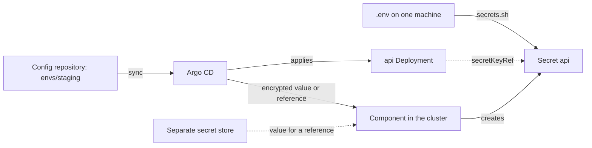

## Bạn cần biết trước

- [[k8s.l1.secrets]] — bạn biết giá trị trong Secret chỉ được mã hóa base64, và Đơn Hàng dựng các Secret của nó từ `.env` thay vì giữ chúng trong Git.
- [[devops.l3.argo-cd-applications]] — bạn biết một Application trỏ Argo CD vào `envs/staging` của repo cấu hình, nơi chỉ chứa manifest.
- [[devops.l3.self-heal]] — bạn biết khi bật self-heal và prune, các object từ `envs/staging` bám theo Git theo cả hai chiều.

## Tình huống

Ở stage-2, bạn deploy bằng `scripts/k8s/deploy.sh`. Ngay sau namespace, script chạy `secrets.sh`, đọc `.env` trên máy bạn và tạo ba Secret `db`, `api` và `keycloak`. Giờ staging chuyển sang bám theo repo cấu hình, nên object nào cũng cần một file trong `envs/staging`, mà các Secret thì không có. Một đồng nghiệp đề xuất xuất chúng ra bằng `--dry-run=client -o yaml` rồi commit kết quả, vì repository là private. Một người khác bảo cứ để chúng ngoài Git, vì Argo CD không đụng tới thứ không nằm trong thư mục của nó. Vậy `envs/staging` nên chứa gì ở chỗ của các Secret?

## Khái niệm cốt lõi

- Secret tạo ngoài Git — Secret mà một lệnh như `secrets.sh` gửi thẳng tới API server. Không file nào trong repo cấu hình mô tả nó, nên Argo CD không quản lý nó.
- Manifest Secret dạng nguyên — đoạn YAML mà `kubectl create secret ... --dry-run=client -o yaml` in ra, mỗi giá trị nằm dưới `data` ở dạng base64. Commit nó tức là đưa các giá trị vào Git.
- Secret đã mã hóa trong Git — manifest chứa từng giá trị ở dạng mã hóa, để chỉ một thành phần riêng chạy trong cluster (không phải Argo CD), thành phần giữ khóa, mới biến nó trở lại thành Secret được. Làm sao mã hóa một giá trị khi không giữ khóa đó là chủ đề của bài sau.
- Tham chiếu tới secret store — manifest ghi nơi một giá trị được cất trong secret store, tức một server riêng chỉ làm đúng một việc: giữ các giá trị bí mật và trao từng giá trị, theo tên, cho bên được phép đọc. Một thành phần trong cluster chép giá trị đó vào một Secret.

## Cơ chế hoạt động



Trước hết, đi theo đường từ repo cấu hình tới api Deployment. Argo CD apply Deployment từ `envs/staging` ở mỗi lần sync. Deployment chỉ gọi tên Secret `api` qua `secretKeyRef`, còn bản thân Secret lại đến từ `.env` của người chạy `secrets.sh` gần nhất. Git giữ lời tham chiếu, không giữ thứ được tham chiếu.

Argo CD chỉ so sánh và apply những gì thư mục mô tả. Một Secret do lệnh tạo ra không thuộc các object của nó, nên Argo CD không tạo lại khi Secret bị xóa, cũng không ghi lại lúc giá trị thay đổi. Một cluster dựng lại từ Git có đủ các Deployment nhưng thiếu mọi Secret chúng cần, nên database không khởi động được.

Commit đầu ra của `--dry-run=client -o yaml` sẽ lấp được lỗ hổng đó, nhưng mở ra một lỗ hổng tệ hơn. File giữ từng giá trị ở dạng base64, thứ ai cũng giải ngược được mà không cần khóa. Ai clone được repository là đọc được các giá trị. Xóa file sau đó chỉ gỡ chúng khỏi commit mới nhất: mọi commit trước, và mọi bản clone đã có, vẫn còn giữ chúng.

Đường đi qua thành phần trong cluster thay thế mũi tên từ `.env`, chứ không chạy song song với nó. Nhờ vậy repo cấu hình vẫn là nguồn duy nhất, trong khi không giá trị nào nằm ở đó dưới dạng đọc được. Ở cách thứ nhất, file giữ từng giá trị đã mã hóa, và chỉ thành phần đó giữ khóa. Argo CD apply object đã mã hóa như mọi manifest khác. Ở cách thứ hai, file chỉ giữ một tham chiếu, và thành phần đó chép giá trị từ một secret store riêng. Dù theo cách nào, Argo CD vẫn khôi phục và lưu lịch sử của file, còn người đọc Git không biết được mật khẩu nào.

## Trong hệ thống Đơn Hàng

Phần của `secrets.sh` dựng các Secret:

```bash file=scripts/k8s/secrets.sh tag=stage-2 lines=18-31
# lesson: k8s.l1.secrets
# No Secret manifest exists in Git: each Secret is built here from .env and
# sent to the API server. `create --dry-run=client -o yaml` only writes the
# object out; `apply` creates it, or updates it when .env has changed.
secret() {
  local name=$1
  shift
  kubectl create secret generic "$name" -n donhang "$@" --dry-run=client -o yaml \
    | kubectl apply -f - -o name
}
echo "== Secrets from .env"
secret db --from-literal=POSTGRES_PASSWORD="$POSTGRES_PASSWORD"
secret api --from-literal=ConnectionStrings__Default="Host=db;Database=donhang;Username=donhang;Password=$POSTGRES_PASSWORD"
secret keycloak --from-literal=KC_BOOTSTRAP_ADMIN_PASSWORD="$KEYCLOAK_ADMIN_PASSWORD"
```

Dòng 19–21 nêu quy tắc của stage-2: không có manifest Secret nào trong Git. Hàm `secret` chuyển YAML thẳng từ `kubectl create` sang `kubectl apply` qua pipe, nên các giá trị base64 không bao giờ nằm trong file nào. Dòng 29–31 điền ba Secret bằng các biến đọc từ `.env`. Connection string trong `api` lặp lại mật khẩu của `db`.

Chỗ `deploy.sh` gọi nó:

```bash file=scripts/k8s/deploy.sh tag=stage-2 lines=10-16
echo "== namespace"
kubectl apply -f deploy/k8s/namespace.yaml -o name

echo "== Secrets, from .env (scripts/k8s/secrets.sh)"
scripts/dev-secrets.sh >/dev/null
scripts/k8s/secrets.sh >/dev/null
kubectl get secrets -n donhang -o name
```

Dòng 11 apply namespace, dòng 14 tạo `.env` nếu chưa có, dòng 15 dựng các Secret, và dòng 16 chỉ liệt kê tên của chúng.

`dev-secrets.sh`, nằm ngoài đoạn trích, ghi cùng một mật khẩu database cố định vào mọi `.env` mới, nhưng mật khẩu admin Keycloak thì sinh ngẫu nhiên trên từng máy. Vì vậy mật khẩu Keycloak của staging tùy vào ai deploy sau cùng. Hai bước khác của `deploy.sh` cũng dựng object bằng lệnh, là hai ConfigMap `db-init` và `keycloak-realm`, nhưng đầu ra của chúng không chứa gì bí mật, nên có thể ghi ra file và commit. Chỉ có các Secret là object mà file của chúng sẽ để lộ giá trị.

Từ stage-3, Đơn Hàng theo cách thứ nhất: thư mục của staging giữ các Secret ở dạng mã hóa, vì khi đó lab không cần gì ngoài cluster và repository. Một store riêng hợp hơn khi nhiều hệ thống dùng chung các secret, hoặc khi giá trị đổi mà không qua commit, chẳng hạn một mật khẩu do team khác tự thay theo lịch của họ. Thành phần Đơn Hàng dùng là nội dung bài sau.

## Senior hay nhầm rằng…

- **"Repo cấu hình private là đủ an toàn cho manifest Secret dạng nguyên."** → Thực ra private chỉ giới hạn ai clone được, còn ai clone được thì nhận đủ mọi giá trị: từng đồng nghiệp review một thay đổi số replica, và cả chính Argo CD. Một giá trị bị xóa sau đó vẫn nằm trong các commit cũ và trong mọi bản clone, nên phải đổi nó, chứ xóa thôi là chưa đủ. Bạn sẽ nhận ra khi một người được cấp quyền chỉ để review manifest chạy `base64 -d` trên `POSTGRES_PASSWORD` và đọc được mật khẩu database.
- **"Để Secret ngoài Git chẳng tốn gì khi dùng GitOps, vì Argo CD đơn giản là bỏ qua chúng."** → Thực ra cái giá nằm ngay ở chỗ bị bỏ qua: Argo CD không tạo lại một Secret nó không quản lý, và repo cấu hình không lưu dấu vết nào về lúc giá trị đổi. Khi đó repository mô tả một staging không tự khởi động được. Bạn sẽ nhận ra khi một cluster dựng lại từ Git sync xong, mà Pod db vẫn chờ với `CreateContainerConfigError`, lý do container báo khi một Secret nó gọi qua `secretKeyRef` không tồn tại, và lần sync không bao giờ qua được sync wave của database, nên api không bao giờ được apply.
- **"Nếu giá trị trong Git đã mã hóa thì Argo CD phải giữ khóa để giải mã."** → Thực ra không cần, khi một thành phần riêng chạy trong cluster cạnh Argo CD đảm nhận giải mã: Argo CD apply object đã mã hóa như mọi manifest, rồi thành phần giữ khóa biến nó thành Secret. Có những cách dựng giao khóa cho Argo CD, qua một add-on giải mã ngay lúc đọc thư mục. Khi đó các giá trị đã giải mã nằm trong cache của chính Argo CD, và ai truy cập được các thành phần nội bộ của Argo CD cũng đọc được toàn bộ. Bạn sẽ nhận ra khi đọc `scripts/devops/argocd-install.sh` từ stage-3: nó chỉ apply manifest cài đặt của Argo CD, không kèm Secret hay khóa nào, vậy mà api của staging vẫn khởi động với đúng mật khẩu.

## Thử ngay (3 phút)

Trong thư mục repository `don-hang`:

1. Chạy `git check-ignore -v .env`.
2. Chạy `git log --all --oneline -- .env`.

Kết quả mong đợi: lệnh thứ nhất in `.gitignore:1:.env` rồi tới `.env`, tức quy tắc giữ file này ngoài Git. Lệnh thứ hai không in gì: chưa commit nào trên bất kỳ branch nào từng chứa `.env`, nơi duy nhất có giá trị Secret của stage-2. Vì thế một cluster dựng lại chỉ từ những gì Git giữ sẽ không có cách nào lấy được chúng.

## Liên hệ

- [[k8s.l1.secrets]] — điều kiện tiên quyết: vì sao base64 trong Secret không bảo vệ gì, và đó là lý do một manifest Secret đã commit đọc được.
- [[devops.l1.secrets-vs-config]] — cùng quy tắc ở tầng dưới: ở đó `.gitignore` giữ `.env` ngoài repo mã nguồn, còn ở đây repo cấu hình cần có các giá trị dưới một dạng nào đó.
- [[devops.l3.tofu-state]] — cùng vấn đề ở một file khác: file state cũng chứa thông tin đăng nhập, nên bài đó giữ nó ngoài Git.
- [[devops.l3.sealed-secrets]] — bài kế: thành phần Đơn Hàng dùng từ stage-3 để commit các Secret ở dạng mã hóa.

## Tóm tắt 5 dòng

1. Với GitOps, repo cấu hình nên mô tả mọi Secret staging cần, nhưng không giá trị nào được nằm ở đó dưới dạng đọc được.
2. Ở stage-2, `secrets.sh` dựng các Secret `db`, `api` và `keycloak` từ `.env` bị gitignore trên máy người deploy, không file nào trong Git giữ chúng.
3. Argo CD không khôi phục cũng không ghi lại một Secret tạo ngoài Git, nên cluster dựng lại từ Git không khởi động được database.
4. Commit một manifest Secret là trao các giá trị base64 của nó cho mọi người clone được, và chúng vẫn nằm trong lịch sử sau khi xóa.
5. Hãy commit từng giá trị đã mã hóa cho một thành phần trong cluster, hoặc một tham chiếu tới store riêng. Đơn Hàng mã hóa từ stage-3.
