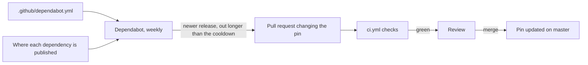

## Before you start

- [[devops.l3.pinning-by-content]] — you know every input of Đơn Hàng is pinned by a content hash, and that a pin also stops fixes from arriving on their own.
- [[devops.l2.quality-gate]] — you know the checks in `ci.yml` that every change must pass before it goes further.
- [[devops.l2.semantic-versioning]] — you know what a MAJOR, MINOR or PATCH increase promises about a release.

## The situation

Since `stage-3`, Đơn Hàng pins everything: lock files for the .NET projects and the Flutter app, every action by commit id, every base image by digest.

A month later, a NuGet package the API uses publishes a release that fixes a security problem. Đơn Hàng keeps restoring the old version from its lock file, because nothing changes a pin unless a person does. Weeks later, a developer reading release notes finds that every build since then shipped without the fix. Checking dozens of packages, actions and images by hand every week is work nobody keeps up for long. How do the pins get updated regularly without giving up the review that pinning bought?

## Core concepts

- **Dependabot** — a GitHub service that reads `.github/dependabot.yml` in a repository and opens a pull request when a dependency it watches has a newer version.
- Ecosystem — one kind of dependency Dependabot knows how to update, such as NuGet packages (the .NET libraries `dotnet restore` downloads), pub packages (the Dart and Flutter libraries `flutter pub get` downloads), GitHub Actions or Docker base images; each entry under `updates` names one.
- Group — a rule in that file that puts several matching updates into one pull request instead of one pull request each.
- Cooldown — a number of days Dependabot waits after a release is published before it proposes that release.

## How it works



In the situation above, Dependabot does the checking nobody keeps up with. Once a week, for each entry in `.github/dependabot.yml`, it compares what the repository pins with what is now published. When something newer exists, it opens a pull request from a branch whose name starts with `dependabot/`.

The pull request changes the pin itself. A package update edits the version where the project declares it and the lock file; an action update replaces the commit id after `uses:`. The diff shows the old and the new value side by side, so the update is visible in review.

Because it is a pull request, `ci.yml` runs on it, with the same build, tests and locked restore as a change a person makes. A green run says the new version builds and passes Đơn Hàng's tests; it says nothing about what else the new code does. Once the run is green, a person reviews the diff, and merging the pull request is what moves the pin on `master`.

Two settings keep the flow manageable. `groups` puts the minor and patch updates of one ecosystem into one pull request, so a weekly run brings a few pull requests. A major update, which semantic versioning reserves for breaking changes, falls outside such a group and arrives in its own pull request. `cooldown` makes Dependabot propose a release in a version update only after it has been out for a set number of days. If a malicious release is found and removed from where it is published within that time, it never reaches a version-update pull request.

## In the Đơn Hàng system

The first two entries of Đơn Hàng's configuration:

```yaml file=.github/dependabot.yml tag=stage-3 lines=8-28
version: 2
updates:
  - package-ecosystem: nuget
    directory: /
    schedule:
      interval: weekly
    cooldown:
      default-days: 7
    groups:
      nuget-minor-and-patch:
        update-types: [minor, patch]

  - package-ecosystem: pub
    directory: /DonHang.App
    schedule:
      interval: weekly
    cooldown:
      default-days: 7
    groups:
      pub-minor-and-patch:
        update-types: [minor, patch]
```

Lines 10–18 configure NuGet: line 11 is the folder where Dependabot looks for the project files, line 13 checks once a week, line 15 waits 7 days after a release, and lines 16–18 name one group for every minor and patch update. Lines 20–28 do the same for the pub packages of `DonHang.App`. Lines 30–53, outside this excerpt, add the same settings for `github-actions` and for `docker`, which lists the five folders whose Dockerfiles it watches.

The 7 days are Đơn Hàng's choice, not a value the file requires: a longer wait gives more time for a bad release to be found, and makes every fix arrive later.

The triggers of `ci.yml`:

```yaml file=.github/workflows/ci.yml tag=stage-3 lines=1-9
name: ci

on:
  push:
    # A Dependabot branch always has its pull request, which runs ci.yml
    # already; running it for the push as well would only do it twice.
    branches-ignore: ['dependabot/**']
  pull_request:
  workflow_dispatch:
```

Line 8 runs the workflow on every pull request, Dependabot's included, so its updates face the same gate as yours. Lines 4–7 skip the run for pushes to branches under `dependabot/`, because the pull request for that branch already runs it. Line 9 lets a person start the workflow by hand and is not related to Dependabot. Beyond that, nothing in `ci.yml` treats Dependabot specially: an update that breaks a test turns its pull request red, like anyone else's.

Dependabot runs only on GitHub, so the lab cannot run it, and no script in `scripts/` shows it. Its configuration lives in the repository like the workflows, and a change to it is reviewed the same way.

## Seniors often assume…

- **"Dependabot only opens pull requests for packages with known vulnerabilities."** → Actually the updates configured in `dependabot.yml` propose every newer release that matches their rules, whether or not it fixes a known vulnerability (a security flaw already publicly reported for specific versions of a package); GitHub calls them version updates. Proposing fixes for known vulnerabilities is a separate Dependabot feature, switched on in the repository's settings. You notice this when a weekly pull request raises a package whose release notes list only new features.
- **"Merging every Dependabot pull request without review is safe, since the bot only proposes official releases."** → Actually "official" means only that the release came from whoever controls the package or action where it is published. If that control is taken over, a malicious release is official too, and the cooldown helps only if someone finds it within those days. A green `ci.yml` shows the release builds and passes Đơn Hàng's tests, not that it does nothing else. You notice this when a patch update of one small package adds new transitive dependencies to the lock file diff; a patch should only fix bugs, so new packages it pulls in deserve a closer look.
- **"Automated updates make pinning pointless, so version ranges would do just as well."** → Actually a version range (a dependency declared as an allowed span of versions instead of one exact version) without a lock file lets the result of a restore change without any commit; with pub, for example, a `^` constraint lets resolution pick a newer allowed release. With pins, each update is a commit that CI checked and someone approved, and one more commit that reverses it undoes it. The cooldown also applies only to updates that go through Dependabot; a pub range can take a release the day it is published. You notice this when two builds of the same commit of the Flutter app, a week apart, contain different package versions, which a locked restore never produces.

## Try it (3 minutes)

In the `don-hang` repository folder:

1. Run `git show stage-3:.github/dependabot.yml | grep -c 'package-ecosystem'` (`grep -c` prints how many lines contain the text).
2. Run the same command with `'default-days: 7'` instead of `'package-ecosystem'`.

Expected result: `4` and `4`: four ecosystems, each with the same 7-day cooldown.

Now think it through. In one week, three packages Đơn Hàng uses get a patch release and a fourth gets a major release, all published more than 7 days before the weekly check. How many NuGet pull requests does Dependabot open?

<details><summary>Suggested answer</summary>

Two. The three patch updates match `update-types: [minor, patch]`, so they arrive together in one `nuget-minor-and-patch` pull request. The major update matches no group, so it arrives alone. Each must pass `ci.yml` and be reviewed before it is merged, and the major one deserves the closer reading, since semantic versioning allows it to break things.

</details>

## Connections

- [[devops.l3.pinning-by-content]] — the cost this lesson answers: pins that stop fixes from arriving on their own.
- [[devops.l2.quality-gate]] — the gate every Dependabot pull request must pass, exactly like a person's.
- [[management.l1.code-review-basics]] — what reviewing a Dependabot pull request still asks of you.
- [[devops.l3.vulnerability-scanning]] — the next defence: finding known vulnerabilities in what updates have not replaced yet.

## Five-line summary

1. Pinned inputs do not update themselves, so Dependabot proposes each update as a pull request that changes the pin.
2. `.github/dependabot.yml` lists what to watch; Đơn Hàng's covers NuGet, pub, GitHub Actions and Docker base images.
3. Each update must pass the same `ci.yml` checks and review as any other change before it is merged.
4. Đơn Hàng checks weekly, groups minor and patch updates per ecosystem, and waits a cooldown after each release.
5. Dependabot runs only on GitHub, not in the lab; its configuration is reviewed in the repository like the workflows.
