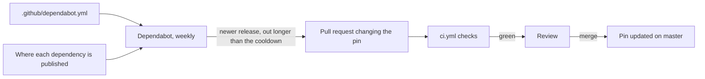

## Bạn cần biết trước

- [[devops.l3.pinning-by-content]] — bạn biết mọi đầu vào của Đơn Hàng đều được ghim bằng hash nội dung, và ghim cũng chặn luôn các bản sửa lỗi tự tới.
- [[devops.l2.quality-gate]] — bạn biết các bước kiểm tra trong `ci.yml` mà mọi thay đổi phải qua trước khi đi tiếp.
- [[devops.l2.semantic-versioning]] — bạn biết mỗi lần tăng MAJOR, MINOR hay PATCH hứa hẹn điều gì về một bản phát hành.

## Tình huống

Từ `stage-3`, Đơn Hàng ghim mọi thứ: lock file cho các project .NET và app Flutter, mọi action bằng commit id, mọi base image bằng digest.

Một tháng sau, một package NuGet mà api dùng ra bản phát hành vá một lỗ hổng bảo mật. Đơn Hàng vẫn restore phiên bản cũ từ lock file, vì không có gì đổi bản ghim trừ khi có người đổi. Vài tuần sau, một developer đọc release notes mới phát hiện mọi bản build từ hôm đó đều thiếu bản vá. Tự tay kiểm tra hàng chục package, action và image mỗi tuần là việc không ai theo nổi lâu. Làm sao để các bản ghim được cập nhật đều đặn mà không đánh mất bước review mà ghim mang lại?

## Khái niệm cốt lõi

- **Dependabot** (Dịch vụ của GitHub mở pull request khi dependency đã ghim có phiên bản mới) — dịch vụ của GitHub đọc `.github/dependabot.yml` trong một repository và mở pull request khi một dependency nó theo dõi có phiên bản mới hơn.
- Ecosystem — một loại dependency mà Dependabot biết cách cập nhật, như package NuGet (các thư viện .NET mà `dotnet restore` tải về), package pub (các thư viện Dart và Flutter mà `flutter pub get` tải về), GitHub Actions hay base image Docker. Mỗi mục dưới `updates` gọi tên một ecosystem.
- Group — một quy tắc trong file đó gom nhiều bản cập nhật khớp điều kiện vào chung một pull request, thay vì mỗi bản một pull request.
- Cooldown — số ngày Dependabot chờ sau khi một bản phát hành ra mắt rồi mới đề xuất bản đó.

## Cơ chế hoạt động



Trong tình huống ở trên, Dependabot làm phần kiểm tra mà không ai theo nổi. Mỗi tuần một lần, với từng mục trong `.github/dependabot.yml`, nó so thứ repository đang ghim với thứ hiện đã phát hành. Khi có bản mới hơn, Dependabot mở một pull request từ một nhánh có tên bắt đầu bằng `dependabot/`.

Pull request đổi chính bản ghim. Bản cập nhật package sửa phiên bản ở chỗ project khai báo nó và sửa cả lock file. Bản cập nhật action thay commit id sau `uses:`. Diff đặt giá trị cũ và mới cạnh nhau, nên bản cập nhật hiện rõ khi review.

Vì là pull request, `ci.yml` chạy trên nó, với cùng bước build, test và restore có khóa như một thay đổi do người làm. Lần chạy xanh cho biết phiên bản mới build được và qua các test của Đơn Hàng. Nó không nói gì về những việc khác mà code mới làm. Khi lần chạy đã xanh, một người review diff, và chính lúc merge pull request thì bản ghim trên `master` mới đổi.

Hai thiết lập giữ cho luồng này trong tầm kiểm soát. `groups` gom các bản cập nhật minor và patch của một ecosystem vào một pull request, nên mỗi lần chạy hằng tuần chỉ mang tới vài pull request. Bản cập nhật major, loại mà semantic versioning dành cho thay đổi phá vỡ tương thích, nằm ngoài group đó và tới trong pull request riêng. `cooldown` khiến Dependabot chỉ đề xuất một bản phát hành trong version update khi bản đó đã ra được một số ngày nhất định. Nếu một bản phát hành độc hại bị phát hiện và gỡ khỏi nơi phát hành trong khoảng thời gian đó, nó không bao giờ tới được pull request version update.

## Trong hệ thống Đơn Hàng

Hai mục đầu trong cấu hình của Đơn Hàng:

```yaml file=.github/dependabot.yml tag=stage-3 lines=8-28
version: 2
updates:
  - package-ecosystem: nuget
    directory: /
    schedule:
      interval: weekly
    cooldown:
      default-days: 7
    groups:
      nuget-minor-and-patch:
        update-types: [minor, patch]

  - package-ecosystem: pub
    directory: /DonHang.App
    schedule:
      interval: weekly
    cooldown:
      default-days: 7
    groups:
      pub-minor-and-patch:
        update-types: [minor, patch]
```

Dòng 10–18 cấu hình NuGet: dòng 11 là thư mục Dependabot tìm các file project, dòng 13 kiểm tra mỗi tuần một lần, dòng 15 chờ 7 ngày sau mỗi bản phát hành, và dòng 16–18 đặt một group cho mọi bản cập nhật minor và patch. Dòng 20–28 làm y như vậy cho các package pub của `DonHang.App`. Dòng 30–53, nằm ngoài đoạn trích, thêm cùng các thiết lập đó cho `github-actions` và cho `docker`, mục liệt kê năm thư mục có Dockerfile mà nó theo dõi.

Con số 7 ngày là lựa chọn của Đơn Hàng, không phải giá trị file bắt buộc: chờ lâu hơn thì có thêm thời gian để phát hiện một bản phát hành tồi, nhưng mọi bản vá cũng tới muộn hơn.

Các trigger của `ci.yml`:

```yaml file=.github/workflows/ci.yml tag=stage-3 lines=1-9
name: ci

on:
  push:
    # A Dependabot branch always has its pull request, which runs ci.yml
    # already; running it for the push as well would only do it twice.
    branches-ignore: ['dependabot/**']
  pull_request:
  workflow_dispatch:
```

Dòng 8 chạy workflow trên mọi pull request, kể cả của Dependabot, nên các bản cập nhật của nó phải qua cùng cổng với bản của bạn. Dòng 4–7 bỏ qua lần chạy cho các push lên nhánh dưới `dependabot/`, vì pull request của nhánh đó đã chạy rồi. Dòng 9 cho phép người khởi chạy workflow bằng tay và không liên quan tới Dependabot. Ngoài những dòng đó, `ci.yml` không đối xử riêng gì với Dependabot: bản cập nhật làm hỏng một test sẽ khiến pull request của nó đỏ, như của bất kỳ ai.

Dependabot chỉ chạy trên GitHub, nên lab không chạy được nó, và không script nào trong `scripts/` minh họa nó. Cấu hình của nó nằm trong repository như các workflow, và mỗi thay đổi cấu hình được review theo cùng cách.

## Senior hay nhầm rằng…

- **"Dependabot chỉ mở pull request cho các package có lỗ hổng đã biết."** → Thực ra các bản cập nhật cấu hình trong `dependabot.yml` đề xuất mọi bản phát hành mới hơn khớp quy tắc của chúng, dù bản đó có vá một lỗ hổng đã biết (lỗi bảo mật đã được công bố cho những phiên bản cụ thể của một package) hay không. GitHub gọi chúng là version update. Đề xuất bản vá cho lỗ hổng đã biết là một tính năng Dependabot khác, bật trong phần cài đặt của repository. Bạn sẽ nhận ra khi một pull request hằng tuần nâng một package mà release notes chỉ liệt kê tính năng mới.
- **"Merge mọi pull request của Dependabot mà không review là an toàn, vì bot chỉ đề xuất bản phát hành chính thức."** → Thực ra "chính thức" chỉ có nghĩa là bản phát hành đến từ người đang kiểm soát package hay action đó ở nơi phát hành. Nếu quyền kiểm soát đó bị chiếm, bản phát hành độc hại cũng là bản chính thức, và cooldown chỉ giúp được nếu có người phát hiện ra trong mấy ngày đó. `ci.yml` xanh chỉ cho thấy bản phát hành build được và qua các test của Đơn Hàng, không cho thấy nó không làm gì khác. Bạn sẽ nhận ra khi bản cập nhật patch của một package nhỏ thêm phụ thuộc bắc cầu mới vào diff của lock file: bản patch chỉ nên sửa lỗi, nên package mới mà nó kéo vào đáng được xem kỹ hơn.
- **"Cập nhật tự động khiến ghim trở nên thừa, nên dùng khoảng phiên bản cũng tốt y như vậy."** → Thực ra khoảng phiên bản (dependency khai báo bằng một dải phiên bản được phép thay vì một phiên bản chính xác) mà không có lock file thì kết quả restore có thể đổi mà không cần commit nào. Ví dụ với pub, ràng buộc `^` cho phép lần resolve chọn một bản phát hành mới hơn nằm trong dải. Có ghim, mỗi lần cập nhật là một commit đã qua CI và được người duyệt, và chỉ cần thêm một commit đảo ngược nó là hoàn tác được. Cooldown cũng chỉ áp dụng cho các bản cập nhật đi qua Dependabot, còn một khoảng phiên bản pub có thể nhận bản phát hành ngay hôm nó ra mắt. Bạn sẽ nhận ra khi hai lần build cùng một commit của app Flutter, cách nhau một tuần, chứa phiên bản package khác nhau, điều mà restore có khóa không bao giờ tạo ra.

## Thử ngay (3 phút)

Trong thư mục repository `don-hang`:

1. Chạy `git show stage-3:.github/dependabot.yml | grep -c 'package-ecosystem'` (`grep -c` in ra số dòng chứa đoạn chữ đó).
2. Chạy lại lệnh đó, thay `'package-ecosystem'` bằng `'default-days: 7'`.

Kết quả mong đợi: `4` và `4`: bốn ecosystem, mỗi ecosystem có cùng cooldown 7 ngày.

Giờ hãy nghĩ thử. Trong một tuần, ba package Đơn Hàng dùng ra bản patch và một package thứ tư ra bản major, tất cả đều phát hành hơn 7 ngày trước lần kiểm tra hằng tuần. Dependabot mở bao nhiêu pull request NuGet?

<details><summary>Gợi ý đáp án</summary>

Hai. Ba bản cập nhật patch khớp `update-types: [minor, patch]`, nên chúng tới chung trong một pull request `nuget-minor-and-patch`. Bản cập nhật major không khớp group nào, nên tới riêng. Mỗi pull request phải qua `ci.yml` và được review trước khi merge, và bản major đáng được đọc kỹ hơn, vì semantic versioning cho phép nó phá vỡ tương thích.

</details>

## Liên hệ

- [[devops.l3.pinning-by-content]] — cái giá mà bài này giải quyết: bản ghim chặn các bản sửa lỗi tự tới.
- [[devops.l2.quality-gate]] — cổng mà mọi pull request của Dependabot phải qua, y như của người.
- [[management.l1.code-review-basics]] — những gì review một pull request của Dependabot vẫn đòi hỏi ở bạn.
- [[devops.l3.vulnerability-scanning]] — lớp phòng thủ tiếp theo: tìm lỗ hổng đã biết trong những gì các bản cập nhật chưa thay.

## Tóm tắt 5 dòng

1. Đầu vào đã ghim không tự cập nhật, nên Dependabot đề xuất mỗi lần cập nhật bằng một pull request đổi bản ghim.
2. `.github/dependabot.yml` liệt kê những gì cần theo dõi. File của Đơn Hàng bao gồm NuGet, pub, GitHub Actions và base image Docker.
3. Mỗi bản cập nhật phải qua cùng các bước kiểm tra trong `ci.yml` và cùng bước review như mọi thay đổi khác trước khi được merge.
4. Đơn Hàng kiểm tra hằng tuần, gom các bản cập nhật minor và patch theo từng ecosystem, và chờ một khoảng cooldown sau mỗi bản phát hành.
5. Dependabot chỉ chạy trên GitHub, không chạy trong lab. Cấu hình của nó được review trong repository như các workflow.
