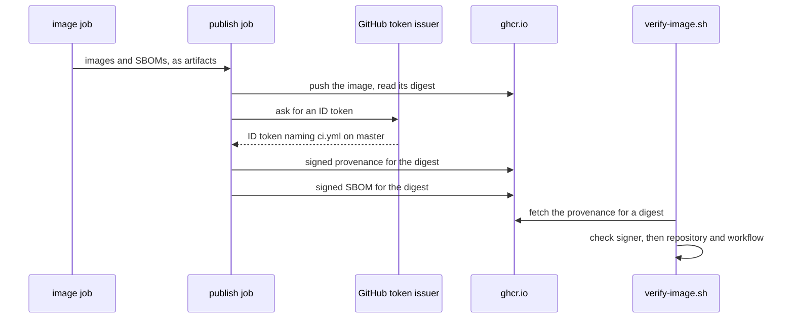

## Before you start

- [[devops.l3.signing-images]] — you know how the `publish` job signs a digest keyless and how `verify-image.sh` accepts only `ci.yml` on `master`.
- [[devops.l3.software-bill-of-materials]] — you know the `image` job writes one SBOM per image and keeps them as the `sboms` artifact.
- [[devops.l2.tagging-images-by-commit]] — you know a `sha-` tag names the commit that built an image, by convention only.

## The situation

It is `stage-3`, and a bug report says staging behaves like old code. You run `verify-image.sh` on the api image staging uses. The signature passes: `ci.yml` on `master` vouched for this digest. But `ci.yml` runs on every push to `master`, so the signature check confirms who signed, and its output names no run or commit. The tag says `sha-` plus a commit id, yet a tag is a label that anyone allowed to push can put on another image. The SBOM lists what is inside, not where it came from.

What signed record, attached to the digest itself, says which commit and workflow built it?

## Core concepts

- **attestation (supply chain)** — a signed statement about a digest: a signature says who vouches for an image, an attestation also says what they state about it, such as how it was built or what it contains.
- **build provenance** — an attestation of how an image was built: the repository, the commit, the workflow file and the event that started the run.
- **SLSA** — a published framework that grades how far a build can be trusted, in levels based on its provenance; it is a set of requirements, not a tool.

## How it works



In the situation above, the attestation you were missing is the provenance the `publish` job stores beside each image. The job receives the images and their SBOMs from the `image` job as artifacts. After pushing an image and reading its digest, it runs `actions/attest-build-provenance`. The action does not ask you what to write: it fills the statement from the run's own details, which GitHub provides, such as the repository, the commit, the workflow file and the event. The digest is the statement's subject. The next step attests the image's SBOM the same way.

The action signs the statement keyless, the way Cosign signed the image: it trades the job's ID token for a short-lived certificate naming `ci.yml` on `master`. The diagram leaves that exchange out. That is why the job needs `id-token: write`; `attestations: write` lets it create the attestation, and GitHub keeps a copy. With `push-to-registry: true` the action also pushes it to `ghcr.io`, beside the image and its signature.

Verifying has two halves. First the attestation's signature must carry the identity you trust, as for the image. Then you read what it states and check the fields you care about. A valid attestation from the wrong repository is still the wrong answer.

SLSA names what this setup reaches. GitHub states that its attestations alone reach SLSA Build Level 2, and that Level 3 needs more isolation of the build. Đơn Hàng's is L2: any step in the `publish` job could ask for the same ID token, so a harmful step there could sign a statement with false contents, and it would still verify.

## In the Đơn Hàng system

The last two steps of the `publish` job, lines 278–296 of `ci.yml`:

```yaml file=.github/workflows/ci.yml tag=stage-3 lines=278-296
      # lesson: devops.l3.build-provenance
      # Provenance for the same digest: the repository, commit, workflow and
      # event that built it, signed through the same ID token and pushed to
      # the registry beside the image. Then the image job's SBOM of this
      # image, attested the same way.
      - uses: actions/attest-build-provenance@4d101475d8b20a2381f78447822ac1eab6504dd8 # v4.2.2
        with:
          subject-name: ${{ steps.push.outputs.name }}
          subject-digest: ${{ steps.push.outputs.digest }}
          push-to-registry: true
          create-storage-record: false

      - uses: actions/attest@1e69f48acb82d1966a394da916b4c1698aa569d6 # v4.2.2
        with:
          subject-name: ${{ steps.push.outputs.name }}
          subject-digest: ${{ steps.push.outputs.digest }}
          sbom-path: ${{ steps.push.outputs.sbom }}
          push-to-registry: true
          create-storage-record: false
```

Lines 285–286 (`subject-name`, `subject-digest`) name the subject: the image name and the digest the push step just read, never a tag. The job's `permissions:` block on lines 222–225, outside this excerpt, grants `id-token: write` and `attestations: write` beside `packages: write`. The second step attests the SBOM the `image` job wrote for this image. The `publish` job runs once for each of the six images, so each gets its own provenance and its own signed SBOM. The check below passes with `create-storage-record: false`.

The provenance half of the check, lines 33–47 of `verify-image.sh`:

```bash file=scripts/devops/verify-image.sh tag=stage-3 lines=33-47
  # lesson: devops.l3.build-provenance
  # The SLSA provenance attestation for the same digest, signed by the same
  # identity; then what it states: the repository and workflow that built it.
  echo "-- provenance"
  payload=$(cosign verify-attestation "${ref%%[:@]*}@$digest" --type slsaprovenance1 "${trusted[@]}" \
    2>/dev/null | head -n 1 | sed -nE 's/.*"payload":"([^"]+)".*/\1/p' | base64 -d) \
    || { echo "no provenance from ci.yml for this digest"; return 1; }
  grep -q '"repository":"https://github.com/duyan11110/don-hang"' <<<"$payload" \
    && grep -q '"path":".github/workflows/ci.yml"' <<<"$payload" \
    || { echo "the provenance names another repository or workflow"; return 1; }
  echo "built by $(grep -oE '"repository":"[^"]+"' <<<"$payload" | cut -d'"' -f4)," \
    "$(grep -oE '"path":"[^"]+"' <<<"$payload" | cut -d'"' -f4)" \
    "at commit $(grep -oE '"gitCommit":"[0-9a-f]+"' <<<"$payload" | cut -d'"' -f4)" \
    "($(grep -oE '"event_name":"[^"]+"' <<<"$payload" | cut -d'"' -f4))"
  echo "verified"
```

```text output=true
== ghcr.io/duyan11110/donhang-api:sha-... -> ghcr.io/duyan11110/donhang-api@sha256:...
-- signature
Verification for ghcr.io/duyan11110/donhang-api@sha256:... --
The following checks were performed on each of these signatures:
  - The cosign claims were validated
  - Existence of the claims in the transparency log was verified offline
  - The code-signing certificate was verified using trusted certificate authority certificates
-- provenance
built by https://github.com/duyan11110/don-hang, .github/workflows/ci.yml at commit ... (push)
verified

== ghcr.io/duyan11110/donhang-api:1.0.0 -> ghcr.io/duyan11110/donhang-api@sha256:1d0825b582ec31c52d33e7fa9e2b9d73f39bd059018aa41bafbbdec006dea314
-- signature
Error: no signatures found
error during command execution: no signatures found
not verified: refused
```

Line 37 (`payload=$(cosign verify-attestation …`) asks Cosign for the attestation of type `slsaprovenance1` on this digest, with the same `trusted` identity flags as the signature check; an attestation signed by anyone else does not count. Line 38 takes the statement out of Cosign's output, where it is Base64-encoded, a way of writing any bytes as plain text; `base64 -d` turns it back into the JSON statement. Lines 40–42 are the second half: the statement must name Đơn Hàng's repository and `.github/workflows/ci.yml`. The output's `-- provenance` line names the commit and the `push` event. The `1.0.0` image was pushed before `stage-3`, with neither a signature nor an attestation, and the script refuses it at the signature check, before line 37 runs.

## Seniors often assume…

- **"An image signature already tells us which commit the image was built from."** → Actually a signature makes no statement: it says an identity vouched for the digest. Whatever else the keyless certificate records, `verify-image.sh` checks only who it names (`ci.yml` on `master`) and that GitHub issued the ID token behind it, so its signature check says nothing about the commit. Provenance is the record built to be read for that, in a known format a verifier can ask for by type. You notice this when the `-- signature` block of the output names no commit, and only the `-- provenance` line does.
- **"Provenance proves the source code at that commit is free of malicious changes."** → Actually it proves which commit and workflow built the image, nothing about what that commit contains. A harmful change merged to `master` gets provenance as valid as any other. You notice this when a bad release verifies cleanly, and provenance is what tells you which commit to read.
- **"SLSA is a tool we install in the pipeline."** → Actually SLSA is a set of requirements in levels; `actions/attest-build-provenance` and Cosign are the tools, and SLSA says what their output is worth. You notice this when you search `ci.yml` for an SLSA step and find only the attest actions, whose provenance follows SLSA's format.

## Try it (3 minutes)

In the `don-hang` repository folder, checked out at `stage-3`, with Docker running and access to `ghcr.io` and the internet (Cosign contacts the public transparency log):

1. Run `scripts/devops/verify-image.sh`.
2. In the first block, compare the commit id after `sha-` on the first line with the commit after `at commit` on the `built by` line.

Expected result: the same 40-character commit id appears in both places, the line ends with `(push)` and the block ends with `verified`; the `1.0.0` block ends with `not verified: refused`.

Now think it through. Someone copies Đơn Hàng's repository to their own GitHub account and runs the same `ci.yml`, which signs and attests their image. Where does `verify-image.sh` refuse their image, and what would the excerpt print if it got that far?

<details><summary>Suggested answer</summary>

The script never reaches the excerpt: their image's signature names their `ci.yml`, so the signature check refuses it first, as it refuses `1.0.0`. Had it reached line 37, Cosign would find no attestation from the trusted identity, and line 39 would print `no provenance from ci.yml for this digest`.

</details>

## Connections

- [[devops.l3.signing-images]] — prerequisite: the same keyless signing, now over a statement about the digest instead of the digest alone.
- [[devops.l3.software-bill-of-materials]] — the SBOM that lesson wrote becomes a second attestation on the same digest.
- [[devops.l2.tagging-images-by-commit]] — the fix for its weak spot: the commit a `sha-` tag names by convention, provenance states and signs.
- [[devops.l2.continuous-integration]] — the workflow run that provenance describes.
- [[devops.l3.verifying-before-deploy]] — puts this check on the path every deploy takes.

## Five-line summary

1. Build provenance is a signed statement, attached to an image's digest, of the repository, commit, workflow and event that built it.
2. An attestation adds a statement to a signature: who vouches for the digest, and what they state about it.
3. The `publish` job attests provenance and the SBOM for each pushed digest, with `id-token: write` and `attestations: write`, and pushes both beside the image.
4. `verify-image.sh` checks the attestation's signer, then that it names Đơn Hàng's repository and `ci.yml`; `1.0.0` has neither and is refused.
5. SLSA grades builds in levels by their provenance; GitHub states its attestations alone reach Build L2, which is where Đơn Hàng stands.
