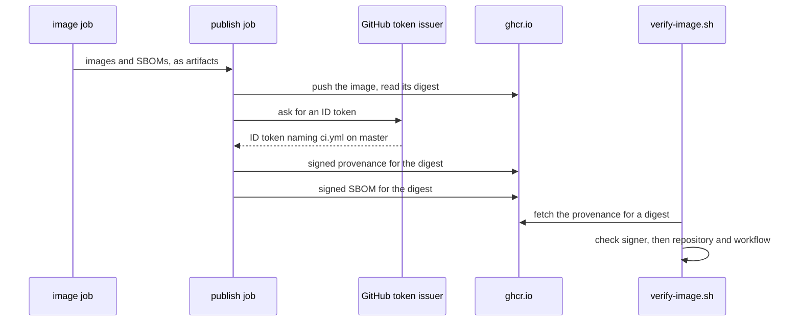

## Bạn cần biết trước

- [[devops.l3.signing-images]] — bạn biết job `publish` ký keyless một digest thế nào, và vì sao `verify-image.sh` chỉ chấp nhận `ci.yml` trên `master`.
- [[devops.l3.software-bill-of-materials]] — bạn biết job `image` ghi một SBOM cho mỗi image và giữ chúng thành artifact `sboms`.
- [[devops.l2.tagging-images-by-commit]] — bạn biết tag `sha-` gọi tên commit đã build ra image, nhưng chỉ theo quy ước.

## Tình huống

Đơn Hàng đang ở `stage-3`, và một báo lỗi nói staging chạy như code cũ. Bạn chạy `verify-image.sh` trên image api mà staging đang dùng. Chữ ký qua: `ci.yml` trên `master` đã đứng ra bảo đảm cho digest này. Nhưng `ci.yml` chạy với mỗi lần push lên `master`, nên phép kiểm chữ ký chỉ xác nhận ai đã ký, và kết quả của nó không ghi lần chạy hay commit nào. Tag ghi `sha-` cộng một mã commit, nhưng tag chỉ là nhãn, ai có quyền push cũng gắn được lên một image khác. SBOM liệt kê những gì nằm bên trong, không cho biết image từ đâu ra.

Bản ghi có chữ ký nào, gắn vào chính digest, cho biết commit và workflow nào đã build ra nó?

## Khái niệm cốt lõi

- **attestation (supply chain)** (một khẳng định có chữ ký về một digest, vd image được build thế nào hay chứa gì) — một tuyên bố có chữ ký về một digest. Chữ ký cho biết ai đứng ra bảo đảm cho image, còn attestation cho biết thêm họ khẳng định điều gì về nó, chẳng hạn image được build thế nào hay chứa gì.
- **build provenance** (attestation ghi image được build từ repo, commit, workflow và sự kiện nào) — một attestation về cách image được build: repository, commit, file workflow và sự kiện đã khởi động lần chạy.
- **SLSA** (khung chuẩn chia mức độ tin cậy của quy trình build, dựa trên provenance) — một khung chuẩn đã công bố, chấm một quy trình build đáng tin tới đâu theo các level, dựa trên provenance của nó. SLSA là một bộ yêu cầu, không phải công cụ.

## Cơ chế hoạt động



Trong tình huống ở trên, attestation bạn còn thiếu chính là provenance mà job `publish` lưu cạnh mỗi image. Job nhận các image và SBOM của chúng từ job `image` dưới dạng artifact. Sau khi push một image và đọc digest của nó, job chạy `actions/attest-build-provenance`. Action này không hỏi bạn cần ghi gì: nó tự điền tuyên bố từ thông tin của chính lần chạy do GitHub cung cấp, như repository, commit, file workflow và sự kiện. Digest là đối tượng (subject) của tuyên bố. Bước kế tiếp tạo attestation cho SBOM của image theo đúng cách đó.

Action ký tuyên bố theo kiểu keyless, giống cách Cosign đã ký image: nó đổi ID token của job lấy một certificate ngắn hạn ghi `ci.yml` trên `master`. Sơ đồ lược bỏ bước trao đổi đó. Đó là lý do job cần `id-token: write`. Còn `attestations: write` cho phép job tạo attestation, và GitHub giữ một bản. Với `push-to-registry: true`, action còn push attestation lên `ghcr.io`, cạnh image và chữ ký của nó.

Xác minh gồm hai nửa. Đầu tiên, chữ ký của attestation phải mang danh tính bạn tin, giống như với image. Sau đó bạn đọc nội dung nó khẳng định và kiểm những trường bạn quan tâm. Một attestation hợp lệ nhưng đến từ sai repository thì vẫn là câu trả lời sai.

SLSA gọi tên mức mà cách thiết lập này đạt được. GitHub tuyên bố riêng attestation của họ đạt SLSA Build Level 2, còn Level 3 cần cô lập quá trình build nhiều hơn. Đơn Hàng đang ở L2: bước nào trong job `publish` cũng xin được cùng ID token đó, nên một bước độc hại ở đây có thể ký một tuyên bố với nội dung sai, và tuyên bố đó vẫn xác minh qua.

## Trong hệ thống Đơn Hàng

Hai bước cuối của job `publish`, dòng 278–296 của `ci.yml`:

```yaml file=.github/workflows/ci.yml tag=stage-3 lines=278-296
      # lesson: devops.l3.build-provenance
      # Provenance for the same digest: the repository, commit, workflow and
      # event that built it, signed through the same ID token and pushed to
      # the registry beside the image. Then the image job's SBOM of this
      # image, attested the same way.
      - uses: actions/attest-build-provenance@4d101475d8b20a2381f78447822ac1eab6504dd8 # v4.2.2
        with:
          subject-name: ${{ steps.push.outputs.name }}
          subject-digest: ${{ steps.push.outputs.digest }}
          push-to-registry: true
          create-storage-record: false

      - uses: actions/attest@1e69f48acb82d1966a394da916b4c1698aa569d6 # v4.2.2
        with:
          subject-name: ${{ steps.push.outputs.name }}
          subject-digest: ${{ steps.push.outputs.digest }}
          sbom-path: ${{ steps.push.outputs.sbom }}
          push-to-registry: true
          create-storage-record: false
```

Dòng 285–286 (`subject-name`, `subject-digest`) chỉ định đối tượng: tên image và digest mà bước push vừa đọc, không bao giờ là tag. Khối `permissions:` của job ở dòng 222–225, ngoài đoạn trích này, cấp `id-token: write` và `attestations: write` bên cạnh `packages: write`. Bước thứ hai tạo attestation cho SBOM mà job `image` đã ghi cho image này. Job `publish` chạy một lần cho mỗi image trong sáu image, nên image nào cũng có provenance riêng và SBOM có chữ ký riêng. Phép kiểm bên dưới vẫn qua với `create-storage-record: false`.

Phần provenance của phép kiểm, dòng 33–47 của `verify-image.sh`:

```bash file=scripts/devops/verify-image.sh tag=stage-3 lines=33-47
  # lesson: devops.l3.build-provenance
  # The SLSA provenance attestation for the same digest, signed by the same
  # identity; then what it states: the repository and workflow that built it.
  echo "-- provenance"
  payload=$(cosign verify-attestation "${ref%%[:@]*}@$digest" --type slsaprovenance1 "${trusted[@]}" \
    2>/dev/null | head -n 1 | sed -nE 's/.*"payload":"([^"]+)".*/\1/p' | base64 -d) \
    || { echo "no provenance from ci.yml for this digest"; return 1; }
  grep -q '"repository":"https://github.com/duyan11110/don-hang"' <<<"$payload" \
    && grep -q '"path":".github/workflows/ci.yml"' <<<"$payload" \
    || { echo "the provenance names another repository or workflow"; return 1; }
  echo "built by $(grep -oE '"repository":"[^"]+"' <<<"$payload" | cut -d'"' -f4)," \
    "$(grep -oE '"path":"[^"]+"' <<<"$payload" | cut -d'"' -f4)" \
    "at commit $(grep -oE '"gitCommit":"[0-9a-f]+"' <<<"$payload" | cut -d'"' -f4)" \
    "($(grep -oE '"event_name":"[^"]+"' <<<"$payload" | cut -d'"' -f4))"
  echo "verified"
```

```text output=true
== ghcr.io/duyan11110/donhang-api:sha-... -> ghcr.io/duyan11110/donhang-api@sha256:...
-- signature
Verification for ghcr.io/duyan11110/donhang-api@sha256:... --
The following checks were performed on each of these signatures:
  - The cosign claims were validated
  - Existence of the claims in the transparency log was verified offline
  - The code-signing certificate was verified using trusted certificate authority certificates
-- provenance
built by https://github.com/duyan11110/don-hang, .github/workflows/ci.yml at commit ... (push)
verified

== ghcr.io/duyan11110/donhang-api:1.0.0 -> ghcr.io/duyan11110/donhang-api@sha256:1d0825b582ec31c52d33e7fa9e2b9d73f39bd059018aa41bafbbdec006dea314
-- signature
Error: no signatures found
error during command execution: no signatures found
not verified: refused
```

Dòng 37 (`payload=$(cosign verify-attestation …`) xin Cosign attestation loại `slsaprovenance1` trên digest này, với đúng các cờ danh tính `trusted` của phép kiểm chữ ký. Attestation do bất kỳ ai khác ký đều không được tính. Dòng 38 lấy tuyên bố ra khỏi output của Cosign, nơi nó được mã hóa Base64, kiểu mã hóa viết bytes bất kỳ thành văn bản thuần. `base64 -d` đổi nó trở lại thành tuyên bố JSON. Dòng 40–42 là nửa thứ hai: tuyên bố phải ghi repository của Đơn Hàng và `.github/workflows/ci.yml`. Dòng `-- provenance` trong kết quả ghi commit và sự kiện `push`. Image `1.0.0` được push trước `stage-3`, không có chữ ký lẫn attestation, và script từ chối nó ngay ở phép kiểm chữ ký, trước khi dòng 37 chạy.

## Senior hay nhầm rằng…

- **"Chữ ký image đã cho biết image được build từ commit nào."** → Thực ra chữ ký không khẳng định điều gì cả: nó chỉ nói một danh tính đã đứng ra bảo đảm cho digest. Dù certificate keyless còn ghi gì khác, `verify-image.sh` chỉ kiểm nó ghi ai (`ci.yml` trên `master`) và GitHub đã cấp ID token đứng sau nó, nên phép kiểm chữ ký không nói gì về commit. Provenance mới là bản ghi sinh ra để đọc điều đó, theo một định dạng đã biết mà bên xác minh có thể yêu cầu theo loại. Bạn sẽ nhận ra khi khối `-- signature` trong kết quả không ghi commit nào, chỉ dòng `-- provenance` mới ghi.
- **"Provenance chứng minh mã nguồn ở commit đó không có thay đổi độc hại."** → Thực ra nó chứng minh commit và workflow nào đã build ra image, không nói gì về nội dung của commit đó. Một thay đổi độc hại đã merge vào `master` vẫn nhận provenance hợp lệ như mọi commit khác. Bạn sẽ nhận ra khi một bản release lỗi vẫn xác minh qua trơn tru, và chính provenance cho bạn biết cần đọc commit nào.
- **"SLSA là một công cụ ta cài vào pipeline."** → Thực ra SLSA là một bộ yêu cầu chia theo level. `actions/attest-build-provenance` và Cosign mới là công cụ, còn SLSA cho biết output của chúng có giá trị tới đâu. Bạn sẽ nhận ra khi tìm một bước SLSA trong `ci.yml` và chỉ thấy các action attest, với provenance theo định dạng của SLSA.

## Thử ngay (3 phút)

Trong thư mục repository `don-hang`, checkout ở `stage-3`, với Docker đang chạy và truy cập được `ghcr.io` cùng internet (Cosign liên hệ transparency log công khai):

1. Chạy `scripts/devops/verify-image.sh`.
2. Ở khối đầu tiên, so mã commit sau `sha-` trên dòng đầu với commit sau `at commit` trên dòng `built by`.

Kết quả mong đợi: cùng một mã commit 40 ký tự xuất hiện ở cả hai chỗ, dòng đó kết thúc bằng `(push)` và khối kết thúc bằng `verified`. Khối `1.0.0` kết thúc bằng `not verified: refused`.

Giờ hãy nghĩ thử. Ai đó sao chép repository của Đơn Hàng sang tài khoản GitHub của họ và chạy cùng `ci.yml`, workflow này ký và tạo attestation cho image của họ. `verify-image.sh` từ chối image đó ở đâu, và nếu đi được tới đoạn trích thì nó sẽ in gì?

<details><summary>Gợi ý đáp án</summary>

Script không bao giờ tới được đoạn trích: chữ ký trên image của họ ghi `ci.yml` của họ, nên phép kiểm chữ ký từ chối nó trước, như đã từ chối `1.0.0`. Nếu đi tới dòng 37, Cosign sẽ không tìm thấy attestation nào từ danh tính được tin, và dòng 39 sẽ in `no provenance from ci.yml for this digest`.

</details>

## Liên hệ

- [[devops.l3.signing-images]] — kiến thức nền: vẫn là keyless signing đó, giờ ký trên một tuyên bố về digest thay vì chỉ trên digest.
- [[devops.l3.software-bill-of-materials]] — SBOM mà bài đó tạo ra trở thành attestation thứ hai trên cùng digest.
- [[devops.l2.tagging-images-by-commit]] — lời giải cho điểm yếu của bài đó: commit mà tag `sha-` gọi tên theo quy ước, provenance khẳng định và ký.
- [[devops.l2.continuous-integration]] — lần chạy workflow mà provenance mô tả.
- [[devops.l3.verifying-before-deploy]] — đặt phép kiểm này lên con đường mà mọi lần deploy đều đi qua.

## Tóm tắt 5 dòng

1. Build provenance là một tuyên bố có chữ ký, gắn vào digest của image, ghi repository, commit, workflow và sự kiện đã build ra nó.
2. Attestation thêm một tuyên bố vào chữ ký: ai đứng ra bảo đảm cho digest, và họ khẳng định điều gì về nó.
3. Job `publish` tạo attestation provenance và SBOM cho mỗi digest đã push, với `id-token: write` và `attestations: write`, rồi push cả hai lên cạnh image.
4. `verify-image.sh` kiểm người ký attestation, rồi kiểm nó ghi đúng repository của Đơn Hàng và `ci.yml`. `1.0.0` không có chữ ký lẫn attestation nên bị từ chối.
5. SLSA chấm các quy trình build theo level dựa trên provenance. GitHub tuyên bố riêng attestation của họ đạt Build L2, đúng mức Đơn Hàng đang đứng.
