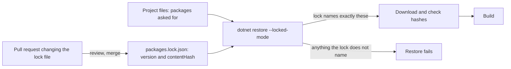

## Before you start

- [[devops.l3.software-supply-chain]] — you know the api image is mostly inputs your team never wrote, each named by something its owner can change.
- [[devops.l2.image-tags-and-digests]] — you know a tag is a movable label, while a digest names one exact image for good.
- [[devops.l3.opentofu-resources]] — you have seen `.terraform.lock.hcl` record the exact version and checksums of each provider, so every `init` installs the same one.
- [[devops.l2.dependency-cache]] — you know `dotnet restore` downloads packages and that the cache only saves time.

## The situation

A fix must go out on a branch cut from a `stage-2` commit three months old. You re-run `ci.yml` on it, expecting the same result as last time. Nobody changed a line of that commit.

The run may differ anyway. It uses whatever commit `actions/checkout@v4` points at today, which may not be the one the old run used. `docker build` starts from whatever image `aspnet:10.0` names today, which may no longer be the one the old run used. The commit you reviewed names its inputs by names, and the names may now lead somewhere else. How can a commit name every input so that building it later gets exactly what you reviewed?

## Core concepts

- Name — a label for an input that its owner can point at different content later: a version number, an action tag such as `@v4`, an image tag such as `aspnet:10.0`.
- Content hash — a short value computed from the bytes of an input, so different content gives a different hash; a digest and a Git commit id are both content hashes.
- Pin — naming an input by its content hash, so the build either gets those exact bytes or fails.
- **transitive dependency** — a package your project gets because a package it uses depends on it, not because you listed it; `prometheus-net` reaches the api only through `prometheus-net.AspNetCore`.
- **lock file** — a file, committed next to the project, recording the exact version and content hash of every package, direct and transitive, so every restore gets the same ones.

## How it works



A name such as `@v4` or `aspnet:10.0` is a question the build asks someone else at run time: what does this name point at today? Pinning replaces the question with the answer you reviewed, a content hash.

For packages, that answer is a lock file. The project files say which packages the api asks for, and `packages.lock.json` records what restore resolved for them: each version and a `contentHash`, for the direct packages and for every transitive dependency. `DonHang.App/pubspec.lock` has done the same for Flutter packages since `stage-2`, with a `sha256` for each downloaded package. From `stage-3` each .NET project has its own `packages.lock.json`.

With `--locked-mode`, restore takes the lock file as the only acceptable answer. If the project files would resolve to anything the lock does not name, restore fails instead of picking something new. It also checks each downloaded package against its recorded hash, and only then does the build run. `flutter pub get`, Flutter's counterpart of `dotnet restore`, does the same for `pubspec.lock` with `--enforce-lockfile`; the `app` job in `ci.yml` runs it that way.

So the only path for new package code is the "review, merge" arrow. After a project file changes, someone runs restore without `--locked-mode`, which rewrites the lock file, and commits the result in a pull request like any other change.

In the situation above, the old commit had no `packages.lock.json`, named actions by tags and base images by tags. At `stage-3` every one of those names is replaced by, or paired with, a content hash.

## In the Đơn Hàng system

Part of the api's lock file:

```json file=DonHang.Api/packages.lock.json tag=stage-3 lines=78-91
      "prometheus-net.AspNetCore": {
        "type": "Direct",
        "requested": "[8.2.1, )",
        "resolved": "8.2.1",
        "contentHash": "/4TfTvbwIDqpaKTiWvEsjUywiHYF9zZvGZF5sK15avoDsUO/WPQbKsF8TiMaesuphdFQPK2z52P0zk6j26V0rQ==",
        "dependencies": {
          "prometheus-net": "8.2.1"
        }
      },
      "Microsoft.Bcl.Cryptography": {
        "type": "Transitive",
        "resolved": "10.0.2",
        "contentHash": "LG9Yll3B5aNpxv0+D47g6LiOiKBIlodhcHdQwcYzo8VeexFLGqx5ymetmA2aBRyo9cCcWsQWrFsdbsr8LvmWDw=="
      },
```

Line 79 marks a package `DonHang.Api.csproj` lists itself; line 88 marks one it never lists; what brings it in lies outside this excerpt. Line 80 is what the project asks for; lines 81–82 record the version restore chose and the hash of that package's content. Lines 83–85 show why transitive dependencies exist: `prometheus-net.AspNetCore` needs `prometheus-net`, so the api gets it too. `Directory.Build.props` sets `RestorePackagesWithLockFile` for every project, which is what makes restore write these files.

The test job, from its first step to the restore:

```yaml file=.github/workflows/ci.yml tag=stage-3 lines=23-47
      - uses: actions/checkout@11d5960a326750d5838078e36cf38b85af677262 # v4.4.0

      - uses: actions/setup-dotnet@67a3573c9a986a3f9c594539f4ab511d57bb3ce9 # v4.3.1
        with:
          global-json-file: global.json

      # lesson: devops.l2.dependency-cache
      # The key changes exactly when a locked package changes. With no exact
      # match, the newest cache whose key starts with the restore-keys prefix
      # is restored, and dotnet restore downloads only what is still missing.
      - name: Cache NuGet packages
        uses: actions/cache@0057852bfaa89a56745cba8c7296529d2fc39830 # v4.3.0
        with:
          path: ~/.nuget/packages
          key: ${{ runner.os }}-nuget-${{ hashFiles('**/packages.lock.json') }}
          restore-keys: |
            ${{ runner.os }}-nuget-

      # lesson: devops.l3.pinning-by-content
      # Locked mode restores exactly what each project's packages.lock.json
      # names and fails if a project asks for anything else, so a change to
      # the packages arrives as a reviewed change to a lock file. NuGet's
      # warnings about known vulnerabilities still fail the build below.
      - name: Restore the packages the lock files name
        run: dotnet restore DonHang.slnx --locked-mode
```

Lines 23, 25 and 34 name each action by a full 40-character commit id, with the version it had when pinned in a comment; from `stage-3` every `uses:` in Đơn Hàng's workflows does the same. A Git commit id is computed from the commit's content, so it cannot later name other code; the comment is for the people reading. Line 37 builds the cache key from the lock files, which change exactly when a locked package changes. Line 47 is the locked restore from the diagram.

The same rule holds for base images. `DonHang.Api/Dockerfile` names `sdk:10.0` at line 10 and `aspnet:10.0` at line 48, each followed by `@sha256:` and a digest. The digest names exactly one image, so the build gets those bytes or fails; the tag beside it tells readers which release line it came from. `deploy/k8s/kind-config.yaml` already named its node image this way: the image each node of Đơn Hàng's local cluster runs from.

Pinning has a price. A pin also stops fixes: when Microsoft publishes a patched `aspnet:10.0`, Đơn Hàng keeps building on the old digest until someone changes it. A commit id fixes an action's own code, not what that code brings in when it runs, such as the .NET SDK that `actions/setup-dotnet` sets up on the runner when the job runs. Every update is now a change someone must make on purpose.

## Seniors often assume…

- **"A version tag of a GitHub Action such as `v4` always runs the same code."** → Actually `v4` is a Git tag in the action's repository. A Git tag usually stays on one commit, but its owner can delete it and create it again on another, so "fixed" is a habit, not a guarantee. Action authors are even advised to move a major tag to each new release in that line. A full commit id names one fixed version of the action. You notice this when an action starts acting differently although your workflow file has not changed.
- **"A lock file is generated output that does not belong in Git."** → Actually restore does generate it, but it pins only once it is committed. Without it in the repository, each clone resolves again and can get different versions. You notice this when `flutter pub get` on a fresh clone without `pubspec.lock` picks newer package versions than CI tested.
- **"A lock file protects against a malicious package."** → Actually a lock file keeps whatever was locked. If a malicious version entered the lock in a reviewed pull request, every locked restore installs it faithfully and its hash check passes. You notice this when a pull request that changes only a lock file passes CI: the checks prove the package matches its hash, not that its code is safe.

## Try it (3 minutes)

In the `don-hang` repository folder:

1. Run `git show stage-3:DonHang.Api/packages.lock.json | grep -c '"type": "Direct"'` (`grep -c` prints how many lines contain the text).
2. Run the same command with `"type": "Transitive"` instead of `"type": "Direct"`.
3. Open `DonHang.Api/DonHang.Api.csproj` at `stage-3` and count its `PackageReference` lines (each one names a package the project lists itself).

Expected result: 9 direct entries, 19 transitive entries, and 9 `PackageReference` lines in the project file.

Before `stage-3`, what in the repository recorded which version and which bytes of those 19 transitive packages the api was built with?

<details><summary>Suggested answer</summary>

Nothing. The project file names 9 packages and 4 other projects, and `Directory.Packages.props` sets versions but no hashes. Restore chose the transitive ones from what those packages and projects depend on, and no committed file kept the result. Now the lock file records all 19 with their hashes, and a locked restore fails if it would get anything else.

</details>

## Connections

- [[devops.l3.automated-dependency-updates]] — the answer to this lesson's cost: a service that proposes each update to a pin as a pull request.
- [[devops.l2.image-tags-and-digests]] — the tag-versus-digest idea this lesson applies to every input, not only images.
- [[devops.l3.opentofu-resources]] — `.terraform.lock.hcl` is the same idea for OpenTofu providers.
- [[k8s.l1.cluster-nodes-and-control-plane]] — where the kind node image was first named by its digest.
- [[devops.l1.dockerfile-for-dotnet]] — the Dockerfile whose `FROM` lines now carry digests.

## Five-line summary

1. Name each input by a hash of its content, not by a tag or version its owner can point elsewhere.
2. A lock file records the exact version and content hash of every package, direct and transitive.
3. `dotnet restore --locked-mode` and `flutter pub get --enforce-lockfile` fail instead of resolving anything the lock does not name.
4. Actions are pinned by full commit id and base images by digest, so a rebuild later starts from the same code.
5. Pinning also stops fixes from arriving: every update becomes a reviewed change someone makes on purpose.
