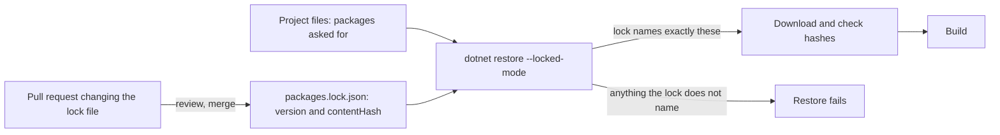

## Bạn cần biết trước

- [[devops.l3.software-supply-chain]] — bạn biết image api phần lớn là đầu vào team không hề viết, và mỗi đầu vào được gọi bằng một cái tên mà chủ của nó đổi được.
- [[devops.l2.image-tags-and-digests]] — bạn biết tag là một nhãn dời được, còn digest gọi đúng một image và không bao giờ đổi.
- [[devops.l3.opentofu-resources]] — bạn đã thấy `.terraform.lock.hcl` ghi đúng phiên bản và checksum của từng provider, nên lần `init` nào cũng cài đúng provider đó.
- [[devops.l2.dependency-cache]] — bạn biết `dotnet restore` tải package về, còn cache chỉ giúp tiết kiệm thời gian.

## Tình huống

Một bản sửa lỗi phải phát hành trên một nhánh tách ra từ một commit `stage-2` cách đây ba tháng. Bạn chạy lại `ci.yml` trên nhánh đó và chờ kết quả giống lần trước. Không ai sửa dòng nào của commit đó.

Vậy mà lần chạy vẫn có thể khác. Nó dùng commit mà `actions/checkout@v4` trỏ tới hôm nay, có thể không phải commit lần chạy cũ đã dùng. `docker build` bắt đầu từ image mà `aspnet:10.0` chỉ tới hôm nay, có thể không còn là image lần chạy cũ đã dùng. Commit bạn đã review gọi các đầu vào bằng tên, và giờ những cái tên đó có thể dẫn tới chỗ khác. Commit phải gọi mọi đầu vào thế nào để build lại về sau vẫn lấy đúng thứ bạn đã review?

## Khái niệm cốt lõi

- Tên — nhãn của một đầu vào mà về sau chủ của nó có thể trỏ sang nội dung khác: một số phiên bản, một tag action như `@v4`, một tag image như `aspnet:10.0`.
- Hash nội dung — một giá trị ngắn tính từ các byte của một đầu vào, nên nội dung khác cho ra hash khác. Digest và commit id của Git đều là hash nội dung.
- Ghim — gọi một đầu vào bằng hash nội dung của nó, để lần build hoặc lấy đúng những byte đó, hoặc thất bại.
- **phụ thuộc bắc cầu** (transitive dependency) — package mà dự án có vì một package nó dùng cần đến, không phải vì bạn khai báo. `prometheus-net` đến với api chỉ qua `prometheus-net.AspNetCore`.
- **lock file** (File ghi đúng phiên bản và hash nội dung của mọi dependency, để lần restore nào cũng lấy đúng chúng) — file được commit ngay cạnh project, ghi đúng phiên bản và hash nội dung của mọi package, cả trực tiếp lẫn bắc cầu, để lần restore nào cũng lấy đúng những package đó.

## Cơ chế hoạt động



Một cái tên như `@v4` hay `aspnet:10.0` là câu hỏi mà lần build đặt cho người khác lúc chạy: hôm nay cái tên này trỏ tới đâu? Ghim thay câu hỏi đó bằng câu trả lời bạn đã review, tức một hash nội dung.

Với package, câu trả lời đó là lock file. Các file project nói api cần những package nào, còn `packages.lock.json` ghi lại thứ restore đã chọn cho chúng: phiên bản và một `contentHash` cho từng package, cả package trực tiếp lẫn mọi phụ thuộc bắc cầu. `DonHang.App/pubspec.lock` đã làm điều tương tự cho các package Flutter từ `stage-2`, với một `sha256` cho mỗi package tải về. Từ `stage-3`, mỗi project .NET có `packages.lock.json` riêng.

Với `--locked-mode`, restore coi lock file là câu trả lời duy nhất được chấp nhận. Nếu các file project dẫn tới bất cứ thứ gì lock file không ghi, restore thất bại thay vì chọn cái mới. Restore còn đối chiếu từng package tải về với hash đã ghi, và chỉ sau đó lần build mới chạy. `flutter pub get`, lệnh tương ứng với `dotnet restore` bên Flutter, làm y như vậy với `pubspec.lock` khi có `--enforce-lockfile`. Job `app` trong `ci.yml` chạy lệnh này theo đúng cách đó.

Vì thế, đường duy nhất để code package mới đi vào là mũi tên "review, merge". Sau khi một file project thay đổi, ai đó chạy restore không có `--locked-mode` để lock file được ghi lại, rồi commit kết quả trong một pull request như mọi thay đổi khác.

Trong tình huống ở trên, commit cũ không có `packages.lock.json`, gọi action bằng tag và gọi base image cũng bằng tag. Ở `stage-3`, mỗi cái tên đó đều được thay bằng, hoặc đi kèm, một hash nội dung.

## Trong hệ thống Đơn Hàng

Một phần lock file của api:

```json file=DonHang.Api/packages.lock.json tag=stage-3 lines=78-91
      "prometheus-net.AspNetCore": {
        "type": "Direct",
        "requested": "[8.2.1, )",
        "resolved": "8.2.1",
        "contentHash": "/4TfTvbwIDqpaKTiWvEsjUywiHYF9zZvGZF5sK15avoDsUO/WPQbKsF8TiMaesuphdFQPK2z52P0zk6j26V0rQ==",
        "dependencies": {
          "prometheus-net": "8.2.1"
        }
      },
      "Microsoft.Bcl.Cryptography": {
        "type": "Transitive",
        "resolved": "10.0.2",
        "contentHash": "LG9Yll3B5aNpxv0+D47g6LiOiKBIlodhcHdQwcYzo8VeexFLGqx5ymetmA2aBRyo9cCcWsQWrFsdbsr8LvmWDw=="
      },
```

Dòng 79 đánh dấu một package mà `DonHang.Api.csproj` tự liệt kê. Dòng 88 đánh dấu một package nó không hề liệt kê, còn thứ kéo package đó vào nằm ngoài đoạn trích. Dòng 80 là thứ project yêu cầu. Dòng 81–82 ghi phiên bản restore đã chọn và hash nội dung của package đó. Dòng 83–85 cho thấy vì sao có phụ thuộc bắc cầu: `prometheus-net.AspNetCore` cần `prometheus-net`, nên api cũng nhận luôn package này. `Directory.Build.props` đặt `RestorePackagesWithLockFile` cho mọi project, và chính thiết lập đó khiến restore ghi ra các file này.

Job test, từ bước đầu tiên tới bước restore:

```yaml file=.github/workflows/ci.yml tag=stage-3 lines=23-47
      - uses: actions/checkout@11d5960a326750d5838078e36cf38b85af677262 # v4.4.0

      - uses: actions/setup-dotnet@67a3573c9a986a3f9c594539f4ab511d57bb3ce9 # v4.3.1
        with:
          global-json-file: global.json

      # lesson: devops.l2.dependency-cache
      # The key changes exactly when a locked package changes. With no exact
      # match, the newest cache whose key starts with the restore-keys prefix
      # is restored, and dotnet restore downloads only what is still missing.
      - name: Cache NuGet packages
        uses: actions/cache@0057852bfaa89a56745cba8c7296529d2fc39830 # v4.3.0
        with:
          path: ~/.nuget/packages
          key: ${{ runner.os }}-nuget-${{ hashFiles('**/packages.lock.json') }}
          restore-keys: |
            ${{ runner.os }}-nuget-

      # lesson: devops.l3.pinning-by-content
      # Locked mode restores exactly what each project's packages.lock.json
      # names and fails if a project asks for anything else, so a change to
      # the packages arrives as a reviewed change to a lock file. NuGet's
      # warnings about known vulnerabilities still fail the build below.
      - name: Restore the packages the lock files name
        run: dotnet restore DonHang.slnx --locked-mode
```

Dòng 23, 25 và 34 gọi mỗi action bằng một commit id đầy đủ 40 ký tự, kèm comment ghi phiên bản của action lúc được ghim. Từ `stage-3`, mọi `uses:` trong các workflow của Đơn Hàng đều làm vậy. Commit id của Git được tính từ nội dung của commit, nên về sau không thể chỉ sang code khác. Comment chỉ để người đọc dễ hiểu. Dòng 37 tạo cache key từ các lock file, những file đổi đúng khi một package đã khóa thay đổi. Dòng 47 là lần restore có khóa trong sơ đồ.

Base image cũng theo quy tắc đó. `DonHang.Api/Dockerfile` ghi `sdk:10.0` ở dòng 10 và `aspnet:10.0` ở dòng 48, sau mỗi tag là `@sha256:` và một digest. Digest chỉ đúng một image, nên lần build lấy đúng những byte đó hoặc thất bại. Tag đứng cạnh cho người đọc biết image thuộc dòng phát hành nào. `deploy/k8s/kind-config.yaml` vốn đã gọi node image theo cách này: đó là image mà mỗi node trong cluster cục bộ của Đơn Hàng chạy từ đó.

Ghim có cái giá của nó. Ghim cũng chặn luôn các bản sửa lỗi: khi Microsoft phát hành bản `aspnet:10.0` đã vá, Đơn Hàng vẫn build trên digest cũ cho tới khi có người đổi. Commit id cố định code của chính action, không cố định thứ code đó mang vào lúc chạy, chẳng hạn .NET SDK mà `actions/setup-dotnet` cài lên runner khi job chạy. Giờ mỗi lần cập nhật là một thay đổi mà ai đó phải chủ động làm.

## Senior hay nhầm rằng…

- **"Tag phiên bản của một GitHub Action, như `v4`, lúc nào cũng chạy cùng một code."** → Thực ra `v4` là một Git tag trong repository của action. Git tag thường nằm yên trên một commit, nhưng chủ của nó có thể xóa đi rồi tạo lại trên commit khác, nên "cố định" chỉ là thói quen, không phải bảo đảm. Tác giả action thậm chí còn được khuyên dời tag major sang mỗi bản phát hành mới của dòng đó. Một commit id đầy đủ gọi đúng một phiên bản cố định của action. Bạn sẽ nhận ra khi một action bắt đầu chạy khác đi dù file workflow không hề đổi.
- **"Lock file là output được sinh ra, không thuộc về Git."** → Thực ra restore đúng là sinh ra nó, nhưng nó chỉ ghim được khi đã được commit. Không có nó trong repository, mỗi bản clone lại tự chọn phiên bản từ đầu và có thể nhận phiên bản khác. Bạn sẽ nhận ra khi `flutter pub get` trên một bản clone mới không có `pubspec.lock` chọn phiên bản package mới hơn bản CI đã test.
- **"Lock file bảo vệ bạn khỏi package độc hại."** → Thực ra lock file giữ nguyên bất cứ thứ gì đã bị khóa. Nếu một phiên bản độc hại lọt vào lock file qua một pull request đã review, mọi lần restore có khóa đều cài đúng phiên bản đó, và bước kiểm tra hash vẫn qua. Bạn sẽ nhận ra khi một pull request chỉ đổi lock file vẫn qua CI: các bước kiểm tra chứng minh package khớp với hash của nó, không chứng minh code bên trong an toàn.

## Thử ngay (3 phút)

Trong thư mục repository `don-hang`:

1. Chạy `git show stage-3:DonHang.Api/packages.lock.json | grep -c '"type": "Direct"'` (`grep -c` in ra số dòng chứa đoạn chữ đó).
2. Chạy lại lệnh đó, thay `"type": "Direct"` bằng `"type": "Transitive"`.
3. Mở `DonHang.Api/DonHang.Api.csproj` ở `stage-3` và đếm số dòng `PackageReference` (mỗi dòng gọi tên một package mà project tự liệt kê).

Kết quả mong đợi: 9 mục trực tiếp, 19 mục bắc cầu, và 9 dòng `PackageReference` trong file project.

Trước `stage-3`, thứ gì trong repository ghi lại api đã được build với phiên bản nào và những byte nào của 19 package bắc cầu đó?

<details><summary>Gợi ý đáp án</summary>

Không có gì cả. File project gọi tên 9 package và 4 project khác, còn `Directory.Packages.props` đặt phiên bản nhưng không có hash. Restore tự chọn các package bắc cầu dựa trên những gì các package và project đó phụ thuộc, và không file nào được commit giữ lại kết quả. Giờ lock file ghi cả 19 package kèm hash, và một lần restore có khóa sẽ thất bại nếu nhận được bất cứ thứ gì khác.

</details>

## Liên hệ

- [[devops.l3.automated-dependency-updates]] — lời đáp cho cái giá của bài này: một dịch vụ đề xuất mỗi lần cập nhật một bản ghim dưới dạng pull request.
- [[devops.l2.image-tags-and-digests]] — ý tưởng tag và digest mà bài này áp dụng cho mọi đầu vào, không riêng image.
- [[devops.l3.opentofu-resources]] — `.terraform.lock.hcl` là cùng ý tưởng đó cho provider của OpenTofu.
- [[k8s.l1.cluster-nodes-and-control-plane]] — nơi node image của kind lần đầu được gọi bằng digest.
- [[devops.l1.dockerfile-for-dotnet]] — Dockerfile mà các dòng `FROM` giờ mang theo digest.

## Tóm tắt 5 dòng

1. Gọi mỗi đầu vào bằng hash nội dung của nó, không bằng một tag hay phiên bản mà chủ của nó có thể trỏ sang chỗ khác.
2. Lock file ghi đúng phiên bản và hash nội dung của mọi package, cả trực tiếp lẫn bắc cầu.
3. `dotnet restore --locked-mode` và `flutter pub get --enforce-lockfile` thất bại thay vì chọn bất cứ thứ gì lock file không ghi.
4. Action được ghim bằng commit id đầy đủ, base image bằng digest, nên lần build lại về sau bắt đầu từ cùng một code.
5. Ghim cũng chặn các bản sửa lỗi: mỗi lần cập nhật trở thành một thay đổi đã review mà ai đó chủ động làm.
