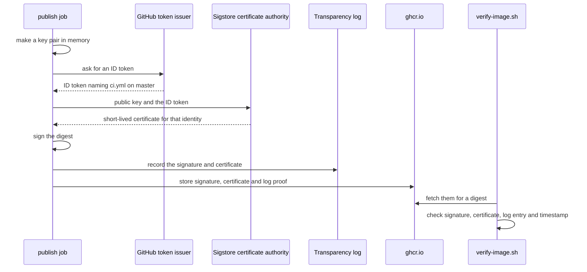

## Before you start

- [[devops.l3.software-supply-chain]] — you know the third question of this module: was the running image built by your own pipeline.
- [[devops.l2.image-tags-and-digests]] — you know a tag is a movable label, while a digest names one exact image.
- [[backend.l2.validating-provider-tokens]] — you know how the API checks a Keycloak token: its signature, then its issuer and claims.
- [[devops.l2.cutting-a-release]] — you know `release.yml` builds nothing: it gives the commit's `sha-` images a version tag such as `1.0.0`.

## The situation

It is `stage-3`. The staging config in `envs/staging/api.yaml` names the api image by a `sha-` tag, and a colleague proposes adding the digest so staging always runs CI's image. Then you read the `permissions:` blocks. On `ghcr.io` each image is stored as a package, and the `publish` job in `ci.yml` may push packages there; so may `release.yml`, and so could a leaked token with that permission. Any of them can push a different image under the name `donhang-api`, and the registry gives that image a digest exactly as valid as the one CI pushed.

What could prove that a digest came from `ci.yml` on `master`, and from nothing else that can push?

## Core concepts

- **image signature** — a signature over an image's digest; checking it proves the image is exactly the one the holder of the signing key signed.
- **Cosign** — a command-line tool that signs images in a registry and verifies their signatures; it belongs to Sigstore, a public signing project that also runs the certificate authority and the transparency log used here.
- **keyless signing** — signing with a key pair made for one signing and then discarded, tied to an identity, here the `ci.yml` workflow, by a short-lived certificate.
- Certificate — a document that binds a public key to a name, signed by a certificate authority: a service whose public key verifiers already trust, so they believe what it signs. In this lesson the name is the `ci.yml` workflow, not a website.
- **transparency log** — a public log that only grows, in which Cosign records each keyless signature by default, so anyone can see which signatures were made for an identity.

## How it works



In the situation above, the `publish` job has just pushed `donhang-api` and knows its digest. Cosign makes a new key pair in memory, then asks GitHub for an ID token. The job may get one only because its `permissions:` grant `id-token: write`. The token is a JWT signed by GitHub's token issuer, and it names the repository, the workflow file and the branch of this run.

Cosign sends the new public key and the token to Sigstore's certificate authority. The authority checks the token's signature, much as Đơn Hàng's API checks Keycloak's tokens, and issues a certificate binding that public key to the workflow's identity, valid for minutes only. Cosign signs the digest, records the signature and certificate in the transparency log, and gets a trusted, signed timestamp for the signing, from the log or from a separate timestamp authority. It stores the signature in the registry beside the image, with the certificate and the log's proof of the entry, then discards the private key. No long-lived key exists to steal, rotate or back up.

Verifying runs the other way. A verifier fetches what is stored beside a digest and checks three things. The signature must match the digest and the certificate's public key. The certificate must come from Sigstore's authority and name the identity and issuer the verifier expects. The log entry must be there, and the trusted timestamp must show the signing happened while the certificate was still valid; without it, every signature would look expired minutes after it was made.

## In the Đơn Hàng system

The signing step of the `publish` job, lines 264–276 of `ci.yml`, right after the image is pushed:

```yaml file=.github/workflows/ci.yml tag=stage-3 lines=264-276
      - uses: sigstore/cosign-installer@6f9f17788090df1f26f669e9d70d6ae9567deba6 # v4.1.2
        with:
          cosign-release: v3.1.3

      # lesson: devops.l3.signing-images
      # Keyless: cosign trades this job's GitHub ID token for a short-lived
      # certificate that names ci.yml on this branch, signs the digest (never
      # a tag), records the signature in the public transparency log and
      # discards the private key. The signature is stored beside the image.
      - name: Sign the pushed digest
        env:
          IMAGE: ${{ steps.push.outputs.name }}@${{ steps.push.outputs.digest }}
        run: cosign sign --yes "$IMAGE"
```

Lines 264–266 install Cosign 3.1. Line 275 builds the reference from the push step's outputs as `name@digest`, so what gets signed is the digest, never a tag. Line 276 passes no key, which makes Cosign sign keyless; `--yes` answers the confirmation prompt that nobody could answer in a CI job. The `id-token: write` permission sits on lines 222–225, outside this excerpt. The job runs once per image, six times in all, so each image gets its own signature.

The check, lines 14–31 of `verify-image.sh`:

```bash file=scripts/devops/verify-image.sh tag=stage-3 lines=14-31
# lesson: devops.l3.signing-images
# Anyone can get a keyless signature for their own identity, so a valid
# signature proves nothing until the certificate's identity is checked:
# exactly ci.yml, on master, of this repository, as GitHub's token issuer
# vouched for it.
identity=https://github.com/duyan11110/don-hang/.github/workflows/ci.yml@refs/heads/master
issuer=https://token.actions.githubusercontent.com
trusted=(--certificate-identity "$identity" --certificate-oidc-issuer "$issuer")

verify() {
  local ref=$1 digest payload
  # Always a digest: a tag can be moved to another image after the check.
  if [[ $ref == *@sha256:* ]]; then digest=${ref#*@}; else digest=$(digest_of "$ref"); fi
  [ -n "$digest" ] || { echo "no image $ref"; return 1; }
  echo "== $ref -> ${ref%%[:@]*}@$digest"

  echo "-- signature"
  cosign verify "${ref%%[:@]*}@$digest" "${trusted[@]}" 2>&1 >/dev/null | grep -v '^$' || return 1
```

```text output=true
== ghcr.io/duyan11110/donhang-api:sha-... -> ghcr.io/duyan11110/donhang-api@sha256:...
-- signature
Verification for ghcr.io/duyan11110/donhang-api@sha256:... --
The following checks were performed on each of these signatures:
  - The cosign claims were validated
  - Existence of the claims in the transparency log was verified offline
  - The code-signing certificate was verified using trusted certificate authority certificates
-- provenance
built by https://github.com/duyan11110/don-hang, .github/workflows/ci.yml at commit ... (push)
verified

== ghcr.io/duyan11110/donhang-api:1.0.0 -> ghcr.io/duyan11110/donhang-api@sha256:1d0825b582ec31c52d33e7fa9e2b9d73f39bd059018aa41bafbbdec006dea314
-- signature
Error: no signatures found
error during command execution: no signatures found
not verified: refused
```

Lines 19–21 are the trust decision: one exact workflow file, on `refs/heads/master`, of this repository, with GitHub's token issuer. Line 26 turns a tag into the digest it names right now, through `digest_of` from `scripts/lib/images.sh` (outside the excerpt), and line 31 verifies that digest. The output shows the three checks passing for the newest `sha-` image; the log proof is stored with the signature, so the log check runs offline. The `1.0.0` image, released before `stage-3`, has no signature at all, so the script refuses it. The `-- provenance` lines belong to the next lesson.

`release.yml` has no `id-token: write` and runs no Cosign. Its lines 46–61, outside these excerpts, compare each image's `sha-` digest with its new version tag and fail the release if they differ. A signature belongs to the digest, so the version tag finds CI's signature unchanged.

## Seniors often assume…

- **"Pinning an image by digest already proves who built it."** → Actually a digest is computed from the image's content, and the registry gives one to every image pushed, whoever pushed it. Pinning proves you get the same image every time, not that CI made it. You notice this when an image appears under `donhang-api` that no `ci.yml` run pushed, and nothing about its digest looks different from CI's.
- **"`cosign verify` passing on any valid signature proves the image came from our own pipeline."** → Actually keyless signatures are free to anyone: a copy of Đơn Hàng's repository under someone else's GitHub account, running Cosign in its own workflow, gets a valid certificate for its own identity. The check means exactly what its identity flags say, which is why `verify-image.sh` names one workflow, one branch and one issuer. You notice this when a check whose identity names only the issuer, or only part of the workflow path, still passes for an image signed from someone else's repository.
- **"Giving an already signed image a release tag means signing it again."** → Actually the signature is stored for the digest, and a tag is only a name for a digest. Signing again in `release.yml` would add a signature with `release.yml`'s identity, which `verify-image.sh` would not trust anyway. You notice this when you look for a signing step in `release.yml` and find only that digest comparison.

## Try it (3 minutes)

In the `don-hang` repository folder, checked out at `stage-3`, with Docker running and access to `ghcr.io` and Sigstore (Cosign runs in a container, so nothing else needs installing):

1. Run `scripts/devops/verify-image.sh`. With no arguments it checks the newest `sha-` api image, then `1.0.0`.

Expected result: the first block lists the three checks and ends with `verified`; the second, for `1.0.0`, prints `no signatures found` and `not verified: refused`.

Now think it through. Suppose someone changes line 19 so the identity names `release.yml` instead of `ci.yml`. What does the script print for the newest `sha-` image?

<details><summary>Suggested answer</summary>

It stops after `-- signature` with a Cosign error and never reaches `verified`. The digest has a valid signature, but its certificate names `ci.yml`, and no signature on that digest carries the identity the script now asks for. The signature did not change; the trust decision did.

</details>

## Connections

- [[devops.l2.image-tags-and-digests]] — prerequisite: a signature is made over the digest that lesson introduced, never over a tag.
- [[backend.l2.validating-provider-tokens]] — the same idea one layer down: check a signature, then check that it names the issuer and subject you expect.
- [[backend.l2.openid-connect-id-token]] — the kind of token Cosign trades for its certificate, here issued to a workflow instead of a user.
- [[devops.l3.sealed-secrets]] — the opposite trade-off: one long-lived key you must keep and back up, where keyless signing keeps none.
- [[devops.l3.build-provenance]] — the next step: a signed statement of which commit and workflow built the digest.
- [[devops.l3.verifying-before-deploy]] — puts this check on the path every deploy takes.

## Five-line summary

1. A digest says exactly which image you have, not who made it; a signature over the digest ties it to the identity that signed it.
2. In keyless signing, Cosign trades the `publish` job's GitHub ID token for a short-lived certificate, signs the digest, then discards the private key.
3. Cosign records each keyless signature in a public transparency log, and a trusted, signed timestamp shows the signing happened while the certificate was valid.
4. `release.yml` only adds a version tag to the digest CI signed, and checks it, so the release carries CI's signature without signing again.
5. Anyone can get a valid keyless signature, so `verify-image.sh` accepts only `ci.yml` on `master` of Đơn Hàng's repository.
