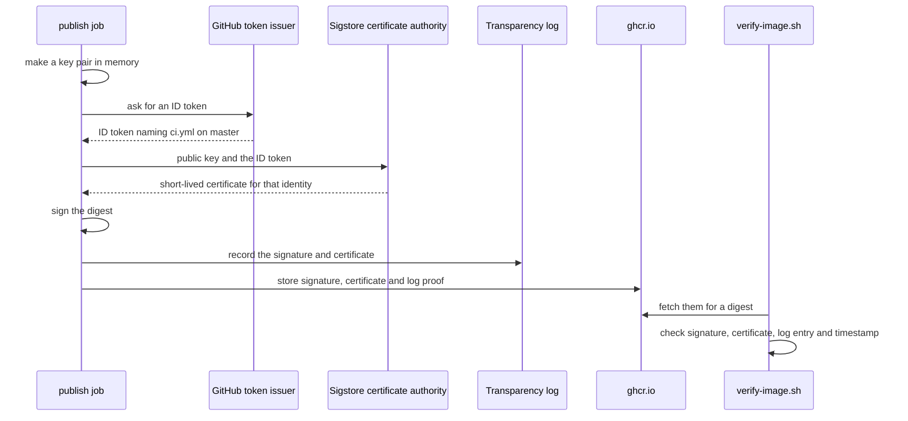

## Bạn cần biết trước

- [[devops.l3.software-supply-chain]] — bạn biết câu hỏi thứ ba của module này: image đang chạy có đúng do pipeline của chính bạn build ra không.
- [[devops.l2.image-tags-and-digests]] — bạn biết tag là nhãn dời đi được, còn digest chỉ đúng một image.
- [[backend.l2.validating-provider-tokens]] — bạn biết API kiểm token của Keycloak thế nào: kiểm chữ ký trước, rồi tới issuer và các claim.
- [[devops.l2.cutting-a-release]] — bạn biết `release.yml` không build gì cả: nó chỉ gắn cho các image `sha-` của commit một tag phiên bản như `1.0.0`.

## Tình huống

Đơn Hàng đang ở `stage-3`. File cấu hình staging `envs/staging/api.yaml` gọi image api bằng tag `sha-`, và một đồng nghiệp đề xuất thêm digest để staging luôn chạy đúng image của CI. Rồi bạn đọc các khối `permissions:`. Trên `ghcr.io`, mỗi image được lưu thành một package. Job `publish` trong `ci.yml` được quyền push package lên đó, `release.yml` cũng vậy, và một token bị lộ có quyền đó cũng làm được. Bất kỳ bên nào trong số này cũng push được một image khác dưới tên `donhang-api`, và registry cấp cho image đó một digest hợp lệ y hệt digest của image CI đã push.

Thứ gì chứng minh được một digest đến từ `ci.yml` trên `master`, chứ không phải từ bất kỳ bên nào khác có quyền push?

## Khái niệm cốt lõi

- **chữ ký image** (image signature) — chữ ký trên digest của một image. Kiểm chữ ký này chứng minh image đúng là cái mà người giữ khóa ký đã ký.
- **Cosign** (công cụ dòng lệnh ký và xác minh chữ ký, attestation của image trong registry) — công cụ dòng lệnh ký image trong registry và xác minh chữ ký của chúng. Nó thuộc Sigstore, một dự án ký công khai, cũng là bên vận hành certificate authority và transparency log dùng trong bài này.
- **keyless signing** (ký bằng khóa dùng một lần, gắn với danh tính (vd job CI) qua certificate ngắn hạn, không giữ khóa lâu dài) — ký bằng một cặp khóa tạo ra cho đúng một lần ký rồi bỏ đi, gắn với một danh tính, ở đây là workflow `ci.yml`, qua một certificate ngắn hạn.
- Certificate — văn bản gắn một public key với một cái tên, được ký bởi certificate authority: một dịch vụ có public key mà bên kiểm tra đã tin sẵn, nên họ tin những gì nó ký. Trong bài này, cái tên là workflow `ci.yml`, không phải một website.
- **transparency log** (nhật ký công khai chỉ ghi thêm, lưu mọi chữ ký đã cấp để không chữ ký nào bị giấu) — một nhật ký công khai chỉ lớn thêm, nơi Cosign mặc định ghi lại mỗi chữ ký keyless, nên ai cũng xem được những chữ ký nào đã được tạo cho một danh tính.

## Cơ chế hoạt động



Trong tình huống ở trên, job `publish` vừa push `donhang-api` và biết digest của nó. Cosign tạo một cặp khóa mới trong bộ nhớ, rồi xin GitHub một ID token. Job xin được token chỉ vì `permissions:` của nó cấp `id-token: write`. Token là một JWT do bên phát token của GitHub ký, ghi tên repository, file workflow và branch của lần chạy này.

Cosign gửi public key mới cùng token cho certificate authority của Sigstore. Bên này kiểm chữ ký của token, giống cách API của Đơn Hàng kiểm token của Keycloak, rồi cấp một certificate gắn public key đó với danh tính của workflow, chỉ có hiệu lực vài phút. Cosign ký digest, ghi chữ ký và certificate vào transparency log, và lấy một mốc thời gian đáng tin, có chữ ký, cho lần ký này, từ chính log hoặc từ một dịch vụ cấp mốc thời gian riêng. Nó lưu chữ ký vào registry ngay cạnh image, kèm certificate và bằng chứng của log về mục đã ghi, rồi bỏ private key. Không có khóa lâu dài nào để bị đánh cắp, phải xoay vòng hay phải sao lưu.

Xác minh thì đi theo chiều ngược lại. Bên kiểm tra lấy những gì được lưu cạnh một digest và kiểm ba điều. Chữ ký phải khớp với digest và với public key trong certificate. Certificate phải do certificate authority của Sigstore cấp và ghi đúng danh tính, đúng issuer mà bên kiểm tra chờ đợi. Mục trong log phải có mặt, và mốc thời gian đáng tin phải cho thấy lần ký diễn ra khi certificate còn hiệu lực. Không có mốc này thì chữ ký nào cũng trông như đã hết hạn chỉ vài phút sau khi được tạo.

## Trong hệ thống Đơn Hàng

Bước ký của job `publish`, dòng 264–276 của `ci.yml`, ngay sau khi image được push:

```yaml file=.github/workflows/ci.yml tag=stage-3 lines=264-276
      - uses: sigstore/cosign-installer@6f9f17788090df1f26f669e9d70d6ae9567deba6 # v4.1.2
        with:
          cosign-release: v3.1.3

      # lesson: devops.l3.signing-images
      # Keyless: cosign trades this job's GitHub ID token for a short-lived
      # certificate that names ci.yml on this branch, signs the digest (never
      # a tag), records the signature in the public transparency log and
      # discards the private key. The signature is stored beside the image.
      - name: Sign the pushed digest
        env:
          IMAGE: ${{ steps.push.outputs.name }}@${{ steps.push.outputs.digest }}
        run: cosign sign --yes "$IMAGE"
```

Dòng 264–266 cài Cosign 3.1. Dòng 275 ghép tham chiếu từ output của bước push thành `name@digest`, nên thứ được ký là digest, không bao giờ là tag. Dòng 276 không truyền khóa nào, và vì thế Cosign ký keyless. `--yes` trả lời câu hỏi xác nhận mà trong job CI không ai trả lời được. Quyền `id-token: write` nằm ở dòng 222–225, ngoài đoạn trích này. Job chạy một lần cho mỗi image, tổng cộng sáu lần, nên image nào cũng có chữ ký riêng.

Phần kiểm tra, dòng 14–31 của `verify-image.sh`:

```bash file=scripts/devops/verify-image.sh tag=stage-3 lines=14-31
# lesson: devops.l3.signing-images
# Anyone can get a keyless signature for their own identity, so a valid
# signature proves nothing until the certificate's identity is checked:
# exactly ci.yml, on master, of this repository, as GitHub's token issuer
# vouched for it.
identity=https://github.com/duyan11110/don-hang/.github/workflows/ci.yml@refs/heads/master
issuer=https://token.actions.githubusercontent.com
trusted=(--certificate-identity "$identity" --certificate-oidc-issuer "$issuer")

verify() {
  local ref=$1 digest payload
  # Always a digest: a tag can be moved to another image after the check.
  if [[ $ref == *@sha256:* ]]; then digest=${ref#*@}; else digest=$(digest_of "$ref"); fi
  [ -n "$digest" ] || { echo "no image $ref"; return 1; }
  echo "== $ref -> ${ref%%[:@]*}@$digest"

  echo "-- signature"
  cosign verify "${ref%%[:@]*}@$digest" "${trusted[@]}" 2>&1 >/dev/null | grep -v '^$' || return 1
```

```text output=true
== ghcr.io/duyan11110/donhang-api:sha-... -> ghcr.io/duyan11110/donhang-api@sha256:...
-- signature
Verification for ghcr.io/duyan11110/donhang-api@sha256:... --
The following checks were performed on each of these signatures:
  - The cosign claims were validated
  - Existence of the claims in the transparency log was verified offline
  - The code-signing certificate was verified using trusted certificate authority certificates
-- provenance
built by https://github.com/duyan11110/don-hang, .github/workflows/ci.yml at commit ... (push)
verified

== ghcr.io/duyan11110/donhang-api:1.0.0 -> ghcr.io/duyan11110/donhang-api@sha256:1d0825b582ec31c52d33e7fa9e2b9d73f39bd059018aa41bafbbdec006dea314
-- signature
Error: no signatures found
error during command execution: no signatures found
not verified: refused
```

Dòng 19–21 là quyết định tin ai: đúng một file workflow, trên `refs/heads/master`, của repository này, với bên phát token của GitHub làm issuer. Dòng 26 đổi một tag thành digest mà tag đó đang trỏ tới ngay lúc này, qua `digest_of` trong `scripts/lib/images.sh` (ngoài đoạn trích), và dòng 31 xác minh digest đó. Kết quả cho thấy ba phép kiểm đều qua với image `sha-` mới nhất. Bằng chứng của log được lưu cùng chữ ký, nên phép kiểm log chạy offline. Image `1.0.0`, release trước `stage-3`, không có chữ ký nào, nên script từ chối nó. Các dòng `-- provenance` thuộc về bài sau.

`release.yml` không có `id-token: write` và không chạy Cosign. Dòng 46–61 của nó, ngoài các đoạn trích này, so digest `sha-` của từng image với tag phiên bản mới và làm release thất bại nếu hai bên khác nhau. Chữ ký thuộc về digest, nên tag phiên bản vẫn tìm thấy nguyên chữ ký của CI.

## Senior hay nhầm rằng…

- **"Ghim image theo digest là đã chứng minh được ai build ra nó."** → Thực ra digest tính từ nội dung image, và registry cấp digest cho mọi image được push, bất kể ai push. Ghim chứng minh lần nào bạn cũng nhận cùng một image, chứ không chứng minh CI đã tạo ra nó. Bạn sẽ nhận ra khi dưới `donhang-api` xuất hiện một image không do lần chạy `ci.yml` nào push, mà digest của nó trông chẳng khác gì digest của CI.
- **"`cosign verify` qua với bất kỳ chữ ký hợp lệ nào là chứng minh image đến từ pipeline của mình."** → Thực ra chữ ký keyless ai cũng lấy được miễn phí: một bản sao repository của Đơn Hàng dưới tài khoản GitHub của người khác, chạy Cosign trong workflow riêng, sẽ nhận certificate hợp lệ cho danh tính của chính nó. Phép kiểm chỉ mang đúng ý nghĩa mà các cờ danh tính của nó nói, đó là lý do `verify-image.sh` ghi rõ một workflow, một branch và một issuer. Bạn sẽ nhận ra khi một phép kiểm chỉ ghi issuer, hoặc chỉ ghi một phần đường dẫn workflow, vẫn qua với image được ký từ repository của người khác.
- **"Gắn tag release cho một image đã ký thì phải ký lại."** → Thực ra chữ ký được lưu theo digest, còn tag chỉ là một cái tên trỏ tới digest. Ký lại trong `release.yml` sẽ thêm một chữ ký mang danh tính của `release.yml`, thứ mà `verify-image.sh` dù sao cũng không tin. Bạn sẽ nhận ra khi tìm bước ký trong `release.yml` và chỉ thấy phép so digest kia.

## Thử ngay (3 phút)

Trong thư mục repository `don-hang`, checkout ở `stage-3`, với Docker đang chạy và truy cập được `ghcr.io` cùng Sigstore (Cosign chạy trong container, nên không cần cài thêm gì):

1. Chạy `scripts/devops/verify-image.sh`. Không truyền tham số thì script kiểm image api `sha-` mới nhất, rồi tới `1.0.0`.

Kết quả mong đợi: khối đầu liệt kê ba phép kiểm và kết thúc bằng `verified`. Khối thứ hai, cho `1.0.0`, in `no signatures found` và `not verified: refused`.

Giờ hãy nghĩ thử. Giả sử ai đó sửa dòng 19 để danh tính ghi `release.yml` thay vì `ci.yml`. Script sẽ in gì cho image `sha-` mới nhất?

<details><summary>Gợi ý đáp án</summary>

Nó dừng sau `-- signature` với một lỗi của Cosign và không bao giờ tới `verified`. Digest có chữ ký hợp lệ, nhưng certificate của chữ ký ghi `ci.yml`, và không chữ ký nào trên digest đó mang danh tính mà script giờ đòi. Chữ ký không đổi, chỉ quyết định tin ai là đổi.

</details>

## Liên hệ

- [[devops.l2.image-tags-and-digests]] — kiến thức nền: chữ ký được tạo trên digest mà bài đó giới thiệu, không bao giờ trên tag.
- [[backend.l2.validating-provider-tokens]] — cùng ý tưởng ở tầng dưới: kiểm chữ ký, rồi kiểm nó có ghi đúng issuer và subject bạn chờ đợi không.
- [[backend.l2.openid-connect-id-token]] — loại token Cosign đổi lấy certificate, ở đây cấp cho một workflow thay vì một người dùng.
- [[devops.l3.sealed-secrets]] — đánh đổi ngược lại: một khóa lâu dài bạn phải giữ và sao lưu, trong khi keyless signing không giữ khóa nào.
- [[devops.l3.build-provenance]] — bước tiếp theo: một tuyên bố có chữ ký về commit và workflow nào đã build ra digest.
- [[devops.l3.verifying-before-deploy]] — đặt phép kiểm này lên con đường mà mọi lần deploy đều đi qua.

## Tóm tắt 5 dòng

1. Digest cho biết chính xác bạn có image nào, không cho biết ai tạo ra nó. Chữ ký trên digest gắn nó với danh tính đã ký.
2. Với keyless signing, Cosign đổi ID token GitHub của job `publish` lấy một certificate ngắn hạn, ký digest, rồi bỏ private key.
3. Cosign ghi mỗi chữ ký keyless vào một transparency log công khai, và một mốc thời gian đáng tin, có chữ ký, cho thấy lần ký diễn ra khi certificate còn hiệu lực.
4. `release.yml` chỉ gắn thêm tag phiên bản cho digest mà CI đã ký, và kiểm tra nó, nên bản release mang chữ ký của CI mà không cần ký lại.
5. Ai cũng lấy được chữ ký keyless hợp lệ, nên `verify-image.sh` chỉ chấp nhận `ci.yml` trên `master` của repository Đơn Hàng.
