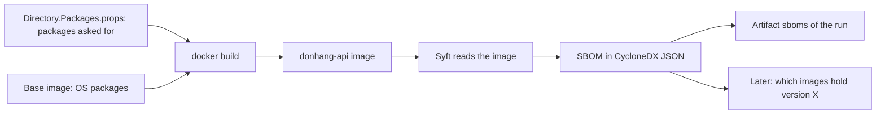

## Before you start

- [[devops.l3.pinning-by-content]] — you know a lock file records every package of one project, direct and transitive, as the source declares them.
- [[devops.l2.building-images-in-ci]] — you know the `image` job builds Đơn Hàng's images once per run, and later jobs use those images.
- [[devops.l2.workflow-artifacts]] — you know a job keeps a file with its run by uploading it as an artifact.

## The situation

It is a Monday at `stage-3`. A security notice says one version of a library that reads JWTs has a serious flaw, and your lead asks whether the api image ships it. You open `Directory.Packages.props`, the file naming the packages Đơn Hàng's projects ask for, find no package with that name, and answer no.

A colleague is less sure. `Microsoft.AspNetCore.Authentication.JwtBearer` is listed, and it must read tokens with something. The image also does not hold Đơn Hàng's code alone: `mcr.microsoft.com/dotnet/aspnet:10.0` brings a whole operating system's libraries, and no file in the repository names them. How do you find out what is actually inside the image you ship?

## Core concepts

- **SBOM (software bill of materials)** — a machine-readable list of the components inside a piece of software, each with its name, version and kind, such as a NuGet package (one a .NET project depends on, the kind `Directory.Packages.props` lists) or an OS package (a library or program installed into the image's operating system, outside any .NET project).
- Syft — a tool that reads a built image and writes its SBOM.
- CycloneDX — a standard format for SBOMs; Đơn Hàng writes its JSON form, so any tool that reads CycloneDX can use the list without the image.
- Package URL — the `pkg:` identifier on each package Syft finds, stored under the key `purl` in the JSON. Its first part names the kind: `pkg:deb/…` for an OS package in the Debian package format, which Ubuntu, the Linux operating system inside the `aspnet:10.0` base image, uses; `pkg:nuget/…` for a NuGet package.

## How it works



In the situation above, the file you searched describes what Đơn Hàng asks for. The image is what `docker build` made from it: OS packages (the base image's, plus the one the Dockerfile installs), the published app, and every package the app needs to run, direct or transitive. Only the image holds the OS packages and the app's full package list together, so the SBOM is made from the image.

Syft opens the image and reads what the build left there: the list the operating system keeps of the packages installed in it, and the `deps.json` files naming .NET packages, both the one published next to the app and the .NET runtime's own in the base image. For each component it recognises, it writes a name, a version and a package URL, all as CycloneDX JSON.

The SBOM is a file in a standard format, so another tool can read it later, on another machine, without pulling the image. The scanner in the next lesson does exactly that.

In CI, the `image` job makes one SBOM per image, right after it builds them and from those exact images, then uploads the files as an artifact of the run. The list therefore describes what runs, not what the source declares.

An SBOM records what is inside, not whether any of it is safe. Its value shows up later: when a flaw is made public in one version of a package, you search the stored SBOMs for that name and version instead of rebuilding images or guessing from project files.

## In the Đơn Hàng system

The part of `sbom.sh` that makes and reads the SBOM:

```bash file=scripts/devops/sbom.sh tag=stage-3 lines=18-42
# lesson: devops.l3.software-bill-of-materials
# Syft runs from its own image, named by digest like any base image. It reads
# the image through the Docker engine's socket and writes the SBOM, in the
# CycloneDX JSON format, to standard output.
syft=anchore/syft:v1.54.0@sha256:0356562f495d432056237fbea5cbc2d4839c9c75cd500784a66de2e7cc95ca7c
docker pull --quiet "$syft" >/dev/null
docker run --rm --volume /var/run/docker.sock:/var/run/docker.sock "$syft" \
  scan "docker:$image" --output cyclonedx-json --quiet > "$out"
echo "== $image -> $out"

# Every component has a package URL: pkg:deb/... for an OS package from the
# base image, pkg:nuget/... for a NuGet package inside the published app.
purls() { grep -o '"purl":"pkg:[^"]*' "$out" | cut -d'"' -f4; }
echo "== components by kind"
purls | cut -d/ -f1 | sort | uniq -c

# The packages Directory.Packages.props names, and the ones the image holds
# although no project file asks for them: transitive dependencies.
echo "== NuGet packages in the image that Directory.Packages.props does not list"
declared=$(grep -o 'PackageVersion Include="[^"]*"' Directory.Packages.props | cut -d'"' -f2)
purls | grep '^pkg:nuget/' | sed 's|^pkg:nuget/||; s|@| |' | sort -f \
  | while read -r name version; do
      case $name in DonHang.*) continue ;; esac  # Đơn Hàng's own code
      grep -qxF "$name" <<<"$declared" || echo "  $name $version"
    done
```

```text output=true
== donhang-api:stage-2 -> sbom/donhang-api.cdx.json
== components by kind
    102 pkg:deb
     34 pkg:nuget
== NuGet packages in the image that Directory.Packages.props does not list
  Microsoft.AspNetCore.App.Runtime.linux-x64 10.0.12
  Microsoft.Bcl.Cryptography 10.0.2
  Microsoft.EntityFrameworkCore 10.0.4
  Microsoft.EntityFrameworkCore.Abstractions 10.0.4
  Microsoft.EntityFrameworkCore.Relational 10.0.4
  Microsoft.IdentityModel.Abstractions 8.19.2
  Microsoft.IdentityModel.JsonWebTokens 8.19.2
  Microsoft.IdentityModel.Logging 8.19.2
  Microsoft.IdentityModel.Protocols 8.19.2
  Microsoft.IdentityModel.Protocols.OpenIdConnect 8.19.2
  Microsoft.IdentityModel.Tokens 8.19.2
  Microsoft.NETCore.App.Runtime.linux-x64 10.0.12
  Microsoft.OpenApi 2.12.0
  OpenTelemetry 1.15.3
  OpenTelemetry.Api 1.15.3
  OpenTelemetry.Api.ProviderBuilderExtensions 1.15.3
  prometheus-net 8.2.1
  RESPite 3.3.1
  System.IdentityModel.Tokens.Jwt 8.19.2
  System.IO.Hashing 10.0.12
```

Lines 22–25 run Syft from its own image, pinned by digest, and give it `/var/run/docker.sock`, the file through which programs talk to the Docker engine, so it can read `donhang-api:stage-2` from your machine; `--output cyclonedx-json` picks the format. Lines 30–32 count components by the kind in their package URL. Lines 36–42 print each NuGet package in the image that `Directory.Packages.props` does not name, skipping Đơn Hàng's own code, the `DonHang.Api` entry, on line 40.

The output answers the situation. The OS packages outnumber the NuGet ones, and none of them appears in a project file. The second list holds the token libraries, such as `Microsoft.IdentityModel.Tokens` and `System.IdentityModel.Tokens.Jwt`: transitive dependencies, which `DonHang.Api/packages.lock.json` shows arriving through `Microsoft.AspNetCore.Authentication.JwtBearer`.

The SBOM step of the `image` job; its comment also names what the `publish` job does with the files, which belongs to a later lesson:

```yaml file=.github/workflows/ci.yml tag=stage-3 lines=117-130
      # lesson: devops.l3.software-bill-of-materials
      # One SBOM per image, made by Syft from the image this job just built,
      # so it lists what will run, not what the project files declare. The
      # SBOMs are kept as an artifact of the run, and publish attests them.
      - name: Write an SBOM of each image
        run: |
          for image in $IMAGES; do
            scripts/devops/sbom.sh "$image"
          done

      - uses: actions/upload-artifact@ea165f8d65b6e75b540449e92b4886f43607fa02 # v4.6.2
        with:
          name: sboms
          path: sbom/*.cdx.json
```

Lines 123–125 run the same script as the lab on every image in `$IMAGES`, which the job built just before, outside this excerpt. Lines 127–130 upload every SBOM file as one artifact named `sboms`.

## Seniors often assume…

- **"`Directory.Packages.props` and `pubspec.lock` together already are the SBOM of the api image."** → Actually `pubspec.lock` belongs to `DonHang.App`, which is not in the api image at all, and `Directory.Packages.props` names the packages every Đơn Hàng project asks for, including test packages such as `xunit` that never reach the image. Neither names a transitive package or an OS package. Even `DonHang.Api/packages.lock.json`, which does list transitive packages, describes the source, not the base image. You notice this when a notice names a package you cannot find in any project file, and `sbom.sh` shows it inside the image.
- **"An image that has an SBOM has been checked for vulnerabilities."** → Actually making the list compares nothing against published flaws: `sbom.sh` only reads the image and writes what it finds. A flaw published next month does not change the file either; the list stays correct while its meaning changes. You notice this when the `sboms` artifact of an old run lists a version that a later notice calls vulnerable, although that run was green.

## Try it (3 minutes)

In the `don-hang` repository folder, checked out at `stage-3`:

1. Run `scripts/devops/sbom.sh`. With no argument, it reads `donhang-api:stage-2`; if that image is not on your machine, it says so; build it with `docker compose build api` and run the script again.
2. Run `grep -c IdentityModel Directory.Packages.props` (`grep -c` prints how many lines contain the text).

Expected result: the script prints the two kinds, `pkg:deb` and `pkg:nuget`, and a list that includes `Microsoft.IdentityModel.Tokens 8.19.2`; `grep` prints `0`. The image holds a token library that no project file names.

Now think it through. A notice names a flaw in one version of an Ubuntu package that the `aspnet:10.0` base image installs. Which file tells you whether the api image holds it, and which file cannot?

<details><summary>Suggested answer</summary>

The SBOM can: `sbom/donhang-api.cdx.json` locally, or the `sboms` artifact of the CI run that built the image, lists every `pkg:deb` component with its version. `DonHang.Api/packages.lock.json` and `Directory.Packages.props` cannot, because they describe only NuGet packages, and no project file lists the OS packages.

</details>

## Connections

- [[devops.l3.pinning-by-content]] — the lock file is the list the source declares; the SBOM is the list the built image contains.
- [[devops.l1.multi-stage-builds]] — why the api image's SBOM lists the runtime base image's packages and not the SDK's: only the last stage becomes the image.
- [[devops.l2.workflow-artifacts]] — the mechanism that keeps each run's `sboms` beside the images it describes.
- [[devops.l3.vulnerability-scanning]] — the next step: a scanner reads these SBOM files and checks each version against published flaws.

## Five-line summary

1. An SBOM lists the components found inside the built image, with name, version and kind, not just what project files declare.
2. Syft reads the api image and finds its OS packages, base image's and Dockerfile's, beside the NuGet packages of the app and the .NET runtime.
3. The image's SBOM shows transitive packages and base-image packages that `Directory.Packages.props` never names.
4. Đơn Hàng writes SBOMs as CycloneDX JSON, a published format other tools can read without the image.
5. The `image` job makes one SBOM per built image and keeps them as the `sboms` artifact; an SBOM is an inventory, not a safety check.
