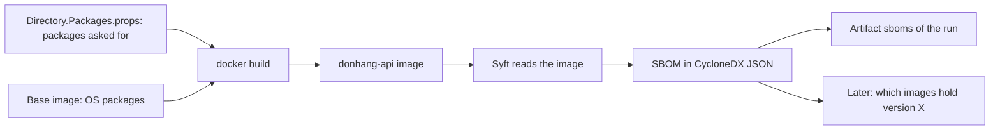

## Bạn cần biết trước

- [[devops.l3.pinning-by-content]] — bạn biết lock file ghi lại mọi package của một project, cả trực tiếp lẫn bắc cầu, đúng như mã nguồn khai báo.
- [[devops.l2.building-images-in-ci]] — bạn biết job `image` build các image của Đơn Hàng một lần mỗi lần chạy, và các job sau dùng lại chính các image đó.
- [[devops.l2.workflow-artifacts]] — bạn biết một job giữ file lại cùng lần chạy bằng cách upload nó thành artifact.

## Tình huống

Một sáng thứ Hai, Đơn Hàng đang ở `stage-3`. Một thông báo bảo mật cho biết một phiên bản của một thư viện đọc JWT có lỗi nghiêm trọng, và trưởng nhóm hỏi image api có mang thư viện đó không. Bạn mở `Directory.Packages.props`, file liệt kê các package mà các project của Đơn Hàng yêu cầu, không thấy package nào tên như vậy, và trả lời là không.

Một đồng nghiệp thì không chắc lắm. `Microsoft.AspNetCore.Authentication.JwtBearer` có trong danh sách, và nó phải dùng thứ gì đó để đọc token. Image cũng không chỉ chứa code của Đơn Hàng: `mcr.microsoft.com/dotnet/aspnet:10.0` mang theo cả bộ thư viện của một hệ điều hành, và không file nào trong repository ghi tên chúng. Làm sao biết thứ gì thật sự nằm trong image bạn đem đi chạy?

## Khái niệm cốt lõi

- **SBOM (software bill of materials)** (danh sách máy đọc được mọi thành phần bên trong một phần mềm, kèm phiên bản và loại) — mỗi thành phần có tên, phiên bản và loại, ví dụ package NuGet (package mà một project .NET phụ thuộc vào, loại mà `Directory.Packages.props` liệt kê) hay package hệ điều hành (thư viện hoặc chương trình được cài vào hệ điều hành của image, nằm ngoài mọi project .NET).
- Syft — công cụ đọc một image đã build và ghi ra SBOM của nó.
- CycloneDX — một định dạng chuẩn cho SBOM. Đơn Hàng ghi dạng JSON của nó, nên bất kỳ công cụ nào đọc được CycloneDX đều dùng được danh sách mà không cần image.
- Package URL — mã định danh `pkg:` gắn với mỗi package Syft tìm thấy, lưu dưới khóa `purl` trong JSON. Phần đầu của nó cho biết loại: `pkg:deb/…` là package hệ điều hành theo định dạng package Debian, định dạng mà Ubuntu, hệ điều hành Linux bên trong base image `aspnet:10.0`, sử dụng. `pkg:nuget/…` là package NuGet.

## Cơ chế hoạt động



Trong tình huống ở trên, file bạn tìm chỉ mô tả những gì Đơn Hàng yêu cầu. Image mới là thứ `docker build` làm ra từ đó: các package hệ điều hành (của base image, cộng thêm package mà Dockerfile cài), app đã publish, và mọi package app cần để chạy, trực tiếp hay bắc cầu. Chỉ image chứa cùng lúc cả package hệ điều hành lẫn danh sách package đầy đủ của app, nên SBOM được tạo từ image.

Syft mở image và đọc những gì bản build để lại: danh sách package đã cài mà hệ điều hành tự lưu, và các file `deps.json` ghi tên package .NET, gồm file publish cạnh app và file riêng của .NET runtime trong base image. Với mỗi thành phần nhận ra được, Syft ghi tên, phiên bản và package URL, tất cả dưới dạng CycloneDX JSON.

SBOM là một file theo định dạng chuẩn, nên công cụ khác có thể đọc nó sau này, trên máy khác, mà không cần pull image. Công cụ quét ở bài sau làm đúng như vậy.

Trong CI, job `image` tạo một SBOM cho mỗi image, ngay sau khi build và từ chính các image đó, rồi upload các file thành artifact của lần chạy. Vì vậy danh sách mô tả thứ sẽ chạy, không phải thứ mã nguồn khai báo.

SBOM ghi lại thứ gì nằm bên trong, không cho biết thứ đó có an toàn hay không. Giá trị của nó lộ ra về sau: khi một lỗi trong một phiên bản package được công bố, bạn tìm tên và phiên bản đó trong các SBOM đã lưu, thay vì build lại image hay đoán từ file project.

## Trong hệ thống Đơn Hàng

Phần của `sbom.sh` tạo và đọc SBOM:

```bash file=scripts/devops/sbom.sh tag=stage-3 lines=18-42
# lesson: devops.l3.software-bill-of-materials
# Syft runs from its own image, named by digest like any base image. It reads
# the image through the Docker engine's socket and writes the SBOM, in the
# CycloneDX JSON format, to standard output.
syft=anchore/syft:v1.54.0@sha256:0356562f495d432056237fbea5cbc2d4839c9c75cd500784a66de2e7cc95ca7c
docker pull --quiet "$syft" >/dev/null
docker run --rm --volume /var/run/docker.sock:/var/run/docker.sock "$syft" \
  scan "docker:$image" --output cyclonedx-json --quiet > "$out"
echo "== $image -> $out"

# Every component has a package URL: pkg:deb/... for an OS package from the
# base image, pkg:nuget/... for a NuGet package inside the published app.
purls() { grep -o '"purl":"pkg:[^"]*' "$out" | cut -d'"' -f4; }
echo "== components by kind"
purls | cut -d/ -f1 | sort | uniq -c

# The packages Directory.Packages.props names, and the ones the image holds
# although no project file asks for them: transitive dependencies.
echo "== NuGet packages in the image that Directory.Packages.props does not list"
declared=$(grep -o 'PackageVersion Include="[^"]*"' Directory.Packages.props | cut -d'"' -f2)
purls | grep '^pkg:nuget/' | sed 's|^pkg:nuget/||; s|@| |' | sort -f \
  | while read -r name version; do
      case $name in DonHang.*) continue ;; esac  # Đơn Hàng's own code
      grep -qxF "$name" <<<"$declared" || echo "  $name $version"
    done
```

```text output=true
== donhang-api:stage-2 -> sbom/donhang-api.cdx.json
== components by kind
    102 pkg:deb
     34 pkg:nuget
== NuGet packages in the image that Directory.Packages.props does not list
  Microsoft.AspNetCore.App.Runtime.linux-x64 10.0.12
  Microsoft.Bcl.Cryptography 10.0.2
  Microsoft.EntityFrameworkCore 10.0.4
  Microsoft.EntityFrameworkCore.Abstractions 10.0.4
  Microsoft.EntityFrameworkCore.Relational 10.0.4
  Microsoft.IdentityModel.Abstractions 8.19.2
  Microsoft.IdentityModel.JsonWebTokens 8.19.2
  Microsoft.IdentityModel.Logging 8.19.2
  Microsoft.IdentityModel.Protocols 8.19.2
  Microsoft.IdentityModel.Protocols.OpenIdConnect 8.19.2
  Microsoft.IdentityModel.Tokens 8.19.2
  Microsoft.NETCore.App.Runtime.linux-x64 10.0.12
  Microsoft.OpenApi 2.12.0
  OpenTelemetry 1.15.3
  OpenTelemetry.Api 1.15.3
  OpenTelemetry.Api.ProviderBuilderExtensions 1.15.3
  prometheus-net 8.2.1
  RESPite 3.3.1
  System.IdentityModel.Tokens.Jwt 8.19.2
  System.IO.Hashing 10.0.12
```

Dòng 22–25 chạy Syft từ image riêng của nó, ghim bằng digest, và trao cho nó `/var/run/docker.sock`, file mà các chương trình dùng để nói chuyện với Docker engine, để Syft đọc được `donhang-api:stage-2` trên máy bạn. `--output cyclonedx-json` chọn định dạng. Dòng 30–32 đếm thành phần theo loại ghi trong package URL. Dòng 36–42 in ra từng package NuGet trong image mà `Directory.Packages.props` không ghi tên, bỏ qua code của chính Đơn Hàng, tức mục `DonHang.Api`, ở dòng 40.

Kết quả này trả lời tình huống. Package hệ điều hành nhiều hơn package NuGet, và không package nào trong số đó có mặt trong file project. Danh sách thứ hai chứa các thư viện xử lý token, như `Microsoft.IdentityModel.Tokens` và `System.IdentityModel.Tokens.Jwt`: đó là phụ thuộc bắc cầu, và `DonHang.Api/packages.lock.json` cho thấy chúng tới qua `Microsoft.AspNetCore.Authentication.JwtBearer`.

Bước SBOM của job `image`. Comment của nó cũng nhắc tới việc job `publish` làm với các file, phần đó thuộc về một bài sau:

```yaml file=.github/workflows/ci.yml tag=stage-3 lines=117-130
      # lesson: devops.l3.software-bill-of-materials
      # One SBOM per image, made by Syft from the image this job just built,
      # so it lists what will run, not what the project files declare. The
      # SBOMs are kept as an artifact of the run, and publish attests them.
      - name: Write an SBOM of each image
        run: |
          for image in $IMAGES; do
            scripts/devops/sbom.sh "$image"
          done

      - uses: actions/upload-artifact@ea165f8d65b6e75b540449e92b4886f43607fa02 # v4.6.2
        with:
          name: sboms
          path: sbom/*.cdx.json
```

Dòng 123–125 chạy cùng script với lab cho từng image trong `$IMAGES`, các image mà job vừa build ngay trước đó, nằm ngoài đoạn trích. Dòng 127–130 upload mọi file SBOM thành một artifact tên `sboms`.

## Senior hay nhầm rằng…

- **"`Directory.Packages.props` cộng với `pubspec.lock` đã là SBOM của image api rồi."** → Thực ra `pubspec.lock` thuộc về `DonHang.App`, thứ hoàn toàn không có trong image api, còn `Directory.Packages.props` ghi các package mà mọi project của Đơn Hàng yêu cầu, kể cả package test như `xunit` không bao giờ vào image. Cả hai đều không ghi package bắc cầu hay package hệ điều hành nào. Ngay cả `DonHang.Api/packages.lock.json`, file có liệt kê package bắc cầu, cũng chỉ mô tả mã nguồn, không mô tả base image. Bạn sẽ nhận ra khi một thông báo nêu tên một package mà bạn không tìm thấy trong file project nào, còn `sbom.sh` lại cho thấy nó nằm trong image.
- **"Image đã có SBOM nghĩa là đã được kiểm tra lỗ hổng."** → Thực ra tạo danh sách không đối chiếu gì với các lỗi đã công bố: `sbom.sh` chỉ đọc image và ghi ra những gì tìm thấy. Một lỗi công bố tháng sau cũng không làm file thay đổi: danh sách vẫn đúng, chỉ ý nghĩa của nó đổi. Bạn sẽ nhận ra khi artifact `sboms` của một lần chạy cũ liệt kê một phiên bản mà thông báo sau này gọi là có lỗ hổng, dù lần chạy đó xanh.

## Thử ngay (3 phút)

Trong thư mục repository `don-hang`, checkout ở `stage-3`:

1. Chạy `scripts/devops/sbom.sh`. Không truyền tham số thì script đọc `donhang-api:stage-2`. Nếu image đó chưa có trên máy, script sẽ báo, khi đó build nó bằng `docker compose build api` rồi chạy lại script.
2. Chạy `grep -c IdentityModel Directory.Packages.props` (`grep -c` in ra số dòng chứa đoạn chữ đó).

Kết quả mong đợi: script in ra hai loại, `pkg:deb` và `pkg:nuget`, cùng một danh sách có `Microsoft.IdentityModel.Tokens 8.19.2`. `grep` in ra `0`. Image chứa một thư viện token mà không file project nào ghi tên.

Giờ hãy nghĩ thử. Một thông báo nêu lỗi trong một phiên bản của một package Ubuntu mà base image `aspnet:10.0` cài sẵn. File nào cho bạn biết image api có chứa nó không, và file nào không cho biết được?

<details><summary>Gợi ý đáp án</summary>

SBOM cho biết được: `sbom/donhang-api.cdx.json` trên máy, hoặc artifact `sboms` của lần chạy CI đã build image, liệt kê mọi thành phần `pkg:deb` kèm phiên bản. `DonHang.Api/packages.lock.json` và `Directory.Packages.props` thì không, vì chúng chỉ mô tả package NuGet, và không file project nào liệt kê package hệ điều hành.

</details>

## Liên hệ

- [[devops.l3.pinning-by-content]] — lock file là danh sách mã nguồn khai báo, SBOM là danh sách image đã build thật sự chứa.
- [[devops.l1.multi-stage-builds]] — lý do SBOM của image api liệt kê package của base image runtime chứ không phải của SDK: chỉ stage cuối mới thành image.
- [[devops.l2.workflow-artifacts]] — cơ chế giữ `sboms` của mỗi lần chạy bên cạnh các image mà nó mô tả.
- [[devops.l3.vulnerability-scanning]] — bước tiếp theo: một công cụ quét đọc các file SBOM này và đối chiếu từng phiên bản với các lỗi đã công bố.

## Tóm tắt 5 dòng

1. SBOM liệt kê các thành phần tìm thấy bên trong image đã build, kèm tên, phiên bản và loại, chứ không chỉ những gì file project khai báo.
2. Syft đọc image api và tìm ra package hệ điều hành, của base image lẫn của Dockerfile, bên cạnh package NuGet của app và của .NET runtime.
3. SBOM của image cho thấy package bắc cầu và package của base image mà `Directory.Packages.props` không bao giờ ghi tên.
4. Đơn Hàng ghi SBOM dưới dạng CycloneDX JSON, một định dạng công khai mà công cụ khác đọc được không cần image.
5. Job `image` tạo một SBOM cho mỗi image đã build và giữ chúng thành artifact `sboms`. SBOM là bản kiểm kê, không phải bước kiểm tra an toàn.
