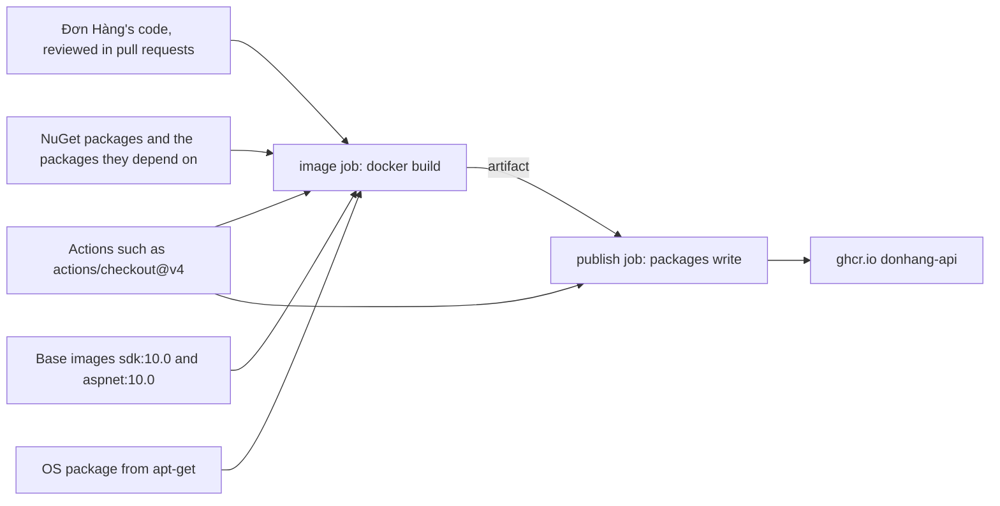

## Before you start

- [[devops.l2.cutting-a-release]] — you know a release only gives a second tag to images CI already pushed, so what CI builds is what ships.
- [[devops.l2.pushing-images-from-ci]] — you know the `publish` job pushes to `ghcr.io` with a `GITHUB_TOKEN` that `permissions:` grants `packages: write`.
- [[devops.l2.dependency-cache]] — you know `dotnet restore` downloads packages at the versions `Directory.Packages.props` declares.
- [[devops.l1.multi-stage-builds]] — you know the api image starts from the runtime image and keeps only what the `final` stage copies.

## The situation

After a merge to `master`, the `publish` job pushes `ghcr.io/duyan11110/donhang-api` with a new `sha-` tag. A teammate filling in a security checklist asks who wrote the code in that image. You start with the pull requests your team merged.

Then you open `DonHang.Api/Dockerfile`: the image starts from `mcr.microsoft.com/dotnet/aspnet:10.0`, `dotnet restore` downloads the packages the api's projects reference, at the versions `Directory.Packages.props` sets, and the CI run that built it executed actions from other people's repositories. Your team reviewed every line of its own code. Nobody on the team has read the rest. What goes into the image you ship, and who besides your team can change it?

## Core concepts

- **software supply chain** — every input that goes into what you ship, such as packages, base images, build tools and CI actions, plus the steps that turn them into it; for Đơn Hàng, everything that ends up in `donhang-api` on `ghcr.io`.
- Input — anything the build fetches from outside your repository by a name: a package version on nuget.org, a base image tag on `mcr.microsoft.com`, an action tag on GitHub.
- Base image — the image a `FROM` line starts from; the `final` stage's base image ships inside yours, while a build stage's base image only runs the build.
- Third-party action — a step written `uses: owner/name@tag`, whose code lives in another repository and runs inside your job.

## How it works



Five kinds of input meet in the `image` job, and only the first, Đơn Hàng's code, passes through your team's pull requests.

The second is NuGet packages. `dotnet restore` downloads each package the api's projects reference, at the version `Directory.Packages.props` sets, plus the packages those depend on, which the file does not list. NuGet picks their versions, and aims to pick the same ones while the inputs stay the same. `dotnet publish` puts their compiled code next to yours.

The third is base images. The `build` stage runs inside `sdk:10.0`, the build tools, which compile your code but do not ship. The `final` stage starts from `aspnet:10.0`, so every file in it ships. That image contains a small Linux system, and `apt-get` is that system's command for downloading extra libraries, its operating system packages, from the distribution's servers. The fourth input is the one `apt-get` downloads during the build. The fifth is actions: code written by other people that runs inside the job, with access to what the job has.

The image then travels as an artifact to the `publish` job, which runs another action, holds `packages: write` and pushes it to `ghcr.io`.

Each input is named by something its owner can change. Microsoft moves the `10.0` tag to a new image when it publishes an update. An action's `v4` is a Git tag in someone else's repository. A Git tag stays on its commit only by convention: whoever controls that repository can delete it and create it again on another commit. A package's new code reaches you through a commit that changes only a version number; the code behind that number is not in the diff.

In the situation above, the software supply chain is the whole diagram, and your team's review covers one box.

## In the Đơn Hàng system

The stage that becomes the api image:

```dockerfile file=DonHang.Api/Dockerfile tag=stage-2 lines=36-46
# The api's image: the default target, because it is the last stage.
FROM mcr.microsoft.com/dotnet/aspnet:10.0 AS final
WORKDIR /app
# Npgsql probes for Kerberos/GSSAPI support at startup; without this library
# present that probe logs a scary but harmless "cannot open shared object" line.
RUN apt-get update && apt-get install -y --no-install-recommends libgssapi-krb5-2 \
    && rm -rf /var/lib/apt/lists/*
COPY --from=build /app .
EXPOSE 8080
ENV ASPNETCORE_URLS=http://+:8080
ENTRYPOINT ["dotnet", "DonHang.Api.dll"]
```

Line 37 makes every file of `aspnet:10.0` part of the image, chosen by a tag Microsoft controls. Line 41 asks the operating system's package servers for a library at build time; the comment above it only says why the api needs it. The Dockerfile names the package, not the version that arrives. Line 43 copies the output of the `build` stage, which holds Đơn Hàng's compiled code and the NuGet packages' compiled code together. That stage starts from `sdk:10.0` at line 5 and runs `dotnet restore` at line 12, both outside the excerpt.

The job that can push under Đơn Hàng's name:

```yaml file=.github/workflows/ci.yml tag=stage-2 lines=130-152
  # lesson: devops.l2.pushing-images-from-ci
  # Only master's green commits reach the registry. The job logs in with the
  # GITHUB_TOKEN GitHub creates for this run, which may push packages only
  # because `permissions:` says so. It pushes the images the tests passed
  # with: loaded from the artifact, never rebuilt.
  publish:
    if: github.event_name == 'push' && github.ref == 'refs/heads/master'
    needs: [test, image]
    runs-on: ubuntu-24.04
    permissions:
      packages: write
    steps:
      - uses: actions/download-artifact@v4
        with:
          name: images

      - name: Load the images
        run: docker load --input images.tar

      - name: Log in to GitHub Container Registry
        env:
          GITHUB_TOKEN: ${{ secrets.GITHUB_TOKEN }}
        run: echo "$GITHUB_TOKEN" | docker login ghcr.io --username "$GITHUB_ACTOR" --password-stdin
```

Lines 139–140 give this job's `GITHUB_TOKEN` the right to push packages. Line 142 runs `actions/download-artifact@v4`, code from another repository, in this same job.

Lines 151–152 pass the token to `docker login` explicitly, but an action does not need that. GitHub makes the job's token available to every action in the job under the name `github.token`, whether or not the workflow passes it. So any code this job runs, including whatever commit the `v4` tag names on the day of the run, could push an image to `ghcr.io` under Đơn Hàng's name.

The other jobs add more inputs: `actions/checkout@v4` starts most of them, and the `app` job runs `subosito/flutter-action@v2` (line 48, outside the excerpt) to install Flutter. The rest of this module answers three questions about these inputs. Is each input the one you reviewed? What is inside the image, and does any of it have a known vulnerability, a publicly reported weakness in a specific version of a package? Was the running image built by your pipeline?

## Seniors often assume…

- **"Supply-chain security means checking the final image for known vulnerabilities."** → Actually such a check looks for vulnerabilities already known and published for what it finds in the image. Code put in on purpose that nobody has reported is not on that list, and the check cannot tell who built the image. You notice this when a check of the image reports nothing, yet nobody can say which commit of `actions/checkout` ran in the job that built it.
- **"A package from a well-known registry such as nuget.org cannot contain malicious code."** → Actually nuget.org distributes what each package's owners publish, and nobody on your team reads that code before `dotnet restore` downloads it. A package can also run code while you build, through files it adds to your project that the build tools run while compiling, not only when the app runs. You notice this with `Microsoft.EntityFrameworkCore.Design`: the package contains a `.props` file in its `build` folder, which restore adds to the build of each project that references it.
- **"A third-party GitHub Action can touch only the files on the runner it runs on."** → Actually an action runs as code inside the job, with the job's network access and its `GITHUB_TOKEN`, which the action can read even when the workflow does not pass it. You notice this in the `publish` job: `actions/download-artifact@v4` runs in the job granted `packages: write`.

## Try it (3 minutes)

In the `don-hang` repository folder:

1. Run `git show stage-2:.github/workflows/ci.yml | grep -n "uses:"`.
2. For each line, write down which repository the code comes from. To find the job that runs it, open `ci.yml` at that tag and look upward from the line number to the nearest job name.

Expected result: 15 lines naming six different actions. Five come from `actions/` and one, `subosito/flutter-action@v2`, from another owner. Each is named by a tag such as `@v4` or `@v2`.

Which of these actions run in the job that holds `packages: write`, and what else does `ci.yml` download that this `grep` does not show?

<details><summary>Suggested answer</summary>

Only `actions/download-artifact@v4`, at line 142, runs in `publish`; it is enough, because it can reach that job's token. The `grep` misses inputs fetched by `run:` steps: the `manifests` job runs the image `ghcr.io/yannh/kubeconform`, a tool that checks Kubernetes manifests (line 178), and the `k8s` job downloads `kind`, a tool that starts a small Kubernetes cluster inside Docker, and `kubectl` in a `run:` step (lines 198–199). Those jobs cannot push packages, but they are part of the chain all the same.

</details>

## Connections

- [[devops.l3.pinning-by-content]] — next, and the answer to the first question: naming each input by a hash of its content instead of a tag its owner can move.
- [[devops.l3.software-bill-of-materials]] — the answer to the second question's first half: a list of everything inside the image.
- [[devops.l3.verifying-before-deploy]] — the end of the answer to the third question: deploying only images your pipeline can be shown to have built.
- [[devops.l2.image-tags-and-digests]] — the tag-versus-digest difference this module builds on: a tag can be moved, a digest names one exact image.
- [[devops.l3.deploying-by-commit]] — there staging runs whatever tag a commit names; this lesson asks what that tag contains and who could change it.

## Five-line summary

1. Your api image is mostly inputs your team never wrote: packages, base images, build tools and CI actions, plus the steps that combine them.
2. It holds Đơn Hàng's code, the NuGet packages and the packages they depend on, and everything in `aspnet:10.0`, including operating system packages.
3. Actions in `ci.yml` run as code inside their jobs with the job's token; in `publish`, that token can push to `ghcr.io`.
4. Whoever controls a package release, a base image tag or an action tag can change your image without that code appearing in any reviewed diff.
5. The defences ask three questions: is each input the one you reviewed, what is inside and is any known vulnerable, did your pipeline build it.
