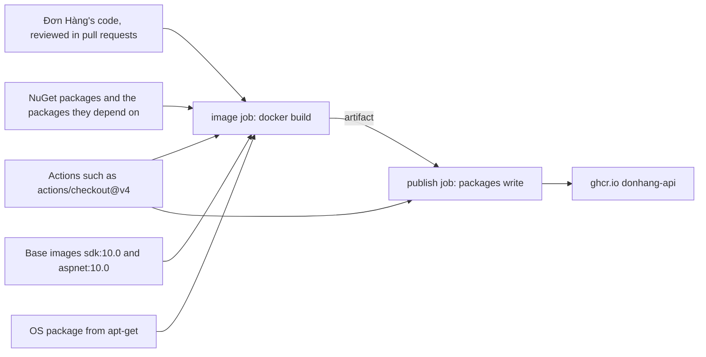

## Bạn cần biết trước

- [[devops.l2.cutting-a-release]] — bạn biết một release chỉ gắn thêm tag thứ hai cho image mà CI đã push, nên thứ CI build chính là thứ được deploy.
- [[devops.l2.pushing-images-from-ci]] — bạn biết job `publish` push lên `ghcr.io` bằng một `GITHUB_TOKEN` được `permissions:` cấp quyền `packages: write`.
- [[devops.l2.dependency-cache]] — bạn biết `dotnet restore` tải các package về đúng phiên bản mà `Directory.Packages.props` khai báo.
- [[devops.l1.multi-stage-builds]] — bạn biết image api bắt đầu từ image runtime và chỉ giữ những gì stage `final` chép vào.

## Tình huống

Sau một lần merge vào `master`, job `publish` push `ghcr.io/duyan11110/donhang-api` với một tag `sha-` mới. Một đồng nghiệp đang điền checklist bảo mật hỏi: code trong image đó do ai viết? Bạn bắt đầu từ các pull request mà team đã merge.

Rồi bạn mở `DonHang.Api/Dockerfile`. Image bắt đầu từ `mcr.microsoft.com/dotnet/aspnet:10.0`. `dotnet restore` tải các package mà những project của api tham chiếu, ở phiên bản `Directory.Packages.props` đặt. Lần chạy CI build ra image còn chạy cả những action nằm trong repository của người khác. Team đã review từng dòng code của chính mình. Phần còn lại thì chưa ai trong team đọc. Image bạn deploy chứa những gì, và ngoài team ra, còn ai thay đổi được nó?

## Khái niệm cốt lõi

- **chuỗi cung ứng phần mềm** (software supply chain) — mọi đầu vào đi vào thứ bạn deploy, như package, base image, công cụ build và action CI, cộng với các bước biến chúng thành thứ đó. Với Đơn Hàng, đó là mọi thứ nằm trong `donhang-api` trên `ghcr.io`.
- Đầu vào — bất cứ thứ gì lần build lấy từ ngoài repository của bạn theo một cái tên: một phiên bản package trên nuget.org, một tag base image trên `mcr.microsoft.com`, một tag action trên GitHub.
- Base image — image mà một dòng `FROM` bắt đầu từ đó. Base image của stage `final` nằm luôn trong image của bạn khi deploy, còn base image của một stage build chỉ dùng để chạy lần build.
- Action bên thứ ba — một bước viết dạng `uses: owner/name@tag`, có code nằm ở repository khác và chạy ngay trong job của bạn.

## Cơ chế hoạt động



Năm loại đầu vào gặp nhau ở job `image`, và chỉ loại đầu tiên, code của Đơn Hàng, đi qua pull request của team.

Loại thứ hai là các NuGet package. `dotnet restore` tải từng package mà các project của api tham chiếu, ở phiên bản `Directory.Packages.props` đặt, cộng thêm những package mà chúng cần đến, thứ file này không liệt kê. NuGet tự chọn phiên bản cho nhóm sau, và cố chọn lại đúng những phiên bản đó chừng nào đầu vào chưa đổi. `dotnet publish` đặt code đã biên dịch của chúng cạnh code của bạn.

Loại thứ ba là base image. Stage `build` chạy bên trong `sdk:10.0`, bộ công cụ build: chúng biên dịch code của bạn nhưng không được deploy. Stage `final` bắt đầu từ `aspnet:10.0`, nên mọi file trong đó đều được deploy. Image này chứa một hệ thống Linux nhỏ, và `apt-get` là lệnh của hệ thống đó để tải thêm thư viện, tức các package hệ điều hành, từ server của bản phân phối. Loại thứ tư chính là thứ `apt-get` tải về trong lúc build. Loại thứ năm là các action: code người khác viết, chạy ngay trong job, với quyền truy cập vào những gì job có.

Sau đó image đi dưới dạng artifact tới job `publish`. Job này chạy thêm một action, giữ quyền `packages: write` và push image lên `ghcr.io`.

Mỗi đầu vào được gọi bằng một cái tên mà chủ của nó đổi được. Microsoft chuyển tag `10.0` sang image mới khi phát hành bản cập nhật. `v4` của một action là một Git tag trong repository của người khác. Git tag nằm yên trên commit của nó chỉ nhờ quy ước: ai kiểm soát repository đó đều xóa được tag rồi tạo lại nó trên commit khác. Code mới của một package tới tay bạn qua một commit chỉ đổi số phiên bản. Code đằng sau con số đó không có trong diff.

Trong tình huống trên, chuỗi cung ứng phần mềm là toàn bộ sơ đồ, còn phần review của team chỉ phủ một ô.

## Trong hệ thống Đơn Hàng

Stage trở thành image api:

```dockerfile file=DonHang.Api/Dockerfile tag=stage-2 lines=36-46
# The api's image: the default target, because it is the last stage.
FROM mcr.microsoft.com/dotnet/aspnet:10.0 AS final
WORKDIR /app
# Npgsql probes for Kerberos/GSSAPI support at startup; without this library
# present that probe logs a scary but harmless "cannot open shared object" line.
RUN apt-get update && apt-get install -y --no-install-recommends libgssapi-krb5-2 \
    && rm -rf /var/lib/apt/lists/*
COPY --from=build /app .
EXPOSE 8080
ENV ASPNETCORE_URLS=http://+:8080
ENTRYPOINT ["dotnet", "DonHang.Api.dll"]
```

Dòng 37 đưa mọi file của `aspnet:10.0` vào image, chọn theo một tag do Microsoft kiểm soát. Dòng 41 xin server package của hệ điều hành một thư viện lúc build. Comment phía trên chỉ giải thích vì sao api cần nó. Dockerfile nêu tên package, không nêu phiên bản sẽ được tải về. Dòng 43 chép output của stage `build`, nơi code đã biên dịch của Đơn Hàng nằm chung với code đã biên dịch của các NuGet package. Stage đó bắt đầu từ `sdk:10.0` ở dòng 5 và chạy `dotnet restore` ở dòng 12, cả hai nằm ngoài đoạn trích.

Job có thể push dưới tên Đơn Hàng:

```yaml file=.github/workflows/ci.yml tag=stage-2 lines=130-152
  # lesson: devops.l2.pushing-images-from-ci
  # Only master's green commits reach the registry. The job logs in with the
  # GITHUB_TOKEN GitHub creates for this run, which may push packages only
  # because `permissions:` says so. It pushes the images the tests passed
  # with: loaded from the artifact, never rebuilt.
  publish:
    if: github.event_name == 'push' && github.ref == 'refs/heads/master'
    needs: [test, image]
    runs-on: ubuntu-24.04
    permissions:
      packages: write
    steps:
      - uses: actions/download-artifact@v4
        with:
          name: images

      - name: Load the images
        run: docker load --input images.tar

      - name: Log in to GitHub Container Registry
        env:
          GITHUB_TOKEN: ${{ secrets.GITHUB_TOKEN }}
        run: echo "$GITHUB_TOKEN" | docker login ghcr.io --username "$GITHUB_ACTOR" --password-stdin
```

Dòng 139–140 cho `GITHUB_TOKEN` của job này quyền push package. Dòng 142 chạy `actions/download-artifact@v4`, code từ một repository khác, ngay trong job này.

Dòng 151–152 truyền thẳng token cho `docker login`, nhưng action thì không cần thế. GitHub cung cấp token của job cho mọi action trong job dưới tên `github.token`, dù workflow có truyền hay không. Vậy bất kỳ code nào job này chạy, kể cả commit mà tag `v4` trỏ tới vào ngày chạy, đều có thể push một image lên `ghcr.io` dưới tên Đơn Hàng.

Các job khác thêm đầu vào nữa: phần lớn chúng mở đầu bằng `actions/checkout@v4`, và job `app` chạy `subosito/flutter-action@v2` (dòng 48, ngoài đoạn trích) để cài Flutter. Phần còn lại của module trả lời ba câu hỏi về các đầu vào này. Mỗi đầu vào có đúng là thứ bạn đã review không? Bên trong image có gì, và có thứ nào mang lỗ hổng đã biết, tức một điểm yếu đã được báo công khai ở một phiên bản cụ thể của package? Image đang chạy có phải do pipeline của bạn build không?

## Senior hay nhầm rằng…

- **"Bảo mật chuỗi cung ứng nghĩa là kiểm tra image cuối cùng xem có lỗ hổng đã biết không."** → Thực ra kiểu kiểm tra đó chỉ tìm các lỗ hổng đã được biết và công bố cho những thứ nó thấy trong image. Code bị cố ý cài vào mà chưa ai báo thì không có trong danh sách đó, và kiểu kiểm tra này cũng không cho biết ai đã build image. Bạn sẽ nhận ra khi lần kiểm tra image không báo gì, vậy mà không ai nói được commit nào của `actions/checkout` đã chạy trong job build ra nó.
- **"Package từ một registry nổi tiếng như nuget.org thì không thể chứa code độc hại."** → Thực ra nuget.org phát hành những gì chủ của từng package publish, và không ai trong team đọc code đó trước khi `dotnet restore` tải về. Một package còn có thể chạy code ngay lúc bạn build, qua những file nó thêm vào project mà công cụ build chạy trong lúc biên dịch, chứ không chỉ khi app chạy. Bạn sẽ nhận ra điều này với `Microsoft.EntityFrameworkCore.Design`: package này chứa một file `.props` trong thư mục `build`, và restore thêm file đó vào lần build của mỗi project tham chiếu tới nó.
- **"Một GitHub Action bên thứ ba chỉ đụng được tới các file trên runner nơi nó chạy."** → Thực ra action chạy như code bên trong job, với quyền truy cập mạng của job và `GITHUB_TOKEN` của job, thứ action đọc được kể cả khi workflow không truyền vào. Bạn sẽ nhận ra trong job `publish`: `actions/download-artifact@v4` chạy trong job được cấp `packages: write`.

## Thử ngay (3 phút)

Trong thư mục repository `don-hang`:

1. Chạy `git show stage-2:.github/workflows/ci.yml | grep -n "uses:"`.
2. Với mỗi dòng, ghi lại code đến từ repository nào. Để tìm job chạy nó, mở `ci.yml` ở tag đó rồi đi ngược lên từ số dòng tới tên job gần nhất.

Kết quả mong đợi: 15 dòng, nêu tên sáu action khác nhau. Năm action đến từ `actions/`, một action, `subosito/flutter-action@v2`, đến từ chủ khác. Mỗi action được gọi bằng một tag như `@v4` hay `@v2`.

Những action nào chạy trong job giữ `packages: write`, và `ci.yml` còn tải về những gì mà lệnh `grep` này không cho thấy?

<details><summary>Gợi ý đáp án</summary>

Chỉ có `actions/download-artifact@v4`, ở dòng 142, chạy trong `publish`. Một action là đủ, vì nó với tới được token của job đó. `grep` bỏ sót các đầu vào do bước `run:` tải về: job `manifests` chạy image `ghcr.io/yannh/kubeconform`, công cụ kiểm tra manifest Kubernetes (dòng 178), còn job `k8s` tải `kind`, công cụ dựng một cluster Kubernetes nhỏ bên trong Docker, và `kubectl` trong một bước `run:` (dòng 198–199). Các job đó không push được package, nhưng vẫn là một phần của chuỗi.

</details>

## Liên hệ

- [[devops.l3.pinning-by-content]] — bài tiếp theo, và là lời đáp cho câu hỏi thứ nhất: gọi mỗi đầu vào bằng hash nội dung của nó thay vì một tag mà chủ của nó dời được.
- [[devops.l3.software-bill-of-materials]] — lời đáp cho nửa đầu câu hỏi thứ hai: danh sách mọi thứ bên trong image.
- [[devops.l3.verifying-before-deploy]] — đoạn cuối của lời đáp cho câu hỏi thứ ba: chỉ deploy những image chứng minh được là do pipeline của bạn build.
- [[devops.l2.image-tags-and-digests]] — khác biệt giữa tag và digest mà module này dựa vào: tag dời được, còn digest chỉ đúng một image.
- [[devops.l3.deploying-by-commit]] — ở đó staging chạy bất cứ tag nào một commit nêu ra. Bài này hỏi tag đó chứa gì và ai đổi được nó.

## Tóm tắt 5 dòng

1. Image api của bạn phần lớn là đầu vào team không hề viết: package, base image, công cụ build và action CI, cộng các bước ghép chúng lại.
2. Nó chứa code của Đơn Hàng, các NuGet package và những package chúng cần đến, cùng mọi thứ trong `aspnet:10.0`, kể cả package hệ điều hành.
3. Các action trong `ci.yml` chạy như code bên trong job, với token của job. Trong `publish`, token đó push được lên `ghcr.io`.
4. Ai kiểm soát một bản phát hành package, một tag base image hay một tag action đều đổi được image của bạn mà code đó không hiện trong diff nào đã review.
5. Các lớp phòng vệ hỏi ba câu: mỗi đầu vào có đúng thứ bạn đã review, bên trong có gì và có thứ nào mang lỗ hổng đã biết, pipeline của bạn có build ra nó không.
