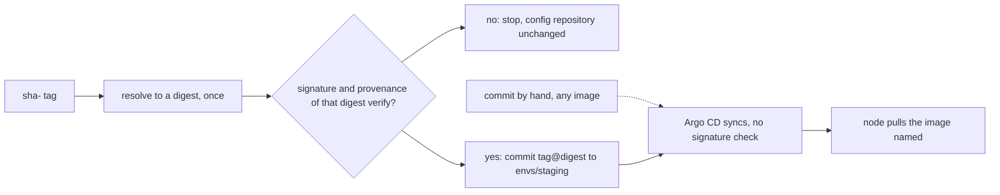

## Before you start

- [[devops.l3.build-provenance]] — you know `verify-image.sh` checks the signature and provenance of a digest, and refuses `1.0.0`.
- [[devops.l3.deploying-by-commit]] — you know a commit to `envs/staging` changes the image staging runs, and Argo CD syncs it by itself.
- [[devops.l2.image-tags-and-digests]] — you know a tag can be moved to another image, while a digest names one image for good.

## The situation

In the gitops module, `gitops-deploy.sh` committed `1.0.0` to `envs/staging`, and Argo CD rolled it out. In the last lesson, `verify-image.sh` refused that same `1.0.0`: it has no signature and no provenance. So staging has already run an image that fails your check, and nothing objected. The check exists, but it sits beside the deploy, as a script someone has to remember. Even when someone runs it, they check a tag, and the commit that follows names the tag again; between the two, anyone who can push to that name in `ghcr.io` can move it.

Where must the check sit so a failing image never reaches staging, and how do you make sure what runs is what passed?

## Core concepts

- Deploy path — the step every change to what an environment runs has to pass through; in the lab, for staging, it is a commit to `envs/staging` in the config repository, which Argo CD syncs.
- Check on the deploy path — a check that the deploy step runs itself, so the deploy cannot happen without it.
- Tag and digest together — an image written as `name:tag@sha256:…`, which keeps the readable tag but lets the digest decide which image is pulled.
- Failing closed — stopping when a check cannot give an answer, for example when the registry cannot be reached, instead of letting the deploy through unchecked.

## How it works



In the situation above, the deploy path is the commit to `envs/staging`: Argo CD applies whatever that folder names, so a check anywhere else is only advice. `deploy-verified.sh` moves the check into the step that makes the commit. It asks the registry once for the digest the tag names right now, then works only with that digest. It runs `verify-image.sh` on the digest of the api image and of the migrate image, and only when both pass does it write them into the manifests and commit.

The commit names each image as `tag@sha256:…`. When a reference carries both, Kubernetes uses only the digest for pulling, so the Pods run the image that was verified even if someone moves the tag later. The tag stays for people: it says which commit built the image.

For `1.0.0` the signature check fails and the script stops before changing any file. The same happens when the check cannot finish: without access to `ghcr.io`, no digest comes back and nothing is committed. The script fails closed. That means an outage can block a fix you need, so decide before that day who may deploy without the check and how, for example one named person committing by hand with the reason in the message. If your team instead lets deploys through when verification is down, the gap is open whenever it is down.

The dashed arrow is the gap. Argo CD 3.1 does not check image signatures; it syncs whatever a commit names. Anyone who can push to the config repository can still commit an unsigned image by hand, and it will run. Refusing an unverified image for every Pod needs a check inside the cluster when a Pod is created; this module installs none.

## In the Đơn Hàng system

The function that verifies and then commits, lines 13–30 of `deploy-verified.sh`:

```bash file=scripts/devops/deploy-verified.sh tag=stage-3 lines=13-30
# lesson: devops.l3.verifying-before-deploy
# The gate sits on the only path to staging: the commit that changes the
# image. Each tag is resolved to a digest once; that digest is verified and
# that digest is committed, so a tag moved in between changes nothing.
deploy_verified() {
  local tag=$1 api migrate
  api=$(digest_of "$registry/donhang-api:$tag")
  migrate=$(digest_of "$registry/donhang-migrate:$tag")
  [ -n "$api" ] && [ -n "$migrate" ] || { echo "no images tagged $tag in $registry"; return 1; }
  scripts/devops/verify-image.sh "$registry/donhang-api@$api" || return 1
  scripts/devops/verify-image.sh "$registry/donhang-migrate@$migrate" || return 1
  perl -pi -e "s|\Q$registry\E/donhang-api:\S+|$registry/donhang-api:$tag\@$api|" \
    "$config_repo/envs/staging/api.yaml"
  perl -pi -e "s|\Q$registry\E/donhang-migrate:\S+|$registry/donhang-migrate:$tag\@$migrate|" \
    "$config_repo/envs/staging/migrate-hook.yaml"
  git -C "$config_repo" diff --stat
  config_commit deploy-verified.sh "Deploy verified api $tag to staging"
}
```

Lines 19–20 resolve each tag to a digest, once; `$registry` is `ghcr.io/duyan11110` and `$config_repo` is the local clone of the config repository, both set outside the excerpt. `digest_of`, also outside, returns nothing when the registry has no such image or cannot be reached; line 21 then stops. Lines 22–23 pass `verify-image.sh` a digest, never the tag, and `|| return 1` leaves the function before any file changes. Lines 24–27 use `perl` as an in-place find-and-replace: they replace the image line in `api.yaml` and `migrate-hook.yaml` with `tag@digest`. In `deploy/gitops/config-repo/envs/staging/api.yaml`, which the config repository starts from, that line names the api by its `sha-` tag only. Line 29 calls `config_commit`, a helper outside the excerpt that commits and pushes.

The loop around it, lines 37–59:

```bash file=scripts/devops/deploy-verified.sh tag=stage-3 lines=37-59
before=$(config_head --verify)
for tag in "${tags[@]}"; do
  echo "== deploy $tag"
  if ! deploy_verified "$tag" 2>&1; then
    echo "== $tag did not verify: not deployed"
    [ "$(config_head --verify)" = "$before" ] && echo "the config repository is unchanged"
    [ $# -gt 0 ] && exit 1
    echo
    continue
  fi
  app_refresh
  # Healthy alone could still be the previous commit's state: first wait
  # for the sync of this commit to finish.
  app_wait_sync "$(config_head --verify)" >/dev/null
  app_wait Synced Healthy "$(config_head --verify)"
  kubectl rollout status deployment/api -n donhang --timeout=300s >/dev/null
  # With a digest in the image, the node pulls by digest: what runs is
  # what was verified, even if someone later moves the tag.
  echo "== what the api Pods run"
  kubectl get pods -n donhang -l app=api \
    -o jsonpath='{range .items[*]}{.spec.containers[0].image}{"\n"}{end}' | sort | uniq -c
  echo
done
```

```text output=true
== deploy 1.0.0
== ghcr.io/duyan11110/donhang-api@sha256:... -> ghcr.io/duyan11110/donhang-api@sha256:...
-- signature
Error: no signatures found
error during command execution: no signatures found
== 1.0.0 did not verify: not deployed
the config repository is unchanged

== deploy sha-...
== ghcr.io/duyan11110/donhang-api@sha256:... -> ghcr.io/duyan11110/donhang-api@sha256:...
-- signature
Verification for ghcr.io/duyan11110/donhang-api@sha256:... --
The following checks were performed on each of these signatures:
  - The cosign claims were validated
  - Existence of the claims in the transparency log was verified offline
  - The code-signing certificate was verified using trusted certificate authority certificates
-- provenance
built by https://github.com/duyan11110/don-hang, .github/workflows/ci.yml at commit ... (push)
verified
== ghcr.io/duyan11110/donhang-migrate@sha256:... -> ghcr.io/duyan11110/donhang-migrate@sha256:...
-- signature
Verification for ghcr.io/duyan11110/donhang-migrate@sha256:... --
The following checks were performed on each of these signatures:
  - The cosign claims were validated
  - Existence of the claims in the transparency log was verified offline
  - The code-signing certificate was verified using trusted certificate authority certificates
-- provenance
built by https://github.com/duyan11110/don-hang, .github/workflows/ci.yml at commit ... (push)
verified
 envs/staging/api.yaml          | 2 +-
 envs/staging/migrate-hook.yaml | 2 +-
 2 files changed, 2 insertions(+), 2 deletions(-)
staging: Synced, Healthy
== what the api Pods run
      2 ghcr.io/duyan11110/donhang-api:sha-...

== git log -- envs/staging
... deploy-verified.sh: Deploy verified api sha-... to staging
... rotate-db-password.sh: Rotate the database password of staging
... seal-secrets.sh: Seal staging's Secrets again
```

The output is from a run with no argument: the script then tries `1.0.0` and the newest published `sha-` tag in turn, and after the loop prints `git log -- envs/staging` (outside the excerpt). Line 37 records the config repository's commit; on a failure, line 42 compares again, and line 43 exits with status 1 when a tag was given. Only a commit reaches lines 47–51, whose helpers live outside the excerpt: `app_refresh` asks Argo CD to read the config repository now, and `app_wait_sync` and `app_wait` wait until Argo CD has synced this commit and reports Synced, Healthy.

In the output, each `== …@sha256:… -> …` line comes from `verify-image.sh`: the reference it was given, then the digest it checks. `1.0.0` stops at `no signatures found`, and the repository is unchanged. For the `sha-` tag, the three lines under `-- signature` are `cosign verify` reporting that its checks passed; nothing new happens there. The masked Pod line was `donhang-api:sha-<commit>@sha256:<digest>`: the single `...` after `sha-` hides both the commit id and the digest the commit wrote.

## Seniors often assume…

- **"Once CI signs every image, an unsigned image can no longer be deployed."** → Actually signing only adds a signature; nothing refuses an image without one unless a step on the deploy path asks for it. You notice this when `git log -- envs/staging` shows a commit naming `1.0.0`, which `verify-image.sh` refuses, and staging ran it.
- **"Argo CD refuses to sync an image whose signature does not verify."** → Actually Argo CD 3.1 compares the manifests with the cluster and applies them; it does not look at image signatures. The check has to run before the commit, or in the cluster when a Pod is created. You notice this when a commit naming `1.0.0` syncs like any other.
- **"A tag that was verified yesterday still names the verified image today."** → Actually a tag is a label in the registry that anyone who can push to the name can move, and verification is about a digest. You notice this when the Pods of one Deployment run different code under the same tag, because nodes pulled it at different times.

## Try it (3 minutes)

In the `don-hang` repository folder at `stage-3`, with `donhang-staging` from the gitops module running and access to `ghcr.io` and the internet:

1. Run `git -C .gitops/donhang-config rev-parse --short HEAD` and note the commit.
2. Run `scripts/devops/deploy-verified.sh 1.0.0`, then `echo $?`.
3. Run the command from step 1 again.

Expected result: the script prints `no signatures found`, `== 1.0.0 did not verify: not deployed` and `the config repository is unchanged`; `echo $?` prints `1`; both commands print the same commit.

Now think it through. A teammate edits `envs/staging/api.yaml` by hand to name `1.0.0` and pushes. What stops it?

<details><summary>Suggested answer</summary>

Nothing in this module. The commit did not go through `deploy-verified.sh`, and Argo CD syncs it without checking a signature, so staging runs `1.0.0`. Only a check inside the cluster, when the Pod is created, would refuse it. Without such a check, who may push to the config repository decides who can deploy.

</details>

## Connections

- [[devops.l3.build-provenance]] — prerequisite: the check this lesson moves onto the deploy path.
- [[devops.l3.deploying-by-commit]] — the same deploy commit, now made only after verification.
- [[k8s.l1.deploying-an-image-tag]] — the same image line, which there named a tag only.
- [[devops.l3.self-heal]] — why the commit is the deploy path: changes made in the cluster by hand are undone.
- [[k8s.l3.admission-policies]] — a check inside the cluster when a Pod is created: it refuses an image without a digest, though it cannot tell whether that digest was signed.

## Five-line summary

1. A check protects a deploy only when the deploy step itself runs it; in the lab, that step is the commit to `envs/staging`.
2. `deploy-verified.sh` resolves a tag to a digest once, verifies that digest's signature and provenance, then commits it.
3. The commit writes `tag@sha256:…`; Kubernetes pulls by the digest alone, so a moved tag changes nothing that runs.
4. Argo CD 3.1 does not check image signatures, so a commit made by hand still deploys an unsigned image.
5. When verification cannot finish, the script deploys nothing; decide in advance who may bypass it in an emergency.
