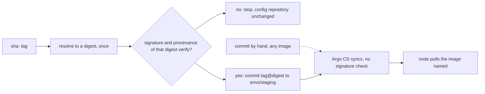

## Bạn cần biết trước

- [[devops.l3.build-provenance]] — bạn biết `verify-image.sh` kiểm chữ ký và provenance của một digest, và từ chối `1.0.0`.
- [[devops.l3.deploying-by-commit]] — bạn biết một commit vào `envs/staging` đổi image mà staging chạy, và Argo CD tự sync nó.
- [[devops.l2.image-tags-and-digests]] — bạn biết tag có thể bị chuyển sang image khác, còn digest gọi tên đúng một image mãi mãi.

## Tình huống

Ở module gitops, `gitops-deploy.sh` đã commit `1.0.0` vào `envs/staging`, và Argo CD triển khai nó. Ở bài trước, `verify-image.sh` từ chối chính `1.0.0` đó: nó không có chữ ký, cũng không có provenance. Vậy staging đã chạy một image trượt phép kiểm, và không có gì phản đối. Phép kiểm có tồn tại, nhưng nó nằm bên cạnh lần deploy, là một script mà ai đó phải nhớ chạy. Ngay cả khi có người chạy, họ kiểm một tag, rồi commit sau đó lại ghi tag ấy. Giữa hai bước, bất kỳ ai có quyền push lên tên đó trong `ghcr.io` đều có thể chuyển tag đi.

Phép kiểm phải nằm ở đâu để image trượt không bao giờ tới được staging, và làm sao bảo đảm thứ đang chạy đúng là thứ đã qua kiểm?

## Khái niệm cốt lõi

- Đường deploy — bước mà mọi thay đổi về thứ một môi trường đang chạy đều phải đi qua. Trong lab, với staging, đó là một commit vào `envs/staging` trong repo cấu hình, được Argo CD sync.
- Phép kiểm trên đường deploy — phép kiểm do chính bước deploy chạy, nên không thể deploy mà bỏ qua nó.
- Tag và digest đi cùng nhau — image được viết dạng `name:tag@sha256:…`, giữ tag dễ đọc nhưng để digest quyết định image nào được pull.
- Chặn khi không có câu trả lời (failing closed) — dừng lại khi phép kiểm không đưa ra được kết quả, chẳng hạn khi không kết nối được registry, thay vì để lần deploy đi qua mà không kiểm.

## Cơ chế hoạt động



Trong tình huống ở trên, đường deploy là commit vào `envs/staging`: Argo CD áp dụng bất cứ thứ gì thư mục đó ghi, nên phép kiểm đặt ở chỗ khác chỉ là lời khuyên. `deploy-verified.sh` đưa phép kiểm vào chính bước tạo commit. Script hỏi registry một lần xem tag lúc này trỏ tới digest nào, rồi từ đó chỉ làm việc với digest ấy. Nó chạy `verify-image.sh` trên digest của image api và của image migrate. Chỉ khi cả hai đều qua, nó mới ghi chúng vào manifest và commit.

Commit ghi mỗi image dưới dạng `tag@sha256:…`. Khi một tham chiếu có cả hai, Kubernetes chỉ dùng digest để pull, nên các Pod chạy đúng image đã xác minh, kể cả khi sau này có người chuyển tag. Tag ở lại cho người đọc: nó cho biết commit nào đã build ra image.

Với `1.0.0`, phép kiểm chữ ký trượt và script dừng trước khi đổi file nào. Điều tương tự xảy ra khi phép kiểm không chạy xong: không truy cập được `ghcr.io` thì không có digest nào trả về và không có gì được commit. Script chặn khi không có câu trả lời. Nghĩa là một sự cố có thể chặn cả bản sửa bạn đang cần, nên hãy quyết định trước ngày đó ai được deploy mà không qua phép kiểm và bằng cách nào, chẳng hạn một người được chỉ định commit tay và ghi lý do trong message. Nếu team bạn chọn ngược lại, cho deploy đi qua khi phép xác minh không chạy được, thì lỗ hổng mở ra mỗi khi nó không chạy được.

Mũi tên nét đứt là lỗ hổng. Argo CD 3.1 không kiểm chữ ký image, commit ghi gì thì nó sync nấy. Ai có quyền push lên repo cấu hình vẫn có thể commit tay một image chưa ký, và image đó sẽ chạy. Muốn từ chối image chưa xác minh cho mọi Pod thì cần một phép kiểm bên trong cluster lúc Pod được tạo. Module này không cài phép kiểm nào như thế.

## Trong hệ thống Đơn Hàng

Hàm xác minh rồi mới commit, dòng 13–30 của `deploy-verified.sh`:

```bash file=scripts/devops/deploy-verified.sh tag=stage-3 lines=13-30
# lesson: devops.l3.verifying-before-deploy
# The gate sits on the only path to staging: the commit that changes the
# image. Each tag is resolved to a digest once; that digest is verified and
# that digest is committed, so a tag moved in between changes nothing.
deploy_verified() {
  local tag=$1 api migrate
  api=$(digest_of "$registry/donhang-api:$tag")
  migrate=$(digest_of "$registry/donhang-migrate:$tag")
  [ -n "$api" ] && [ -n "$migrate" ] || { echo "no images tagged $tag in $registry"; return 1; }
  scripts/devops/verify-image.sh "$registry/donhang-api@$api" || return 1
  scripts/devops/verify-image.sh "$registry/donhang-migrate@$migrate" || return 1
  perl -pi -e "s|\Q$registry\E/donhang-api:\S+|$registry/donhang-api:$tag\@$api|" \
    "$config_repo/envs/staging/api.yaml"
  perl -pi -e "s|\Q$registry\E/donhang-migrate:\S+|$registry/donhang-migrate:$tag\@$migrate|" \
    "$config_repo/envs/staging/migrate-hook.yaml"
  git -C "$config_repo" diff --stat
  config_commit deploy-verified.sh "Deploy verified api $tag to staging"
}
```

Dòng 19–20 phân giải mỗi tag thành một digest, đúng một lần. `$registry` là `ghcr.io/duyan11110`, còn `$config_repo` là bản clone cục bộ của repo cấu hình, cả hai được đặt ngoài đoạn trích. `digest_of`, cũng nằm ngoài, không trả về gì khi registry không có image đó hoặc không kết nối được, và lúc ấy dòng 21 dừng lại. Dòng 22–23 đưa cho `verify-image.sh` một digest, không bao giờ là tag, và `|| return 1` thoát khỏi hàm trước khi file nào bị đổi. Dòng 24–27 dùng `perl` như một lệnh tìm-và-thay ngay trong file: chúng thay dòng image trong `api.yaml` và `migrate-hook.yaml` bằng `tag@digest`. Trong `deploy/gitops/config-repo/envs/staging/api.yaml`, file mà repo cấu hình lấy làm điểm xuất phát, dòng đó chỉ ghi api bằng tag `sha-`. Dòng 29 gọi `config_commit`, một hàm phụ ngoài đoạn trích, lo commit và push.

Vòng lặp bao quanh nó, dòng 37–59:

```bash file=scripts/devops/deploy-verified.sh tag=stage-3 lines=37-59
before=$(config_head --verify)
for tag in "${tags[@]}"; do
  echo "== deploy $tag"
  if ! deploy_verified "$tag" 2>&1; then
    echo "== $tag did not verify: not deployed"
    [ "$(config_head --verify)" = "$before" ] && echo "the config repository is unchanged"
    [ $# -gt 0 ] && exit 1
    echo
    continue
  fi
  app_refresh
  # Healthy alone could still be the previous commit's state: first wait
  # for the sync of this commit to finish.
  app_wait_sync "$(config_head --verify)" >/dev/null
  app_wait Synced Healthy "$(config_head --verify)"
  kubectl rollout status deployment/api -n donhang --timeout=300s >/dev/null
  # With a digest in the image, the node pulls by digest: what runs is
  # what was verified, even if someone later moves the tag.
  echo "== what the api Pods run"
  kubectl get pods -n donhang -l app=api \
    -o jsonpath='{range .items[*]}{.spec.containers[0].image}{"\n"}{end}' | sort | uniq -c
  echo
done
```

```text output=true
== deploy 1.0.0
== ghcr.io/duyan11110/donhang-api@sha256:... -> ghcr.io/duyan11110/donhang-api@sha256:...
-- signature
Error: no signatures found
error during command execution: no signatures found
== 1.0.0 did not verify: not deployed
the config repository is unchanged

== deploy sha-...
== ghcr.io/duyan11110/donhang-api@sha256:... -> ghcr.io/duyan11110/donhang-api@sha256:...
-- signature
Verification for ghcr.io/duyan11110/donhang-api@sha256:... --
The following checks were performed on each of these signatures:
  - The cosign claims were validated
  - Existence of the claims in the transparency log was verified offline
  - The code-signing certificate was verified using trusted certificate authority certificates
-- provenance
built by https://github.com/duyan11110/don-hang, .github/workflows/ci.yml at commit ... (push)
verified
== ghcr.io/duyan11110/donhang-migrate@sha256:... -> ghcr.io/duyan11110/donhang-migrate@sha256:...
-- signature
Verification for ghcr.io/duyan11110/donhang-migrate@sha256:... --
The following checks were performed on each of these signatures:
  - The cosign claims were validated
  - Existence of the claims in the transparency log was verified offline
  - The code-signing certificate was verified using trusted certificate authority certificates
-- provenance
built by https://github.com/duyan11110/don-hang, .github/workflows/ci.yml at commit ... (push)
verified
 envs/staging/api.yaml          | 2 +-
 envs/staging/migrate-hook.yaml | 2 +-
 2 files changed, 2 insertions(+), 2 deletions(-)
staging: Synced, Healthy
== what the api Pods run
      2 ghcr.io/duyan11110/donhang-api:sha-...

== git log -- envs/staging
... deploy-verified.sh: Deploy verified api sha-... to staging
... rotate-db-password.sh: Rotate the database password of staging
... seal-secrets.sh: Seal staging's Secrets again
```

Kết quả trên lấy từ một lần chạy không truyền tham số: khi đó script lần lượt thử `1.0.0` và tag `sha-` mới nhất đã publish, rồi sau vòng lặp in `git log -- envs/staging` (ngoài đoạn trích). Dòng 37 ghi lại commit hiện tại của repo cấu hình. Khi thất bại, dòng 42 so lại, và dòng 43 thoát với mã 1 nếu có truyền tag. Chỉ khi đã có commit thì mới tới dòng 47–51, nơi các hàm phụ nằm ngoài đoạn trích: `app_refresh` bảo Argo CD đọc repo cấu hình ngay, còn `app_wait_sync` và `app_wait` chờ tới khi Argo CD đã sync commit này và báo Synced, Healthy.

Trong kết quả, mỗi dòng `== …@sha256:… -> …` do `verify-image.sh` in ra: tham chiếu nó nhận được, rồi digest nó kiểm. `1.0.0` dừng ở `no signatures found`, và repository không đổi. Với tag `sha-`, ba dòng dưới `-- signature` là `cosign verify` báo các phép kiểm của nó đã qua, ở đó không có gì mới. Dòng Pod đã bị che vốn là `donhang-api:sha-<commit>@sha256:<digest>`: một dấu `...` sau `sha-` che cả mã commit lẫn digest mà commit đã ghi.

## Senior hay nhầm rằng…

- **"Một khi CI ký mọi image thì không ai deploy được image chưa ký nữa."** → Thực ra ký chỉ thêm một chữ ký. Không có gì từ chối image thiếu chữ ký trừ khi một bước trên đường deploy đòi nó. Bạn sẽ nhận ra khi `git log -- envs/staging` có một commit ghi `1.0.0`, image mà `verify-image.sh` từ chối, và staging vẫn chạy nó.
- **"Argo CD từ chối sync image có chữ ký không xác minh được."** → Thực ra Argo CD 3.1 so manifest với cluster rồi áp dụng, không hề nhìn vào chữ ký image. Phép kiểm phải chạy trước commit, hoặc trong cluster lúc Pod được tạo. Bạn sẽ nhận ra khi một commit ghi `1.0.0` vẫn sync như mọi commit khác.
- **"Tag đã xác minh hôm qua thì hôm nay vẫn trỏ tới đúng image đã xác minh."** → Thực ra tag là một nhãn trong registry mà ai có quyền push lên tên đó cũng chuyển được, còn phép xác minh gắn với digest. Bạn sẽ nhận ra khi các Pod của cùng một Deployment chạy code khác nhau dưới cùng một tag, vì các node pull nó vào những thời điểm khác nhau.

## Thử ngay (3 phút)

Trong thư mục repository `don-hang` ở `stage-3`, với `donhang-staging` từ module gitops đang chạy và truy cập được `ghcr.io` cùng internet:

1. Chạy `git -C .gitops/donhang-config rev-parse --short HEAD` và ghi lại commit.
2. Chạy `scripts/devops/deploy-verified.sh 1.0.0`, rồi `echo $?`.
3. Chạy lại lệnh ở bước 1.

Kết quả mong đợi: script in `no signatures found`, `== 1.0.0 did not verify: not deployed` và `the config repository is unchanged`. `echo $?` in `1`. Cả hai lần chạy lệnh ở bước 1 in cùng một commit.

Giờ hãy nghĩ thử. Một đồng nghiệp sửa tay `envs/staging/api.yaml` để ghi `1.0.0` rồi push. Điều gì chặn lại?

<details><summary>Gợi ý đáp án</summary>

Không có gì trong module này. Commit đó không đi qua `deploy-verified.sh`, và Argo CD sync nó mà không kiểm chữ ký, nên staging chạy `1.0.0`. Chỉ một phép kiểm bên trong cluster, lúc Pod được tạo, mới từ chối được nó. Không có phép kiểm như thế thì ai được push lên repo cấu hình, người đó deploy được.

</details>

## Liên hệ

- [[devops.l3.build-provenance]] — kiến thức nền: phép kiểm mà bài này đưa lên đường deploy.
- [[devops.l3.deploying-by-commit]] — vẫn commit deploy đó, giờ chỉ được tạo sau khi xác minh.
- [[k8s.l1.deploying-an-image-tag]] — cũng dòng image đó, ở bài ấy chỉ ghi tag.
- [[devops.l3.self-heal]] — vì sao commit là đường deploy: thay đổi làm tay trong cluster sẽ bị hoàn tác.
- [[k8s.l3.admission-policies]] — một phép kiểm bên trong cluster lúc Pod được tạo: nó từ chối image không có digest, nhưng không biết digest đó đã được ký hay chưa.

## Tóm tắt 5 dòng

1. Phép kiểm chỉ bảo vệ được lần deploy khi chính bước deploy chạy nó. Trong lab, bước đó là commit vào `envs/staging`.
2. `deploy-verified.sh` phân giải tag thành digest một lần, xác minh chữ ký và provenance của digest đó, rồi mới commit nó.
3. Commit ghi `tag@sha256:…`. Kubernetes chỉ pull theo digest, nên tag có bị chuyển cũng không đổi được thứ đang chạy.
4. Argo CD 3.1 không kiểm chữ ký image, nên một commit làm tay vẫn deploy được image chưa ký.
5. Khi phép xác minh không chạy xong, script không deploy gì. Hãy quyết định trước ai được bỏ qua nó khi khẩn cấp.
