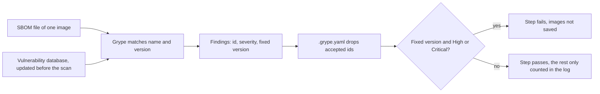

## Before you start

- [[devops.l3.software-bill-of-materials]] — you know the `image` job writes one SBOM per image, listing its OS packages and NuGet packages with their versions.
- [[devops.l2.quality-gate]] — you know a quality gate is a set of automated checks a change must pass, and a green gate proves only what its checks check.
- [[devops.l3.automated-dependency-updates]] — you know Dependabot proposes each update as a pull request and waits a cooldown after each release.

## The situation

It is `stage-3`. The api image you deployed last month came from a green run of `ci.yml`, and you open that run's `image` job. Its scan step printed counts of vulnerabilities by severity, listed four `libpam` packages as "accepted in .grype.yaml", and still ended with `none: the scan passes`.

Your lead reads the same log and concludes two things: the image has no known vulnerabilities, and it stays that way until the next build. A colleague asks the opposite question: why did the step pass at all, when it reported findings? What does a passing scan actually tell you, and for how long?

## Core concepts

- **CVE** — a public identifier, such as `CVE-2024-10041`, given to one published vulnerability (a flaw in a component that an attacker could use, for example to read data they should not), so that every tool and notice can name the same flaw.
- **vulnerability scanner** — a tool that matches each component's name and version against a database of published vulnerabilities and reports every match as a finding.
- Grype — the vulnerability scanner Đơn Hàng runs; it reads an SBOM file, so it does not need the image.
- Severity — how serious a vulnerability is rated; Grype's ratings are Critical, High, Medium, Low, Negligible, and Unknown when no rating is known.
- Fixed version — a version of the package, named in the database, that no longer has the vulnerability; a finding has one only once such a version has been released.

## How it works



In the situation above, the scan step ran Grype on the api image's SBOM. For each component, such as the OS package `libpam0g` or a NuGet package, Grype looks up its name and version in its database. A match becomes a finding: the vulnerability's id, often a CVE, its severity and, when one exists, the fixed version.

The database is not part of Grype or of the image. `scan-image.sh` downloads the latest build of it before every scan, and later builds include vulnerabilities published since. The same SBOM can therefore scan clean today and show a Critical finding next month, with nothing in the image changed. A scan answers one question: what was known on the day it ran.

Grype then drops the findings `.grype.yaml` accepts. With `--only-fixed` it keeps only findings that have a fixed version, and `--fail-on high` makes it exit non-zero if any of those is High or Critical. Every program ends with an exit status, 0 for success and anything else for failure, and a CI step fails when its script exits non-zero. Every other finding is only counted by severity in the log, by a separate scan that runs before the gate. That is why the step in the situation printed findings and passed: the gate blocks only what an update can fix.

`dotnet restore` audits the NuGet packages it restores against known vulnerabilities and reports matches as warnings; for projects targeting .NET 10 it checks direct and transitive packages by default. It reads only NuGet packages, though. The `libpam` packages come from the Ubuntu base image, which no project file lists. The SBOM does list them, so Grype checks them too.

## In the Đơn Hàng system

The end of `scan-image.sh`, from the database update to the gate:

```bash file=scripts/devops/scan-image.sh tag=stage-3 lines=23-47
grype db update >/dev/null
echo "== vulnerability database built: $(grype db status | sed -n 's/^Built: *//p')"

echo "== every known vulnerability in $sbom, fixed or not, by severity"
all=$(grype "sbom:$sbom" --quiet --show-suppressed)
for severity in Critical High Medium Low Negligible Unknown; do
  printf '%-10s %s\n' "$severity" "$(grep -v '(suppressed)' <<<"$all" | grep -c " $severity " || true)"
done
echo "== accepted in .grype.yaml"
grep '(suppressed)' <<<"$all" | while read -r package rest; do
  echo "  $package $(grep -oE '(CVE|GHSA)-[A-Za-z0-9-]+' <<<"$rest" | head -n 1)"
done | sort -u

# lesson: devops.l3.vulnerability-scanning
# The gate: only vulnerabilities with a fixed version, and the scan fails on
# High or Critical. Grype exits non-zero then, and so does this script.
echo "== High or Critical with a fixed version"
status=0
blocking=$(grype "sbom:$sbom" --quiet --only-fixed --fail-on high) || status=$?
if [ "$status" -ne 0 ]; then
  printf '%s\n' "$blocking"
  echo "scan failed: update the package or base image, or accept the finding in .grype.yaml with a reason" >&2
  exit "$status"
fi
echo "none: the scan passes"
```

```text output=true
== vulnerability database built: ...
== every known vulnerability in sbom/donhang-api.cdx.json, fixed or not, by severity
Critical   ...
High       ...
Medium     ...
Low        ...
Negligible ...
Unknown    ...
== accepted in .grype.yaml
  libpam-modules CVE-2024-10041
  libpam-modules-bin CVE-2024-10041
  libpam-runtime CVE-2024-10041
  libpam0g CVE-2024-10041
== High or Critical with a fixed version
none: the scan passes
```

Line 23 updates the database and line 24 prints when it was built; the output above shows `...` in place of that date and the counts, because both change from day to day. Lines 27–34 scan with `--show-suppressed`, which keeps accepted findings in the output marked `(suppressed)`: lines 28–30 count the others by severity, lines 31–34 list the accepted ones, each with its id, a CVE or a GHSA id (GitHub's own identifier for a vulnerability).

Line 41 is the gate. When it blocks, lines 43–45 print the blocking findings, say what to do, and exit with Grype's status; here nothing blocked, so line 47 ran.

In CI, the `image` job runs this script on every SBOM, after the SBOMs are uploaded and before the images are saved as the artifact `staging` starts from (`ci.yml` lines 132–141, outside these excerpts). A failing scan fails the job, so `staging`, which needs `image`, never runs.

```yaml file=.grype.yaml tag=stage-3 lines=1-11
# lesson: devops.l3.vulnerability-scanning
# Grype reads this file from the directory it runs in. Every vulnerability
# accepted here says why it does not apply to Đơn Hàng, so the next reader
# sees a decision instead of a finding that silently disappeared. Remove an
# entry once the reason stops being true.
ignore:
  # PAM (Medium, no fix planned for Ubuntu 24.04): a program that is
  # authenticating a user can leak passwords such as those in /etc/shadow.
  # Đơn Hàng's images run one dotnet process (or one migration bundle) and
  # no login, so nothing in them authenticates a user through PAM.
  - vulnerability: CVE-2024-10041
```

Line 11 accepts one CVE, and the rule matches that id in every package, which is why four `libpam` packages appear as accepted. PAM is the Linux library programs use to check a user's login, the four `libpam` packages are its parts in the Ubuntu base image, and `/etc/shadow` is the Linux file holding users' password hashes. Lines 7–10 give the reason: Medium, no fix planned, and nothing in the images logs a user in. As a Medium finding with no fix, it would not fail the gate anyway; the entry exists so that the log separates a decided finding from one nobody has read. Nothing in Grype checks whether the reason is still true; lines 4–5 leave that to the next reader.

## Seniors often assume…

- **"An image that passed the scan in CI stays free of known vulnerabilities while it runs."** → Actually the scan compared the image with that day's database. The image does not change, but the database grows, and at `stage-3` Đơn Hàng has no scheduled job that scans the stored SBOMs of running images again. You notice this when a notice names a package in an image already deployed, and the green run that built it shows no such finding.
- **"Every finding must be fixed before a release, or the scan is pointless."** → Actually a finding with no fixed version cannot be fixed by an update. Failing on it keeps every run red until someone else releases a fix, and a gate that is always red stops being read. Đơn Hàng blocks what an update can fix and records the rest as decisions in `.grype.yaml`. A stricter gate fits when the team can act on every finding it blocks, for example by removing the package. You notice this when the same PAM finding appears in every run, with no newer Ubuntu package to move to.
- **"A clean scan means the image contains no malicious code."** → Actually Grype knows only vulnerabilities already published in its database. A package release made malicious on purpose matches nothing until someone reports it, so the scan stays clean. Other controls cover that gap: pinning by content, Dependabot's cooldown before proposing a new release, and signatures, in the next lessons. You notice this when a notice about a malicious package version appears days after its release, and builds made in between passed every scan.

## Try it (3 minutes)

In the `don-hang` repository folder, checked out at `stage-3`, with Docker running (the scripts run Grype and Syft in containers, so nothing else needs installing):

1. Run `scripts/devops/scan-image.sh`. With no argument it scans `sbom/donhang-api.cdx.json` and, if that file is missing, makes it first with `sbom.sh`, which needs the `donhang-api:stage-2` image, the name `docker-compose.yml` still gives it (`docker compose build api`). The first run also downloads the vulnerability database.
2. Run `mv .grype.yaml .grype.off`, run the script again, then `mv .grype.off .grype.yaml`.

Expected result: the first run lists four `libpam` packages under `CVE-2024-10041` as accepted and ends with `none: the scan passes`. The second run lists nothing as accepted and still passes: the finding is Medium, below `--fail-on high`, and with no fixed version `--only-fixed` also keeps it out of the gate.

Now think it through. Suppose a High vulnerability that has a fixed version had been accepted in `.grype.yaml` months ago, for a reason that has since stopped being true. What does the next CI run do?

<details><summary>Suggested answer</summary>

It passes. The `ignore` rule drops that id before the gate looks at it, so the finding shows only under "accepted in .grype.yaml". Only a person re-reading the reason in the file catches it, which is why each entry carries one.

</details>

## Connections

- [[devops.l3.software-bill-of-materials]] — the input: Grype reads the SBOM files that lesson's step writes, not the image.
- [[devops.l2.quality-gate]] — the scan is one more check in the gate, and like every check it proves only what it checks.
- [[devops.l3.automated-dependency-updates]] — the usual fix for a blocking finding: a Dependabot pull request that moves the pin to a fixed version.
- [[devops.l3.restore-testing]] — the same idea for backups: a green check is evidence about the moment and the data it ran on.
- [[devops.l3.signing-images]] — covers part of what a scan cannot: showing which pipeline built an image.

## Five-line summary

1. A vulnerability scan reports only what its database knew on the day it ran, so a passing scan says nothing about later.
2. Grype matches each SBOM component's name and version against published vulnerabilities, each with an id (often a CVE), a severity, maybe a fixed version.
3. `dotnet restore` audits only NuGet packages; Grype scans the whole SBOM, including the base image's OS packages.
4. Đơn Hàng's `image` job fails only on High or Critical findings with a fixed version; `.grype.yaml` records each accepted finding with its reason.
5. A clean scan does not rule out malicious code nobody has reported; pinning, cooldowns and signatures cover that gap.
