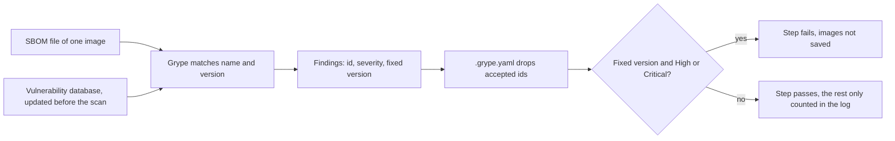

## Bạn cần biết trước

- [[devops.l3.software-bill-of-materials]] — bạn biết job `image` ghi một SBOM cho mỗi image, liệt kê package hệ điều hành và package NuGet bên trong kèm phiên bản.
- [[devops.l2.quality-gate]] — bạn biết quality gate là tập kiểm tra tự động mà một thay đổi phải vượt qua, và gate xanh chỉ chứng minh đúng những gì các kiểm tra của nó kiểm tra.
- [[devops.l3.automated-dependency-updates]] — bạn biết Dependabot đề xuất mỗi bản cập nhật thành một pull request và chờ một khoảng thời gian sau mỗi bản phát hành.

## Tình huống

Đơn Hàng đang ở `stage-3`. Image api bạn deploy tháng trước đến từ một lần chạy `ci.yml` xanh, và bạn mở job `image` của lần chạy đó. Bước quét in ra số lỗ hổng theo mức độ nghiêm trọng, liệt kê bốn package `libpam` là "accepted in .grype.yaml", và vẫn kết thúc bằng `none: the scan passes`.

Trưởng nhóm đọc cùng log đó và rút ra hai kết luận: image không có lỗ hổng nào đã biết, và sẽ giữ nguyên như vậy tới lần build sau. Một đồng nghiệp hỏi ngược lại: báo có phát hiện mà sao bước này vẫn qua? Rốt cuộc một lần quét qua được cho bạn biết điều gì, và đúng trong bao lâu?

## Khái niệm cốt lõi

- **CVE** (mã định danh công khai cho một lỗ hổng đã công bố) — ví dụ `CVE-2024-10041`, gắn với một lỗ hổng (một lỗi trong thành phần mà kẻ tấn công có thể lợi dụng, chẳng hạn để đọc dữ liệu họ không được phép đọc) đã công bố, để mọi công cụ và mọi thông báo gọi cùng một lỗi bằng cùng một tên.
- **trình quét lỗ hổng** (vulnerability scanner) — công cụ so tên và phiên bản của từng thành phần với một cơ sở dữ liệu các lỗ hổng đã công bố, và báo mỗi chỗ khớp thành một phát hiện.
- Grype — trình quét lỗ hổng mà Đơn Hàng dùng. Nó đọc file SBOM, nên không cần tới image.
- Mức độ nghiêm trọng (severity) — lỗ hổng được xếp hạng nghiêm trọng đến đâu. Grype có các mức Critical, High, Medium, Low, Negligible, và Unknown khi chưa có xếp hạng.
- Phiên bản đã sửa (fixed version) — phiên bản của package, được cơ sở dữ liệu ghi tên, không còn lỗ hổng đó. Một phát hiện chỉ có phiên bản đã sửa khi phiên bản như vậy đã được phát hành.

## Cơ chế hoạt động



Trong tình huống ở trên, bước quét chạy Grype trên SBOM của image api. Với mỗi thành phần, như package hệ điều hành `libpam0g` hay một package NuGet, Grype tra tên và phiên bản của nó trong cơ sở dữ liệu. Chỗ nào khớp thành một phát hiện: id của lỗ hổng, thường là CVE, mức độ nghiêm trọng, và phiên bản đã sửa nếu có.

Cơ sở dữ liệu không nằm trong Grype, cũng không nằm trong image. `scan-image.sh` tải bản build mới nhất của nó trước mỗi lần quét, và các bản build sau có thêm những lỗ hổng mới công bố. Vì vậy cùng một SBOM có thể quét sạch hôm nay rồi tháng sau hiện một phát hiện Critical, dù image không đổi gì. Một lần quét chỉ trả lời một câu hỏi: vào ngày nó chạy, người ta đã biết những gì.

Sau đó Grype bỏ các phát hiện mà `.grype.yaml` chấp nhận. Với `--only-fixed`, nó chỉ giữ phát hiện có phiên bản đã sửa, và `--fail-on high` khiến nó thoát với mã khác 0 nếu có phát hiện nào trong số đó là High hoặc Critical. Chương trình nào khi kết thúc cũng trả về một mã thoát, 0 là thành công, mọi giá trị khác là thất bại, và một bước CI thất bại khi script của nó thoát với mã khác 0. Mọi phát hiện còn lại chỉ được đếm theo mức độ nghiêm trọng trong log, bởi một lần quét riêng chạy trước gate. Đó là lý do bước trong tình huống in ra phát hiện mà vẫn qua: gate chỉ chặn những gì một bản cập nhật sửa được.

`dotnet restore` đối chiếu các package NuGet nó restore với các lỗ hổng đã biết và báo chỗ khớp thành cảnh báo. Với project nhắm tới .NET 10, mặc định nó kiểm tra cả package trực tiếp lẫn bắc cầu. Nhưng nó chỉ đọc package NuGet. Các package `libpam` đến từ base image Ubuntu, thứ không file project nào liệt kê. SBOM thì có liệt kê chúng, nên Grype kiểm tra cả chúng.

## Trong hệ thống Đơn Hàng

Phần cuối của `scan-image.sh`, từ bước cập nhật cơ sở dữ liệu tới gate:

```bash file=scripts/devops/scan-image.sh tag=stage-3 lines=23-47
grype db update >/dev/null
echo "== vulnerability database built: $(grype db status | sed -n 's/^Built: *//p')"

echo "== every known vulnerability in $sbom, fixed or not, by severity"
all=$(grype "sbom:$sbom" --quiet --show-suppressed)
for severity in Critical High Medium Low Negligible Unknown; do
  printf '%-10s %s\n' "$severity" "$(grep -v '(suppressed)' <<<"$all" | grep -c " $severity " || true)"
done
echo "== accepted in .grype.yaml"
grep '(suppressed)' <<<"$all" | while read -r package rest; do
  echo "  $package $(grep -oE '(CVE|GHSA)-[A-Za-z0-9-]+' <<<"$rest" | head -n 1)"
done | sort -u

# lesson: devops.l3.vulnerability-scanning
# The gate: only vulnerabilities with a fixed version, and the scan fails on
# High or Critical. Grype exits non-zero then, and so does this script.
echo "== High or Critical with a fixed version"
status=0
blocking=$(grype "sbom:$sbom" --quiet --only-fixed --fail-on high) || status=$?
if [ "$status" -ne 0 ]; then
  printf '%s\n' "$blocking"
  echo "scan failed: update the package or base image, or accept the finding in .grype.yaml with a reason" >&2
  exit "$status"
fi
echo "none: the scan passes"
```

```text output=true
== vulnerability database built: ...
== every known vulnerability in sbom/donhang-api.cdx.json, fixed or not, by severity
Critical   ...
High       ...
Medium     ...
Low        ...
Negligible ...
Unknown    ...
== accepted in .grype.yaml
  libpam-modules CVE-2024-10041
  libpam-modules-bin CVE-2024-10041
  libpam-runtime CVE-2024-10041
  libpam0g CVE-2024-10041
== High or Critical with a fixed version
none: the scan passes
```

Dòng 23 cập nhật cơ sở dữ liệu và dòng 24 in thời điểm nó được build. Kết quả ở trên ghi `...` thay cho ngày đó và các con số, vì cả hai thay đổi theo từng ngày. Dòng 27–34 quét với `--show-suppressed`, cờ giữ các phát hiện đã chấp nhận trong kết quả kèm nhãn `(suppressed)`: dòng 28–30 đếm các phát hiện còn lại theo mức độ nghiêm trọng, dòng 31–34 liệt kê các phát hiện đã chấp nhận, mỗi phát hiện kèm id, là CVE hoặc GHSA (mã định danh lỗ hổng riêng của GitHub).

Dòng 41 là gate. Khi gate chặn, dòng 43–45 in các phát hiện gây chặn, nói cần làm gì, rồi thoát với mã của Grype. Ở đây không có gì bị chặn, nên dòng 47 chạy.

Trong CI, job `image` chạy script này trên từng SBOM, sau khi các SBOM đã upload và trước khi các image được lưu thành artifact mà `staging` dùng để bắt đầu (`ci.yml` dòng 132–141, nằm ngoài các đoạn trích). Quét thất bại thì job thất bại, nên `staging`, job cần `image`, không bao giờ chạy.

```yaml file=.grype.yaml tag=stage-3 lines=1-11
# lesson: devops.l3.vulnerability-scanning
# Grype reads this file from the directory it runs in. Every vulnerability
# accepted here says why it does not apply to Đơn Hàng, so the next reader
# sees a decision instead of a finding that silently disappeared. Remove an
# entry once the reason stops being true.
ignore:
  # PAM (Medium, no fix planned for Ubuntu 24.04): a program that is
  # authenticating a user can leak passwords such as those in /etc/shadow.
  # Đơn Hàng's images run one dotnet process (or one migration bundle) and
  # no login, so nothing in them authenticates a user through PAM.
  - vulnerability: CVE-2024-10041
```

Dòng 11 chấp nhận một CVE, và quy tắc này khớp id đó ở mọi package, nên bốn package `libpam` hiện ra là đã chấp nhận. PAM là thư viện Linux mà các chương trình dùng để kiểm tra đăng nhập của người dùng, bốn package `libpam` là các phần của nó trong base image Ubuntu, còn `/etc/shadow` là file Linux chứa hash mật khẩu của người dùng. Dòng 7–10 nêu lý do: Medium, không có kế hoạch sửa, và không gì trong các image cho người dùng đăng nhập. Là phát hiện Medium không có bản sửa, nó vốn đã không làm gate thất bại. Mục này tồn tại để log tách được phát hiện đã có quyết định khỏi phát hiện chưa ai đọc. Grype không hề kiểm tra lý do còn đúng hay không, dòng 4–5 để chuyện đó cho người đọc tiếp theo.

## Senior hay nhầm rằng…

- **"Image đã qua bước quét trong CI thì suốt lúc chạy vẫn không có lỗ hổng nào đã biết."** → Thực ra lần quét đó so image với cơ sở dữ liệu của ngày hôm ấy. Image không đổi, nhưng cơ sở dữ liệu lớn dần, và ở `stage-3` Đơn Hàng chưa có job định kỳ nào quét lại SBOM đã lưu của các image đang chạy. Bạn sẽ nhận ra khi một thông báo nêu tên một package trong image đã deploy, còn lần chạy xanh build ra image đó không hề có phát hiện này.
- **"Phát hiện nào cũng phải sửa trước khi release, không thì quét chẳng để làm gì."** → Thực ra phát hiện không có phiên bản đã sửa thì không bản cập nhật nào sửa được. Chặn vì nó sẽ khiến mọi lần chạy đỏ cho tới khi bên khác phát hành bản sửa, và một gate lúc nào cũng đỏ thì không còn ai đọc. Đơn Hàng chặn những gì cập nhật sửa được và ghi phần còn lại thành quyết định trong `.grype.yaml`. Gate chặt hơn hợp lý khi nhóm hành động được với mọi phát hiện nó chặn, ví dụ bằng cách bỏ package đó đi. Bạn sẽ nhận ra khi cùng một phát hiện PAM xuất hiện ở mọi lần chạy, mà không có package Ubuntu mới hơn nào để chuyển sang.
- **"Quét sạch nghĩa là image không chứa mã độc."** → Thực ra Grype chỉ biết những lỗ hổng đã công bố trong cơ sở dữ liệu của nó. Một bản phát hành package bị cố ý cài mã độc không khớp gì cho tới khi có người báo, nên lần quét vẫn sạch. Các biện pháp khác lấp chỗ trống đó: ghim theo nội dung, khoảng chờ của Dependabot trước khi đề xuất bản phát hành mới, và chữ ký, ở các bài sau. Bạn sẽ nhận ra khi thông báo về một phiên bản package độc hại xuất hiện vài ngày sau khi nó phát hành, và các bản build làm trong khoảng đó đều qua mọi lần quét.

## Thử ngay (3 phút)

Trong thư mục repository `don-hang`, checkout ở `stage-3`, với Docker đang chạy (các script chạy Grype và Syft trong container, nên không cần cài thêm gì):

1. Chạy `scripts/devops/scan-image.sh`. Không truyền tham số thì script quét `sbom/donhang-api.cdx.json`, và nếu file đó chưa có thì tạo nó trước bằng `sbom.sh`. `sbom.sh` cần image `donhang-api:stage-2`, cái tên mà `docker-compose.yml` vẫn đặt cho nó (`docker compose build api`). Lần chạy đầu cũng tải cơ sở dữ liệu lỗ hổng về.
2. Chạy `mv .grype.yaml .grype.off`, chạy lại script, rồi chạy `mv .grype.off .grype.yaml`.

Kết quả mong đợi: lần chạy đầu liệt kê bốn package `libpam` dưới `CVE-2024-10041` là đã chấp nhận và kết thúc bằng `none: the scan passes`. Lần chạy thứ hai không liệt kê gì là đã chấp nhận và vẫn qua: phát hiện này là Medium, dưới ngưỡng `--fail-on high`, và vì không có phiên bản đã sửa nên `--only-fixed` cũng giữ nó ngoài gate.

Giờ hãy nghĩ thử. Giả sử một lỗ hổng High có phiên bản đã sửa đã được chấp nhận trong `.grype.yaml` từ mấy tháng trước, với một lý do nay không còn đúng. Lần chạy CI tiếp theo sẽ làm gì?

<details><summary>Gợi ý đáp án</summary>

Nó qua. Quy tắc `ignore` bỏ id đó trước khi gate kịp xét, nên phát hiện chỉ hiện dưới "accepted in .grype.yaml". Chỉ người đọc lại lý do trong file mới bắt được nó, đó là lý do mỗi mục đều phải ghi lý do.

</details>

## Liên hệ

- [[devops.l3.software-bill-of-materials]] — đầu vào: Grype đọc các file SBOM mà bước trong bài đó ghi ra, không đọc image.
- [[devops.l2.quality-gate]] — bước quét là thêm một kiểm tra trong gate, và như mọi kiểm tra, nó chỉ chứng minh đúng thứ nó kiểm tra.
- [[devops.l3.automated-dependency-updates]] — cách sửa thường gặp cho một phát hiện gây chặn: pull request của Dependabot chuyển phiên bản ghim sang phiên bản đã sửa.
- [[devops.l3.restore-testing]] — cùng ý tưởng cho bản sao lưu: một kiểm tra xanh là bằng chứng về đúng thời điểm và đúng dữ liệu nó đã chạy.
- [[devops.l3.signing-images]] — lấp một phần chỗ quét không làm được: cho thấy pipeline nào đã build ra image.

## Tóm tắt 5 dòng

1. Một lần quét lỗ hổng chỉ báo những gì cơ sở dữ liệu của nó biết vào ngày chạy, nên quét qua không nói gì về sau này.
2. Grype so tên và phiên bản từng thành phần trong SBOM với các lỗ hổng đã công bố, mỗi lỗ hổng có id (thường là CVE), mức độ nghiêm trọng, và có thể có phiên bản đã sửa.
3. `dotnet restore` chỉ kiểm tra package NuGet. Grype quét toàn bộ SBOM, kể cả package hệ điều hành của base image.
4. Job `image` của Đơn Hàng chỉ thất bại với phát hiện High hoặc Critical có phiên bản đã sửa. `.grype.yaml` ghi mỗi phát hiện được chấp nhận kèm lý do.
5. Quét sạch không loại trừ được mã độc chưa ai báo. Ghim phiên bản, khoảng chờ và chữ ký lấp chỗ trống đó.
