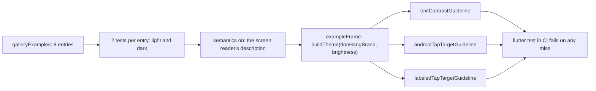

## Before you start

- [[frontend.l3.component-gallery]] — you know `galleryExamples`, the one list of every shared component in every variant, and that the gallery shows each entry in light and dark.
- [[frontend.l1.accessibility-basics]] — you know a screen reader reads the app's description, not its pixels, and that Material recommends tap targets of at least 48 by 48.
- [[frontend.l2.overriding-providers-in-tests]] — you can read a widget test: `testWidgets`, `tester.pumpWidget`, then `expect`.

## The situation

A designer asks for a softer yellow behind warning banners in dark mode. You change the dark `warning` value in `lib/design/brand.dart`, open the gallery, and `status_banner_warning` looks fine on your screen. A teammate reading on a laptop by a window says the dark text on it is hard to read.

Your eyes, your screen and the light in the room all differ from theirs. Next month someone changes another token and never opens the gallery at all. How do you know a color change leaves every component's text readable, without trusting anyone's screen?

## Core concepts

- **contrast ratio** — a number comparing how light a text color and its background color are, from 1:1 for two identical colors to 21:1 for black on white; the higher it is, the easier the text is to read.
- **WCAG** — the Web Content Accessibility Guidelines, a published standard with conformance levels such as AA and AAA; at level AA, normal-size text needs a contrast ratio of at least 4.5:1 and large text at least 3:1.
- large text — in those rules, text of 18 point and up, or 14 point and up when bold; everything smaller counts as normal-size.
- accessibility guideline — a check from `flutter_test` that you run on what a widget test has built, with `expectLater(tester, meetsGuideline(...))`.
- `textContrastGuideline`, `androidTapTargetGuideline`, `labeledTapTargetGuideline` — three such checks: text contrast against the rule above, tappable parts of at least 48 by 48, and a label on everything that can be tapped.

## How it works



Start at the left. In the situation above, the question "is this text readable?" becomes a number: the contrast ratio between the banner's text color and its background. WCAG at level AA gives the line to clear, 4.5:1 for the banner's normal-size text. A number can be checked by a test, on every run, on every machine alike.

The stage-3 test takes each of the eight entries in `galleryExamples` and makes two widget tests from it, one per `Brightness`. Each test builds the entry inside `exampleFrame`, which wraps it in the app's real theme for that brightness, from `buildTheme(donHangBrand, brightness)`. So the colors under test are the same values `lib/main.dart` uses, including your new dark `warning`.

The guidelines read the description a screen reader would get to find each text and each tappable part. `testWidgets` turns that description on by default; the test's own `tester.ensureSemantics()`, called before building, makes it explicit, as Flutter's accessibility testing docs do. Then three checks run. The contrast check compares each text with the colors drawn behind it. The other two check the size of every tappable part and that each one has a label.

A miss in any of the three fails the test. `ci.yml` runs `flutter test` for pushes and pull requests, so a token change that makes a banner unreadable fails the job before anyone has to notice it by eye.

## In the Đơn Hàng system

The test, in `DonHang.App/test/design/components_accessibility_test.dart`:

```dart file=DonHang.App/test/design/components_accessibility_test.dart tag=stage-3 lines=8-27
void main() {
  // lesson: frontend.l3.accessibility-checks
  // Every gallery example, in the light and the dark theme, against three
  // guidelines flutter_test can measure on what the test has built: text
  // contrast (4.5:1, or 3:1 for large text), tap targets of at least
  // 48 × 48, and a label on everything that can be tapped.
  for (final example in galleryExamples) {
    for (final brightness in Brightness.values) {
      testWidgets('${example.name} (${brightness.name}) meets the guidelines', (tester) async {
        final semantics = tester.ensureSemantics();
        await tester.pumpWidget(exampleFrame(example, brightness));

        await expectLater(tester, meetsGuideline(textContrastGuideline));
        await expectLater(tester, meetsGuideline(androidTapTargetGuideline));
        await expectLater(tester, meetsGuideline(labeledTapTargetGuideline));
        semantics.dispose();
      });
    }
  }
}
```

The two loops write 16 tests without writing 16 test bodies. Each test's name carries the entry and the theme, such as `status_banner_warning (dark)`, so a failure tells you exactly which component broke in which theme. `meetsGuideline` gives `expect` its check, but that check has to wait for a result, so the test writes `await expectLater` instead of `expect`. `semantics.dispose()` releases the handle the test asked for. `exampleFrame`, in `test/design/example_frame.dart`, is not shown; it puts the entry in a fixed 360 by 160 box on the theme's surface color.

Where the entries come from, in `DonHang.App/lib/gallery/examples.dart`:

```dart file=DonHang.App/lib/gallery/examples.dart tag=stage-3 lines=16-32
// lesson: frontend.l3.component-gallery
// lesson: frontend.l3.accessibility-checks
// Every shared component in every variant, kept in one list: the gallery
// shows it, the accessibility test checks each entry in both themes, and
// the golden test keeps an image of each. A new variant added here is
// shown, checked and pictured without touching the three.
final List<GalleryExample> galleryExamples = [
  const GalleryExample('loading_view', LoadingView()),
  const GalleryExample('message_view', MessageView(message: 'No products yet.')),
  GalleryExample('message_view_action', MessageView(message: 'Could not load products.', actionLabel: 'Reload', onAction: () {})),
  for (final tone in StatusTone.values)
    GalleryExample('status_banner_${tone.name}', StatusBanner(message: 'A ${tone.name} message for the customer.', tone: tone)),
  GalleryExample(
    'status_banner_action',
    StatusBanner(message: 'Not placed: product 3 no longer exists.', tone: StatusTone.error, actionLabel: 'Remove', onAction: () {}),
  ),
];
```

The third use the comment names, keeping an image of each entry, is the next lesson's topic; here it only matters that it reads the same list. The two entries with an action, `Reload` and `Remove`, give the tap target checks something to measure. `StatusTone` has four tones: `info` and `error` take their colors from the theme's `colorScheme`, while `warning` and `success` draw theirs from `StatusColors`, the ThemeExtension in `lib/design/status_colors.dart`. Those values sit in `lib/design/brand.dart`, whose comment promises that each "on" color, such as `onWarning` for text drawn on `warning`, keeps at least 4.5:1 with its background and names this test as the proof.

## Seniors often assume…

- **"If the colors come from the theme, the contrast is good enough by definition."** → Actually the theme decides which color goes where, not whether two colors read well together. The `StatusColors` values in `brand.dart` are written by hand for each theme, and nothing in `ThemeData` compares `warning` with `onWarning`. You notice this when a token change looks fine in the gallery on your monitor, yet `status_banner_warning (dark)` fails the contrast check.
- **"Accessibility can only be checked by hand, so it cannot be part of CI."** → Actually some of it is measurable on one built widget: a contrast ratio, a size in logical pixels, whether a label exists. The stage-3 test checks those 16 times in every `flutter test`, and `ci.yml` runs that for pushes and pull requests. You notice this when a pull request that changes only a color value fails CI with a test name pointing at one component in one theme.
- **"Passing the automated guidelines means the app is accessible."** → Actually the checks only see one widget at a time and only what can be measured. A button labeled with the wrong words still has a label, so it passes. Whether a screen reader user can follow a whole flow, such as placing an order, needs a person to try it. You notice the gap when CI is green but a screen reader user cannot tell which order a `Remove` button removes.

## Try it (3 minutes)

1. In the Đơn Hàng repository, run `git switch --detach stage-3`, then go into `DonHang.App`.
2. In `lib/design/brand.dart`, in `darkStatus`, change `onWarning` from `Color(0xFF3D2E00)` to `Color(0xFF7A5900)`, the brown the light theme uses for its warning background.
3. Run `flutter test test/design/components_accessibility_test.dart`, then undo the change with `git restore lib/design/brand.dart`.

Expected result: 16 tests run and exactly one fails, `status_banner_warning (dark) meets the guidelines`, on the text contrast check. That brown on the dark yellow is about 4:1: enough for large text, not for the banner's normal-size message. On your screen it may still look readable.

Then answer: after the revert all 16 pass. Name one thing about the `Remove` banner the test still cannot tell you.

<details><summary>Suggested answer</summary>

Whether "Remove" alone tells a screen reader user what it removes, and whether the banner is read at a sensible point on the screen it sits in. The test only checks that the button has a label and is big enough, not what the label means or how the whole screen reads.

</details>

## Connections

- [[frontend.l3.component-gallery]] — the same `galleryExamples` list; the gallery shows each entry to a person, this test measures each one.
- [[frontend.l1.accessibility-basics]] — the hand-written check of one tile's height and label; here the same kind of rule is measured on every shared component at once.
- [[frontend.l3.theme-extension]] — where the `warning` and `onWarning` pair comes from; this test is what holds that pair to 4.5:1 in both themes.
- [[frontend.l3.golden-tests]] — the next step: the same frame and list, checked for how each entry looks rather than for measured rules.

## Five-line summary

1. Contrast, tap target size and tap labels can be measured on built widgets, so a test can check them on every run.
2. Contrast ratio runs from 1:1 to 21:1; WCAG at level AA asks 4.5:1 for normal text, 3:1 for large text.
3. `meetsGuideline` with `textContrastGuideline`, `androidTapTargetGuideline` and `labeledTapTargetGuideline` checks what a widget test has built.
4. At stage-3 every `galleryExamples` entry is checked in light and dark, 16 tests, so a bad token fails CI.
5. The checks see one widget at a time; whether a screen reader user can finish a flow still needs a person.
