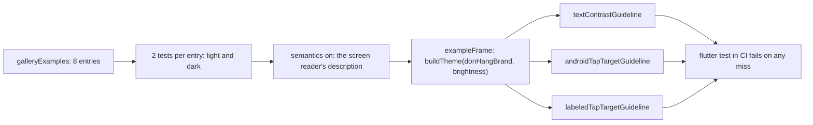

## Bạn cần biết trước

- [[frontend.l3.component-gallery]] — bạn biết `galleryExamples`, danh sách duy nhất chứa mọi component dùng chung ở mọi biến thể, và trang trưng bày hiện từng mục ở cả sáng lẫn tối.
- [[frontend.l1.accessibility-basics]] — bạn biết screen reader đọc phần mô tả của app chứ không đọc pixel, và Material khuyên vùng chạm tối thiểu 48 × 48.
- [[frontend.l2.overriding-providers-in-tests]] — bạn đọc được một widget test: `testWidgets`, `tester.pumpWidget`, rồi `expect`.

## Tình huống

Một designer muốn nền banner cảnh báo ở dark mode là màu vàng dịu hơn. Bạn đổi giá trị `warning` của theme tối trong `lib/design/brand.dart`, mở trang trưng bày, và `status_banner_warning` trông ổn trên màn hình của bạn. Một đồng đội đọc trên laptop cạnh cửa sổ thì bảo chữ tối trên nền đó khó đọc.

Mắt bạn, màn hình bạn và ánh sáng trong phòng đều khác của họ. Tháng sau, có người đổi một token khác mà không hề mở trang trưng bày. Làm sao biết một lần đổi màu vẫn giữ chữ của mọi component đọc được, mà không phải tin vào màn hình của ai cả?

## Khái niệm cốt lõi

- **tỉ lệ tương phản** (contrast ratio) — con số so độ sáng của màu chữ với màu nền, từ 1:1 khi hai màu giống hệt nhau tới 21:1 với chữ đen trên nền trắng. Con số càng cao, chữ càng dễ đọc.
- **WCAG** (bộ hướng dẫn accessibility cho nội dung web của W3C, chia mức A, AA, AAA) — Web Content Accessibility Guidelines, một tiêu chuẩn đã công bố với các mức tuân thủ như AA và AAA. Ở mức AA, chữ cỡ thường cần tỉ lệ tương phản ít nhất 4,5:1, chữ lớn ít nhất 3:1.
- chữ lớn — theo các quy tắc đó, là chữ từ 18 point trở lên, hoặc từ 14 point trở lên nếu in đậm. Mọi chữ nhỏ hơn được tính là cỡ thường.
- accessibility guideline — một phép kiểm của `flutter_test`, chạy trên những gì widget test đã dựng, bằng `expectLater(tester, meetsGuideline(...))`.
- `textContrastGuideline`, `androidTapTargetGuideline`, `labeledTapTargetGuideline` — ba phép kiểm như vậy: tương phản của chữ theo quy tắc trên, mọi phần bấm được tối thiểu 48 × 48, và mọi thứ bấm được đều có nhãn.

## Cơ chế hoạt động



Bắt đầu từ bên trái. Trong tình huống trên, câu hỏi "chữ này có đọc được không?" trở thành một con số: tỉ lệ tương phản giữa màu chữ và màu nền của banner. WCAG ở mức AA cho ngưỡng phải vượt, 4,5:1 với chữ cỡ thường của banner. Đã là con số thì test kiểm được, ở mọi lần chạy, trên mọi máy như nhau.

Test của stage-3 lấy từng mục trong tám mục của `galleryExamples` và tạo ra hai widget test, mỗi `Brightness` một test. Mỗi test dựng mục đó bên trong `exampleFrame`, hàm bọc nó trong theme thật của app ở brightness đó, lấy từ `buildTheme(donHangBrand, brightness)`. Vậy các màu bị kiểm chính là các giá trị `lib/main.dart` dùng, kể cả màu `warning` tối mới của bạn.

Các guideline đọc phần mô tả mà screen reader sẽ nhận để tìm từng đoạn chữ và từng phần bấm được. `testWidgets` mặc định đã bật phần mô tả đó. Lời gọi `tester.ensureSemantics()` của chính test, đặt trước khi dựng, chỉ làm cho điều này rõ ràng, giống cách tài liệu kiểm thử accessibility của Flutter vẫn viết. Sau đó ba phép kiểm chạy. Phép kiểm tương phản so từng đoạn chữ với màu vẽ phía sau nó. Hai phép còn lại kiểm kích thước của mọi phần bấm được và kiểm từng phần đều có nhãn.

Trượt bất kỳ phép nào trong ba thì test hỏng. `ci.yml` chạy `flutter test` cho mỗi lần push và mỗi pull request, nên một lần đổi token làm banner khó đọc sẽ làm job hỏng trước khi ai đó phải tự nhìn ra.

## Trong hệ thống Đơn Hàng

Test này, trong `DonHang.App/test/design/components_accessibility_test.dart`:

```dart file=DonHang.App/test/design/components_accessibility_test.dart tag=stage-3 lines=8-27
void main() {
  // lesson: frontend.l3.accessibility-checks
  // Every gallery example, in the light and the dark theme, against three
  // guidelines flutter_test can measure on what the test has built: text
  // contrast (4.5:1, or 3:1 for large text), tap targets of at least
  // 48 × 48, and a label on everything that can be tapped.
  for (final example in galleryExamples) {
    for (final brightness in Brightness.values) {
      testWidgets('${example.name} (${brightness.name}) meets the guidelines', (tester) async {
        final semantics = tester.ensureSemantics();
        await tester.pumpWidget(exampleFrame(example, brightness));

        await expectLater(tester, meetsGuideline(textContrastGuideline));
        await expectLater(tester, meetsGuideline(androidTapTargetGuideline));
        await expectLater(tester, meetsGuideline(labeledTapTargetGuideline));
        semantics.dispose();
      });
    }
  }
}
```

Hai vòng lặp tạo ra 16 test mà không phải viết 16 thân test. Tên mỗi test mang theo mục và theme, như `status_banner_warning (dark)`, nên khi hỏng bạn biết đúng component nào hỏng ở theme nào. `meetsGuideline` đưa cho `expect` phép kiểm của nó, nhưng phép kiểm đó phải chờ kết quả, nên test viết `await expectLater` thay cho `expect`. `semantics.dispose()` trả lại handle mà test đã xin. `exampleFrame`, trong `test/design/example_frame.dart`, không được trích ở đây. Nó đặt mục vào một khung cố định 360 × 160 trên màu surface của theme.

Nơi các mục được tạo ra, trong `DonHang.App/lib/gallery/examples.dart`:

```dart file=DonHang.App/lib/gallery/examples.dart tag=stage-3 lines=16-32
// lesson: frontend.l3.component-gallery
// lesson: frontend.l3.accessibility-checks
// Every shared component in every variant, kept in one list: the gallery
// shows it, the accessibility test checks each entry in both themes, and
// the golden test keeps an image of each. A new variant added here is
// shown, checked and pictured without touching the three.
final List<GalleryExample> galleryExamples = [
  const GalleryExample('loading_view', LoadingView()),
  const GalleryExample('message_view', MessageView(message: 'No products yet.')),
  GalleryExample('message_view_action', MessageView(message: 'Could not load products.', actionLabel: 'Reload', onAction: () {})),
  for (final tone in StatusTone.values)
    GalleryExample('status_banner_${tone.name}', StatusBanner(message: 'A ${tone.name} message for the customer.', tone: tone)),
  GalleryExample(
    'status_banner_action',
    StatusBanner(message: 'Not placed: product 3 no longer exists.', tone: StatusTone.error, actionLabel: 'Remove', onAction: () {}),
  ),
];
```

Cách dùng thứ ba mà comment nhắc tới, giữ một ảnh cho mỗi mục, là chủ đề của bài sau. Ở đây chỉ cần biết nó đọc cùng danh sách này. Hai mục có hành động, `Reload` và `Remove`, cho hai phép kiểm vùng chạm thứ để đo. `StatusTone` có bốn tone: `info` và `error` lấy màu từ `colorScheme` của theme, còn `warning` và `success` lấy màu từ `StatusColors`, ThemeExtension trong `lib/design/status_colors.dart`. Các giá trị đó nằm trong `lib/design/brand.dart`. Comment ở file này hứa rằng mỗi màu "on", như `onWarning` cho chữ vẽ trên `warning`, giữ tương phản ít nhất 4,5:1 với nền của nó, và chỉ ra test này là bằng chứng.

## Senior hay nhầm rằng…

- **"Màu đã lấy từ theme thì tương phản mặc nhiên đủ tốt."** → Thực ra theme quyết định màu nào đặt ở đâu, chứ không quyết định hai màu đặt cạnh nhau có dễ đọc không. Các giá trị `StatusColors` trong `brand.dart` được viết tay cho từng theme, và không gì trong `ThemeData` so `warning` với `onWarning`. Bạn sẽ nhận ra khi một lần đổi token trông ổn trong trang trưng bày trên màn hình của bạn, nhưng `status_banner_warning (dark)` lại trượt phép kiểm tương phản.
- **"Accessibility chỉ kiểm được bằng tay, nên không đưa vào CI được."** → Thực ra một phần của nó đo được trên một widget đã dựng: một tỉ lệ tương phản, một kích thước tính bằng logical pixel, một cái nhãn có hay không. Test của stage-3 kiểm những thứ đó 16 lần trong mỗi lần `flutter test`, và `ci.yml` chạy lệnh đó cho mỗi lần push và mỗi pull request. Bạn sẽ nhận ra khi một pull request chỉ đổi một giá trị màu mà CI hỏng, với tên test chỉ đúng một component ở một theme.
- **"Qua hết các guideline tự động nghĩa là app đã accessible."** → Thực ra các phép kiểm chỉ thấy từng widget một và chỉ thấy những gì đo được. Một nút gắn nhãn sai chữ thì vẫn có nhãn, nên vẫn qua. Người dùng screen reader có đi hết được cả một luồng hay không, như đặt một đơn hàng, thì cần một người thật thử. Bạn sẽ nhận ra khoảng trống này khi CI xanh nhưng người dùng screen reader không biết nút `Remove` sẽ xóa đơn nào.

## Thử ngay (3 phút)

1. Trong repo Đơn Hàng, chạy `git switch --detach stage-3`, rồi vào `DonHang.App`.
2. Trong `lib/design/brand.dart`, ở `darkStatus`, đổi `onWarning` từ `Color(0xFF3D2E00)` thành `Color(0xFF7A5900)`, màu nâu mà theme sáng dùng làm nền cảnh báo.
3. Chạy `flutter test test/design/components_accessibility_test.dart`, rồi hoàn tác bằng `git restore lib/design/brand.dart`.

Kết quả mong đợi: 16 test chạy và đúng một test hỏng, `status_banner_warning (dark) meets the guidelines`, ở phép kiểm tương phản chữ. Màu nâu đó trên nền vàng tối chỉ khoảng 4:1: đủ cho chữ lớn, không đủ cho dòng chữ cỡ thường của banner. Trên màn hình của bạn, nó có thể vẫn trông đọc được.

Rồi trả lời: sau khi hoàn tác, cả 16 test đều qua. Hãy nêu một điều về banner có nút `Remove` mà test vẫn không cho bạn biết.

<details><summary>Gợi ý đáp án</summary>

Chỉ riêng chữ "Remove" có cho người dùng screen reader biết nó xóa gì hay không, và banner có được đọc ở một thời điểm hợp lý trên màn hình chứa nó hay không. Test chỉ kiểm nút có nhãn và đủ lớn, không kiểm nhãn có nghĩa gì hay cả màn hình được đọc ra sao.

</details>

## Liên hệ

- [[frontend.l3.component-gallery]] — cùng danh sách `galleryExamples`. Trang trưng bày cho người xem từng mục, còn test này đo từng mục.
- [[frontend.l1.accessibility-basics]] — phép kiểm viết tay chiều cao và nhãn của một ô. Ở đây cùng loại quy tắc đó được đo trên mọi component dùng chung cùng lúc.
- [[frontend.l3.theme-extension]] — nơi cặp `warning` và `onWarning` ra đời. Test này giữ cặp đó ở mức 4,5:1 trong cả hai theme.
- [[frontend.l3.golden-tests]] — bước tiếp theo: cùng khung và cùng danh sách, nhưng kiểm từng mục trông ra sao thay vì kiểm các quy tắc đo được.

## Tóm tắt 5 dòng

1. Tương phản, kích thước vùng chạm và nhãn của phần bấm được đều đo được trên widget đã dựng, nên một test kiểm được chúng ở mỗi lần chạy.
2. Tỉ lệ tương phản đi từ 1:1 tới 21:1. WCAG ở mức AA đòi 4,5:1 cho chữ cỡ thường, 3:1 cho chữ lớn.
3. `meetsGuideline` với `textContrastGuideline`, `androidTapTargetGuideline` và `labeledTapTargetGuideline` kiểm những gì widget test đã dựng.
4. Ở stage-3, mọi mục của `galleryExamples` được kiểm ở cả sáng lẫn tối, tổng 16 test, nên một token tồi sẽ làm CI hỏng.
5. Các phép kiểm chỉ thấy từng widget một. Người dùng screen reader có đi hết một luồng hay không vẫn cần một người thật thử.
