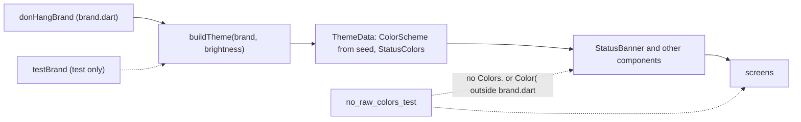

## Before you start

- [[frontend.l3.component-library]] — you know that `StatusBanner` takes a tone, never a color, and reads its background from `ColorScheme` or `StatusColors` in the theme.
- [[design.l2.testing-the-dependency-rule]] — you know that an architecture test checks how code is structured instead of how it behaves, and fails before code review when a rule breaks.

## The situation

The shop behind Đơn Hàng asks whether a partner shop could use the same app in its own colors: teal instead of indigo, and its own amber for warnings. A teammate suggests copying `lib/screens/` into a second folder and changing the colors there.

You count what that means: every screen twice, every later fix made twice, and two sets of banners slowly drifting apart. Then you remember the last lesson: at stage-3 no screen names a color at all. If no screen holds a color, what would a second brand actually have to change?

## Core concepts

- brand — in this lesson, one set of visual token values a product can be shown in; at stage-3, a seed color and the status colors for light and dark.
- `Brand` — the class in `lib/design/brand.dart` that holds one brand's values: `seed`, `lightStatus` and `darkStatus`.
- `donHangBrand` — the one `Brand` value DonHang.App ships, with `Colors.indigo` as its seed.
- `buildTheme(brand, brightness)` — the function in `lib/design/theme.dart` that turns one brand's values into one `ThemeData`.
- `testBrand` — a second `Brand` that exists only in a test, with a teal seed and status colors of its own.

## How it works



In the situation above, a second brand would be a second `Brand` value, not a second copy of any screen. At stage-3 `buildTheme` is the only code that turns token values into a `ThemeData`. It passes the brand's seed as `colorSchemeSeed`, so every `ColorScheme` role grows from it. `brand.statusColors(brightness)` picks `lightStatus` or `darkStatus` and goes into `extensions`, where `ThemeData` keeps `StatusColors`. `main.dart` calls it twice with `donHangBrand`: with `Brightness.light` for `theme`, with `Brightness.dark` for `darkTheme`. These are the two themes the root widget, `MaterialApp`, holds; as in dark mode, it uses `darkTheme` when the device is dark.

Read the diagram from the left. The components never see a `Brand`. They read roles from the theme, as `StatusBanner` reads `secondaryContainer` or the `warning` of `StatusColors`, and the screens pass them meanings. So handing `buildTheme` another `Brand` changes the colors on every screen and touches no screen file.

That is a promise, and two tests keep it. The first builds the theme from `testBrand` and checks that `StatusBanner` takes its colors from that brand. The second guards the condition the first depends on: it reads every Dart file under `lib/` and fails if any file other than `brand.dart` writes `Colors.` or `Color(`. In the diagram, its arrows stand for all those files, `theme.dart` and `main.dart` included. A fixed color in one screen would ignore every brand, and nothing else would catch it.

Which brand a build or a shop gets is not decided here. DonHang.App ships one brand; choosing among several is a product and deployment decision, made outside the theme code.

## In the Đơn Hàng system

The brand test, in `DonHang.App/test/design/brand_theme_test.dart` at stage-3. Above the excerpt, `testBrand` is declared with `seed: Colors.teal` and its own four status colors for each brightness: `warning`, `onWarning`, `success` and `onSuccess`.

```dart file=DonHang.App/test/design/brand_theme_test.dart tag=stage-3 lines=32-51
void main() {
  for (final brightness in Brightness.values) {
    // lesson: frontend.l3.brand-themes
    testWidgets('components follow the test brand (${brightness.name})', (tester) async {
      final theme = buildTheme(testBrand, brightness);
      final scheme = ColorScheme.fromSeed(seedColor: testBrand.seed, brightness: brightness);

      await tester.pumpWidget(MaterialApp(
        theme: theme,
        home: const Scaffold(body: StatusBanner(message: 'Info.', tone: StatusTone.info)),
      ));
      expect(backgroundOf(tester), scheme.secondaryContainer);

      await tester.pumpWidget(MaterialApp(
        theme: theme,
        home: const Scaffold(body: StatusBanner(message: 'Warning.', tone: StatusTone.warning)),
      ));
      expect(backgroundOf(tester), testBrand.statusColors(brightness).warning);
    });
  }
```

The loop runs the test once for each value of `Brightness`, light and dark. `scheme` is the color scheme `ColorScheme.fromSeed` generates from the teal seed, the same generation `colorSchemeSeed` asks `ThemeData` for. An `info` banner must show that scheme's `secondaryContainer`; a `warning` banner must show the test brand's own `warning`. So both paths into the theme, `ColorScheme` and `StatusColors`, are checked. `backgroundOf`, above the excerpt, finds the widget inside the banner that paints its background, a `Material`, and returns its color. One more test, below the excerpt, checks that the two brands' light `secondaryContainer` values really differ; if they matched, the `info` check could not tell the brands apart.

The guard, in `DonHang.App/test/design/no_raw_colors_test.dart`:

```dart file=DonHang.App/test/design/no_raw_colors_test.dart tag=stage-3 lines=10-25
final rawColor = RegExp(r'\bColors\.|\bColor\(');

void main() {
  test('only brand.dart writes a color', () {
    final offenders = <String>[];
    for (final file in Directory('lib').listSync(recursive: true).whereType<File>()) {
      final path = file.path.replaceAll(r'\', '/');
      if (!path.endsWith('.dart') || path == 'lib/design/brand.dart') continue;
      final lines = file.readAsLinesSync();
      for (var i = 0; i < lines.length; i++) {
        if (rawColor.hasMatch(lines[i])) offenders.add('$path:${i + 1}: ${lines[i].trim()}');
      }
    }
    expect(offenders, isEmpty, reason: 'use a theme role or a StatusColors value instead');
  });
}
```

`rawColor` is a pattern that matches `Colors.` or `Color(` at the start of a word, so `Colors.teal` and `Color(0xFF7A5900)` match, while the type `Color` written without `(` does not. The loop walks every file under `lib/`, skips files that are not Dart and `brand.dart`, and records each matching line with its path and line number. When the list is not empty, the failure shows it, so it names the line to fix. `replaceAll` turns Windows path separators into `/`, so the comparison with `lib/design/brand.dart` works on every system.

Like the architecture test for `DonHang.Domain`, this checks how the code is written, not what it does. It reads text, so it catches the usual ways of writing a color, not every way: `Color.fromARGB(...)` does not match `Color(`.

## Seniors often assume…

- **"Supporting a second brand means copying the screens and changing their colors."** → Actually at stage-3 a second brand is a second `Brand` value passed to `buildTheme`. No screen file holds a color, so none would change. Copies would make every later fix twice and let two sets of screens drift apart. You notice the copy approach when a bug fixed in one screen comes back in its twin under the other brand.
- **"If every color goes through the theme today, it will stay that way without a test."** → Actually a raw color compiles, and with the one brand DonHang.App ships it looks right, so neither the build nor a look at the app shows it. A reviewer can miss one line among many. `no_raw_colors_test` fails on it at the next test run and names the file and line. You notice the missing guard when a second brand is tried for the first time and one widget keeps the old indigo.
- **"A brand is only its main color; everything else can stay shared without checking."** → Actually the seed grows only the `ColorScheme` roles. In DonHang.App `warning` and `success` are chosen by hand, per brand and per brightness, because nothing generates them from the seed. That is why the brand test checks a `warning` banner as well as an `info` one: the two colors reach the theme by different paths. You notice an unchecked path when a new brand's info banners turn teal while its warnings keep the old amber.

## Try it (3 minutes)

1. In the Đơn Hàng repository, switch to the tag with `git switch --detach stage-3`.
2. Run `grep -rn -E "Colors\.|Color\(" DonHang.App/lib`. `grep` prints each matching line: `-r` searches every file under the folder, `-n` adds line numbers, and `-E` lets `|` mean "or".

Expected result: nine lines, all in `DonHang.App/lib/design/brand.dart`: the `Colors.indigo` seed and eight status colors, four for light and four for dark. No screen and no component appears. The pattern lacks `rawColor`'s start-of-word check, so it is a little looser, yet at stage-3 it finds the same lines.

A teammate adds `Icon(Icons.wifi_off, color: Colors.grey)` next to the saved-list warning in `ProductListScreen`. What happens at the next test run, which of the two tests notices, and what should the line use instead?

<details><summary>Suggested answer</summary>

`no_raw_colors_test` fails, and its list names `lib/screens/product_list_screen.dart` with the line number and the line itself. The brand test still passes: it builds only `StatusBanner`, not the screen. The icon should take its color from the theme: a `ColorScheme` role that fits, or, if no role fits, a new `StatusColors` value that every `Brand` then sets for light and dark.

</details>

## Connections

- [[frontend.l3.component-library]] — the condition this lesson builds on: because components take a meaning, not a color, a new brand reaches all of them.
- [[design.l2.testing-the-dependency-rule]] — the same kind of test in another place: a check on how code is written, here on colors instead of assemblies.
- [[frontend.l3.theme-extension]] — where each brand's `lightStatus` and `darkStatus` end up: the `StatusColors` extension.
- [[frontend.l2.dark-mode]] — the same move one step earlier: a second theme from the same seed; a brand is a second seed with its own status colors.
- [[backend.l3.multi-tenancy]] — the server side of serving several shops from one system.
- [[frontend.l3.component-gallery]] — the next step: a second entry point that also builds its themes with `buildTheme`, to show each component in light and dark.

## Five-line summary

1. A brand is a set of token values given to one theme builder; a second brand is a second value, not copied screens.
2. At stage-3 `buildTheme(brand, brightness)` is the only code that turns a `Brand`'s seed and status colors into a `ThemeData`.
3. A test builds the theme from a teal test brand and checks that `StatusBanner` takes its info and warning colors from it.
4. A second test fails when any file under `lib/` other than `brand.dart` writes `Colors.` or `Color(`, the condition the promise depends on.
5. DonHang.App ships one brand; which brand a build or a shop gets is a product and deployment decision, not the theme code's.
