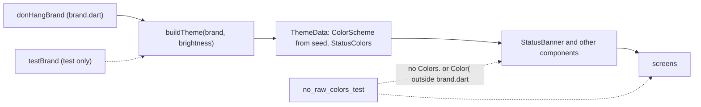

## Bạn cần biết trước

- [[frontend.l3.component-library]] — bạn biết `StatusBanner` nhận một tone, không bao giờ nhận màu, và đọc màu nền từ `ColorScheme` hoặc `StatusColors` trong theme.
- [[design.l2.testing-the-dependency-rule]] — bạn biết architecture test kiểm tra code được tổ chức ra sao chứ không kiểm tra code chạy ra sao, và báo lỗi trước cả code review khi một quy tắc bị phá.

## Tình huống

Cửa hàng đứng sau Đơn Hàng hỏi liệu một cửa hàng đối tác có dùng chung app được không, nhưng bằng màu của họ: xanh mòng két thay cho chàm, và màu hổ phách riêng cho cảnh báo. Một đồng đội đề xuất chép `lib/screens/` sang một thư mục thứ hai rồi đổi màu ở đó.

Bạn đếm xem như thế nghĩa là gì: màn hình nào cũng có hai bản, mỗi lần sửa về sau phải sửa hai lần, và hai bộ banner cứ lệch nhau dần. Rồi bạn nhớ lại bài trước: ở stage-3 không màn hình nào gọi tên một màu. Nếu không màn hình nào giữ màu, thì thương hiệu thứ hai thật ra phải đổi cái gì?

## Khái niệm cốt lõi

- thương hiệu — trong bài này, là một bộ giá trị token về giao diện mà sản phẩm có thể hiện theo. Ở stage-3, đó là một màu seed cùng các màu trạng thái cho chế độ sáng và tối.
- `Brand` — lớp trong `lib/design/brand.dart` giữ các giá trị của một thương hiệu: `seed`, `lightStatus` và `darkStatus`.
- `donHangBrand` — giá trị `Brand` duy nhất mà DonHang.App phát hành, với seed là `Colors.indigo`.
- `buildTheme(brand, brightness)` — hàm trong `lib/design/theme.dart` biến các giá trị của một thương hiệu thành một `ThemeData`.
- `testBrand` — một `Brand` thứ hai chỉ có trong test, với seed màu xanh mòng két và các màu trạng thái riêng.

## Cơ chế hoạt động



Trong tình huống trên, thương hiệu thứ hai là một giá trị `Brand` thứ hai, không phải bản sao thứ hai của màn hình nào. Ở stage-3, `buildTheme` là chỗ duy nhất trong code biến giá trị token thành `ThemeData`. Hàm này truyền seed của thương hiệu vào `colorSchemeSeed`, nên mọi vai trò của `ColorScheme` đều sinh ra từ seed đó. `brand.statusColors(brightness)` chọn `lightStatus` hoặc `darkStatus` rồi đưa vào `extensions`, nơi `ThemeData` giữ `StatusColors`. `main.dart` gọi hàm này hai lần với `donHangBrand`: với `Brightness.light` cho `theme`, với `Brightness.dark` cho `darkTheme`. Đây là hai theme mà widget gốc `MaterialApp` giữ, và cũng như ở dark mode, nó dùng `darkTheme` khi thiết bị đang ở chế độ tối.

Đọc sơ đồ từ trái sang. Component không bao giờ thấy một `Brand`. Chúng đọc vai trò từ theme, như `StatusBanner` đọc `secondaryContainer` hay `warning` của `StatusColors`, còn màn hình truyền cho chúng ý nghĩa. Vì vậy, đưa cho `buildTheme` một `Brand` khác là màu đổi trên mọi màn hình mà không đụng tới file màn hình nào.

Đó là một lời hứa, và có hai test giữ nó. Test đầu dựng theme từ `testBrand` và kiểm tra `StatusBanner` lấy màu từ đúng thương hiệu đó. Test thứ hai canh điều kiện mà test đầu dựa vào: nó đọc mọi file Dart trong `lib/` và báo lỗi nếu bất kỳ file nào ngoài `brand.dart` viết `Colors.` hoặc `Color(`. Trong sơ đồ, các mũi tên của test này đại diện cho tất cả các file đó, kể cả `theme.dart` và `main.dart`. Một màu cố định trong một màn hình sẽ bỏ qua mọi thương hiệu, và không có gì khác bắt được nó.

Bản build hay cửa hàng nào dùng thương hiệu nào thì không được quyết ở đây. DonHang.App phát hành một thương hiệu. Chọn giữa nhiều thương hiệu là quyết định về sản phẩm và deploy, nằm ngoài code theme.

## Trong hệ thống Đơn Hàng

Test thương hiệu, trong `DonHang.App/test/design/brand_theme_test.dart` ở stage-3. Phía trên đoạn trích, `testBrand` được khai báo với `seed: Colors.teal` và bốn màu trạng thái riêng cho mỗi độ sáng: `warning`, `onWarning`, `success` và `onSuccess`.

```dart file=DonHang.App/test/design/brand_theme_test.dart tag=stage-3 lines=32-51
void main() {
  for (final brightness in Brightness.values) {
    // lesson: frontend.l3.brand-themes
    testWidgets('components follow the test brand (${brightness.name})', (tester) async {
      final theme = buildTheme(testBrand, brightness);
      final scheme = ColorScheme.fromSeed(seedColor: testBrand.seed, brightness: brightness);

      await tester.pumpWidget(MaterialApp(
        theme: theme,
        home: const Scaffold(body: StatusBanner(message: 'Info.', tone: StatusTone.info)),
      ));
      expect(backgroundOf(tester), scheme.secondaryContainer);

      await tester.pumpWidget(MaterialApp(
        theme: theme,
        home: const Scaffold(body: StatusBanner(message: 'Warning.', tone: StatusTone.warning)),
      ));
      expect(backgroundOf(tester), testBrand.statusColors(brightness).warning);
    });
  }
```

Vòng lặp chạy test một lần cho mỗi giá trị của `Brightness`, sáng và tối. `scheme` là color scheme mà `ColorScheme.fromSeed` sinh ra từ seed xanh mòng két, cũng chính cách sinh mà `colorSchemeSeed` yêu cầu `ThemeData` dùng. Banner `info` phải hiện `secondaryContainer` của scheme đó, còn banner `warning` phải hiện `warning` riêng của thương hiệu test. Như vậy cả hai đường vào theme, `ColorScheme` và `StatusColors`, đều được kiểm. `backgroundOf`, nằm phía trên đoạn trích, tìm widget bên trong banner tô màu nền, tức một `Material`, rồi trả về màu của nó. Một test nữa, dưới đoạn trích, kiểm tra rằng `secondaryContainer` ở chế độ sáng của hai thương hiệu thật sự khác nhau. Nếu chúng trùng nhau, phép kiểm `info` không phân biệt được hai thương hiệu.

Test canh, trong `DonHang.App/test/design/no_raw_colors_test.dart`:

```dart file=DonHang.App/test/design/no_raw_colors_test.dart tag=stage-3 lines=10-25
final rawColor = RegExp(r'\bColors\.|\bColor\(');

void main() {
  test('only brand.dart writes a color', () {
    final offenders = <String>[];
    for (final file in Directory('lib').listSync(recursive: true).whereType<File>()) {
      final path = file.path.replaceAll(r'\', '/');
      if (!path.endsWith('.dart') || path == 'lib/design/brand.dart') continue;
      final lines = file.readAsLinesSync();
      for (var i = 0; i < lines.length; i++) {
        if (rawColor.hasMatch(lines[i])) offenders.add('$path:${i + 1}: ${lines[i].trim()}');
      }
    }
    expect(offenders, isEmpty, reason: 'use a theme role or a StatusColors value instead');
  });
}
```

`rawColor` là một mẫu khớp `Colors.` hoặc `Color(` ở đầu một từ, nên `Colors.teal` và `Color(0xFF7A5900)` khớp, còn kiểu `Color` viết không kèm `(` thì không. Vòng lặp đi qua mọi file trong `lib/`, bỏ qua file không phải Dart và `brand.dart`, rồi ghi lại từng dòng khớp kèm đường dẫn và số dòng. Khi danh sách không rỗng, thông báo lỗi in nó ra, nên chỉ thẳng dòng cần sửa. `replaceAll` đổi dấu phân cách đường dẫn của Windows thành `/`, để phép so với `lib/design/brand.dart` đúng trên mọi hệ điều hành.

Giống architecture test cho `DonHang.Domain`, test này kiểm tra code được viết ra sao, không kiểm tra code làm gì. Nó đọc văn bản, nên bắt được những cách viết màu thường gặp, chứ không phải mọi cách: `Color.fromARGB(...)` không khớp `Color(`.

## Senior hay nhầm rằng…

- **"Hỗ trợ thương hiệu thứ hai nghĩa là chép các màn hình rồi đổi màu của chúng."** → Thực ra ở stage-3, thương hiệu thứ hai là một giá trị `Brand` thứ hai truyền vào `buildTheme`. Không file màn hình nào giữ màu, nên không file nào phải đổi. Bản sao khiến mỗi lần sửa về sau phải làm hai lần, và để hai bộ màn hình lệch nhau dần. Bạn sẽ nhận ra cách làm bằng bản sao khi một lỗi đã sửa ở một màn hình lại xuất hiện ở màn hình sinh đôi của nó dưới thương hiệu kia.
- **"Nếu hôm nay mọi màu đều đi qua theme, thì không cần test nó vẫn sẽ giữ như vậy."** → Thực ra một màu viết thẳng vẫn compile được, và với thương hiệu duy nhất DonHang.App phát hành thì trông vẫn đúng, nên cả bản build lẫn nhìn qua app đều không làm lộ nó. Người review có thể bỏ sót một dòng giữa rất nhiều dòng. `no_raw_colors_test` báo lỗi ngay lần chạy test kế tiếp và chỉ ra file cùng dòng. Bạn sẽ nhận ra thiếu test canh khi lần đầu thử một thương hiệu thứ hai và có một widget vẫn giữ màu chàm cũ.
- **"Thương hiệu chỉ là màu chính, mọi thứ khác dùng chung được mà không cần kiểm."** → Thực ra seed chỉ sinh ra các vai trò của `ColorScheme`. Trong DonHang.App, `warning` và `success` được chọn bằng tay, theo từng thương hiệu và từng độ sáng, vì không có gì sinh chúng từ seed. Đó là lý do test thương hiệu kiểm cả banner `warning` lẫn banner `info`: hai màu đi vào theme bằng hai đường khác nhau. Bạn sẽ nhận ra một đường chưa được kiểm khi banner info của thương hiệu mới chuyển sang xanh mòng két còn banner cảnh báo vẫn giữ màu hổ phách cũ.

## Thử ngay (3 phút)

1. Trong repo Đơn Hàng, chuyển sang tag bằng `git switch --detach stage-3`.
2. Chạy `grep -rn -E "Colors\.|Color\(" DonHang.App/lib`. `grep` in ra từng dòng khớp: `-r` tìm trong mọi file dưới thư mục, `-n` thêm số dòng, còn `-E` cho `|` mang nghĩa "hoặc".

Kết quả mong đợi: chín dòng, tất cả nằm trong `DonHang.App/lib/design/brand.dart`: seed `Colors.indigo` và tám màu trạng thái, bốn cho chế độ sáng và bốn cho chế độ tối. Không có màn hình hay component nào xuất hiện. Mẫu này thiếu phần kiểm đầu từ của `rawColor`, nên lỏng hơn một chút, nhưng ở stage-3 nó vẫn tìm ra đúng những dòng đó.

Một đồng đội thêm `Icon(Icons.wifi_off, color: Colors.grey)` cạnh cảnh báo của danh sách đã lưu trong `ProductListScreen`. Lần chạy test kế tiếp sẽ ra sao, test nào trong hai test phát hiện, và dòng đó nên dùng gì thay vào?

<details><summary>Gợi ý đáp án</summary>

`no_raw_colors_test` báo lỗi, và danh sách của nó ghi `lib/screens/product_list_screen.dart` kèm số dòng và chính dòng đó. Test thương hiệu vẫn qua: nó chỉ dựng `StatusBanner`, không dựng màn hình. Icon nên lấy màu từ theme: một vai trò của `ColorScheme` phù hợp, hoặc nếu không vai trò nào hợp thì thêm một giá trị `StatusColors` mới mà mọi `Brand` sau đó phải đặt cho cả sáng lẫn tối.

</details>

## Liên hệ

- [[frontend.l3.component-library]] — điều kiện mà bài này dựa vào: vì component nhận ý nghĩa chứ không nhận màu, một thương hiệu mới tới được tất cả chúng.
- [[design.l2.testing-the-dependency-rule]] — cùng loại test ở một chỗ khác: kiểm tra code được viết ra sao, ở đây là về màu thay vì về assembly.
- [[frontend.l3.theme-extension]] — nơi `lightStatus` và `darkStatus` của mỗi thương hiệu cuối cùng đi tới: extension `StatusColors`.
- [[frontend.l2.dark-mode]] — cùng bước đi đó, sớm hơn một bước: một theme thứ hai từ cùng một seed. Thương hiệu là một seed thứ hai kèm các màu trạng thái riêng.
- [[backend.l3.multi-tenancy]] — phía server khi phục vụ nhiều cửa hàng từ một hệ thống.
- [[frontend.l3.component-gallery]] — bước tiếp theo: một điểm khởi chạy thứ hai của app, cũng dựng theme bằng `buildTheme`, để hiện từng component ở cả sáng lẫn tối.

## Tóm tắt 5 dòng

1. Thương hiệu là một bộ giá trị token đưa vào một hàm dựng theme duy nhất. Thương hiệu thứ hai là một giá trị thứ hai, không phải các màn hình chép lại.
2. Ở stage-3, `buildTheme(brand, brightness)` là chỗ duy nhất trong code biến seed và màu trạng thái của một `Brand` thành `ThemeData`.
3. Một test dựng theme từ thương hiệu test màu xanh mòng két và kiểm tra `StatusBanner` lấy màu info và warning từ đó.
4. Test thứ hai báo lỗi khi bất kỳ file nào trong `lib/` ngoài `brand.dart` viết `Colors.` hoặc `Color(`, điều kiện mà lời hứa dựa vào.
5. DonHang.App phát hành một thương hiệu. Bản build hay cửa hàng nào dùng thương hiệu nào là quyết định về sản phẩm và deploy, không phải của code theme.
