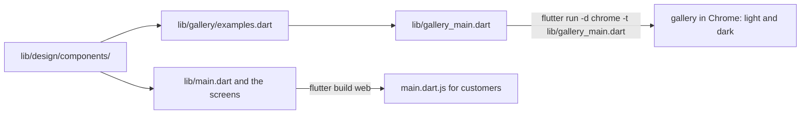

## Before you start

- [[frontend.l3.component-library]] — you know the three shared widgets in `lib/design/components/` and that `StatusBanner` takes a `StatusTone`, never a color.
- [[frontend.l3.web-bundle-size]] — you know `flutter build web` makes `main.dart.js` for the web bundle, and that tree shaking leaves out code the app never calls.

## The situation

You have just changed the `warning` value in `StatusColors`, the ThemeExtension holding the warning color. Now you want to see every `StatusBanner` that uses it, in light and dark. In the real app you walk it into each state: stop the API to get the out-of-date saved list, make a queued order come back with a changed price, make the sync hit its rate limit, let the sign-in run out. Then repeat in dark.

A new teammate needs a "no orders yet" message and cannot tell whether `MessageView` or `StatusBanner` fits. How do you see every shared component in every state, and learn when to use each, without walking the app into those states or sending customers anything extra?

## Core concepts

- documentation comment — a comment that starts with `///` right above a class; Dart tools treat it as that class's documentation.
- entry point — the file whose `main` function a run or a build starts from; for DonHang.App it is `lib/main.dart` unless you name another.
- `galleryExamples` — the list in `lib/gallery/examples.dart` that holds one `GalleryExample`, a name such as `loading_view` and a widget, for each shared component in each state.
- **component gallery** — a small separate app that shows each shared component in each variant, in light and dark, so its states can be seen without walking the real app into them.

## How it works



Start at the left. The shared components live in one folder, and two different programs use them. The documentation has two halves: a comment in the code, not drawn here, and the gallery, the lower path.

The first half sits in the components themselves. Above `StatusBanner` is a documentation comment: what the banner is for, and when to use `MessageView` instead. When your cursor is on a `StatusBanner` call in a screen, the Flutter tools in VS Code or Android Studio can show that comment next to your code. So the teammate reads the answer where they are writing the call.

The second half is something you can look at. In the situation above, the component gallery is the second program. `lib/gallery/examples.dart` lists the examples, and `lib/gallery_main.dart` is a second entry point that shows them. You start it with `flutter run -d chrome -t lib/gallery_main.dart`: `-d chrome` runs it in Chrome, and `-t` names the file whose `main` runs. The page shows every entry in light and dark, so your new `warning` value appears in every banner at once.

The two programs stay apart. `flutter build web` builds from `lib/main.dart`, and the build includes only the files that `lib/main.dart` imports and the files those import. No file outside the gallery imports it, so the gallery's code never reaches `main.dart.js`, and tree shaking keeps out what the app does not call.

Because the gallery runs the same widget code as the app, a change to a component shows the next time you start the gallery. A written page with screenshots would show the old look until someone remembers to update it.

## In the Đơn Hàng system

The documentation comment above `StatusBanner`, in `DonHang.App/lib/design/components/status_banner.dart`:

```dart file=DonHang.App/lib/design/components/status_banner.dart tag=stage-3 lines=11-19
/// A short message about the state of something on the screen, colored by
/// what it means, with at most one action.
///
/// Use it for something the customer should notice next to the rest of the
/// screen: a saved list that may be out of date, an order waiting to be sent,
/// an error from the server. Not for a screen with nothing else to show: use
/// [MessageView]. It takes a [tone], never a color, so every banner of the
/// same tone looks the same and changes with the theme.
class StatusBanner extends StatelessWidget {
```

Notice what it holds: the purpose, real cases from the app, and the case it is not for. The square brackets mark names in scope, a class and a parameter, so documentation tools can link to them. It does not list the parameters; the constructor below already shows them. `LoadingView` and `MessageView` carry the same kind of comment, so "no orders yet", a screen with nothing else to show, is a `MessageView`.

The gallery's entry point, in `DonHang.App/lib/gallery_main.dart`:

```dart file=DonHang.App/lib/gallery_main.dart tag=stage-3 lines=8-31
// lesson: frontend.l3.component-gallery
// A second entry point: flutter run -d chrome -t lib/gallery_main.dart.
// It shows every gallery example in the light and the dark theme, side by
// side. `flutter build web` builds lib/main.dart, which never imports this
// file, so none of the gallery reaches the bundle customers download.
void main() => runApp(const ComponentGallery());

class ComponentGallery extends StatelessWidget {
  const ComponentGallery({super.key});

  @override
  Widget build(BuildContext context) {
    return MaterialApp(
      title: 'DonHang.App components',
      theme: buildTheme(donHangBrand, Brightness.light),
      home: Scaffold(
        appBar: AppBar(title: const Text('DonHang.App components')),
        body: ListView(
          padding: Insets.screen,
          children: [for (final example in galleryExamples) _section(context, example)],
        ),
      ),
    );
  }
```

The file has its own `main` and its own `MaterialApp`, the root widget that here sets the title, the theme and the first screen (`home`). `buildTheme`, in `lib/design/theme.dart`, turns a brand and a `Brightness` into the app's theme; `donHangBrand` is the one brand the app ships, with its seed color and status colors. `lib/main.dart` calls `buildTheme` with the same `donHangBrand`, so the gallery looks like the app.

The `ListView` makes one section per entry of `galleryExamples`. `_section` and `_inTheme`, neither shown above, put the entry's name above two copies of its widget, side by side, and wrap each copy in a `Theme` built for `Brightness.light` or `Brightness.dark`.

`galleryExamples` itself has eight entries: `LoadingView`, `MessageView` with and without an action, one `StatusBanner` for each of the four tones (`info`, `success`, `warning`, `error`), and an error banner with an action. Its comment says the same list feeds two tests in later lessons, so a variant added there is shown and tested without changing those files.

## Seniors often assume…

- **"Documenting components means writing a separate page that lists their parameters."** → Actually the constructor already lists the parameters, and the editor shows it. What a reader also needs is the purpose, when not to use the component, and how it looks. The first two fit in the documentation comment and the look fits in the gallery. Both sit next to the code, so the pull request that changes a component can update them and a reviewer sees them in the same diff. You notice a separate page has drifted when it shows a parameter the constructor no longer has, or a screenshot in last month's colors.
- **"A gallery inside the app's code makes the app customers download bigger."** → Actually the bundle is built from `lib/main.dart`, and only files it reaches through imports are compiled into `main.dart.js`. The gallery files sit in `lib/`, but nothing the app imports leads to them. You notice this when a search under `lib/` for lines that import `gallery` finds only `lib/gallery_main.dart` itself.
- **"The real app already shows every component, so a gallery adds nothing."** → Actually several states appear only after a rare event, such as a rejected order or a changed price, and the app shows one theme at a time. The gallery shows all eight entries in both themes on one page. You notice the gap when a color change looks fine on the product list, but the rejected-order banner in dark mode is hard to read and nobody saw it before a customer did.

## Try it (3 minutes)

1. In the Đơn Hàng repository, switch to the tag with `git switch --detach stage-3`, then go into `DonHang.App`.
2. Run `flutter run -d chrome -t lib/gallery_main.dart` and scroll the page that opens.
3. In a second terminal, in `DonHang.App`, run `grep -rl "import.*gallery" lib`: `-r` searches every file under `lib`, and `-l` prints only the names of files with a matching line.

Expected result: the page is titled `DonHang.App components` and has eight sections, from `loading_view` to `status_banner_action`, each showing the component on a light surface on the left and a dark one on the right. The `grep` prints only `lib/gallery_main.dart`, the gallery's own entry point; no other file imports the gallery.

Then answer: a teammate gives `MessageView` a new variant with an icon. What do they change so the gallery shows it, and does that change add anything to what customers download?

<details><summary>Suggested answer</summary>

They add one `GalleryExample` entry for the new variant to `galleryExamples` in `lib/gallery/examples.dart`; `gallery_main.dart` needs no change, because it shows whatever the list holds. The new entry adds nothing to `main.dart.js`, because `lib/main.dart` never imports the gallery. The new code inside `MessageView` does reach customers, as `MessageView` always did, because the screens use it.

</details>

## Connections

- [[frontend.l3.component-library]] — the components the gallery shows; their documentation comments are the written half of the same documentation.
- [[frontend.l3.web-bundle-size]] — why the gallery costs customers nothing: the bundle holds only what `lib/main.dart` reaches.
- [[management.l2.docs-as-code]] — the same idea for team documents, kept next to the code and changed in the same pull request; the gallery goes one step further, documentation that runs.
- [[frontend.l3.accessibility-checks]] — the next step: a test checks every entry of the same `galleryExamples` list in both themes.

## Five-line summary

1. A component gallery is a separate entry point that shows every shared component in every variant and theme, outside the customers' bundle.
2. A `///` comment above a component says what it is for and when not to use it; the editor shows it at every use.
3. At stage-3 `flutter run -d chrome -t lib/gallery_main.dart` shows the eight entries of `galleryExamples` in light and dark.
4. `flutter build web` builds `lib/main.dart`, which never imports the gallery, so none of it reaches `main.dart.js`.
5. Documentation that runs shows a component's change at once; a separate written page can go out of date unnoticed.
