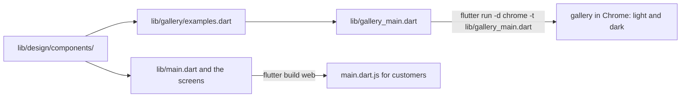

## Bạn cần biết trước

- [[frontend.l3.component-library]] — bạn biết ba widget dùng chung trong `lib/design/components/`, và `StatusBanner` nhận một `StatusTone`, không bao giờ nhận màu.
- [[frontend.l3.web-bundle-size]] — bạn biết `flutter build web` tạo ra `main.dart.js` cho web bundle, và tree shaking bỏ ra ngoài phần code mà app không bao giờ gọi.

## Tình huống

Bạn vừa đổi giá trị `warning` trong `StatusColors`, ThemeExtension giữ màu cảnh báo. Giờ bạn muốn xem mọi `StatusBanner` dùng màu đó, ở cả sáng lẫn tối. Trong app thật, bạn phải dẫn app tới từng trạng thái: tắt API để có danh sách đã lưu bị cũ, làm một đơn trong hàng đợi quay về với giá đã đổi, làm lần đồng bộ chạm giới hạn tần suất, để phiên đăng nhập hết hạn. Rồi làm lại tất cả ở chế độ tối.

Một đồng đội mới cần hiện thông báo "chưa có đơn nào" và không biết nên dùng `MessageView` hay `StatusBanner`. Làm sao để xem mọi component dùng chung ở mọi trạng thái, và biết khi nào dùng cái nào, mà không phải dẫn app tới từng trạng thái, cũng không gửi thêm gì cho khách hàng?

## Khái niệm cốt lõi

- comment tài liệu — comment bắt đầu bằng `///` ngay phía trên một class; các công cụ Dart coi nó là tài liệu của class đó.
- điểm khởi chạy — file có hàm `main` mà một lần chạy hay một lần build bắt đầu từ đó; với DonHang.App là `lib/main.dart`, trừ khi bạn chỉ định file khác.
- `galleryExamples` — danh sách trong `lib/gallery/examples.dart`, giữ một `GalleryExample` (gồm một cái tên như `loading_view` và một widget) cho mỗi component dùng chung ở mỗi trạng thái.
- **trang trưng bày component** (component gallery) — một app nhỏ tách riêng, hiện từng component dùng chung ở từng biến thể, cả sáng lẫn tối, để thấy được các trạng thái của nó mà không cần dẫn app thật tới đó.

## Cơ chế hoạt động



Bắt đầu từ bên trái. Các component dùng chung nằm trong một thư mục, và có hai chương trình khác nhau dùng chúng. Tài liệu gồm hai nửa: một comment trong code, không vẽ ở đây, và trang trưng bày, nhánh phía dưới.

Nửa thứ nhất nằm ngay trong component. Phía trên `StatusBanner` là một comment tài liệu: banner dùng để làm gì, và khi nào nên dùng `MessageView` thay vào. Khi con trỏ đặt trên một lời gọi `StatusBanner` trong màn hình, công cụ Flutter trong VS Code hay Android Studio có thể hiện comment đó ngay cạnh code. Vậy là đồng đội mới đọc được câu trả lời ngay chỗ đang viết lời gọi.

Nửa thứ hai là thứ bạn nhìn thấy được. Trong tình huống trên, trang trưng bày component chính là chương trình thứ hai. `lib/gallery/examples.dart` liệt kê các ví dụ, còn `lib/gallery_main.dart` là điểm khởi chạy thứ hai để hiện chúng. Bạn mở nó bằng `flutter run -d chrome -t lib/gallery_main.dart`: `-d chrome` chạy trong Chrome, `-t` chỉ ra file có hàm `main` sẽ chạy. Trang hiện mọi mục ở cả sáng lẫn tối, nên giá trị `warning` mới hiện trên mọi banner cùng lúc.

Hai chương trình tách biệt nhau. `flutter build web` build từ `lib/main.dart`, và bản build chỉ gồm các file mà `lib/main.dart` import cùng các file mà chúng import tiếp. Không file nào ngoài trang trưng bày import nó, nên code của trang không bao giờ vào `main.dart.js`, còn tree shaking giữ lại bên ngoài những gì app không gọi.

Vì trang trưng bày chạy cùng code widget với app, một thay đổi ở component sẽ hiện ra ở lần mở trang tiếp theo. Một trang viết tay kèm ảnh chụp màn hình sẽ còn hiện giao diện cũ cho tới khi có ai nhớ ra mà cập nhật.

## Trong hệ thống Đơn Hàng

Comment tài liệu phía trên `StatusBanner`, trong `DonHang.App/lib/design/components/status_banner.dart`:

```dart file=DonHang.App/lib/design/components/status_banner.dart tag=stage-3 lines=11-19
/// A short message about the state of something on the screen, colored by
/// what it means, with at most one action.
///
/// Use it for something the customer should notice next to the rest of the
/// screen: a saved list that may be out of date, an order waiting to be sent,
/// an error from the server. Not for a screen with nothing else to show: use
/// [MessageView]. It takes a [tone], never a color, so every banner of the
/// same tone looks the same and changes with the theme.
class StatusBanner extends StatelessWidget {
```

Để ý những gì comment chứa: mục đích, các trường hợp thật trong app, và trường hợp nó không dành cho. Dấu ngoặc vuông đánh dấu những tên trong phạm vi, một class và một tham số, để công cụ tài liệu tạo liên kết tới chúng. Comment không liệt kê tham số, vì constructor bên dưới đã cho thấy. `LoadingView` và `MessageView` cũng có kiểu comment như vậy, nên "chưa có đơn nào", một màn hình không có gì khác để hiện, là việc của `MessageView`.

Điểm khởi chạy của trang trưng bày, trong `DonHang.App/lib/gallery_main.dart`:

```dart file=DonHang.App/lib/gallery_main.dart tag=stage-3 lines=8-31
// lesson: frontend.l3.component-gallery
// A second entry point: flutter run -d chrome -t lib/gallery_main.dart.
// It shows every gallery example in the light and the dark theme, side by
// side. `flutter build web` builds lib/main.dart, which never imports this
// file, so none of the gallery reaches the bundle customers download.
void main() => runApp(const ComponentGallery());

class ComponentGallery extends StatelessWidget {
  const ComponentGallery({super.key});

  @override
  Widget build(BuildContext context) {
    return MaterialApp(
      title: 'DonHang.App components',
      theme: buildTheme(donHangBrand, Brightness.light),
      home: Scaffold(
        appBar: AppBar(title: const Text('DonHang.App components')),
        body: ListView(
          padding: Insets.screen,
          children: [for (final example in galleryExamples) _section(context, example)],
        ),
      ),
    );
  }
```

File này có `main` riêng và `MaterialApp` riêng, widget gốc ở đây đặt tiêu đề, theme và màn hình đầu tiên (`home`). `buildTheme`, trong `lib/design/theme.dart`, biến một brand và một `Brightness` thành theme của app. `donHangBrand` là brand duy nhất app phát hành, với màu seed và các màu trạng thái của nó. `lib/main.dart` gọi `buildTheme` với cùng `donHangBrand`, nên trang trưng bày trông giống app.

`ListView` tạo một phần cho mỗi mục của `galleryExamples`. `_section` và `_inTheme`, không có trong đoạn trích, đặt tên của mục phía trên hai bản sao widget của nó, cạnh nhau, và bọc mỗi bản trong một `Theme` dựng cho `Brightness.light` hoặc `Brightness.dark`.

Bản thân `galleryExamples` có tám mục: `LoadingView`, `MessageView` có và không có hành động, một `StatusBanner` cho mỗi tone trong bốn tone (`info`, `success`, `warning`, `error`), và một banner lỗi có hành động. Comment của danh sách ghi rằng cùng danh sách này cấp dữ liệu cho hai test ở các bài sau, nên một biến thể thêm vào đó sẽ được hiện và được test mà không phải sửa các file kia.

## Senior hay nhầm rằng…

- **"Viết tài liệu cho component nghĩa là viết một trang riêng liệt kê tham số của chúng."** → Thực ra constructor đã liệt kê tham số, và editor hiện nó. Người đọc còn cần biết mục đích, khi nào không dùng component, và trông nó ra sao. Hai điều đầu nằm gọn trong comment tài liệu, còn giao diện nằm trong trang trưng bày. Cả hai đều ở cạnh code, nên pull request đổi component cũng cập nhật được chúng, và người review thấy chúng trong cùng diff. Bạn sẽ nhận ra trang riêng đã lệch khi nó ghi một tham số mà constructor không còn, hoặc có ảnh chụp mang màu của tháng trước.
- **"Đặt trang trưng bày trong code của app sẽ làm app khách hàng tải về nặng hơn."** → Thực ra bundle được build từ `lib/main.dart`, và chỉ những file nó với tới qua import mới được biên dịch vào `main.dart.js`. Các file của trang trưng bày nằm trong `lib/`, nhưng không chuỗi import nào của app dẫn tới chúng. Bạn sẽ nhận ra điều này khi tìm trong `lib/` các dòng import `gallery` và chỉ thấy chính `lib/gallery_main.dart`.
- **"App thật đã hiện mọi component, nên trang trưng bày chẳng thêm được gì."** → Thực ra nhiều trạng thái chỉ hiện sau một sự kiện hiếm, như đơn bị từ chối hay giá bị đổi, và app mỗi lúc chỉ hiện một theme. Trang trưng bày hiện cả tám mục ở cả hai theme trên một trang. Bạn sẽ nhận ra khoảng trống này khi một lần đổi màu trông ổn trên danh sách sản phẩm, nhưng banner đơn bị từ chối ở dark mode lại khó đọc, và không ai thấy trước khi khách hàng thấy.

## Thử ngay (3 phút)

1. Trong repo Đơn Hàng, chuyển sang tag bằng `git switch --detach stage-3`, rồi vào `DonHang.App`.
2. Chạy `flutter run -d chrome -t lib/gallery_main.dart` và cuộn trang vừa mở.
3. Ở terminal thứ hai, trong `DonHang.App`, chạy `grep -rl "import.*gallery" lib`: `-r` tìm trong mọi file dưới `lib`, còn `-l` chỉ in tên các file có dòng khớp.

Kết quả mong đợi: trang có tiêu đề `DonHang.App components` và tám phần, từ `loading_view` tới `status_banner_action`, mỗi phần hiện component trên nền sáng bên trái và nền tối bên phải. `grep` chỉ in `lib/gallery_main.dart`, điểm khởi chạy của chính trang trưng bày. Không file nào khác import nó.

Rồi trả lời: một đồng đội thêm cho `MessageView` một biến thể có icon. Họ phải đổi gì để trang trưng bày hiện biến thể đó, và thay đổi ấy có thêm gì vào phần khách hàng tải về không?

<details><summary>Gợi ý đáp án</summary>

Họ thêm một mục `GalleryExample` cho biến thể mới vào `galleryExamples` trong `lib/gallery/examples.dart`. `gallery_main.dart` không cần đổi, vì nó hiện bất cứ thứ gì danh sách đang giữ. Mục mới không thêm gì vào `main.dart.js`, vì `lib/main.dart` không bao giờ import trang trưng bày. Còn phần code mới bên trong `MessageView` thì vẫn tới tay khách hàng, như `MessageView` vốn vậy, vì các màn hình dùng nó.

</details>

## Liên hệ

- [[frontend.l3.component-library]] — các component mà trang trưng bày hiện; comment tài liệu của chúng là nửa viết của cùng một bộ tài liệu.
- [[frontend.l3.web-bundle-size]] — vì sao trang trưng bày không tốn gì của khách hàng: bundle chỉ chứa những gì `lib/main.dart` với tới.
- [[management.l2.docs-as-code]] — cùng ý tưởng cho tài liệu của nhóm, đặt cạnh code và đổi trong cùng pull request. Trang trưng bày tiến thêm một bước, thành tài liệu chạy được.
- [[frontend.l3.accessibility-checks]] — bước tiếp theo: một test kiểm tra mọi mục của cùng danh sách `galleryExamples` ở cả hai theme.

## Tóm tắt 5 dòng

1. Trang trưng bày component là một điểm khởi chạy riêng, hiện mọi component dùng chung ở mọi biến thể và theme, nằm ngoài bundle của khách hàng.
2. Comment `///` phía trên một component nói nó dùng để làm gì và khi nào không nên dùng, và editor hiện comment đó ở mọi chỗ dùng.
3. Ở stage-3, `flutter run -d chrome -t lib/gallery_main.dart` hiện tám mục của `galleryExamples` ở cả sáng lẫn tối.
4. `flutter build web` build `lib/main.dart`, file không bao giờ import trang trưng bày, nên không phần nào của nó vào `main.dart.js`.
5. Tài liệu chạy được cho thấy thay đổi của component ngay lập tức, còn một trang viết riêng có thể lỗi thời mà không ai hay.
