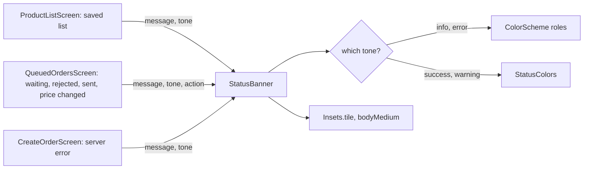

## Before you start

- [[frontend.l3.theme-extension]] — you know that `StatusColors` adds the `warning` and `success` roles to the theme, read with `Theme.of(context).extension<StatusColors>()`.
- [[frontend.l3.sync-conflicts]] — you know that `Waiting orders` warns when a sent order was charged a total different from the one the customer saw.
- [[frontend.l2.server-errors-in-forms]] — you know that `CreateOrderScreen` shows the API's `detail` above the submit button when an order is refused.

## The situation

You are adding the warning for a queued order that was charged a different total. `ProductListScreen` already shows a warning above the saved list, and the designer wants both to look the same: same amber, same padding, same text size. Next month the amber will change.

Copying the saved-list warning into `QueuedOrdersScreen` (the `Waiting orders` screen) takes a minute. Then there are two copies, and the order form's server error, the waiting order and the rejected order would make five. Each later change to a color or a padding means finding every copy. What should one shared widget ask a screen for, so that every warning looks alike and changes in one place?

## Core concepts

- **component library** — the shared widgets every screen uses for the same job; they take a meaning from the screen and their colors, spacing and text style from the theme.
- `LoadingView` — the shared widget a whole screen shows while its data loads: a spinner in the middle.
- `MessageView` — the shared widget a screen shows instead of its data: one centered message and at most one action.
- `StatusBanner` — the shared widget for a short message next to the rest of the screen, colored by what it means, with at most one action.
- `StatusTone` — the four meanings a `StatusBanner` can carry: `info`, `success`, `warning` and `error`.

## How it works



In the situation above, the shared widget is `StatusBanner`, and the warnings and errors become calls to it. At stage-3 DonHang.App keeps its component library in one folder, `lib/design/components/`, with three widgets: `LoadingView`, `MessageView` and `StatusBanner`. The screens that load products or orders show `LoadingView` while loading and `MessageView` when there is nothing to show — a load error, or an empty list — instead of each writing its own spinner or centered text.

Read the diagram from the left. A screen passes what it means: a message, a tone such as `StatusTone.warning`, and, when it needs one, an action label with `onAction`, the function to run when it is tapped. It passes no color, no padding and no text style. The banner turns the tone into a background and a text color from the theme: `ColorScheme` roles for `info` and `error`, `StatusColors` for `success` and `warning`. Its padding is the `Insets.tile` token and its text style is the theme's `bodyMedium`.

Because no screen holds a color, the saved-list warning, the waiting, rejected and price-changed orders, and `CreateOrderScreen`'s server error look alike. A new `warning` value in `StatusColors`, or a new `Insets.tile`, changes every banner that uses it at once.

The parameters are now a contract with every screen that calls the banner. Adding an optional named parameter changes no existing call. Renaming or removing one is a breaking change: each call that passes it stops compiling. So, while several screens call the component, a parameter is added when a screen needs it, not in case one might.

## In the Đơn Hàng system

The top of `StatusBanner`, in `DonHang.App/lib/design/components/status_banner.dart` at stage-3:

```dart file=DonHang.App/lib/design/components/status_banner.dart tag=stage-3 lines=19-39
class StatusBanner extends StatelessWidget {
  final String message;
  final StatusTone tone;
  final String? actionLabel;
  final VoidCallback? onAction;

  const StatusBanner({super.key, required this.message, required this.tone, this.actionLabel, this.onAction});

  // lesson: frontend.l3.component-library
  // The background and the text color for each tone, both from the theme:
  // ColorScheme's roles where Material has one, StatusColors where not.
  (Color, Color) _colors(BuildContext context) {
    final scheme = Theme.of(context).colorScheme;
    final status = Theme.of(context).extension<StatusColors>()!;
    return switch (tone) {
      StatusTone.info => (scheme.secondaryContainer, scheme.onSecondaryContainer),
      StatusTone.success => (status.success, status.onSuccess),
      StatusTone.warning => (status.warning, status.onWarning),
      StatusTone.error => (scheme.errorContainer, scheme.onErrorContainer),
    };
  }
```

`message` and `tone` are `required`; `actionLabel` and `onAction` are optional, so a banner with no action takes two arguments. There is no `Color` parameter anywhere. `_colors` returns a pair for the tone: the background and the color of the text on it, both read from the theme. `build`, below the excerpt, draws a `Material` in that background, padded by `Insets.tile`, with the message in `bodyMedium` and the action as a `TextButton` in the text color. `Material` is the Flutter widget that paints a colored surface; the banner's background is its `color`, which is why the test finds it.

The calls are in the screens, outside the excerpts. In `queued_orders_screen.dart` each queued order becomes one banner: `info` while waiting, `error` with a remove action when rejected, `success` when sent, or `warning` when the charged total differs.

The test that holds the banner to its contract, in `DonHang.App/test/design/status_banner_test.dart`:

```dart file=DonHang.App/test/design/status_banner_test.dart tag=stage-3 lines=24-45
  // lesson: frontend.l3.component-library
  // One banner per tone: the screen passes a meaning, the banner finds the
  // colors, so its background is the theme's role for that tone.
  for (final tone in StatusTone.values) {
    testWidgets('a ${tone.name} banner takes its background from the theme', (tester) async {
      var tapped = false;
      await tester.pumpWidget(MaterialApp(
        theme: theme,
        home: Scaffold(
          body: StatusBanner(message: 'Something happened.', tone: tone, actionLabel: 'Undo', onAction: () => tapped = true),
        ),
      ));

      expect(find.text('Something happened.'), findsOneWidget);
      await tester.tap(find.widgetWithText(TextButton, 'Undo'));
      expect(tapped, isTrue);
      final background = tester.widget<Material>(
        find.descendant(of: find.byType(StatusBanner), matching: find.byType(Material)).first,
      );
      expect(background.color, expectedBackground(theme, tone));
    });
  }
```

The loop creates one test per value of `StatusTone`, so every tone is checked. `theme` is the real light theme, built above the excerpt with `buildTheme`. Each test finds the message, taps the action and checks `onAction` ran. The last line compares the banner's background with `expectedBackground`, a helper above the excerpt that names the theme's role for each tone. A second test, below the excerpt, checks that a banner with no action label shows no button.

## Seniors often assume…

- **"A shared component should take a color parameter for every part, so each screen can adjust it."** → Actually each color parameter hands the decision back to the screens, and the banners drift apart one call at a time. With a tone, a screen can only say what it means; the look is decided once, in the banner and the theme. If a screen needs a meaning none of the four tones covers, add a tone, not a color. You notice the color-parameter version when two warnings show slightly different ambers, and a theme change updates one but not the other.
- **"A component library has to be a separate package; a folder inside the app does not count."** → Actually what makes it a library is that screens use it instead of rebuilding it, not where it lives. A separate package is its own project that an app adds as a dependency; it pays off when several apps share the same components. DonHang.App is one app, so a folder is enough. You notice a split made too early when every change to `StatusBanner` also means changing the one app that uses it, across a boundary nobody else needs.
- **"Once a component is shared, every screen must use it even where it does not fit."** → Actually each component's comment says where it does not fit. `LoadingView`'s says it is "not for a button that is busy: disable the button instead", as `CreateOrderScreen` does while it sends. `AuthCallbackScreen` still draws its own spinner with a "signing in" line under it, which `LoadingView` has no parameter for. You notice forced reuse when a component gains a parameter that only one screen ever passes.

## Try it (3 minutes)

1. In the Đơn Hàng repository, switch to the tag with `git switch --detach stage-3`.
2. Run `grep -rn -F "StatusBanner(" DonHang.App/lib/screens`.
3. Run `grep -rni "color" DonHang.App/lib/screens`.

Expected result: eight matches for the first command: six in `queued_orders_screen.dart` (three for queued orders, where one call covers both sent cases, and three saying why sending the queue paused) and one each in `product_list_screen.dart` and `create_order_screen.dart`. The second command prints nothing: no screen names a color.

The designer now wants a red border on rejected orders. A teammate proposes adding `Color? borderColor` to `StatusBanner`. What do you ask first, and what would you change instead?

<details><summary>Suggested answer</summary>

Ask what the border means. If it means "this is an error", it belongs to the `error` tone inside `StatusBanner`, with its color from the theme's error roles; then `CreateOrderScreen`'s server error gets it too, and the two stay alike. If it means something none of the four tones says, that is a case for a new tone. A `borderColor` parameter would let each screen pick its own red, and removing it later would break every call that passes it.

</details>

## Connections

- [[frontend.l3.theme-extension]] — where the banner's `warning` and `success` colors come from: the `StatusColors` roles.
- [[frontend.l1.composing-widgets]] — the same idea one step further: a widget's constructor is its contract, now shared by every screen.
- [[design.l3.module-contracts]] — the same rule on the backend: callers depend only on a small contract, so changing the contract is what costs.
- [[frontend.l3.rebuild-scope]] — why the screens can write `const LoadingView()`: `const` lets Flutter short-circuit most of the rebuild work for that widget when its parent rebuilds.
- [[frontend.l3.brand-themes]] — the next step: because no component holds a color, a second brand is a second set of token values.

## Five-line summary

1. A shared component takes what the screen means and picks its colors, spacing and text style from the theme itself.
2. At stage-3 DonHang.App's component library is `lib/design/components/`: `LoadingView`, `MessageView` and `StatusBanner`.
3. `StatusBanner` takes a message, a `StatusTone` and an optional action; no screen passes it a color, so all banners change together.
4. A component's parameters are a contract with every caller: adding an optional one is cheap, renaming or removing one breaks each call.
5. A stage-3 widget test builds the banner in each tone and checks its message, its action and its background from the theme.
