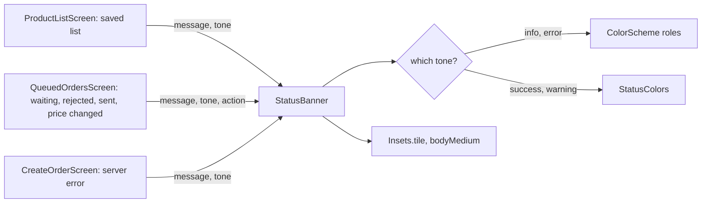

## Bạn cần biết trước

- [[frontend.l3.theme-extension]] — bạn biết `StatusColors` thêm hai vai trò `warning` và `success` vào theme, đọc bằng `Theme.of(context).extension<StatusColors>()`.
- [[frontend.l3.sync-conflicts]] — bạn biết `Waiting orders` cảnh báo khi một đơn đã gửi bị tính tổng tiền khác với tổng khách đã thấy.
- [[frontend.l2.server-errors-in-forms]] — bạn biết `CreateOrderScreen` hiện `detail` của API phía trên nút gửi khi đơn bị từ chối.

## Tình huống

Bạn đang thêm cảnh báo cho một đơn trong hàng đợi bị tính tổng tiền khác. `ProductListScreen` đã có một cảnh báo phía trên danh sách đã lưu, và designer muốn hai cảnh báo trông như nhau: cùng màu hổ phách, cùng padding, cùng cỡ chữ. Tháng sau màu hổ phách sẽ đổi.

Chép cảnh báo của danh sách đã lưu sang `QueuedOrdersScreen` (màn hình `Waiting orders`) chỉ mất một phút. Rồi sẽ có hai bản sao, và thêm lỗi server ở form đặt hàng, đơn đang chờ, đơn bị từ chối là thành năm. Sau này mỗi lần đổi một màu hay một padding đều phải đi tìm từng bản sao. Một widget dùng chung nên xin màn hình điều gì, để mọi cảnh báo trông giống nhau và chỉ đổi ở một chỗ?

## Khái niệm cốt lõi

- **thư viện component** (component library) — các widget dùng chung mà mọi màn hình dùng cho cùng một việc. Chúng nhận ý nghĩa từ màn hình, còn màu, khoảng cách và kiểu chữ thì lấy từ theme.
- `LoadingView` — widget dùng chung mà cả màn hình hiện trong lúc tải dữ liệu: một spinner ở giữa.
- `MessageView` — widget dùng chung mà màn hình hiện thay cho dữ liệu: một thông báo ở giữa và nhiều nhất một hành động.
- `StatusBanner` — widget dùng chung cho một thông báo ngắn nằm cạnh phần còn lại của màn hình, tô màu theo ý nghĩa của thông báo, có nhiều nhất một hành động.
- `StatusTone` — bốn ý nghĩa mà một `StatusBanner` có thể mang: `info`, `success`, `warning` và `error`.

## Cơ chế hoạt động



Trong tình huống trên, widget dùng chung đó là `StatusBanner`, và các cảnh báo, các lỗi trở thành những lần gọi nó. Ở stage-3, DonHang.App giữ thư viện component trong một thư mục, `lib/design/components/`, gồm ba widget: `LoadingView`, `MessageView` và `StatusBanner`. Các màn hình tải sản phẩm hoặc đơn hàng hiện `LoadingView` trong lúc tải và `MessageView` khi không có gì để hiện — lỗi tải, hoặc danh sách rỗng — thay vì mỗi màn hình tự viết spinner hay dòng chữ ở giữa của riêng mình.

Đọc sơ đồ từ trái sang. Màn hình truyền vào điều nó muốn nói: một thông báo, một tone như `StatusTone.warning`, và khi cần thì thêm nhãn hành động cùng `onAction`, hàm sẽ chạy khi người dùng chạm vào hành động. Màn hình không truyền màu, padding hay kiểu chữ nào. Banner tự đổi tone thành màu nền và màu chữ lấy từ theme: vai trò của `ColorScheme` cho `info` và `error`, `StatusColors` cho `success` và `warning`. Padding của banner là token `Insets.tile`, còn kiểu chữ là `bodyMedium` của theme.

Vì không màn hình nào giữ màu, cảnh báo của danh sách đã lưu, các đơn đang chờ, bị từ chối và đổi giá, cùng lỗi server của `CreateOrderScreen` đều trông giống nhau. Một giá trị `warning` mới trong `StatusColors`, hay một `Insets.tile` mới, đổi cùng lúc mọi banner dùng nó.

Giờ các tham số là hợp đồng với mọi màn hình gọi banner. Thêm một tham số có tên, không bắt buộc, không làm đổi lời gọi nào đang có. Đổi tên hay bỏ một tham số là breaking change: mọi lời gọi có truyền tham số đó sẽ không compile được nữa. Vì vậy, khi nhiều màn hình cùng gọi component, chỉ thêm tham số khi có màn hình cần, không thêm phòng khi sau này có màn hình cần.

## Trong hệ thống Đơn Hàng

Phần đầu của `StatusBanner`, trong `DonHang.App/lib/design/components/status_banner.dart` ở stage-3:

```dart file=DonHang.App/lib/design/components/status_banner.dart tag=stage-3 lines=19-39
class StatusBanner extends StatelessWidget {
  final String message;
  final StatusTone tone;
  final String? actionLabel;
  final VoidCallback? onAction;

  const StatusBanner({super.key, required this.message, required this.tone, this.actionLabel, this.onAction});

  // lesson: frontend.l3.component-library
  // The background and the text color for each tone, both from the theme:
  // ColorScheme's roles where Material has one, StatusColors where not.
  (Color, Color) _colors(BuildContext context) {
    final scheme = Theme.of(context).colorScheme;
    final status = Theme.of(context).extension<StatusColors>()!;
    return switch (tone) {
      StatusTone.info => (scheme.secondaryContainer, scheme.onSecondaryContainer),
      StatusTone.success => (status.success, status.onSuccess),
      StatusTone.warning => (status.warning, status.onWarning),
      StatusTone.error => (scheme.errorContainer, scheme.onErrorContainer),
    };
  }
```

`message` và `tone` là `required`, còn `actionLabel` và `onAction` là tùy chọn, nên một banner không có hành động chỉ cần hai đối số. Không có tham số `Color` nào cả. `_colors` trả về một cặp màu cho tone: màu nền và màu chữ nằm trên nền đó, cả hai đọc từ theme. `build`, nằm dưới đoạn trích, vẽ một `Material` với màu nền đó, đệm bằng `Insets.tile`, hiện thông báo bằng `bodyMedium` và hành động là một `TextButton` mang màu chữ. `Material` là widget Flutter tô một bề mặt có màu. Màu nền của banner chính là `color` của `Material`, nên test mới tìm được.

Các lời gọi nằm trong các màn hình, ngoài đoạn trích. Trong `queued_orders_screen.dart`, mỗi đơn trong hàng đợi thành một banner: `info` khi đang chờ, `error` kèm hành động xóa khi bị từ chối, `success` khi đã gửi, hoặc `warning` khi tổng tiền bị tính khác.

Test giữ banner đúng hợp đồng, trong `DonHang.App/test/design/status_banner_test.dart`:

```dart file=DonHang.App/test/design/status_banner_test.dart tag=stage-3 lines=24-45
  // lesson: frontend.l3.component-library
  // One banner per tone: the screen passes a meaning, the banner finds the
  // colors, so its background is the theme's role for that tone.
  for (final tone in StatusTone.values) {
    testWidgets('a ${tone.name} banner takes its background from the theme', (tester) async {
      var tapped = false;
      await tester.pumpWidget(MaterialApp(
        theme: theme,
        home: Scaffold(
          body: StatusBanner(message: 'Something happened.', tone: tone, actionLabel: 'Undo', onAction: () => tapped = true),
        ),
      ));

      expect(find.text('Something happened.'), findsOneWidget);
      await tester.tap(find.widgetWithText(TextButton, 'Undo'));
      expect(tapped, isTrue);
      final background = tester.widget<Material>(
        find.descendant(of: find.byType(StatusBanner), matching: find.byType(Material)).first,
      );
      expect(background.color, expectedBackground(theme, tone));
    });
  }
```

Vòng lặp tạo một test cho mỗi giá trị của `StatusTone`, nên tone nào cũng được kiểm. `theme` là theme sáng thật, dựng phía trên đoạn trích bằng `buildTheme`. Mỗi test tìm thông báo, chạm vào hành động và kiểm tra `onAction` đã chạy. Dòng cuối so màu nền của banner với `expectedBackground`, một hàm trợ giúp phía trên đoạn trích, chỉ ra vai trò trong theme ứng với từng tone. Một test thứ hai, dưới đoạn trích, kiểm tra rằng banner không có nhãn hành động thì không hiện nút nào.

## Senior hay nhầm rằng…

- **"Component dùng chung nên nhận một tham số màu cho từng phần, để mỗi màn hình tự chỉnh."** → Thực ra mỗi tham số màu lại trả quyết định về cho các màn hình, và các banner lệch nhau dần qua từng lời gọi. Với tone, màn hình chỉ nói được ý nghĩa, còn giao diện được quyết một lần, trong banner và theme. Nếu màn hình cần một ý nghĩa mà bốn tone chưa có, hãy thêm tone, đừng thêm màu. Bạn sẽ nhận ra bản dùng tham số màu khi hai cảnh báo hiện hai màu hổ phách hơi khác nhau, và đổi theme chỉ cập nhật một trong hai.
- **"Thư viện component phải là một package riêng, một thư mục trong app thì không tính."** → Thực ra điều làm nên một thư viện là các màn hình dùng nó thay vì dựng lại, chứ không phải nó nằm ở đâu. Package riêng là một project độc lập mà app thêm vào làm dependency, và nó đáng làm khi nhiều app cùng dùng một bộ component. DonHang.App chỉ là một app, nên một thư mục là đủ. Bạn sẽ nhận ra tách quá sớm khi mỗi lần đổi `StatusBanner` lại kéo theo sửa chính app duy nhất dùng nó, qua một ranh giới không ai khác cần.
- **"Khi component đã dùng chung, màn hình nào cũng phải dùng nó, kể cả chỗ không hợp."** → Thực ra comment của mỗi component nói rõ chỗ nào nó không hợp. Comment của `LoadingView` ghi rằng nó "không dành cho nút đang bận: hãy vô hiệu hóa nút", đúng như `CreateOrderScreen` làm trong lúc gửi. `AuthCallbackScreen` vẫn tự vẽ spinner với một dòng "đang đăng nhập" bên dưới, thứ mà `LoadingView` không có tham số nào cho. Bạn sẽ nhận ra kiểu dùng lại gượng ép khi một component có thêm một tham số mà chỉ một màn hình từng truyền.

## Thử ngay (3 phút)

1. Trong repo Đơn Hàng, chuyển sang tag bằng `git switch --detach stage-3`.
2. Chạy `grep -rn -F "StatusBanner(" DonHang.App/lib/screens`.
3. Chạy `grep -rni "color" DonHang.App/lib/screens`.

Kết quả mong đợi: lệnh đầu cho tám kết quả: sáu trong `queued_orders_screen.dart` (ba cho các đơn trong hàng đợi, trong đó một lời gọi dùng cho cả hai trường hợp đã gửi, và ba cho biết vì sao hàng đợi tạm dừng gửi), `product_list_screen.dart` và `create_order_screen.dart` mỗi file một kết quả. Lệnh thứ hai không in gì: không màn hình nào gọi tên một màu.

Giờ designer muốn đơn bị từ chối có viền đỏ. Một đồng đội đề xuất thêm `Color? borderColor` vào `StatusBanner`. Bạn hỏi gì trước, và bạn sẽ đổi gì thay vào đó?

<details><summary>Gợi ý đáp án</summary>

Hỏi xem viền đó mang ý nghĩa gì. Nếu nó nghĩa là "đây là lỗi", nó thuộc về tone `error` bên trong `StatusBanner`, lấy màu từ các vai trò lỗi của theme. Khi đó lỗi server của `CreateOrderScreen` cũng có viền, và hai chỗ vẫn giống nhau. Nếu nó mang một ý nghĩa mà cả bốn tone chưa nói được, đó là lý do để thêm một tone mới. Tham số `borderColor` sẽ cho mỗi màn hình tự chọn màu đỏ của riêng mình, và sau này bỏ nó đi sẽ làm hỏng mọi lời gọi có truyền nó.

</details>

## Liên hệ

- [[frontend.l3.theme-extension]] — nguồn của hai màu `warning` và `success` trong banner: các vai trò của `StatusColors`.
- [[frontend.l1.composing-widgets]] — cùng ý tưởng, tiến thêm một bước: constructor của widget là hợp đồng của nó, giờ được mọi màn hình dùng chung.
- [[design.l3.module-contracts]] — cùng quy tắc ở backend: bên gọi chỉ phụ thuộc vào một hợp đồng nhỏ, nên thứ tốn kém là đổi hợp đồng.
- [[frontend.l3.rebuild-scope]] — vì sao các màn hình viết được `const LoadingView()`: `const` cho Flutter bỏ qua phần lớn công việc dựng lại widget đó khi widget cha dựng lại.
- [[frontend.l3.brand-themes]] — bước tiếp theo: vì không component nào giữ màu, thương hiệu thứ hai chỉ là một bộ giá trị token thứ hai.

## Tóm tắt 5 dòng

1. Component dùng chung nhận điều màn hình muốn nói, rồi tự lấy màu, khoảng cách và kiểu chữ từ theme.
2. Ở stage-3, thư viện component của DonHang.App là `lib/design/components/`: `LoadingView`, `MessageView` và `StatusBanner`.
3. `StatusBanner` nhận một thông báo, một `StatusTone` và một hành động tùy chọn, không màn hình nào truyền màu cho nó, nên mọi banner đổi cùng nhau.
4. Tham số của component là hợp đồng với mọi bên gọi: thêm một tham số tùy chọn thì rẻ, đổi tên hay bỏ một tham số thì hỏng mọi lời gọi.
5. Một widget test ở stage-3 dựng banner ở từng tone và kiểm tra thông báo, hành động và màu nền lấy từ theme.
