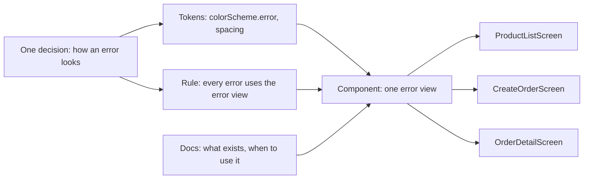

## Before you start

- [[frontend.l2.theme-and-color-scheme]] — you know widgets take their colors from named roles of one theme, and that `Theme.of(context).colorScheme.error` is a design token.
- [[frontend.l2.server-errors-in-forms]] — you know `CreateOrderScreen` shows the API's `detail` above the button in the theme's error color.
- [[frontend.l1.composing-widgets]] — you know a widget is a class with one reason to change, and its constructor parameters are its contract.

## The situation

The team agrees on two small changes to DonHang.App: while something loads, show a short text under the spinner, and give every error message the same look as the order form's server error. You search the app at stage-2 for the spinner and find the same spinner written by hand on four screens, and a different one on a fifth. The error texts are written by hand too, and they do not look alike. Nothing is broken, yet one agreed change becomes four separate edits, and a missed screen would look different from the rest. What would DonHang.App need so that a visual decision is made once and every screen follows it?

## Core concepts

- **design system** — a product's shared design tokens, ready-made components, rules for using them and their documentation, so each screen reuses decisions instead of making them again.
- component — here, a widget written once for a piece of screen that repeats, such as a loading view, that every screen uses instead of building its own.
- usage rule — a sentence saying when to use which token or component, such as "every error message uses the error view".
- documentation — the place a teammate reads what tokens and components exist and how to use them, before writing a new one.

## How it works



Read the diagram from the left; the three screens stand for every screen. A design system starts with a decision, such as how an error looks. The decision is recorded as design tokens: the error color role, and how much space sits around the message. Tokens alone do not stop each screen from arranging them its own way, so the decision also becomes a component: one widget that draws an error message, built from those tokens.

The rule says which screens must use the component, and the documentation tells a teammate it exists, so the next screen does not write its own. All four parts aim at the same result. Each screen then asks for "an error message" and gets the agreed look, and a change to the look is one edit in one place.

In the situation above, DonHang.App has only part of this. It already has tokens for color: the theme's roles. It has no component for loading or for an error, no written rule and no documentation of either, so each screen makes the same decision again. That is why one agreed change turns into four edits.

A design system is a tool with a cost. It pays off when several screens, or several apps, must look alike and change together. For a single screen, a shared component only adds one more file to read, and the screen's own code is easier to follow. The question is how many places repeat a decision, not whether a design system is good in general.

## In the Đơn Hàng system

How `ProductDetailScreen` shows its three cases at stage-2:

```dart file=DonHang.App/lib/screens/product_detail_screen.dart tag=stage-2 lines=22-34
      body: product.when(
        loading: () => const Center(child: CircularProgressIndicator()),
        error: (error, stackTrace) => Center(child: Text(l10n.productLoadError)),
        data: (product) => Padding(
          padding: const EdgeInsets.all(16),
          child: Column(
            crossAxisAlignment: CrossAxisAlignment.start,
            children: [
              Text(product.name, style: Theme.of(context).textTheme.headlineSmall),
              Text(l10n.productPrice(product.priceVnd)),
              const SizedBox(height: 16),
              FilledButton(onPressed: () => context.go('/orders/new'), child: Text(l10n.placeOrder)),
            ],
```

Look at the `loading:` and `error:` lines; `CircularProgressIndicator` is the spinner. `ProductListScreen`, `CreateOrderScreen` and `OrderDetailScreen` contain the same `const Center(child: CircularProgressIndicator())` and their own `Center(child: Text(...))` for an error. Four copies of one decision means four edits to change it.

Now look at the numbers. The text style comes from a theme role, `textTheme.headlineSmall`, but the padding is a raw `16`, and so is the gap above the button. `ProductTile`, outside this excerpt, pads its row with a raw `12`. Colors go through the theme; spacing does not. To change the screen padding you would search for `16` and decide, one match at a time, which ones mean "screen padding".

Besides its centered load error, `CreateOrderScreen` shows a second kind of error: the API's answer after the order is submitted.

```dart file=DonHang.App/lib/screens/create_order_screen.dart tag=stage-2 lines=106-110
          const SizedBox(height: 16),
          if (_serverError != null)
            Text(_serverError!, style: TextStyle(color: Theme.of(context).colorScheme.error)),
          const SizedBox(height: 8),
          FilledButton(onPressed: _sending ? null : _submit, child: Text(l10n.submitOrder)),
```

Its gaps are raw too: `16` above the message, `8` below it. The color is the right role, `colorScheme.error`, so it follows the theme. But the choice "an error is a `Text` in the error color" lives only in this screen. Every other screen that shows an error must repeat it to look the same, and the plain centered texts in the first excerpt already do not. This lesson changes no code; the next lessons of this module give these values names and these pieces a shared widget.

## Seniors often assume…

- **"A design system is the designers' drawing file; the app code only copies its colors."** → Actually the drawing file shows the decisions, but the tokens, components and rules that make every screen follow them live in the app's code. You notice this when the drawing changes and four screens still show the old spinner, because each one copied it by hand.
- **"DonHang.App already uses ColorScheme everywhere, so it already has a design system."** → Actually color roles are one kind of design token. Spacing is still raw numbers, loading and error views are rebuilt on each screen, and no rule or documentation exists. You notice this when a search for `16` to change the screen padding also finds gaps that mean something else.
- **"A design system should be complete before the second screen is written, so nothing is ever duplicated."** → Actually, until a piece repeats, it is hard to tell which parts of it are the same everywhere. When a component is extracted after it repeats on a few screens, its shape comes from real uses. You notice the early version when a shared widget gains one extra parameter for each screen's exception.

## Try it (3 minutes)

1. In the Đơn Hàng repository, switch to the tag with `git switch --detach stage-2`.
2. Run `grep -rn "CircularProgressIndicator" DonHang.App/lib`.
3. Read each match and note how the loading state looks on that screen.

Expected result: five matches, all under `DonHang.App/lib/screens/`. Four are the same `const Center(child: CircularProgressIndicator())`; the fifth, in `auth_callback_screen.dart`, puts the spinner in a list with a `SizedBox` and a text.

If the team now decides how loading looks, how many places do you edit, and which screen already shows a different loading look?

<details><summary>Suggested answer</summary>

Five places, one per match, because no shared widget exists. Four are the copies counted above; the fifth, `auth_callback_screen.dart`, is the screen that already drifted: a spinner with a text below it. Nobody decided the screens should differ; each one simply made its own choice. With one loading component, there would be one place to edit and no screen could drift.

</details>

## Connections

- [[frontend.l2.theme-and-color-scheme]] — the part of a design system DonHang.App already has: color decided once, as theme roles.
- [[frontend.l2.dark-mode]] — a decision made once in the theme that every screen follows without being edited, which is what this lesson wants for spacing and messages.
- [[frontend.l3.semantic-tokens]] — the next step: names for the raw spacing numbers found here.
- [[frontend.l3.component-library]] — the fix for the four copies of the loading and error views.
- [[frontend.l3.offline-first]] — adds a warning to the product list, one more message that should look like the others.

## Five-line summary

1. A design system is shared tokens, components, usage rules and documentation, so each screen reuses a visual decision instead of making it again.
2. At stage-2 four screens each write their own loading spinner and centered error text, so changing either means four edits.
3. Colors already go through theme roles, but screens and `ProductTile` still write raw spacing numbers such as `16`, `12` and `8`.
4. `CreateOrderScreen` uses the right role, `colorScheme.error`, yet "how an error looks" is a choice only that screen makes.
5. A design system pays off when many screens or apps must look alike and change together; for one screen it adds a file.
