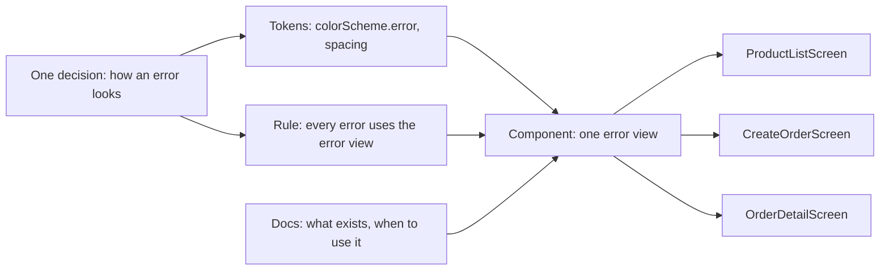

## Bạn cần biết trước

- [[frontend.l2.theme-and-color-scheme]] — bạn biết widget lấy màu từ các vai trò có tên của một theme duy nhất, và `Theme.of(context).colorScheme.error` là một design token.
- [[frontend.l2.server-errors-in-forms]] — bạn biết `CreateOrderScreen` hiện `detail` của API phía trên nút, bằng màu lỗi của theme.
- [[frontend.l1.composing-widgets]] — bạn biết widget là một class chỉ có một lý do để thay đổi, và các tham số constructor là hợp đồng của nó.

## Tình huống

Cả nhóm thống nhất hai thay đổi nhỏ cho DonHang.App: trong lúc tải, hiện một dòng chữ ngắn dưới spinner, và cho mọi thông báo lỗi cùng một kiểu với lỗi server ở form đặt hàng. Bạn tìm spinner trong app ở stage-2 và thấy cùng một spinner được viết tay ở bốn màn hình, còn màn hình thứ năm dùng một kiểu khác. Các dòng báo lỗi cũng viết tay, và trông không giống nhau. Không có gì hỏng, nhưng một thay đổi đã thống nhất lại thành bốn lần sửa riêng, và màn hình nào bị sót sẽ trông lệch so với phần còn lại. DonHang.App cần gì để một quyết định về giao diện chỉ phải đưa ra một lần, rồi mọi màn hình theo đó?

## Khái niệm cốt lõi

- **design system** (Bộ design token, component dùng chung, quy tắc dùng và tài liệu mà mọi màn hình của một sản phẩm cùng theo) — các design token, component dựng sẵn, quy tắc dùng chúng và tài liệu đi kèm mà cả sản phẩm dùng chung, để mỗi màn hình dùng lại quyết định có sẵn thay vì tự quyết lại.
- component — ở đây là một widget viết một lần cho một mảng giao diện lặp lại, như phần hiển thị lúc đang tải, để mọi màn hình dùng thay vì tự dựng.
- quy tắc dùng — một câu nói rõ khi nào dùng token hay component nào, như "mọi thông báo lỗi đều dùng error view".
- tài liệu — chỗ đồng nghiệp đọc để biết có những token và component nào, dùng ra sao, trước khi tự viết cái mới.

## Cơ chế hoạt động



Đọc sơ đồ từ trái sang. Ba màn hình bên phải đại diện cho mọi màn hình. Design system bắt đầu từ một quyết định, chẳng hạn lỗi trông thế nào. Quyết định đó được ghi thành design token: vai trò màu lỗi, và khoảng trống quanh thông báo. Chỉ có token thì chưa ngăn được mỗi màn hình tự sắp xếp chúng theo kiểu riêng, nên quyết định còn được đóng thành một component: một widget duy nhất vẽ thông báo lỗi, dựng từ chính các token đó.

Quy tắc nói màn hình nào phải dùng component, còn tài liệu cho đồng nghiệp biết component đó đã có, để màn hình tiếp theo không tự viết lại. Cả bốn phần cùng nhắm tới một kết quả. Khi đó mỗi màn hình chỉ cần xin "một thông báo lỗi" là nhận đúng kiểu đã thống nhất, và đổi kiểu đó chỉ là một lần sửa ở một chỗ.

Trong tình huống trên, DonHang.App mới có một phần. App đã có token cho màu: các vai trò của theme. App chưa có component cho trạng thái đang tải hay cho lỗi, chưa có quy tắc viết ra và chưa có tài liệu cho cả hai, nên màn hình nào cũng tự quyết lại cùng một chuyện. Đó là lý do một thay đổi đã thống nhất biến thành bốn lần sửa.

Design system là công cụ, và có cái giá của nó. Nó đáng làm khi nhiều màn hình, hoặc nhiều app, phải trông giống nhau và đổi cùng nhau. Với một màn hình duy nhất, component dùng chung chỉ thêm một file phải đọc, và code riêng của màn hình còn dễ theo dõi hơn. Câu hỏi là có bao nhiêu chỗ lặp lại một quyết định, chứ không phải design system nói chung có tốt hay không.

## Trong hệ thống Đơn Hàng

Cách `ProductDetailScreen` hiện ba trường hợp của nó ở stage-2:

```dart file=DonHang.App/lib/screens/product_detail_screen.dart tag=stage-2 lines=22-34
      body: product.when(
        loading: () => const Center(child: CircularProgressIndicator()),
        error: (error, stackTrace) => Center(child: Text(l10n.productLoadError)),
        data: (product) => Padding(
          padding: const EdgeInsets.all(16),
          child: Column(
            crossAxisAlignment: CrossAxisAlignment.start,
            children: [
              Text(product.name, style: Theme.of(context).textTheme.headlineSmall),
              Text(l10n.productPrice(product.priceVnd)),
              const SizedBox(height: 16),
              FilledButton(onPressed: () => context.go('/orders/new'), child: Text(l10n.placeOrder)),
            ],
```

Nhìn hai dòng `loading:` và `error:`. `CircularProgressIndicator` chính là spinner. `ProductListScreen`, `CreateOrderScreen` và `OrderDetailScreen` cũng chứa đúng `const Center(child: CircularProgressIndicator())` đó, cùng `Center(child: Text(...))` riêng của từng màn hình cho lỗi. Bốn bản sao của một quyết định nghĩa là bốn lần sửa khi muốn đổi nó.

Giờ nhìn các con số. Kiểu chữ lấy từ một vai trò của theme, `textTheme.headlineSmall`, nhưng padding là số thô `16`, khoảng cách phía trên nút cũng vậy. `ProductTile`, nằm ngoài đoạn trích này, đệm hàng của nó bằng số thô `12`. Màu đi qua theme, còn khoảng cách thì không. Muốn đổi padding của màn hình, bạn sẽ phải tìm `16` rồi xét từng kết quả xem cái nào nghĩa là "padding màn hình".

Ngoài lỗi tải hiện ở giữa màn hình, `CreateOrderScreen` còn hiện loại lỗi thứ hai: câu trả lời của API sau khi gửi đơn.

```dart file=DonHang.App/lib/screens/create_order_screen.dart tag=stage-2 lines=106-110
          const SizedBox(height: 16),
          if (_serverError != null)
            Text(_serverError!, style: TextStyle(color: Theme.of(context).colorScheme.error)),
          const SizedBox(height: 8),
          FilledButton(onPressed: _sending ? null : _submit, child: Text(l10n.submitOrder)),
```

Các khoảng cách ở đây cũng là số thô: `16` phía trên thông báo, `8` phía dưới. Màu thì đúng vai trò, `colorScheme.error`, nên đi theo theme. Nhưng lựa chọn "lỗi là một `Text` màu lỗi" chỉ nằm trong màn hình này. Màn hình nào khác muốn hiện lỗi giống vậy đều phải lặp lại nó, và các dòng chữ trơn ở giữa màn hình trong đoạn trích đầu đã không giống rồi. Bài này không đổi dòng code nào. Các bài tiếp theo của module sẽ đặt tên cho những giá trị này và gom những mảng này vào widget dùng chung.

## Senior hay nhầm rằng…

- **"Design system là file bản vẽ của designer, code app chỉ chép màu từ đó."** → Thực ra file bản vẽ cho thấy các quyết định, còn token, component và quy tắc khiến mọi màn hình theo các quyết định đó thì nằm trong code của app. Bạn sẽ nhận ra khi bản vẽ đổi mà bốn màn hình vẫn hiện spinner cũ, vì mỗi màn hình đã tự chép tay.
- **"DonHang.App dùng ColorScheme ở khắp nơi, nên đã có design system rồi."** → Thực ra vai trò màu chỉ là một loại design token. Khoảng cách vẫn là số thô, phần hiển thị lúc tải và lúc lỗi vẫn được dựng lại ở từng màn hình, và chưa có quy tắc hay tài liệu nào. Bạn sẽ nhận ra khi tìm `16` để đổi padding màn hình lại ra cả những khoảng cách mang nghĩa khác.
- **"Design system phải xong trước khi viết màn hình thứ hai, để không bao giờ có gì trùng lặp."** → Thực ra khi một mảng giao diện chưa lặp lại, rất khó biết phần nào của nó giống nhau ở mọi nơi. Khi component được tách ra sau khi đã lặp lại ở vài màn hình, hình dạng của nó đến từ cách dùng thật. Bạn sẽ nhận ra bản làm quá sớm khi một widget dùng chung cứ thêm một tham số cho mỗi ngoại lệ của từng màn hình.

## Thử ngay (3 phút)

1. Trong repo Đơn Hàng, chuyển sang tag bằng `git switch --detach stage-2`.
2. Chạy `grep -rn "CircularProgressIndicator" DonHang.App/lib`.
3. Đọc từng kết quả và ghi lại trạng thái đang tải trông thế nào ở màn hình đó.

Kết quả mong đợi: năm kết quả, tất cả nằm trong `DonHang.App/lib/screens/`. Bốn cái là cùng một `const Center(child: CircularProgressIndicator())`. Cái thứ năm, trong `auth_callback_screen.dart`, đặt spinner trong một danh sách cùng một `SizedBox` và một dòng chữ.

Nếu giờ nhóm quyết định trạng thái đang tải trông thế nào, bạn phải sửa bao nhiêu chỗ, và màn hình nào đã có kiểu tải khác?

<details><summary>Gợi ý đáp án</summary>

Năm chỗ, mỗi kết quả một chỗ, vì chưa có widget dùng chung nào. Bốn chỗ là các bản sao đã đếm ở trên. Chỗ thứ năm, `auth_callback_screen.dart`, là màn hình đã lệch sẵn: spinner kèm một dòng chữ bên dưới. Không ai quyết định các màn hình phải khác nhau, mỗi màn hình chỉ tự chọn theo ý mình. Có một component cho trạng thái đang tải thì chỉ còn một chỗ phải sửa, và không màn hình nào lệch được.

</details>

## Liên hệ

- [[frontend.l2.theme-and-color-scheme]] — phần design system mà DonHang.App đã có: màu được quyết một lần, dưới dạng các vai trò của theme.
- [[frontend.l2.dark-mode]] — một quyết định đưa ra một lần trong theme mà mọi màn hình theo mà không cần sửa, đúng điều bài này muốn cho khoảng cách và thông báo.
- [[frontend.l3.semantic-tokens]] — bước tiếp theo: đặt tên cho các số khoảng cách thô tìm thấy ở đây.
- [[frontend.l3.component-library]] — cách xử lý bốn bản sao của phần hiển thị lúc tải và lúc lỗi.
- [[frontend.l3.offline-first]] — thêm một cảnh báo vào danh sách sản phẩm, thêm một thông báo nữa lẽ ra phải trông giống các thông báo khác.

## Tóm tắt 5 dòng

1. Design system là token, component, quy tắc dùng và tài liệu dùng chung, để mỗi màn hình dùng lại một quyết định giao diện thay vì tự quyết lại.
2. Ở stage-2, bốn màn hình tự viết spinner tải và dòng lỗi ở giữa màn hình của riêng mình, nên đổi cái nào cũng là bốn lần sửa.
3. Màu đã đi qua vai trò của theme, nhưng các màn hình và `ProductTile` vẫn viết số khoảng cách thô như `16`, `12` và `8`.
4. `CreateOrderScreen` dùng đúng vai trò `colorScheme.error`, nhưng "lỗi trông thế nào" là lựa chọn chỉ màn hình đó đưa ra.
5. Design system đáng làm khi nhiều màn hình hoặc nhiều app phải trông giống nhau và đổi cùng nhau, còn với một màn hình, nó chỉ thêm một file.
