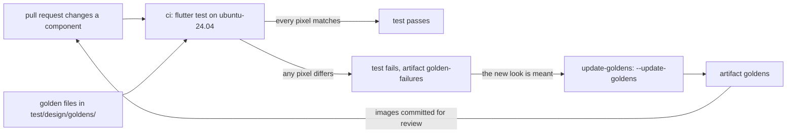

## Before you start

- [[frontend.l3.component-gallery]] — you know `galleryExamples`, the list of shared components in each state that the gallery shows in light and dark.
- [[frontend.l2.overriding-providers-in-tests]] — you know a widget test builds a widget with `testWidgets` and `tester.pumpWidget`, then checks its tree with `find` and `expect`.
- [[devops.l2.workflow-artifacts]] — you know `actions/upload-artifact` stores files with a workflow run as an artifact.

## The situation

A pull request changes one line in `lib/design/tokens.dart`: `Insets.tile`, the semantic token for padding in tiles and banners, now uses `Space.sm` instead of `Space.md`. On your Windows laptop you run the tests the way `STAGE.md` says, with `--exclude-tags golden`, and all of them pass. `status_banner_test.dart` still finds the message, taps the button and gets the right background color.

Yet `StatusBanner` pads its message with `Insets.tile`, so every banner now has less room. The diff is one word, and nothing that `status_banner_test.dart` checks changed: the same widgets, only a padding value no test reads. How does a test fail when a component looks different, even though everything a widget test checks is still the same?

## Core concepts

- **golden test** — a test that renders a widget to an image and compares it, pixel by pixel, with an approved image file kept in the repository; any difference fails the test.
- That approved image is called the golden file; at stage-3 the golden files sit in `DonHang.App/test/design/goldens/`.
- Tests can carry a tag, a name that lets one run include them (`flutter test --tags golden`) or skip them (`--exclude-tags golden`).

## How it works



In the situation above, the golden test is what would catch the narrower padding. It builds one gallery entry in a fixed frame, as a widget test does, then draws that frame into an image. `matchesGoldenFile('goldens/….png')` compares the image with the golden file of that name, found relative to the test file. If one pixel differs, the test fails.

A widget test and a golden test ask different questions. A widget test asks what the tree contains: a text, a button, the background color the banner is given. A golden test asks how the result looks. A spacing token, a color role the widget test never reads, a changed alignment: each changes pixels, so each fails the golden test.

Pixels also depend on the machine. Flutter's documentation warns that text can render differently on different operating systems, so an image made on Windows will likely differ from one made on Linux. At stage-3, golden files are therefore made and compared in one place only, the `ubuntu-24.04` runner of the `ci` workflow. The tests carry the tag `golden`: you skip them on your own machine, and the plain `flutter test` in `ci` runs them.

When a test fails in `ci`, Flutter writes the images that did not match, and their differences, into a `failures` folder, and `ci.yml` keeps it as the artifact `golden-failures`. If the new look is meant, the old golden files are now wrong. `flutter test --update-goldens` writes new files instead of comparing. At stage-3 a workflow you start by hand, `update-goldens`, runs it on the same Linux runner and uploads the images as the artifact `goldens`. You copy them into the pull request. Committing them is the decision "this is the new look", so the reviewer looks at the images, not only the code.

## In the Đơn Hàng system

The golden test, in `DonHang.App/test/design/components_golden_test.dart`. Above this excerpt the file starts with `@Tags(['golden'])`, which tags every test in the file; `DonHang.App/dart_test.yaml` declares that tag, with a description saying the images are made on `ubuntu-24.04`.

```dart file=DonHang.App/test/design/components_golden_test.dart tag=stage-3 lines=15-32
void main() {
  // lesson: frontend.l3.golden-tests
  // Each gallery example becomes an image and is compared, pixel by pixel,
  // with test/design/goldens/<name>_<light|dark>.png in the repository.
  // `flutter test --update-goldens` writes those files instead of comparing.
  for (final example in galleryExamples) {
    for (final brightness in Brightness.values) {
      testWidgets('${example.name} (${brightness.name}) looks as approved', (tester) async {
        await tester.pumpWidget(exampleFrame(example, brightness));

        await expectLater(
          find.byKey(frameKey),
          matchesGoldenFile('goldens/${example.name}_${brightness.name}.png'),
        );
      });
    }
  }
}
```

The two loops make one test per gallery entry and brightness: eight entries in two themes, sixteen tests, each with its own file such as `goldens/status_banner_warning_dark.png`.

`exampleFrame`, shared with the accessibility test, puts the entry in the app's theme inside a box 360 wide and 160 high, the same box on every run. `find.byKey(frameKey)` points at that box, so the image holds the component and its surface, not a whole screen. The comparison reads a file, so it uses `expectLater`, which, unlike `expect`, lets the test wait for the result.

The workflow that writes new images, `.github/workflows/update-goldens.yml`:

```yaml file=.github/workflows/update-goldens.yml tag=stage-3 lines=9-32
on:
  workflow_dispatch:

jobs:
  goldens:
    runs-on: ubuntu-24.04
    defaults:
      run:
        working-directory: DonHang.App
    steps:
      - uses: actions/checkout@11d5960a326750d5838078e36cf38b85af677262 # v4.4.0

      - uses: subosito/flutter-action@1a449444c387b1966244ae4d4f8c696479add0b2 # v2.23.0
        with:
          channel: stable
          flutter-version: 3.47.x

      - name: Write the golden images
        run: flutter test --tags golden --update-goldens

      - uses: actions/upload-artifact@ea165f8d65b6e75b540449e92b4886f43607fa02 # v4.6.2
        with:
          name: goldens
          path: DonHang.App/test/design/goldens/
```

`workflow_dispatch` means the workflow runs only when someone starts it by hand, for example from the Actions tab with Run workflow, picking a branch. The first steps check out the code and install Flutter `3.47.x`, and every command runs inside `DonHang.App`. `--tags golden` runs only the golden tests, and `--update-goldens` makes them write their files instead of comparing. The last step uploads the folder as `goldens`. The workflow commits nothing. Whoever accepts the new look puts the images into `test/design/goldens/` in a pull request, where GitHub can show each changed image beside its previous version.

## Seniors often assume…

- **"A failing golden test means the code is broken."** → Actually it means the picture changed, and that is a question, not a verdict. The change may be the bug, like the narrower padding, or the very thing the pull request set out to do. You notice this when a pull request that only changes the light warning color fails `status_banner_warning (light) looks as approved`, and the right answer is a new image, not a code fix.
- **"Golden files made on my machine will match on CI."** → Actually an image made on another operating system will likely differ in a few pixels, and the comparison accepts no difference at all. Images written with `--update-goldens` on Windows or macOS can fail on the Linux runner with no code change. You notice this when `ci` fails golden tests right after someone commits images from their laptop, and `golden-failures` shows differences you cannot see by eye.
- **"When a golden test fails, regenerating the images is the fix."** → Actually `--update-goldens` makes the test pass whatever the cause, because it replaces the approved image with the current look. If the change was not meant, like the `Insets.tile` edit, new images approve the bug. Open `golden-failures` first and decide whether the look should have changed. You notice the cost when a later pull request is the first to spot padding that shrank earlier, in images nobody reviewed as images.

## Try it (3 minutes)

1. In the Đơn Hàng repository, run `git switch --detach stage-3`, then list the files in `DonHang.App/test/design/goldens/`.
2. Open `status_banner_warning_light.png` and `status_banner_warning_dark.png` in any image viewer.

Expected result: the folder holds sixteen PNG files, one per gallery entry and theme, from `loading_view_dark.png` to `status_banner_warning_light.png`. The two images show the same warning banner, one on a light surface and one on a dark surface. The message shows as rows of solid blocks, not letters: tests draw text with a test font, and the image keeps exactly that.

Then answer: you change `Insets.tile` on purpose, to make banners tighter. In order, what happens and what do you do until the pull request can merge with the new look?

<details><summary>Suggested answer</summary>

You push the change in a pull request. `ci` runs `flutter test` on the Linux runner, and the golden tests of the entries that use `Insets.tile`, at least every `StatusBanner` entry in both themes, fail. You open the `golden-failures` artifact and check that the only difference is the padding you meant. You start `update-goldens` by hand on your branch, download its `goldens` artifact, copy the images into `DonHang.App/test/design/goldens/` and commit them to the pull request. `ci` passes, and the reviewer compares old and new images in the pull request before approving the new look.

</details>

## Connections

- [[frontend.l3.component-gallery]] — the same `galleryExamples` list, turned into images; a new entry gets a golden test without changing the test file.
- [[frontend.l3.accessibility-checks]] — the same frame and list checked against measured rules; the golden test catches the look those rules do not describe.
- [[frontend.l2.overriding-providers-in-tests]] — the widget test this builds on, asking a different question.
- [[devops.l2.workflow-artifacts]] — how `goldens` and `golden-failures` leave the runner that made them.
- [[devops.l2.quality-gate]] — the gate this test joins: a pull request whose look changed fails `ci` until new images are committed.
- [[design.l2.test-pyramid]] — where golden tests sit: fast tests of one widget, plus an image to review for each.

## Five-line summary

1. A golden test catches a change in how a component looks by comparing its rendered image, pixel by pixel, with an approved repository file.
2. `matchesGoldenFile('goldens/….png')` does the comparison; `flutter test --update-goldens` writes the image files instead of comparing.
3. A widget test checks what the tree contains; a golden test catches spacing, color and layout changes the widget test does not check.
4. Pixels differ between operating systems, so at stage-3 the tests tagged `golden` are made and compared only on the Linux CI runner.
5. A manual workflow uploads new images as an artifact; committing them accepts the new look, so they are reviewed as images.
