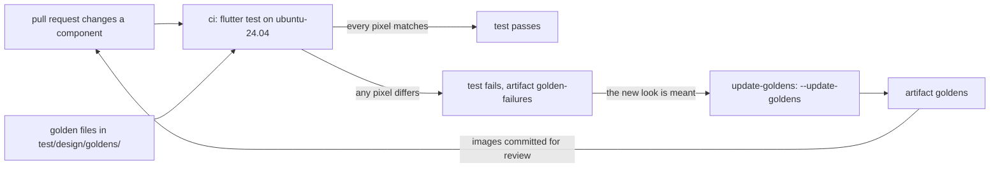

## Bạn cần biết trước

- [[frontend.l3.component-gallery]] — bạn biết `galleryExamples`, danh sách các component dùng chung ở từng trạng thái mà trang trưng bày hiện ở cả sáng lẫn tối.
- [[frontend.l2.overriding-providers-in-tests]] — bạn biết một widget test dựng widget bằng `testWidgets` và `tester.pumpWidget`, rồi kiểm cây widget bằng `find` và `expect`.
- [[devops.l2.workflow-artifacts]] — bạn biết `actions/upload-artifact` lưu file đi kèm một lần chạy workflow dưới dạng artifact.

## Tình huống

Một pull request đổi đúng một dòng trong `lib/design/tokens.dart`: `Insets.tile`, semantic token cho lề trong ô và banner, giờ dùng `Space.sm` thay vì `Space.md`. Trên laptop Windows, bạn chạy test đúng như `STAGE.md` hướng dẫn, với `--exclude-tags golden`, và mọi test đều qua. `status_banner_test.dart` vẫn tìm thấy dòng thông báo, vẫn bấm được nút và vẫn thấy đúng màu nền.

Thế nhưng `StatusBanner` dùng `Insets.tile` làm lề cho dòng thông báo, nên banner nào giờ cũng chật hơn. Diff chỉ có một từ, và không thứ gì `status_banner_test.dart` kiểm bị đổi: vẫn những widget đó, chỉ khác một giá trị lề mà không test nào đọc. Vậy làm sao để một test hỏng khi component trông khác đi, dù mọi thứ widget test kiểm vẫn y nguyên?

## Khái niệm cốt lõi

- **golden test** (test vẽ widget thành ảnh rồi so từng pixel với file ảnh đã duyệt giữ trong repo) — chỉ cần lệch một pixel so với ảnh đã duyệt là test hỏng.
- Ảnh đã duyệt đó gọi là golden file. Ở stage-3, các golden file nằm trong `DonHang.App/test/design/goldens/`.
- Test có thể mang tag, một cái tên giúp một lần chạy chọn riêng chúng (`flutter test --tags golden`) hoặc bỏ qua chúng (`--exclude-tags golden`).

## Cơ chế hoạt động



Trong tình huống trên, golden test chính là thứ bắt được phần lề hẹp đi. Nó dựng một mục của trang trưng bày trong một khung cố định, giống widget test, rồi vẽ khung đó ra ảnh. `matchesGoldenFile('goldens/….png')` so ảnh đó với golden file cùng tên, tìm theo đường dẫn tính từ file test. Lệch một pixel là test hỏng.

Widget test và golden test hỏi hai câu khác nhau. Widget test hỏi trong cây có gì: một đoạn chữ, một nút bấm, màu nền mà banner được gán. Golden test hỏi kết quả trông ra sao. Một token khoảng cách, một vai trò màu mà widget test không hề đọc, một lần đổi căn lề: thứ nào cũng làm pixel đổi, nên thứ nào cũng làm golden test hỏng.

Pixel còn phụ thuộc vào máy. Tài liệu của Flutter cảnh báo chữ có thể được vẽ khác nhau trên các hệ điều hành khác nhau, nên ảnh tạo trên Windows nhiều khả năng sẽ khác ảnh tạo trên Linux. Vì thế ở stage-3, golden file chỉ được tạo và so ở một chỗ duy nhất: runner `ubuntu-24.04` của workflow `ci`. Các test mang tag `golden`: trên máy mình bạn bỏ qua chúng, còn lệnh `flutter test` trơn trong `ci` thì chạy chúng.

Khi test hỏng trong `ci`, Flutter ghi các ảnh không khớp, cùng phần chênh lệch, vào thư mục `failures`, và `ci.yml` giữ thư mục đó thành artifact `golden-failures`. Nếu giao diện mới là cố ý thì golden file cũ giờ đã sai. `flutter test --update-goldens` ghi file mới thay vì so. Ở stage-3, `update-goldens`, một workflow bạn khởi chạy bằng tay, chạy lệnh này trên cùng runner Linux và tải ảnh lên thành artifact `goldens`. Bạn chép các ảnh đó vào pull request. Commit chúng là quyết định "đây là giao diện mới", nên reviewer phải xem ảnh, không chỉ xem code.

## Trong hệ thống Đơn Hàng

Golden test nằm trong `DonHang.App/test/design/components_golden_test.dart`. Phía trên đoạn trích, file mở đầu bằng `@Tags(['golden'])`, gắn tag cho mọi test trong file. `DonHang.App/dart_test.yaml` khai báo tag đó, kèm mô tả rằng ảnh được tạo trên `ubuntu-24.04`.

```dart file=DonHang.App/test/design/components_golden_test.dart tag=stage-3 lines=15-32
void main() {
  // lesson: frontend.l3.golden-tests
  // Each gallery example becomes an image and is compared, pixel by pixel,
  // with test/design/goldens/<name>_<light|dark>.png in the repository.
  // `flutter test --update-goldens` writes those files instead of comparing.
  for (final example in galleryExamples) {
    for (final brightness in Brightness.values) {
      testWidgets('${example.name} (${brightness.name}) looks as approved', (tester) async {
        await tester.pumpWidget(exampleFrame(example, brightness));

        await expectLater(
          find.byKey(frameKey),
          matchesGoldenFile('goldens/${example.name}_${brightness.name}.png'),
        );
      });
    }
  }
}
```

Hai vòng lặp tạo một test cho mỗi cặp mục và brightness: tám mục trong hai theme, mười sáu test, mỗi test có file riêng, như `goldens/status_banner_warning_dark.png`.

`exampleFrame`, dùng chung với test accessibility, đặt mục vào theme của app bên trong một hộp rộng 360, cao 160, lần chạy nào cũng đúng hộp đó. `find.byKey(frameKey)` trỏ vào hộp này, nên ảnh chỉ chứa component và nền của nó, không phải cả màn hình. Phép so phải đọc file, nên test dùng `expectLater`: khác `expect`, nó cho test chờ kết quả.

Workflow ghi ảnh mới, `.github/workflows/update-goldens.yml`:

```yaml file=.github/workflows/update-goldens.yml tag=stage-3 lines=9-32
on:
  workflow_dispatch:

jobs:
  goldens:
    runs-on: ubuntu-24.04
    defaults:
      run:
        working-directory: DonHang.App
    steps:
      - uses: actions/checkout@11d5960a326750d5838078e36cf38b85af677262 # v4.4.0

      - uses: subosito/flutter-action@1a449444c387b1966244ae4d4f8c696479add0b2 # v2.23.0
        with:
          channel: stable
          flutter-version: 3.47.x

      - name: Write the golden images
        run: flutter test --tags golden --update-goldens

      - uses: actions/upload-artifact@ea165f8d65b6e75b540449e92b4886f43607fa02 # v4.6.2
        with:
          name: goldens
          path: DonHang.App/test/design/goldens/
```

`workflow_dispatch` nghĩa là workflow chỉ chạy khi có người khởi chạy bằng tay, chẳng hạn từ tab Actions với Run workflow, rồi chọn một branch. Các bước đầu checkout code và cài Flutter `3.47.x`, và mọi lệnh đều chạy bên trong `DonHang.App`. `--tags golden` chỉ chạy các golden test, còn `--update-goldens` khiến chúng ghi file thay vì so. Bước cuối tải thư mục lên thành `goldens`. Workflow không commit gì cả. Ai chấp nhận giao diện mới thì tự đưa ảnh vào `test/design/goldens/` trong một pull request, nơi GitHub hiện được từng ảnh đã đổi cạnh phiên bản trước của nó.

## Senior hay nhầm rằng…

- **"Golden test hỏng nghĩa là code hỏng."** → Thực ra nó chỉ nghĩa là hình đã đổi, và đó là một câu hỏi, chưa phải phán quyết. Thay đổi đó có thể là bug, như phần lề hẹp đi, hoặc chính là điều pull request muốn làm. Bạn sẽ nhận ra khi một pull request chỉ đổi màu cảnh báo của theme sáng làm hỏng `status_banner_warning (light) looks as approved`, và câu trả lời đúng là một ảnh mới, không phải sửa code.
- **"Golden file tạo trên máy mình sẽ khớp trên CI."** → Thực ra ảnh tạo trên hệ điều hành khác nhiều khả năng lệch vài pixel, mà phép so không chấp nhận chút chênh lệch nào. Ảnh ghi bằng `--update-goldens` trên Windows hay macOS có thể hỏng trên runner Linux dù code không đổi. Bạn sẽ nhận ra khi `ci` hỏng golden test ngay sau khi ai đó commit ảnh từ laptop của họ, và `golden-failures` cho thấy những chỗ khác mà mắt thường không thấy.
- **"Golden test hỏng thì tạo lại ảnh là xong."** → Thực ra `--update-goldens` làm test qua bất kể nguyên nhân là gì, vì nó thay ảnh đã duyệt bằng giao diện hiện tại. Nếu thay đổi không cố ý, như lần sửa `Insets.tile`, ảnh mới sẽ duyệt luôn cái bug. Hãy mở `golden-failures` trước và quyết định giao diện có nên đổi hay không. Bạn sẽ thấy cái giá khi một pull request về sau mới là cái đầu tiên phát hiện phần lề đã co lại từ trước, trong những ảnh chưa ai mở ra xem.

## Thử ngay (3 phút)

1. Trong repo Đơn Hàng, chạy `git switch --detach stage-3`, rồi liệt kê các file trong `DonHang.App/test/design/goldens/`.
2. Mở `status_banner_warning_light.png` và `status_banner_warning_dark.png` bằng trình xem ảnh bất kỳ.

Kết quả mong đợi: thư mục có mười sáu file PNG, mỗi cặp mục và theme một file, từ `loading_view_dark.png` tới `status_banner_warning_light.png`. Hai ảnh cho thấy cùng một banner cảnh báo, một trên nền sáng và một trên nền tối. Dòng thông báo hiện thành các hàng khối đặc chứ không phải chữ cái: test vẽ chữ bằng một font dành cho test, và ảnh giữ đúng như vậy.

Rồi trả lời: bạn cố ý đổi `Insets.tile` để banner gọn hơn. Theo thứ tự, chuyện gì xảy ra và bạn làm gì cho tới khi pull request merge được với giao diện mới?

<details><summary>Gợi ý đáp án</summary>

Bạn đẩy thay đổi lên trong một pull request. `ci` chạy `flutter test` trên runner Linux, và golden test của các mục dùng `Insets.tile` hỏng, ít nhất là mọi mục `StatusBanner` ở cả hai theme. Bạn mở artifact `golden-failures` và kiểm rằng chỗ khác duy nhất là phần lề bạn cố ý đổi. Bạn khởi chạy `update-goldens` bằng tay trên branch của mình, tải artifact `goldens` của nó về, chép ảnh vào `DonHang.App/test/design/goldens/` và commit vào pull request. `ci` qua, và reviewer so ảnh cũ với ảnh mới trong pull request trước khi duyệt giao diện mới.

</details>

## Liên hệ

- [[frontend.l3.component-gallery]] — cùng danh sách `galleryExamples`, giờ biến thành ảnh. Một mục mới tự có golden test mà không cần sửa file test.
- [[frontend.l3.accessibility-checks]] — cùng khung và cùng danh sách, kiểm theo các quy tắc đo được. Golden test bắt phần giao diện mà các quy tắc đó không mô tả.
- [[frontend.l2.overriding-providers-in-tests]] — widget test mà bài này dựa vào, với một câu hỏi khác.
- [[devops.l2.workflow-artifacts]] — cách `goldens` và `golden-failures` ra khỏi runner đã tạo ra chúng.
- [[devops.l2.quality-gate]] — cổng mà test này gia nhập: pull request nào đổi giao diện sẽ hỏng `ci` cho tới khi ảnh mới được commit.
- [[design.l2.test-pyramid]] — chỗ của golden test: test nhanh trên một widget, kèm một ảnh để duyệt cho mỗi test.

## Tóm tắt 5 dòng

1. Golden test bắt thay đổi về giao diện của component bằng cách so ảnh đã vẽ, từng pixel, với một file đã duyệt trong repo.
2. `matchesGoldenFile('goldens/….png')` làm phép so. `flutter test --update-goldens` ghi file ảnh thay vì so.
3. Widget test kiểm trong cây có gì. Golden test bắt thay đổi về khoảng cách, màu và bố cục mà widget test không kiểm.
4. Pixel khác nhau giữa các hệ điều hành, nên ở stage-3 các test mang tag `golden` chỉ được tạo và so trên runner CI Linux.
5. Một workflow chạy tay tải ảnh mới lên thành artifact. Commit chúng là chấp nhận giao diện mới, nên chúng được review dưới dạng ảnh.
