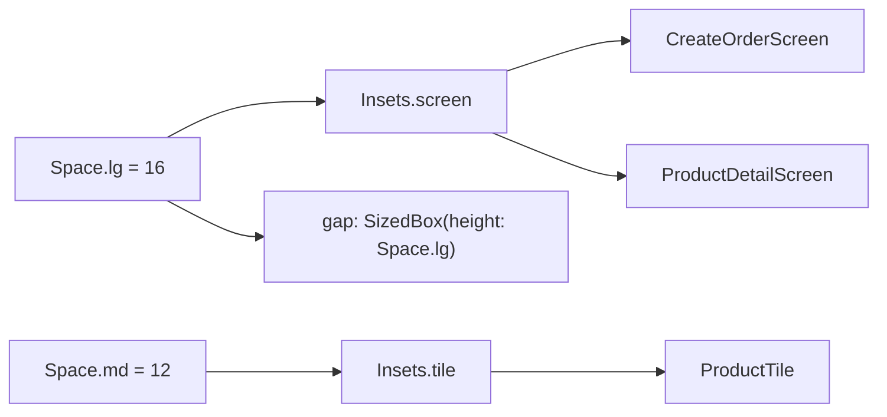

## Before you start

- [[frontend.l3.design-system]] — you know that at stage-2 the screens and `ProductTile` write raw spacing numbers such as `16`, `12` and `8`, while colors already go through theme roles.
- [[frontend.l1.accessibility-basics]] — you know `ProductTile` keeps a minimum height of 48 logical pixels so every row is easy to tap.

## The situation

The designer asks for a little more room at the edges of every screen: `20` instead of `16`. In DonHang.App at stage-2 you search for `16` and get a list of matches. Some are the padding around a screen's content. Others are the gap above a button, which the designer did not mention.

Every match is the same number, and nothing in the code says which job it does. You decide one match at a time, and a wrong guess moves a gap nobody asked to move. How can a number in the code say what it is for, so that a change reaches exactly the places that share its job?

## Core concepts

- role — the job a value does on screen, such as "the space between a screen's edge and its content" or "the color of an error".
- spacing scale — the short list of sizes a gap or a padding may take, named by size only: small, medium, large.
- **semantic token** — a design token named for where it applies, such as a screen's padding, that points at a value from the shared scale.

## How it works



A raw `16` says how much, not why: two paddings and a gap can all be `16` for three different reasons. A name can carry the reason.

Read the diagram from the left. The spacing scale, `Space`, names three sizes: `sm`, `md` and `lg`; `sm` is not drawn. It limits the choices, but `Space.lg` still says only "large". The semantic tokens to its right say where a value applies. Below, `Space.md` (12) builds `Insets.tile`, the padding `ProductTile` uses.

In the situation above, the screen padding is `Insets.screen`, built from `Space.lg`. Every screen that pads its content uses `Insets.screen`, such as `CreateOrderScreen` and `ProductDetailScreen`, so changing it moves the edge of each of those screens and not the gaps or the tile padding. The gap above a button uses `Space.lg` directly, so it does not move. The rule this lesson uses: a value the designer changes as a whole across screens, such as the screen edges, gets a role name; a gap chosen for one spot on one screen names only its size on the scale.

A shared name also stops drift: two places that share a role through one name cannot end up a few pixels apart through one edited number.

Colors and text styles already work this way through theme roles: an error takes the error roles of `ColorScheme`, and `ProductDetailScreen` shows the product name in `textTheme.headlineSmall`, not a font size.

That leaves a choice of where a token lives. Spacing that is the same in every theme can be plain constants, read without a `BuildContext`. A value that changes with light and dark belongs in the theme: `Theme.of(context)` returns the app's `ThemeData`, the object that holds the theme in force.

## In the Đơn Hàng system

`DonHang.App/lib/design/tokens.dart` at stage-3:

```dart file=DonHang.App/lib/design/tokens.dart tag=stage-3 lines=5-23
class Space {
  static const double sm = 8;
  static const double md = 12;
  static const double lg = 16;
}

// Semantic tokens: named for where they apply, built from the scale above.
// Changing Insets.screen moves every screen's edge and nothing else.
class Insets {
  static const EdgeInsets screen = EdgeInsets.all(Space.lg);
  static const EdgeInsets tile = EdgeInsets.all(Space.md);
}

class Sizes {
  // The smallest tap target, in logical pixels (frontend.l1.accessibility-basics).
  static const double minTapTarget = 48;
  // One row of ProductCatalog's grid: a tile's tap target and its padding.
  static const double gridRow = 72;
}
```

`Space` is the scale: three sizes and no others. `Insets` and `Sizes` hold the semantic tokens. `EdgeInsets.all(x)` is a padding of x on all four sides, so `Insets.screen` and `Insets.tile` are built from the scale and stay on it. `Sizes.minTapTarget` is the 48 from the accessibility lesson, now with a name that says why it is 48. `Sizes.gridRow` names the row height of the grid in `ProductCatalog`, the widget that lays out the `ProductTile` rows of the product list, as a grid when it is wide. Every value is `static const`, because none of them changes with the theme.

`ProductTile` at stage-3 uses those names:

```dart file=DonHang.App/lib/widgets/product_tile.dart tag=stage-3 lines=31-35
        child: ConstrainedBox(
          constraints: const BoxConstraints(minHeight: Sizes.minTapTarget),
          child: Padding(
            padding: Insets.tile,
            child: Row(
```

The minimum height is `Sizes.minTapTarget` and the padding is `Insets.tile`, where stage-2 wrote `48` and `12`.

The screens follow the same rule. `CreateOrderScreen` and `ProductDetailScreen` pad their content with `Insets.screen`. Their gaps name a step of the scale directly: `Space.lg` above the button, plus `Space.sm` on `CreateOrderScreen`. Neither file writes a spacing number any more.

## Seniors often assume…

- **"A token is just a constant with a nicer name; replacing 16 with Space.lg changes nothing."** → Actually, for `Space.lg` alone that is close to true: it still says how much, not why. What changes things is `Insets.screen`, a name that carries the role, so one edit reaches the edge of every screen that pads its content, and only those. You notice the difference when a request to widen the screen edges turns into a change in `tokens.dart` instead of a search through every `16`.
- **"Each screen should get its own tokens, so changing one screen cannot affect another."** → Actually a token belongs to a role, not to a screen. Per-screen tokens bring back the copies the shared name removed, and two screens with the same role drift apart again. A screen that truly differs gets a new role with its own name. You notice per-screen tokens when two screens' edges differ by a few pixels and nobody remembers deciding it.
- **"Every design value must live in ThemeData, or it is not a real token."** → Actually a value that is the same in every theme gains nothing from a theme lookup. As a constant, `Space.lg` can sit inside a `const` widget such as `const SizedBox(height: Space.lg)`, which a value read with `Theme.of(context)` cannot. Flutter's guidance is to use `const` widgets where possible, because they let it skip most of the work of building them again. You notice the opposite mistake when a color written as a constant stays the same after the user switches to dark mode.

## Try it (3 minutes)

1. In the Đơn Hàng repository, switch to the tag with `git switch --detach stage-3`.
2. Run `grep -rn -F "Insets.screen" DonHang.App/lib`.
3. Count the lines that pad something with it.

Expected result: eight matches. Seven are the line `padding: Insets.screen,` in different files; the eighth is the comment in `tokens.dart`.

The designer now asks for `20` at every screen edge. Which line do you change, and what else would move if you changed `Space.lg` to `20` instead?

<details><summary>Suggested answer</summary>

Change `Insets.screen` in `tokens.dart`. All seven uses follow it, and `Insets.tile`, built from `Space.md`, stays as it is. Since `20` is not on the scale, there are two ways: `EdgeInsets.all(20)`, one line that leaves the scale, or a new step of 20 in `Space` with `Insets.screen` built from it, two lines that keep it on the scale. Changing `Space.lg` would move more than the edges. Every gap written as `SizedBox(height: Space.lg)`, such as the one above the button on `CreateOrderScreen` and on `ProductDetailScreen`, would grow too, which the designer did not ask for. The scale says how much; only the semantic token says where.

</details>

## Connections

- [[frontend.l3.design-system]] — the problem this lesson fixes: raw spacing numbers that do not say their role.
- [[frontend.l2.theme-and-color-scheme]] — the same idea for colors, already in place: a widget names a role and the theme supplies the value.
- [[frontend.l3.theme-extension]] — the next step: color roles that `ColorScheme` does not have, kept in the theme because they change with dark mode.
- [[frontend.l1.accessibility-basics]] — where the 48 came from; `Sizes.minTapTarget` gives it a name.

## Five-line summary

1. Name a design token for where it applies, such as `Insets.screen`, so changing it changes every place with that role and nothing else.
2. At stage-3 `tokens.dart` holds a spacing scale, `Space.sm` 8, `Space.md` 12 and `Space.lg` 16, and semantic tokens built from it.
3. Screens and `ProductTile` use those names instead of numbers, so two places that share a role cannot drift apart.
4. Colors and text styles follow the same idea through theme roles, such as `textTheme.headlineSmall` for the product name.
5. Values that never change with the theme can be constants; values that change with light and dark belong in the theme.
