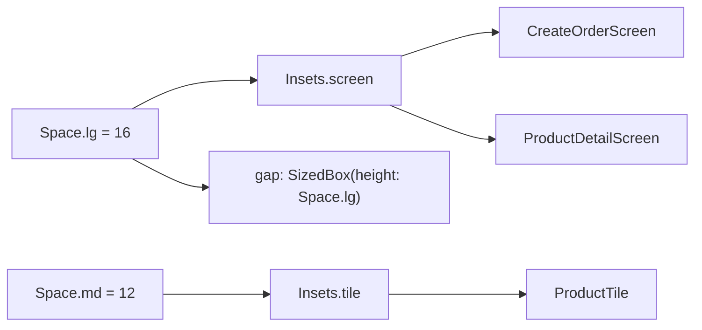

## Bạn cần biết trước

- [[frontend.l3.design-system]] — bạn biết ở stage-2, các màn hình và `ProductTile` viết số khoảng cách thô như `16`, `12` và `8`, trong khi màu đã đi qua các vai trò của theme.
- [[frontend.l1.accessibility-basics]] — bạn biết `ProductTile` giữ chiều cao tối thiểu 48 logical pixel để hàng nào cũng dễ chạm.

## Tình huống

Designer muốn mép mọi màn hình rộng thêm một chút: `20` thay vì `16`. Trong DonHang.App ở stage-2, bạn tìm `16` và nhận về một loạt kết quả. Có cái là padding quanh nội dung của màn hình. Có cái là khoảng cách phía trên nút, thứ designer không hề nhắc tới.

Kết quả nào cũng là cùng một con số, và không chỗ nào trong code nói nó làm nhiệm vụ gì. Bạn phải xét từng kết quả, và đoán sai một lần là dời một khoảng cách không ai yêu cầu dời. Làm sao để một con số trong code tự nói nó dùng vào đâu, để một lần sửa đi tới đúng những chỗ có cùng nhiệm vụ?

## Khái niệm cốt lõi

- vai trò — nhiệm vụ của một giá trị trên màn hình, như "khoảng trống giữa mép màn hình và nội dung" hay "màu của lỗi".
- thang khoảng cách — danh sách ngắn các kích thước mà một khoảng cách hay một padding được phép lấy, chỉ đặt tên theo độ lớn: nhỏ, vừa, lớn.
- **semantic token** (design token đặt tên theo chỗ dùng, như lề màn hình hay màu lỗi, trỏ tới một giá trị trong thang chung) — design token đặt tên theo chỗ nó áp dụng, như padding của màn hình, và trỏ tới một giá trị trong thang dùng chung.

## Cơ chế hoạt động



Số thô `16` nói bao nhiêu, không nói vì sao: hai padding và một khoảng cách đều có thể là `16` vì ba lý do khác nhau. Một cái tên thì mang được lý do.

Đọc sơ đồ từ trái sang. Thang khoảng cách, `Space`, đặt tên cho ba kích thước: `sm`, `md` và `lg`, trong đó `sm` không vẽ ra. Thang giới hạn các lựa chọn, nhưng `Space.lg` vẫn chỉ nói "lớn". Các semantic token bên phải nó mới nói giá trị áp dụng ở đâu. Phía dưới, `Space.md` (12) dựng nên `Insets.tile`, padding mà `ProductTile` dùng.

Trong tình huống trên, padding màn hình là `Insets.screen`, dựng từ `Space.lg`. Mọi màn hình có đệm nội dung đều dùng `Insets.screen`, như `CreateOrderScreen` và `ProductDetailScreen`. Vì vậy đổi nó sẽ dời mép của từng màn hình đó, còn các khoảng cách và padding của tile thì không. Khoảng cách phía trên nút dùng thẳng `Space.lg`, nên nó đứng yên. Quy tắc bài này dùng: giá trị nào designer đổi đồng loạt trên các màn hình, như mép màn hình, thì có tên theo vai trò. Khoảng cách chọn cho một chỗ trên một màn hình thì chỉ gọi tên kích thước của nó trên thang.

Tên dùng chung còn chặn được chuyện lệch dần: hai chỗ cùng vai trò qua một cái tên thì không thể lệch nhau vài pixel chỉ vì ai đó sửa một con số.

Màu và kiểu chữ đã làm theo cách này qua các vai trò của theme: lỗi lấy các vai trò lỗi của `ColorScheme`, và `ProductDetailScreen` hiện tên sản phẩm bằng `textTheme.headlineSmall`, không phải một cỡ chữ.

Còn lại câu hỏi token đặt ở đâu. Khoảng cách giống nhau ở mọi theme có thể là hằng số thường, đọc mà không cần `BuildContext`. Giá trị đổi theo sáng và tối thì thuộc về theme: `Theme.of(context)` trả về `ThemeData` của app, đối tượng chứa theme đang áp dụng.

## Trong hệ thống Đơn Hàng

`DonHang.App/lib/design/tokens.dart` ở stage-3:

```dart file=DonHang.App/lib/design/tokens.dart tag=stage-3 lines=5-23
class Space {
  static const double sm = 8;
  static const double md = 12;
  static const double lg = 16;
}

// Semantic tokens: named for where they apply, built from the scale above.
// Changing Insets.screen moves every screen's edge and nothing else.
class Insets {
  static const EdgeInsets screen = EdgeInsets.all(Space.lg);
  static const EdgeInsets tile = EdgeInsets.all(Space.md);
}

class Sizes {
  // The smallest tap target, in logical pixels (frontend.l1.accessibility-basics).
  static const double minTapTarget = 48;
  // One row of ProductCatalog's grid: a tile's tap target and its padding.
  static const double gridRow = 72;
}
```

`Space` là thang: ba kích thước, không hơn. `Insets` và `Sizes` chứa các semantic token. `EdgeInsets.all(x)` là padding x ở cả bốn cạnh, nên `Insets.screen` và `Insets.tile` dựng từ thang và nằm trên thang. `Sizes.minTapTarget` là con số 48 từ bài accessibility, giờ có một cái tên nói vì sao là 48. `Sizes.gridRow` đặt tên cho chiều cao một hàng trong lưới của `ProductCatalog`, widget sắp các hàng `ProductTile` của danh sách sản phẩm, thành dạng lưới khi màn hình rộng. Mọi giá trị đều là `static const`, vì không cái nào đổi theo theme.

`ProductTile` ở stage-3 dùng các tên đó:

```dart file=DonHang.App/lib/widgets/product_tile.dart tag=stage-3 lines=31-35
        child: ConstrainedBox(
          constraints: const BoxConstraints(minHeight: Sizes.minTapTarget),
          child: Padding(
            padding: Insets.tile,
            child: Row(
```

Chiều cao tối thiểu là `Sizes.minTapTarget` và padding là `Insets.tile`, ở chỗ stage-2 viết `48` và `12`.

Các màn hình theo cùng quy tắc. `CreateOrderScreen` và `ProductDetailScreen` đệm nội dung bằng `Insets.screen`. Các khoảng cách của chúng gọi thẳng một bậc của thang: `Space.lg` phía trên nút, thêm `Space.sm` ở `CreateOrderScreen`. Không file nào còn viết số khoảng cách.

## Senior hay nhầm rằng…

- **"Token chỉ là hằng số có tên đẹp hơn, thay 16 bằng Space.lg chẳng đổi được gì."** → Thực ra riêng với `Space.lg` thì gần đúng: nó vẫn nói bao nhiêu, không nói vì sao. Thứ tạo khác biệt là `Insets.screen`, một cái tên mang vai trò, nên một lần sửa đi tới mép của mọi màn hình có đệm nội dung, và chỉ những chỗ đó. Bạn sẽ nhận ra khác biệt khi yêu cầu nới rộng mép màn hình thành một thay đổi trong `tokens.dart`, thay vì một cuộc lục tìm qua mọi số `16`.
- **"Mỗi màn hình nên có token riêng, để sửa màn hình này không ảnh hưởng màn hình khác."** → Thực ra token thuộc về một vai trò, không thuộc về một màn hình. Token theo màn hình mang lại đúng những bản sao mà tên dùng chung đã xóa bỏ, và hai màn hình cùng vai trò lại lệch nhau. Màn hình nào thực sự khác thì có một vai trò mới với tên riêng. Bạn sẽ nhận ra token theo màn hình khi mép của hai màn hình lệch nhau vài pixel và không ai nhớ đã quyết định điều đó.
- **"Mọi giá trị thiết kế phải nằm trong ThemeData, không thì không phải token thật."** → Thực ra một giá trị giống nhau ở mọi theme chẳng được gì khi tra qua theme. Là hằng số, `Space.lg` nằm được trong một widget `const` như `const SizedBox(height: Space.lg)`, điều mà giá trị đọc bằng `Theme.of(context)` không làm được. Hướng dẫn của Flutter là dùng widget `const` khi có thể, vì chúng cho Flutter bỏ qua phần lớn công dựng lại. Bạn sẽ nhận ra lỗi ngược lại khi một màu viết thành hằng số vẫn giữ nguyên sau khi người dùng chuyển sang chế độ tối.

## Thử ngay (3 phút)

1. Trong repo Đơn Hàng, chuyển sang tag bằng `git switch --detach stage-3`.
2. Chạy `grep -rn -F "Insets.screen" DonHang.App/lib`.
3. Đếm số dòng dùng nó để đệm một thứ gì đó.

Kết quả mong đợi: tám kết quả. Bảy cái là dòng `padding: Insets.screen,` ở các file khác nhau, cái thứ tám là dòng comment trong `tokens.dart`.

Giờ designer muốn `20` ở mọi mép màn hình. Bạn sửa dòng nào, và nếu đổi `Space.lg` thành `20` thì còn gì khác bị dời theo?

<details><summary>Gợi ý đáp án</summary>

Sửa `Insets.screen` trong `tokens.dart`. Cả bảy chỗ dùng đi theo nó, còn `Insets.tile`, dựng từ `Space.md`, giữ nguyên. Vì `20` không có trên thang, bạn có hai cách: `EdgeInsets.all(20)`, một dòng nhưng ra khỏi thang, hoặc thêm một bậc 20 vào `Space` rồi dựng `Insets.screen` từ bậc đó, hai dòng nhưng vẫn nằm trên thang. Đổi `Space.lg` sẽ dời nhiều hơn mép màn hình. Mọi khoảng cách viết là `SizedBox(height: Space.lg)`, như khoảng cách phía trên nút ở `CreateOrderScreen` và ở `ProductDetailScreen`, cũng sẽ rộng ra, điều designer không yêu cầu. Thang nói bao nhiêu, chỉ semantic token mới nói ở đâu.

</details>

## Liên hệ

- [[frontend.l3.design-system]] — vấn đề bài này giải quyết: các số khoảng cách thô không nói vai trò của mình.
- [[frontend.l2.theme-and-color-scheme]] — cùng ý tưởng cho màu, đã có sẵn: widget gọi tên một vai trò và theme cung cấp giá trị.
- [[frontend.l3.theme-extension]] — bước tiếp theo: các vai trò màu mà `ColorScheme` không có, đặt trong theme vì chúng đổi theo chế độ tối.
- [[frontend.l1.accessibility-basics]] — nơi con số 48 ra đời, `Sizes.minTapTarget` đặt tên cho nó.

## Tóm tắt 5 dòng

1. Đặt tên design token theo chỗ nó áp dụng, như `Insets.screen`, để đổi nó là đổi mọi chỗ có vai trò đó và không gì khác.
2. Ở stage-3, `tokens.dart` chứa một thang khoảng cách, `Space.sm` 8, `Space.md` 12 và `Space.lg` 16, cùng các semantic token dựng từ thang đó.
3. Các màn hình và `ProductTile` dùng những tên đó thay cho con số, nên hai chỗ cùng vai trò không thể lệch nhau.
4. Màu và kiểu chữ theo cùng ý tưởng qua các vai trò của theme, như `textTheme.headlineSmall` cho tên sản phẩm.
5. Giá trị không bao giờ đổi theo theme có thể là hằng số, còn giá trị đổi theo sáng và tối thì thuộc về theme.
