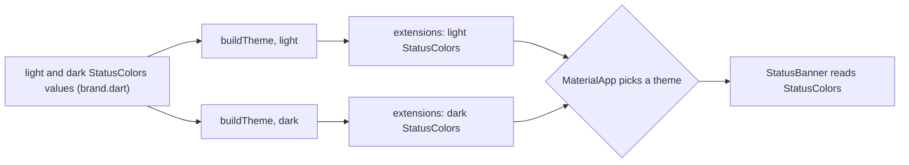

## Before you start

- [[frontend.l3.semantic-tokens]] — you know that a value which changes with light and dark belongs in the theme, where `Theme.of(context)` picks the right one.
- [[frontend.l2.dark-mode]] — you know that widgets reading `colorScheme` roles change with the mode, while a hardcoded color stays the same.
- [[frontend.l3.offline-first]] — you know that when a fresh load fails, the product list keeps the saved copy on screen with a warning that it may be out of date.

## The situation

You are styling the warning above the saved product list: "Showing the saved list: the API did not answer, so it may be out of date." The designer wants it amber, not red. Red is `colorScheme.error`, and this is not an error: the list still works.

You look through `ColorScheme`. It has `error`, `primary`, `surface` and their partners, but nothing for a warning. Writing an amber color right in `ProductListScreen` would work in light mode, and you remember from dark mode what a hardcoded color does on a dark page. Where does a color Material has no role for live, so that it follows the theme the way `error` does?

## Core concepts

- Material — the design system that Flutter's built-in widgets and `ColorScheme` follow; its color roles are the ones `ColorScheme` has.
- color role — a named job for a color, such as `error`, whose value the theme supplies; `ColorScheme` has a fixed set of them.
- "on" color — the color for text and icons drawn on top of a role's color, such as `onError` for `error`, chosen so the text stays readable on it.
- `ThemeData` — the object that holds one whole theme, such as the light or the dark one.
- **ThemeExtension** — a Flutter class that adds a typed set of extra tokens to `ThemeData`, such as the color roles `ColorScheme` does not have.
- `lerp` — short for linear interpolation: given two values and a fraction `t` from 0 to 1, it returns the value that far between them.

## How it works



In the situation above, the missing role is a warning. At stage-3 DonHang.App adds it with one `ThemeExtension` subclass, `StatusColors`. It holds four colors: `warning` and `onWarning`, `success` and `onSuccess`. Each role comes with its "on" color, as `ColorScheme` pairs `error` with `onError`.

Read the diagram from the left. Two sets of `StatusColors` values, one for light and one for dark, live in `brand.dart`, the file that holds the app's raw color values. `buildTheme` runs once per theme and puts the matching set into the `extensions` list of that `ThemeData`. The light warning is a dark amber with white text; the dark warning is a light amber with dark text, so text on a warning stays readable in both modes.

`MaterialApp` then picks the light or the dark theme, as you saw in dark mode. A widget, here `StatusBanner`, does not ask which mode is on. It calls `Theme.of(context).extension<StatusColors>()` and gets the set registered in the theme in force. The type in the angle brackets is the key, so `warning` is a checked field, not a string lookup. If the theme registered no `StatusColors`, the call returns `null`; the compiler cannot know.

A subclass must implement two methods. `copyWith` returns a copy with some values replaced. `lerp` blends this set with another one at fraction `t`. When the theme changes, `MaterialApp` by default moves from the old theme to the new one in small steps, and each step asks every extension for its `lerp`, so the warning fades with the rest of the screen instead of jumping.

## In the Đơn Hàng system

The two methods of `StatusColors`, in `DonHang.App/lib/design/status_colors.dart` at stage-3. The class is declared above the excerpt as `StatusColors extends ThemeExtension<StatusColors>`, with the four `Color` fields.

```dart file=DonHang.App/lib/design/status_colors.dart tag=stage-3 lines=23-46
  @override
  StatusColors copyWith({Color? warning, Color? onWarning, Color? success, Color? onSuccess}) {
    return StatusColors(
      warning: warning ?? this.warning,
      onWarning: onWarning ?? this.onWarning,
      success: success ?? this.success,
      onSuccess: onSuccess ?? this.onSuccess,
    );
  }

  // lesson: frontend.l3.theme-extension
  // Called while the theme changes, with t going from 0 to 1, so the colors
  // move gradually from the old theme's values to the new one's.
  @override
  StatusColors lerp(StatusColors? other, double t) {
    if (other == null) return this;
    return StatusColors(
      warning: Color.lerp(warning, other.warning, t)!,
      onWarning: Color.lerp(onWarning, other.onWarning, t)!,
      success: Color.lerp(success, other.success, t)!,
      onSuccess: Color.lerp(onSuccess, other.onSuccess, t)!,
    );
  }
}
```

`copyWith` keeps every value you do not pass: `warning ?? this.warning` means "the new one if given, else the current one". `lerp` blends each of the four colors with `Color.lerp`, field by field. In Dart, `!` after a value says it is not null; if it is null, the program throws at run time, so `!` is a check that runs, not a hint to the compiler. If the other theme has no `StatusColors`, `other` is `null` and the set stays as it is. Adding a fifth color means adding it to the constructor and to both methods; because the fields are `required`, the compiler points to each `StatusColors(...)` call that leaves it out.

Where the extension is registered, in `DonHang.App/lib/design/theme.dart`:

```dart file=DonHang.App/lib/design/theme.dart tag=stage-3 lines=6-17
// lesson: frontend.l3.theme-extension
// The only code that turns a brand's token values into a ThemeData.
// main.dart calls it twice: once for the light theme, once for the dark.
// `extensions` adds the roles ColorScheme lacks; a widget reads them with
// Theme.of(context).extension<StatusColors>().
ThemeData buildTheme(Brand brand, Brightness brightness) {
  return ThemeData(
    colorSchemeSeed: brand.seed,
    brightness: brightness,
    extensions: [brand.statusColors(brightness)],
  );
}
```

Look at the `extensions:` line. `brand.statusColors(brightness)` returns the light or the dark set, so the two themes register different values under the same type. In `ProductListScreen` the saved-list warning is a `StatusBanner` with a warning tone (`tone` is a parameter of `StatusBanner`, such as warning or success, that chooses its colors). `StatusBanner` makes the `extension<StatusColors>()` call first, whatever its tone, then picks the colors for that tone; both files are outside the excerpts.

## Seniors often assume…

- **"A color Material has no role for has to be written as a raw color where it is needed."** → Actually you can add the role yourself: a `ThemeExtension` registers it in each theme, and widgets read it like any other role. A raw color has one value for every theme. You notice the raw color when the warning stays the same in dark mode while the page behind it turns almost black.
- **"Extra colors can go in a global constants file; ThemeExtension is only needed by large teams."** → Actually the reason is dark mode, not team size. A constant has one value, so a warning that needs two would make every widget check the brightness and choose; the theme makes that choice once, for every widget. Constants still suit values that never change with the theme, such as the spacing scale. You notice the constants approach when a brightness check appears in a second widget, written slightly differently from the first.
- **"lerp is optional decoration; leaving it unfinished cannot affect the app."** → Actually, with `MaterialApp`'s default animated theme change, as in DonHang.App, `lerp` is called on every theme change. One that returns `this` compiles, but its colors do not blend with the rest of the screen and change in one step. One left as `throw UnimplementedError()` throws during the change. You notice this when the first switch between light and dark shows an error from `StatusColors.lerp`, or a banner that flips while everything else fades.

## Try it (3 minutes)

1. In the Đơn Hàng repository, switch to the tag with `git switch --detach stage-3`.
2. Run `grep -rn -F "extension<StatusColors>" DonHang.App/lib`.
3. Look at what each match is.

Expected result: two matches. One is the comment in `design/theme.dart`; the other is the line in `design/components/status_banner.dart` that reads the extension, ending with `!`.

Suppose someone deletes the `extensions:` line from `buildTheme`. The app still compiles. What happens the next time the saved list is shown with its warning, and which other banners are affected?

<details><summary>Suggested answer</summary>

With no `StatusColors` registered, `extension<StatusColors>()` returns `null`, and the `!` fails when `StatusBanner` builds, so an error appears instead of the warning. Every `StatusBanner` reads the extension before it looks at its tone, so banners of every tone fail, not only the warning. The compiler cannot catch this: the theme's contents are only known when the app runs. A widget test that builds a banner under the real theme would catch it.

</details>

## Connections

- [[frontend.l3.semantic-tokens]] — the same idea one step further: a token named for its role, now for colors that change with the theme.
- [[frontend.l2.dark-mode]] — the reason this lesson exists: a second theme in which every role, including these new ones, needs its own value.
- [[frontend.l3.offline-first]] — where the first warning in this lesson comes from: the saved list shown when a fresh load fails.
- [[frontend.l3.sync-conflicts]] — another user of the warning role: a queued order that was sent but charged a total different from the one the customer saw.
- [[frontend.l3.component-library]] — the next step: `StatusBanner` takes a tone and picks its colors from these roles itself.

## Five-line summary

1. A `ThemeExtension` adds the color roles `ColorScheme` lacks to `ThemeData`, so they follow light and dark like the built-in roles.
2. A theme registers it in its `extensions` list; a widget reads it with `Theme.of(context).extension<StatusColors>()`.
3. At stage-3 `StatusColors` holds `warning`, `onWarning`, `success` and `onSuccess`, with separate values for the light and the dark theme.
4. A subclass implements `copyWith` and `lerp`; `lerp` lets its colors blend gradually when the theme changes.
5. A missing extension is not a compile error: `extension<T>()` returns `null` at run time.
