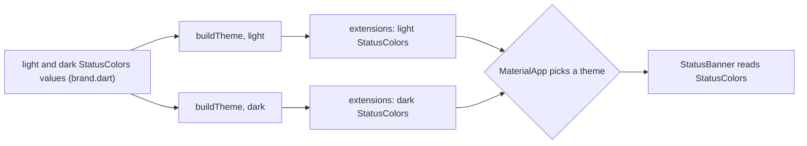

## Bạn cần biết trước

- [[frontend.l3.semantic-tokens]] — bạn biết giá trị nào đổi theo sáng và tối thì thuộc về theme, nơi `Theme.of(context)` chọn đúng giá trị.
- [[frontend.l2.dark-mode]] — bạn biết widget đọc các vai trò của `colorScheme` thì đổi theo chế độ, còn màu viết cứng thì giữ nguyên.
- [[frontend.l3.offline-first]] — bạn biết khi tải mới thất bại, danh sách sản phẩm vẫn hiện bản đã lưu, kèm cảnh báo rằng nó có thể đã cũ.

## Tình huống

Bạn đang làm giao diện cho dòng cảnh báo phía trên danh sách sản phẩm đã lưu: "Showing the saved list: the API did not answer, so it may be out of date." Designer muốn nó màu hổ phách, không phải màu đỏ. Đỏ là `colorScheme.error`, mà đây không phải lỗi: danh sách vẫn dùng được.

Bạn lục `ColorScheme`. Có `error`, `primary`, `surface` cùng các màu đi kèm, nhưng không có gì cho cảnh báo. Viết thẳng một màu hổ phách trong `ProductListScreen` thì chạy được ở chế độ sáng, và bạn còn nhớ từ bài dark mode một màu viết cứng trông thế nào trên trang tối. Vậy một màu mà Material không có vai trò cho nó nên nằm ở đâu, để nó đi theo theme như `error`?

## Khái niệm cốt lõi

- Material — design system mà các widget có sẵn của Flutter và `ColorScheme` tuân theo. Các vai trò màu của nó chính là những vai trò `ColorScheme` có.
- vai trò màu — một nhiệm vụ có tên dành cho một màu, như `error`, còn giá trị do theme cung cấp. `ColorScheme` có một tập vai trò cố định.
- màu "on" — màu cho chữ và icon vẽ trên màu của một vai trò, như `onError` cho `error`, chọn sao cho chữ vẫn đọc được trên nền đó.
- `ThemeData` — đối tượng chứa trọn một theme, như theme sáng hoặc theme tối.
- **ThemeExtension** (lớp Flutter thêm một bộ token có kiểu vào ThemeData, như vai trò màu mà ColorScheme không có) — lớp của Flutter thêm vào `ThemeData` một bộ token phụ có kiểu, như các vai trò màu mà `ColorScheme` không có.
- `lerp` — viết tắt của linear interpolation (nội suy tuyến tính): nhận hai giá trị và một tỉ lệ `t` từ 0 đến 1, trả về giá trị nằm ở khoảng đó giữa hai giá trị.

## Cơ chế hoạt động



Trong tình huống trên, vai trò còn thiếu là cảnh báo. Ở stage-3, DonHang.App thêm nó bằng một lớp con của `ThemeExtension` là `StatusColors`. Lớp này chứa bốn màu: `warning` và `onWarning`, `success` và `onSuccess`. Vai trò nào cũng đi kèm màu "on" của nó, giống cách `ColorScheme` ghép `error` với `onError`.

Đọc sơ đồ từ trái sang. Hai bộ giá trị `StatusColors`, một cho sáng và một cho tối, nằm trong `brand.dart`, file chứa các giá trị màu thô của app. `buildTheme` chạy một lần cho mỗi theme và đưa bộ tương ứng vào danh sách `extensions` của `ThemeData` đó. Cảnh báo ở theme sáng là màu hổ phách đậm với chữ trắng. Ở theme tối là màu hổ phách nhạt với chữ tối, nên chữ trên nền cảnh báo vẫn đọc được ở cả hai chế độ.

Sau đó `MaterialApp` chọn theme sáng hoặc tối, như bạn đã thấy ở bài dark mode. Một widget, ở đây là `StatusBanner`, không hỏi chế độ nào đang bật. Nó gọi `Theme.of(context).extension<StatusColors>()` và nhận về bộ đã đăng ký trong theme đang áp dụng. Kiểu trong cặp ngoặc nhọn chính là khóa, nên `warning` là một field được kiểm tra kiểu, không phải tra cứu bằng chuỗi. Nếu theme không đăng ký `StatusColors`, lời gọi trả về `null`, và compiler không thể biết trước điều đó.

Lớp con phải cài đặt hai method. `copyWith` trả về một bản sao với vài giá trị được thay. `lerp` trộn bộ này với một bộ khác theo tỉ lệ `t`. Khi theme đổi, mặc định `MaterialApp` chuyển từ theme cũ sang theme mới qua từng bước nhỏ, và mỗi bước gọi `lerp` của mọi extension. Nhờ vậy cảnh báo chuyển màu dần cùng phần còn lại của màn hình, thay vì nhảy phắt.

## Trong hệ thống Đơn Hàng

Hai method của `StatusColors`, trong `DonHang.App/lib/design/status_colors.dart` ở stage-3. Phía trên đoạn trích, lớp được khai báo là `StatusColors extends ThemeExtension<StatusColors>`, với bốn field kiểu `Color`.

```dart file=DonHang.App/lib/design/status_colors.dart tag=stage-3 lines=23-46
  @override
  StatusColors copyWith({Color? warning, Color? onWarning, Color? success, Color? onSuccess}) {
    return StatusColors(
      warning: warning ?? this.warning,
      onWarning: onWarning ?? this.onWarning,
      success: success ?? this.success,
      onSuccess: onSuccess ?? this.onSuccess,
    );
  }

  // lesson: frontend.l3.theme-extension
  // Called while the theme changes, with t going from 0 to 1, so the colors
  // move gradually from the old theme's values to the new one's.
  @override
  StatusColors lerp(StatusColors? other, double t) {
    if (other == null) return this;
    return StatusColors(
      warning: Color.lerp(warning, other.warning, t)!,
      onWarning: Color.lerp(onWarning, other.onWarning, t)!,
      success: Color.lerp(success, other.success, t)!,
      onSuccess: Color.lerp(onSuccess, other.onSuccess, t)!,
    );
  }
}
```

`copyWith` giữ lại mọi giá trị bạn không truyền vào: `warning ?? this.warning` nghĩa là "giá trị mới nếu có, không thì giá trị hiện tại". `lerp` trộn từng màu trong bốn màu bằng `Color.lerp`, lần lượt theo từng field. Trong Dart, `!` đặt sau một giá trị khẳng định nó không null. Nếu nó là null, chương trình ném lỗi lúc chạy, nên `!` là một phép kiểm tra thật sự, không phải lời gợi ý cho compiler. Nếu theme kia không có `StatusColors`, `other` là `null` và bộ màu giữ nguyên. Thêm màu thứ năm nghĩa là thêm nó vào constructor và vào cả hai method. Vì các field là `required`, compiler sẽ chỉ ra từng lời gọi `StatusColors(...)` còn thiếu nó.

Chỗ đăng ký extension, trong `DonHang.App/lib/design/theme.dart`:

```dart file=DonHang.App/lib/design/theme.dart tag=stage-3 lines=6-17
// lesson: frontend.l3.theme-extension
// The only code that turns a brand's token values into a ThemeData.
// main.dart calls it twice: once for the light theme, once for the dark.
// `extensions` adds the roles ColorScheme lacks; a widget reads them with
// Theme.of(context).extension<StatusColors>().
ThemeData buildTheme(Brand brand, Brightness brightness) {
  return ThemeData(
    colorSchemeSeed: brand.seed,
    brightness: brightness,
    extensions: [brand.statusColors(brightness)],
  );
}
```

Nhìn dòng `extensions:`. `brand.statusColors(brightness)` trả về bộ sáng hoặc bộ tối, nên hai theme đăng ký hai bộ giá trị khác nhau dưới cùng một kiểu. Trong `ProductListScreen`, cảnh báo danh sách đã lưu là một `StatusBanner` với tone cảnh báo (`tone` là tham số của `StatusBanner`, như warning hay success, quyết định màu của nó). `StatusBanner` gọi `extension<StatusColors>()` trước tiên, bất kể tone nào, rồi mới chọn màu cho tone đó. Cả hai file này nằm ngoài các đoạn trích.

## Senior hay nhầm rằng…

- **"Màu nào Material không có vai trò thì phải viết thành màu thô ngay chỗ cần dùng."** → Thực ra bạn có thể tự thêm vai trò: một `ThemeExtension` đăng ký nó trong từng theme, và widget đọc nó như mọi vai trò khác. Màu thô chỉ có một giá trị cho mọi theme. Bạn sẽ nhận ra màu thô khi cảnh báo vẫn y nguyên ở dark mode, trong khi trang phía sau gần như chuyển sang đen.
- **"Màu phụ cứ để trong một file hằng số toàn cục, ThemeExtension chỉ team lớn mới cần."** → Thực ra lý do là dark mode, không phải quy mô team. Hằng số chỉ có một giá trị, nên một cảnh báo cần hai giá trị sẽ buộc mọi widget tự kiểm tra độ sáng rồi chọn. Theme chọn một lần, cho mọi widget. Hằng số vẫn hợp với những giá trị không bao giờ đổi theo theme, như thang khoảng cách. Bạn sẽ nhận ra cách dùng hằng số khi phép kiểm tra độ sáng xuất hiện ở widget thứ hai, viết hơi khác với widget đầu.
- **"lerp chỉ để trang trí, viết dở cũng không ảnh hưởng gì tới app."** → Thực ra với kiểu đổi theme có hiệu ứng mặc định của `MaterialApp`, như trong DonHang.App, `lerp` được gọi mỗi lần theme đổi. Một `lerp` trả về `this` vẫn biên dịch được, nhưng màu của nó không chuyển dần cùng phần còn lại của màn hình mà đổi một bước. Một `lerp` để nguyên `throw UnimplementedError()` sẽ ném lỗi giữa lúc đổi theme. Bạn sẽ nhận ra khi lần chuyển đầu tiên giữa sáng và tối hiện lỗi từ `StatusColors.lerp`, hoặc một banner đổi phắt trong khi mọi thứ khác chuyển dần.

## Thử ngay (3 phút)

1. Trong repo Đơn Hàng, chuyển sang tag bằng `git switch --detach stage-3`.
2. Chạy `grep -rn -F "extension<StatusColors>" DonHang.App/lib`.
3. Xem mỗi kết quả là gì.

Kết quả mong đợi: hai kết quả. Một là dòng comment trong `design/theme.dart`. Cái còn lại là dòng trong `design/components/status_banner.dart` đọc extension, kết thúc bằng `!`.

Giả sử ai đó xóa dòng `extensions:` khỏi `buildTheme`. App vẫn biên dịch được. Lần tới danh sách đã lưu hiện kèm cảnh báo thì chuyện gì xảy ra, và những banner nào khác bị ảnh hưởng?

<details><summary>Gợi ý đáp án</summary>

Không có `StatusColors` nào được đăng ký, `extension<StatusColors>()` trả về `null`, và `!` thất bại khi `StatusBanner` dựng, nên một lỗi hiện ra thay cho cảnh báo. Mọi `StatusBanner` đều đọc extension trước khi xét tone, nên banner của mọi tone đều lỗi, không riêng cảnh báo. Compiler không bắt được lỗi này: nội dung của theme chỉ được biết khi app chạy. Một widget test dựng banner dưới theme thật sẽ bắt được nó.

</details>

## Liên hệ

- [[frontend.l3.semantic-tokens]] — cùng ý tưởng, tiến thêm một bước: token đặt tên theo vai trò, giờ cho những màu đổi theo theme.
- [[frontend.l2.dark-mode]] — lý do bài này tồn tại: một theme thứ hai, trong đó vai trò nào cũng cần giá trị riêng, kể cả các vai trò mới này.
- [[frontend.l3.offline-first]] — nơi cảnh báo đầu tiên của bài này xuất phát: danh sách đã lưu hiện ra khi tải mới thất bại.
- [[frontend.l3.sync-conflicts]] — một chỗ khác dùng vai trò cảnh báo: đơn hàng trong hàng đợi đã gửi đi nhưng bị tính tổng tiền khác với số khách đã thấy.
- [[frontend.l3.component-library]] — bước tiếp theo: `StatusBanner` nhận một tone và tự chọn màu từ các vai trò này.

## Tóm tắt 5 dòng

1. `ThemeExtension` thêm vào `ThemeData` các vai trò màu mà `ColorScheme` thiếu, để chúng đi theo sáng và tối như các vai trò có sẵn.
2. Theme đăng ký nó trong danh sách `extensions`, widget đọc nó bằng `Theme.of(context).extension<StatusColors>()`.
3. Ở stage-3, `StatusColors` chứa `warning`, `onWarning`, `success` và `onSuccess`, với giá trị riêng cho theme sáng và theme tối.
4. Lớp con cài đặt `copyWith` và `lerp`. `lerp` cho màu của nó chuyển dần khi theme đổi.
5. Thiếu extension không phải lỗi biên dịch: `extension<T>()` trả về `null` lúc chạy.
