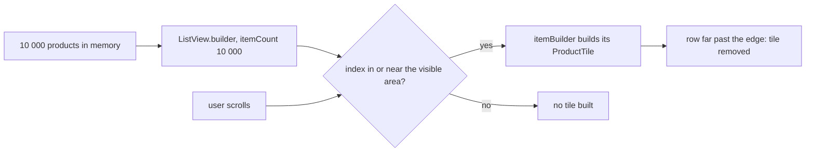

## Before you start

- [[frontend.l3.rebuild-scope]] — you know that every `build` costs work and that the cheapest widget is one Flutter does not build at all.
- [[frontend.l1.responsive-basics]] — you know `ProductCatalog` shows a one-column list below 600 pixels of width and a grid from 600 up.

## The situation

The shop owner wants to load a supplier's catalog of ten thousand products into Đơn Hàng. Before that happens, you are asked whether the product list in `DonHang.App` will cope. On a phone-width window, `ProductCatalog` shows a handful of tiles at a time. You picture ten thousand `ProductTile` widgets being created the moment the screen opens. A teammate suggests showing only fifty products per page, to be safe. Does the catalog create a tile for every product it is given, or only for the ones a customer can see?

## Core concepts

- `ListView(children: [...])` — a list given a ready-made Dart list of widgets, one per item, all created before the `ListView` itself.
- `ListView.builder` — a list given a count and a function instead of widgets, so it can create each row's widget only when it needs that row.
- `itemCount` — the number of items the list may show, known without creating any of their widgets.
- `itemBuilder` — the function the list calls with one index to get the widget for that one row.
- visible area — the part of the list that fits in the space it has; rows well outside it exist as data but not as widgets.

## How it works



The diagram follows one `ListView.builder` from the data to the tiles. Its `itemCount` tells the list that 10 000 items exist, without creating any widget. As it lays itself out, the list works out which indexes fall in the visible area or just beyond its edge, and calls `itemBuilder` for those indexes only. In the situation above, that is the first handful of products on a narrow window; product 10 000 gets no call and no tile.

When the user scrolls, new indexes reach that area, and the list calls `itemBuilder` for them. Rows that move well past the edge are removed, so the number of built tiles stays about the same however far the user goes. Scroll back, and the list calls `itemBuilder` again for the rows that return.

Compare `ListView(children: [...])`. The `children` list is an ordinary Dart list, filled before the `ListView` constructor runs. With 10 000 products, that means 10 000 `ProductTile` objects created every time the `build` that contains this `ListView` runs. That cost grows with the data, not with the screen.

`GridView.builder` works the same way, with rows of several tiles. So `ProductCatalog` builds a number of tiles that depends on the space it gets, whichever arrangement it picks.

That answers the situation: the catalog builds tiles only for what a customer can see, and a little beyond. It does not settle the fifty-per-page idea. All 10 000 `Product` objects still sit in memory as one list. Fetching fewer at a time is a question for the API's pagination, decided on other grounds, such as how much data travels and how long a request takes.

## In the Đơn Hàng system

The stage-3 catalog, both branches:

```dart file=DonHang.App/lib/widgets/product_catalog.dart tag=stage-3 lines=26-47
  @override
  Widget build(BuildContext context) {
    return LayoutBuilder(
      builder: (context, constraints) {
        if (constraints.maxWidth < wideLayoutMinWidth) {
          return ListView.builder(
            itemCount: products.length,
            itemBuilder: (context, index) => _tile(products[index]),
          );
        }
        final columns = (constraints.maxWidth / columnWidth).floor();
        return GridView.builder(
          gridDelegate: SliverGridDelegateWithFixedCrossAxisCount(
            crossAxisCount: columns,
            mainAxisExtent: Sizes.gridRow,
          ),
          itemCount: products.length,
          itemBuilder: (context, index) => _tile(products[index]),
        );
      },
    );
  }
```

Both branches pass `itemCount: products.length` and an `itemBuilder` that turns one index into one `ProductTile` through `_tile`, defined below the excerpt. `wideLayoutMinWidth` is the 600-pixel width from responsive-basics, and the code divides by `columnWidth` to pick the number of columns; the `gridDelegate` takes that column count and a fixed row height, `Sizes.gridRow`. Neither branch loops over `products` itself, so no code here creates a tile for every product.

The widget test that checks the result:

```dart file=DonHang.App/test/product_catalog_test.dart tag=stage-3 lines=52-70
  // lesson: frontend.l3.lazy-lists
  // 10 000 products in memory, but ListView.builder builds tiles only for
  // the 400 pixels on screen and a little beyond: the first products have a
  // tile, the last one has none, and far fewer than 10 000 tiles exist.
  testWidgets('a long list builds only the tiles near the screen', (tester) async {
    final many = [for (var id = 1; id <= 10000; id++) Product(id: id, name: 'Product $id', priceVnd: 1000)];
    await tester.pumpWidget(MaterialApp(
      locale: const Locale('vi'),
      localizationsDelegates: AppLocalizations.localizationsDelegates,
      supportedLocales: AppLocalizations.supportedLocales,
      home: Scaffold(
        body: Center(child: SizedBox(width: 360, height: 400, child: ProductCatalog(products: many))),
      ),
    ));

    expect(find.text('Product 1'), findsOneWidget);
    expect(find.text('Product 10000'), findsNothing);
    expect(tester.widgetList(find.byType(ProductTile)).length, lessThan(30));
  });
```

The test creates 10 000 `Product` objects, then places the catalog in a box 360 pixels wide and 400 high, narrow enough for the `ListView.builder` branch. The first `expect` finds the tile for the first product, the second finds none for the last, and the third requires fewer than 30 tiles on screen. All three look only at what is on screen: these finders skip rows outside the 400 pixels. So the test pins down what a customer sees with 10 000 products. That only a few tiles exist at all is not checked here; it follows from how `itemBuilder` is called, as "How it works" showed. Meanwhile `many` holds every product: building only the rows near the screen limits the tiles, not the data.

## Seniors often assume…

- **"A list of a few thousand rows is slow in Flutter whatever you do, so long lists always need paging."** → Actually with a builder the tiles built depend on the rows near the screen, not on the length of the list, so length alone is no reason to page. Paging is worth it when fetching or holding the whole list costs too much, which is a question about the data. You notice this when a `print` in `ProductTile`'s `build` runs only for the first rows after the catalog receives 10 000 products.
- **"ListView with a children list and ListView.builder do the same work; builder is only shorter to write."** → Actually `children` needs every row's widget created before the list exists, while `itemBuilder` is called only for rows near the screen. You notice this when a `print` in the code that creates each row runs once per product with `children`, but only for the first rows with `itemBuilder`.
- **"Once a row has scrolled off screen, its widget stays built in case the user scrolls back."** → Actually rows that move well past the edge are removed, and `itemBuilder` builds them again when they return. You notice this when a `print` in `ProductTile`'s `build` shows the first products again after you scroll a long way down and back to the top.

## Try it (3 minutes)

In `DonHang.App` at stage-3:

1. Run `flutter test test/product_catalog_test.dart`.
2. In the test `a long list builds only the tiles near the screen`, change `find.text('Product 1')` to `find.text('Product 100')`, then run the file again.
3. Undo the change.

Expected result: the first run ends with `All tests passed!`. The second run fails on the changed `expect`: product 100 is in the list given to `ProductCatalog`, but no widget shows its name, because its row lies far below the 400 pixels the test gives the list.

The third `expect` checks `lessThan(30)`, not an exact number of tiles. Why is that the better check?

<details><summary>Suggested answer</summary>

How many tiles the test finds on screen depends on the height of the box and the height of each tile. None of these is what the lesson is about. The claim that matters is that only about a screenful of tiles is on screen, not thousands, and `lessThan(30)` says that without breaking when a tile's height changes.

</details>

## Connections

- [[frontend.l3.rebuild-scope]] — the previous way to build less: limit what a change rebuilds; this lesson limits what a list builds at all.
- [[frontend.l1.responsive-basics]] — the same `ProductCatalog`, there for its two arrangements, here for how many tiles each arrangement builds.
- [[backend.l2.offset-pagination]] — the separate decision this lesson leaves open: how much data the API sends at a time.
- [[frontend.l3.profile-mode]] — how to check with a measurement that a long list scrolls without jank before changing it.
- [[frontend.l3.web-bundle-size]] — the next cost to keep small: what the browser downloads before the first frame.

## Five-line summary

1. `ListView.builder` builds rows only in or near the visible area, so a long list builds about as many tiles as the screen shows.
2. `ListView(children: [...])` needs every row's widget created before the list exists, so its cost grows with the number of items.
3. `ProductCatalog` uses `ListView.builder` when narrow and `GridView.builder` when wide; the space decides how many tiles exist.
4. The stage-3 test gives the catalog 10 000 products and finds a tile for the first, none for the last, under 30 on screen.
5. Building only the rows near the screen saves widgets, not data: every product stays in memory; fetching fewer is a separate pagination decision.
