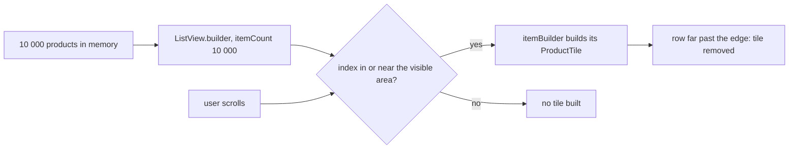

## Bạn cần biết trước

- [[frontend.l3.rebuild-scope]] — bạn biết mỗi lần `build` đều tốn công, và widget rẻ nhất là widget Flutter không phải build chút nào.
- [[frontend.l1.responsive-basics]] — bạn biết `ProductCatalog` hiện danh sách một cột khi chiều rộng dưới 600 pixel, và hiện dạng lưới từ 600 trở lên.

## Tình huống

Chủ shop muốn nạp danh mục mười nghìn sản phẩm của một nhà cung cấp vào Đơn Hàng. Trước khi làm, bạn được hỏi danh sách sản phẩm trong `DonHang.App` có chịu nổi không. Trên cửa sổ rộng cỡ điện thoại, `ProductCatalog` mỗi lúc chỉ hiện vài ô. Bạn hình dung mười nghìn widget `ProductTile` bị tạo ra ngay khi màn hình mở. Một đồng nghiệp đề nghị mỗi trang chỉ hiện năm mươi sản phẩm cho chắc. Danh mục tạo một ô cho mọi sản phẩm nó nhận được, hay chỉ cho những sản phẩm khách hàng đang nhìn thấy?

## Khái niệm cốt lõi

- `ListView(children: [...])` — danh sách nhận sẵn một list Dart gồm các widget, mỗi phần tử một widget, tất cả được tạo trước cả chính `ListView`.
- `ListView.builder` — danh sách nhận một con số và một hàm thay vì các widget, nên nó có thể tạo widget cho từng dòng chỉ khi cần tới dòng đó.
- `itemCount` — số phần tử danh sách có thể hiện, biết được mà không cần tạo widget nào cho chúng.
- `itemBuilder` — hàm mà danh sách gọi với một chỉ số để lấy widget cho đúng dòng đó.
- vùng hiển thị — phần danh sách vừa với khoảng trống nó có. Các dòng nằm xa bên ngoài vùng này có tồn tại dưới dạng dữ liệu, nhưng không có widget.

## Cơ chế hoạt động



Sơ đồ theo chân một `ListView.builder` từ dữ liệu tới các ô. `itemCount` báo cho danh sách biết có 10.000 phần tử, mà không tạo widget nào. Trong lúc tự sắp xếp bố cục, danh sách tính xem chỉ số nào rơi vào vùng hiển thị hoặc ngay sát mép ngoài, rồi chỉ gọi `itemBuilder` cho những chỉ số đó. Trong tình huống trên, đó là vài sản phẩm đầu tiên trên cửa sổ hẹp. Sản phẩm thứ 10.000 không được gọi tới và không có ô nào.

Khi người dùng cuộn, các chỉ số mới đi vào vùng đó, và danh sách gọi `itemBuilder` cho chúng. Các dòng đi quá xa khỏi mép bị gỡ bỏ, nên số ô đã build gần như không đổi dù người dùng cuộn xa tới đâu. Cuộn ngược lại, danh sách lại gọi `itemBuilder` cho những dòng quay về.

Giờ so với `ListView(children: [...])`. List `children` là một list Dart bình thường, được lấp đầy trước khi constructor của `ListView` chạy. Với 10.000 sản phẩm, nghĩa là 10.000 đối tượng `ProductTile` bị tạo ra mỗi lần `build` chứa `ListView` này chạy. Chi phí đó tăng theo dữ liệu, không theo màn hình.

`GridView.builder` hoạt động y như vậy, chỉ khác là mỗi hàng có vài ô. Vì thế `ProductCatalog` build số ô tùy theo khoảng trống nó được cho, dù nó chọn cách sắp xếp nào.

Đó là lời đáp cho tình huống: danh mục chỉ build ô cho những gì khách hàng đang thấy, cộng thêm một chút bên ngoài. Nhưng điều này chưa trả lời ý tưởng năm mươi sản phẩm mỗi trang. Cả 10.000 đối tượng `Product` vẫn nằm trong bộ nhớ thành một list. Mỗi lần tải về ít hơn là chuyện phân trang của API, được quyết định dựa trên những lý do khác, chẳng hạn bao nhiêu dữ liệu phải truyền đi và một request mất bao lâu.

## Trong hệ thống Đơn Hàng

Danh mục ở stage-3, cả hai nhánh:

```dart file=DonHang.App/lib/widgets/product_catalog.dart tag=stage-3 lines=26-47
  @override
  Widget build(BuildContext context) {
    return LayoutBuilder(
      builder: (context, constraints) {
        if (constraints.maxWidth < wideLayoutMinWidth) {
          return ListView.builder(
            itemCount: products.length,
            itemBuilder: (context, index) => _tile(products[index]),
          );
        }
        final columns = (constraints.maxWidth / columnWidth).floor();
        return GridView.builder(
          gridDelegate: SliverGridDelegateWithFixedCrossAxisCount(
            crossAxisCount: columns,
            mainAxisExtent: Sizes.gridRow,
          ),
          itemCount: products.length,
          itemBuilder: (context, index) => _tile(products[index]),
        );
      },
    );
  }
```

Cả hai nhánh đều truyền `itemCount: products.length` và một `itemBuilder` biến một chỉ số thành một `ProductTile` qua `_tile`, hàm định nghĩa bên dưới đoạn trích. `wideLayoutMinWidth` là mốc chiều rộng 600 pixel trong bài responsive-basics, và code chia cho `columnWidth` để chọn số cột. `gridDelegate` nhận số cột đó cùng một chiều cao hàng cố định, `Sizes.gridRow`. Không nhánh nào tự lặp qua `products`, nên không có dòng code nào ở đây tạo ô cho mọi sản phẩm.

Widget test kiểm tra kết quả:

```dart file=DonHang.App/test/product_catalog_test.dart tag=stage-3 lines=52-70
  // lesson: frontend.l3.lazy-lists
  // 10 000 products in memory, but ListView.builder builds tiles only for
  // the 400 pixels on screen and a little beyond: the first products have a
  // tile, the last one has none, and far fewer than 10 000 tiles exist.
  testWidgets('a long list builds only the tiles near the screen', (tester) async {
    final many = [for (var id = 1; id <= 10000; id++) Product(id: id, name: 'Product $id', priceVnd: 1000)];
    await tester.pumpWidget(MaterialApp(
      locale: const Locale('vi'),
      localizationsDelegates: AppLocalizations.localizationsDelegates,
      supportedLocales: AppLocalizations.supportedLocales,
      home: Scaffold(
        body: Center(child: SizedBox(width: 360, height: 400, child: ProductCatalog(products: many))),
      ),
    ));

    expect(find.text('Product 1'), findsOneWidget);
    expect(find.text('Product 10000'), findsNothing);
    expect(tester.widgetList(find.byType(ProductTile)).length, lessThan(30));
  });
```

Test tạo 10.000 đối tượng `Product`, rồi đặt danh mục vào một khung rộng 360 pixel và cao 400 pixel, đủ hẹp để đi vào nhánh `ListView.builder`. `expect` đầu tiên tìm thấy ô của sản phẩm đầu tiên, `expect` thứ hai không thấy ô nào cho sản phẩm cuối, và `expect` thứ ba đòi trên màn hình có ít hơn 30 ô. Cả ba chỉ nhìn những gì đang hiện trên màn hình: các finder này bỏ qua những dòng nằm ngoài 400 pixel. Vậy test chốt lại điều khách hàng thấy khi có 10.000 sản phẩm. Chuyện tổng cộng chỉ có vài ô tồn tại thì test này không kiểm. Điều đó suy ra từ cách `itemBuilder` được gọi, như phần "Cơ chế hoạt động" đã cho thấy. Trong khi đó `many` vẫn giữ mọi sản phẩm: chỉ build những dòng gần màn hình giới hạn số ô, không giới hạn dữ liệu.

## Senior hay nhầm rằng…

- **"Danh sách vài nghìn dòng trong Flutter kiểu gì cũng chậm, nên danh sách dài lúc nào cũng cần phân trang."** → Thực ra với builder, số ô được build phụ thuộc vào các dòng gần màn hình, không phụ thuộc độ dài danh sách, nên riêng độ dài không phải lý do để phân trang. Phân trang đáng làm khi tải về hoặc giữ cả danh sách tốn quá nhiều, và đó là câu hỏi về dữ liệu. Bạn sẽ nhận ra khi một lệnh `print` trong `build` của `ProductTile` chỉ chạy cho mấy dòng đầu sau khi danh mục nhận 10.000 sản phẩm.
- **"ListView với list children và ListView.builder làm cùng một việc, builder chỉ viết ngắn hơn."** → Thực ra `children` đòi widget của mọi dòng phải được tạo trước khi danh sách tồn tại, còn `itemBuilder` chỉ được gọi cho các dòng gần màn hình. Bạn sẽ nhận ra khi một lệnh `print` trong đoạn code tạo từng dòng chạy một lần cho mỗi sản phẩm với `children`, nhưng chỉ chạy cho mấy dòng đầu với `itemBuilder`.
- **"Một dòng đã cuộn ra khỏi màn hình thì widget của nó vẫn được giữ nguyên, phòng khi người dùng cuộn lại."** → Thực ra các dòng đi quá xa khỏi mép bị gỡ bỏ, và `itemBuilder` build lại chúng khi chúng quay về. Bạn sẽ nhận ra khi một lệnh `print` trong `build` của `ProductTile` lại hiện các sản phẩm đầu tiên sau khi bạn cuộn xuống thật xa rồi cuộn về đầu.

## Thử ngay (3 phút)

Trong `DonHang.App` ở stage-3:

1. Chạy `flutter test test/product_catalog_test.dart`.
2. Trong test `a long list builds only the tiles near the screen`, đổi `find.text('Product 1')` thành `find.text('Product 100')`, rồi chạy lại file.
3. Hoàn tác thay đổi.

Kết quả mong đợi: lần chạy đầu kết thúc bằng `All tests passed!`. Lần chạy thứ hai rớt ở `expect` vừa sửa: sản phẩm 100 có trong list truyền cho `ProductCatalog`, nhưng không widget nào hiện tên nó, vì dòng của nó nằm tít bên dưới 400 pixel mà test dành cho danh sách.

`expect` thứ ba kiểm `lessThan(30)` chứ không kiểm một số ô chính xác. Vì sao cách kiểm đó tốt hơn?

<details><summary>Gợi ý đáp án</summary>

Test tìm thấy bao nhiêu ô trên màn hình còn tùy chiều cao của khung và chiều cao của mỗi ô. Không yếu tố nào trong số đó là điều bài học muốn nói. Điều quan trọng là trên màn hình chỉ có khoảng một màn hình đầy ô, chứ không phải hàng nghìn ô, và `lessThan(30)` nói đúng điều đó mà không bị hỏng khi chiều cao của ô thay đổi.

</details>

## Liên hệ

- [[frontend.l3.rebuild-scope]] — cách build ít hơn ở bài trước: giới hạn những gì một thay đổi build lại. Bài này giới hạn những gì danh sách build ngay từ đầu.
- [[frontend.l1.responsive-basics]] — vẫn `ProductCatalog` đó, ở bài kia để nói về hai cách sắp xếp, ở đây để nói mỗi cách build bao nhiêu ô.
- [[backend.l2.offset-pagination]] — quyết định riêng mà bài này để ngỏ: API gửi bao nhiêu dữ liệu mỗi lần.
- [[frontend.l3.profile-mode]] — cách dùng số đo để kiểm một danh sách dài cuộn có bị jank không trước khi sửa nó.
- [[frontend.l3.web-bundle-size]] — chi phí tiếp theo cần giữ nhỏ: những gì trình duyệt tải về trước khung hình đầu tiên.

## Tóm tắt 5 dòng

1. `ListView.builder` chỉ build các dòng trong hoặc gần vùng hiển thị, nên một danh sách dài build số ô xấp xỉ số ô màn hình hiện được.
2. `ListView(children: [...])` đòi widget của mọi dòng được tạo trước khi danh sách tồn tại, nên chi phí của nó tăng theo số phần tử.
3. `ProductCatalog` dùng `ListView.builder` khi hẹp và `GridView.builder` khi rộng. Khoảng trống quyết định có bao nhiêu ô.
4. Test ở stage-3 đưa cho danh mục 10.000 sản phẩm, thấy ô của sản phẩm đầu, không thấy ô của sản phẩm cuối, và dưới 30 ô trên màn hình.
5. Chỉ build các dòng gần màn hình tiết kiệm widget, không tiết kiệm dữ liệu: mọi sản phẩm vẫn ở trong bộ nhớ, còn tải về ít hơn là một quyết định phân trang riêng.
