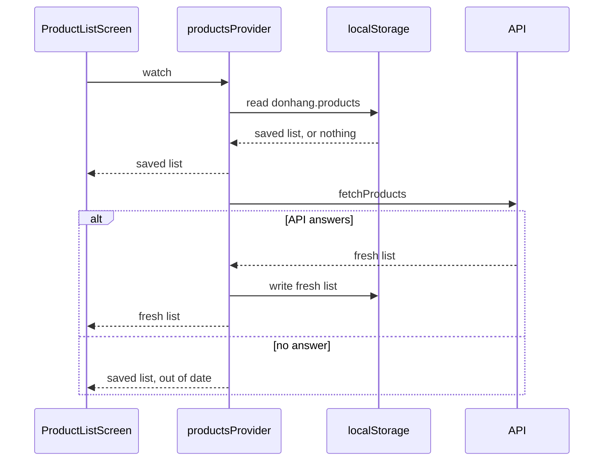

## Before you start

- [[frontend.l2.futureprovider-and-asyncvalue]] — you know `productsProvider` hands the screen an AsyncValue, and `AsyncValue.when` picks the loading, error or data builder.
- [[backend.l3.graceful-degradation]] — you know to decide in advance what still works when a dependency fails; here the dependency is the API and the decision is made in the app.
- [[backend.l2.cache-aside]] — you know a copy kept closer to the reader can answer instead of the source; this lesson keeps that copy on the customer's device.

## The situation

At stage-2 a customer has the product list of DonHang.App open and is comparing two keyboards. The API stops answering for a few minutes. The customer opens DonHang.App again in a new tab to check a price. A spinner turns for a while, then the whole screen says `Could not load products.` The list they were reading a minute ago, in the same browser, is nowhere to be seen, though not a single product has changed. Until the API is back, the customer can do nothing at all. What would the app have to keep on the device, and in what order would the screen have to use it, to stay useful while the API cannot be reached?

## Core concepts

- **offline-first** — designing an app to read a copy kept on the device first and to use the network to refresh that copy, so a screen still has something to show without a connection.
- **localStorage** — the browser's store of string values by key for one web address (scheme, host and port); the values survive a page reload and closing the tab, and the browser limits how much one address may keep.
- saved copy — the product list exactly as the API last returned it, written to `localStorage` under the key `donhang.products`.
- `StreamProvider` — a Riverpod provider that can hand the screen several values one after another, each as AsyncValue data, where a `FutureProvider` hands over one result.
- out of date — `LoadedProducts` is what the provider hands the screen: the product list plus an `outOfDate` flag, set when the screen shows the saved copy because a fresh load failed.

## How it works



In the situation above, the stage-2 screen had one source: the API. When the API did not answer, the screen had nothing to show, even though the same list had been on screen a minute earlier. The screen needs a second source that does not depend on the network.

At stage-3 that second source is `localStorage`. Because it holds only strings, the app turns the product list into JSON text before writing it, and back into `Product` objects after reading it.

Follow the diagram from the top. It shows a returning visit; on a first visit nothing is saved, so the first arrow back to the screen is skipped and the "no answer" branch ends in an error instead. When the screen first watches `productsProvider`, the provider reads the saved copy. If one exists, the screen gets it at once, without waiting for the API. Then the provider asks the API. A fresh list replaces the copy in two places: first in `localStorage` for the next visit, then on screen.

If the request to the API fails, the provider hands the screen the saved copy again, now marked out of date. The customer keeps the list and sees a warning above it instead of a spinner or an error. Only when nothing was saved, as on a first visit, does the screen show its error.

The order is the answer to the situation: device first, network second. The copy is only as new as the last successful load, so the screen says so whenever it could not refresh it. This suits a list the customer browses; where acting on an old copy could cause harm, an error can be the safer answer.

## In the Đơn Hàng system

The stage-3 provider behind the product list:

```dart file=DonHang.App/lib/providers.dart tag=stage-3 lines=39-57
// lesson: frontend.l3.offline-first
// Offline-first: the saved copy is shown at once, then the API is asked for
// a fresh list, which replaces the copy on screen and on the device. When
// that fails the saved copy stays, marked out of date. Riverpod's retry is
// off here: with a copy on screen there is nothing to wait for.
final productsProvider = StreamProvider<LoadedProducts>((ref) async* {
  final store = ref.watch(localStoreProvider);
  final api = ref.watch(apiClientProvider);
  final saved = readSavedProducts(store);
  if (saved != null) yield LoadedProducts(saved);
  try {
    final fresh = await api.fetchProducts();
    store.write(savedProductsKey, jsonEncode([for (final product in fresh) product.toJson()]));
    yield LoadedProducts(fresh);
  } on Exception {
    if (saved == null) rethrow;
    yield LoadedProducts(saved, outOfDate: true);
  }
}, retry: (retryCount, error) => null);
```

Each `yield` hands the screen one more value (`async*` marks a function that may `await` and also `yield` several values), so the diagram's three arrows back to the screen are three lines here. `readSavedProducts`, below the excerpt, reads the key `savedProductsKey` (the constant holding `donhang.products`) and decodes the JSON; it returns `null` when nothing is saved.

The `store.write` line saves the fresh list only after `fetchProducts` succeeded, so a failed load never overwrites a good copy. `rethrow` keeps the old behaviour for a first visit: no copy, so the screen gets an error. The `retry` function returns `null`, which turns off Riverpod's automatic retries for this provider. Retries would only start when the provider itself fails, on the `rethrow` with nothing saved; without them the screen shows its error at once instead of after Riverpod's retries.

`localStoreProvider` comes from `lib/offline/local_store.dart`: in the browser it is the real `localStorage`, and in widget tests an in-memory map stands in. How the screen uses the flag:

```dart file=DonHang.App/lib/screens/product_list_screen.dart tag=stage-3 lines=32-41
      body: products.when(
        loading: () => const LoadingView(),
        error: (error, stackTrace) => MessageView(message: l10n.productsLoadError),
        data: (loaded) => Column(
          children: [
            if (loaded.outOfDate) StatusBanner(message: l10n.savedListBanner, tone: StatusTone.warning),
            Expanded(child: _catalog(context, loaded)),
          ],
        ),
      ),
```

The three builders are the same three cases as at stage-2. What changed is how often each one runs. With a copy saved, the loading builder shows only until the copy is read, and the error builder runs only on a first visit with no answer. An out-of-date copy goes through the data builder like any other list, with a warning banner placed above the catalog. In English the banner reads `Showing the saved list: the API did not answer, so it may be out of date.`

## Seniors often assume…

- **"Offline support is just a better error message when the request fails."** → Actually offline-first changes where the screen reads from: the saved copy, shown without waiting for the request. An error message, however friendly, still leaves the customer with nothing to choose from. You notice this when the stage-2 screen says `Could not load products.` while the list it showed a minute ago is gone.
- **"Data saved in localStorage stays correct until the user is back online."** → Actually the copy is what the API said at the last successful load, and nothing tells the device when the server changes. A product removed or repriced on the server still appears in the saved list until a load succeeds. You notice this when the warning banner is on screen: that is the app admitting it cannot know.
- **"Once the data is saved in the browser, the whole app works offline, a page reload included."** → Actually `localStorage` holds the product list, not the app. Before any Dart code can read the saved list, a reload must get the web bundle again, from the network or from whatever the browser's HTTP cache kept. Storing the app's own files in the browser on purpose is a separate step that this module leaves out. You notice this when a device with no network at all fails to open DonHang.App, though the product list is still saved.

## Try it (3 minutes)

In `DonHang.App` at stage-3:

1. Run `flutter test test/offline_products_test.dart`.
2. In `lib/providers.dart`, comment out the `store.write(savedProductsKey, …)` line inside `productsProvider`, then run the same command again.
3. Undo the change.

Expected result: the first run ends with `All tests passed!`. In the second run the test `saves each fresh list for the next visit` fails at its last check, `readSavedProducts(store)!`, because nothing was saved: the screen still showed the fresh list, but nothing was saved for the next visit. The other two tests still pass.

Why does `shows the saved list when the API does not answer` still pass without the `store.write` line?

<details><summary>Suggested answer</summary>

In that test the API never answers, so `fetchProducts` throws and the `store.write` line is never reached. The saved list the screen shows was written by the test itself, before the screen started, standing in for an earlier visit.

</details>

## Connections

- [[backend.l2.cache-aside]] — the same idea one layer down: a copy answers first, but there the server fills it, and here the app shows its copy even before asking.
- [[backend.l3.graceful-degradation]] — the same decision made for the app: without the API the product list still works, marked as possibly out of date.
- [[foundation.l1.http-caching]] — the browser's own cache of responses, driven by headers from the server; `localStorage` is filled and read by the app's code instead.
- [[frontend.l3.rebuild-scope]] — the same `ProductListScreen`: its `build` watches only `productsProvider`, so each new list the provider hands over marks that `build` to run again before the next frame.
- [[frontend.l3.offline-order-queue]] — the next step: keeping a new order on the device when the API cannot take it.

## Five-line summary

1. Offline-first means the screen reads a copy kept on the device first and uses the network only to refresh that copy.
2. `localStorage` keeps strings by key for one web address, survives reloads and closing the tab, and the browser limits its size.
3. At stage-3 `productsProvider` shows the saved list at once, then asks the API and saves each fresh list it gets.
4. When the fresh load fails, the saved list stays on screen with a warning that it may be out of date.
5. `localStorage` keeps data, not the app: a reload with no network still needs the app's own files.
