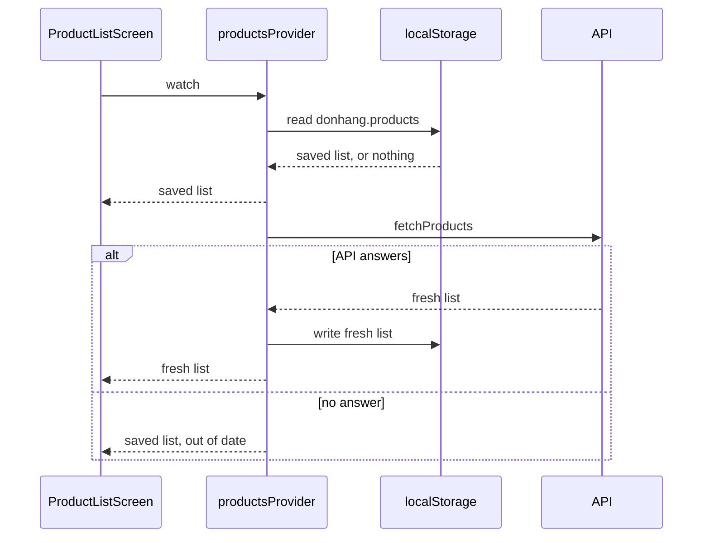

## Bạn cần biết trước

- [[frontend.l2.futureprovider-and-asyncvalue]] — bạn biết `productsProvider` đưa cho màn hình một AsyncValue, và `AsyncValue.when` chọn builder cho trạng thái đang tải, lỗi hay đã có dữ liệu.
- [[backend.l3.graceful-degradation]] — bạn biết phải quyết định trước những gì vẫn chạy khi một phụ thuộc hỏng. Ở đây phụ thuộc là API, và quyết định nằm trong app.
- [[backend.l2.cache-aside]] — bạn biết một bản sao đặt gần người đọc hơn có thể trả lời thay cho nguồn gốc. Bài này giữ bản sao đó ngay trên máy của khách.

## Tình huống

Ở stage-2, một khách đang mở danh sách sản phẩm của DonHang.App để so hai chiếc bàn phím. API ngừng trả lời vài phút. Khách mở DonHang.App lần nữa trong một tab mới để xem giá. Vòng xoay chờ quay một lúc, rồi cả màn hình báo `Could not load products.` Danh sách khách vừa đọc một phút trước, trên cùng trình duyệt, biến mất, dù chưa sản phẩm nào thay đổi. Cho tới khi API trở lại, khách không làm được gì cả. App phải giữ gì trên máy, và màn hình phải dùng nó theo thứ tự nào, để vẫn có ích trong lúc không tới được API?

## Khái niệm cốt lõi

- **offline-first** — thiết kế app sao cho nó đọc bản sao giữ trên máy trước và dùng mạng để làm mới bản sao đó, nhờ vậy màn hình vẫn có thứ để hiện khi không có kết nối.
- **localStorage** — kho giá trị chuỗi theo key của trình duyệt, dành cho một địa chỉ web (scheme, chẳng hạn `http` hay `https`, cùng host và port). Các giá trị còn lại sau khi tải lại trang và sau khi đóng tab, và trình duyệt giới hạn lượng dữ liệu một địa chỉ được giữ.
- bản lưu — danh sách sản phẩm đúng như lần gần nhất API trả về, ghi vào `localStorage` dưới key `donhang.products`.
- `StreamProvider` — provider của Riverpod có thể đưa cho màn hình nhiều giá trị nối tiếp nhau, mỗi giá trị là dữ liệu của AsyncValue, trong khi `FutureProvider` chỉ đưa một kết quả.
- có thể đã cũ — `LoadedProducts` là thứ provider đưa cho màn hình: danh sách sản phẩm kèm cờ `outOfDate`, được bật khi màn hình hiện bản lưu vì lần tải mới thất bại.

## Cơ chế hoạt động



Trong tình huống trên, màn hình ở stage-2 chỉ có một nguồn là API. Khi API không trả lời, màn hình không còn gì để hiện, dù cùng danh sách đó vừa nằm trên màn hình một phút trước. Màn hình cần một nguồn thứ hai không phụ thuộc vào mạng.

Ở stage-3, nguồn thứ hai đó là `localStorage`. Vì nó chỉ giữ chuỗi, app chuyển danh sách sản phẩm thành văn bản JSON trước khi ghi, và chuyển ngược lại thành các đối tượng `Product` sau khi đọc.

Hãy theo sơ đồ từ trên xuống. Nó minh họa một lần khách quay lại. Khi màn hình bắt đầu theo dõi `productsProvider`, provider đọc bản lưu. Nếu có, màn hình nhận ngay bản đó mà không phải chờ API. Sau đó provider mới hỏi API. Danh sách mới thay bản sao ở hai chỗ: trước hết trong `localStorage` cho lần ghé sau, rồi trên màn hình.

Nếu request tới API thất bại, provider đưa lại bản lưu cho màn hình, lần này đánh dấu là có thể đã cũ. Khách vẫn giữ danh sách và thấy một cảnh báo phía trên nó, thay vì vòng xoay chờ hay câu báo lỗi. Chỉ khi chưa lưu gì, như ở lần ghé đầu tiên, màn hình mới hiện lỗi: mũi tên đầu tiên quay về màn hình bị bỏ qua, và nhánh "no answer" kết thúc bằng lỗi đó.

Thứ tự này chính là lời giải cho tình huống: máy trước, mạng sau. Bản sao chỉ mới bằng lần tải thành công gần nhất, nên màn hình nói rõ điều đó mỗi khi không làm mới được. Cách này hợp với một danh sách khách chỉ xem qua. Ở chỗ mà hành động dựa trên bản sao cũ có thể gây hại, báo lỗi có thể là lựa chọn an toàn hơn.

## Trong hệ thống Đơn Hàng

Provider đứng sau danh sách sản phẩm ở stage-3:

```dart file=DonHang.App/lib/providers.dart tag=stage-3 lines=39-57
// lesson: frontend.l3.offline-first
// Offline-first: the saved copy is shown at once, then the API is asked for
// a fresh list, which replaces the copy on screen and on the device. When
// that fails the saved copy stays, marked out of date. Riverpod's retry is
// off here: with a copy on screen there is nothing to wait for.
final productsProvider = StreamProvider<LoadedProducts>((ref) async* {
  final store = ref.watch(localStoreProvider);
  final api = ref.watch(apiClientProvider);
  final saved = readSavedProducts(store);
  if (saved != null) yield LoadedProducts(saved);
  try {
    final fresh = await api.fetchProducts();
    store.write(savedProductsKey, jsonEncode([for (final product in fresh) product.toJson()]));
    yield LoadedProducts(fresh);
  } on Exception {
    if (saved == null) rethrow;
    yield LoadedProducts(saved, outOfDate: true);
  }
}, retry: (retryCount, error) => null);
```

Mỗi `yield` đưa thêm một giá trị cho màn hình (`async*` đánh dấu một hàm vừa có thể `await` vừa có thể `yield` nhiều giá trị), nên ba mũi tên quay về màn hình trong sơ đồ là ba dòng ở đây. `readSavedProducts`, nằm dưới đoạn trích, đọc key `savedProductsKey` (hằng số chứa `donhang.products`) rồi giải mã JSON. Nó trả về `null` khi chưa lưu gì.

Dòng `store.write` chỉ lưu danh sách mới sau khi `fetchProducts` thành công, nên một lần tải hỏng không bao giờ ghi đè một bản sao tốt. `rethrow` (ném lại exception vừa bắt, giống `throw;` của C#) giữ nguyên hành vi cũ cho lần ghé đầu tiên: không có bản sao, nên màn hình nhận lỗi. Mặc định, khi một provider hỏng, Riverpod chạy lại nó vài lần, có chờ giữa các lần thử. Ở stage-2, đó là lý do vòng xoay chờ quay một lúc. Hàm `retry` trả về `null`, và điều đó tắt cơ chế này ở đây. Khi đã có bản lưu, lần tải hỏng bị bắt lại và bản sao được hiện ra, nên không có gì phải chờ. Trong lần tải, chỉ `rethrow` làm provider hỏng, và thử lại chỉ làm lỗi của nó đến muộn hơn.

`apiClientProvider` đưa ra client gọi API, như ở stage-2. `localStoreProvider` đến từ `lib/offline/local_store.dart`: trong trình duyệt nó là `localStorage` thật, còn trong widget test thì một map trong bộ nhớ đứng thay. Màn hình dùng cờ đó như sau:

```dart file=DonHang.App/lib/screens/product_list_screen.dart tag=stage-3 lines=32-41
      body: products.when(
        loading: () => const LoadingView(),
        error: (error, stackTrace) => MessageView(message: l10n.productsLoadError),
        data: (loaded) => Column(
          children: [
            if (loaded.outOfDate) StatusBanner(message: l10n.savedListBanner, tone: StatusTone.warning),
            Expanded(child: _catalog(context, loaded)),
          ],
        ),
      ),
```

Ba builder vẫn là ba trường hợp như ở stage-2. Thứ thay đổi là mỗi builder chạy thường xuyên tới đâu. Khi đã có bản lưu, builder đang tải chỉ hiện cho tới lúc đọc xong bản sao. Khi API không trả lời, builder lỗi không còn chạy nữa, miễn là có bản lưu. Nó vẫn chạy ở lần ghé đầu tiên mà API không trả lời. Một bản sao có thể đã cũ đi qua builder dữ liệu như mọi danh sách khác, kèm một banner cảnh báo đặt phía trên danh mục. Bản tiếng Anh của banner là `Showing the saved list: the API did not answer, so it may be out of date.`

## Senior hay nhầm rằng…

- **"Hỗ trợ offline chỉ là một câu báo lỗi tử tế hơn khi request thất bại."** → Thực ra offline-first đổi chỗ màn hình đọc dữ liệu: đọc từ bản lưu, hiện ra mà không chờ request. Một câu báo lỗi, dù thân thiện tới đâu, vẫn để khách không còn gì để chọn. Bạn sẽ nhận ra khi màn hình stage-2 báo `Could not load products.` trong khi danh sách nó vừa hiện một phút trước đã biến mất.
- **"Dữ liệu lưu trong localStorage vẫn đúng cho tới khi người dùng có mạng trở lại."** → Thực ra bản sao là những gì API nói ở lần tải thành công gần nhất, và không có gì báo cho máy biết khi server thay đổi. Một sản phẩm đã bị xóa hay đổi giá trên server vẫn xuất hiện trong danh sách đã lưu cho tới khi có một lần tải thành công. Bạn sẽ nhận ra khi banner cảnh báo hiện trên màn hình: đó là app thừa nhận nó không thể biết.
- **"Một khi dữ liệu đã lưu trong trình duyệt, cả app chạy được khi offline, kể cả khi tải lại trang."** → Thực ra `localStorage` giữ danh sách sản phẩm, không giữ app. Trước khi code Dart nào đọc được danh sách đã lưu, một lần tải lại trang phải lấy lại web bundle, từ mạng hoặc từ HTTP cache của trình duyệt, tức các bản sao response trước đó mà trình duyệt tự giữ, trong phạm vi header của server cho phép. Chủ động lưu các file của chính app trong trình duyệt là một bước riêng mà module này bỏ qua. Bạn sẽ nhận ra khi một máy hoàn toàn không có mạng không mở được DonHang.App, dù danh sách sản phẩm vẫn còn được lưu.

## Thử ngay (3 phút)

Trong `DonHang.App` ở stage-3:

1. Chạy `flutter test test/offline_products_test.dart`.
2. Trong `lib/providers.dart`, comment dòng `store.write(savedProductsKey, …)` bên trong `productsProvider`, rồi chạy lại đúng lệnh đó.
3. Hoàn tác thay đổi.

Kết quả mong đợi: lần chạy đầu kết thúc bằng `All tests passed!`. Ở lần chạy thứ hai, test `saves each fresh list for the next visit` hỏng ở phép kiểm tra cuối, `readSavedProducts(store)!`, vì không có gì được lưu: màn hình vẫn hiện danh sách mới, nhưng không có gì được lưu cho lần ghé sau. Hai test còn lại vẫn qua.

Vì sao test `shows the saved list when the API does not answer` vẫn qua khi không có dòng `store.write`?

<details><summary>Gợi ý đáp án</summary>

Trong test đó API không bao giờ trả lời, nên `fetchProducts` ném exception và dòng `store.write` không bao giờ được chạy tới. Danh sách đã lưu mà màn hình hiện là do chính test ghi vào trước khi màn hình khởi động, đóng vai một lần ghé trước đó.

</details>

## Liên hệ

- [[backend.l2.cache-aside]] — cùng ý tưởng ở tầng dưới: một bản sao trả lời trước, nhưng ở đó server điền bản sao, còn ở đây app hiện bản sao của mình trước cả khi hỏi.
- [[backend.l3.graceful-degradation]] — cùng quyết định đó, áp dụng cho app: không có API thì danh sách sản phẩm vẫn dùng được, kèm dấu hiệu có thể đã cũ.
- [[foundation.l1.http-caching]] — cache response của chính trình duyệt, do header từ server điều khiển. Còn `localStorage` thì do code của app ghi và đọc.
- [[frontend.l3.rebuild-scope]] — cùng `ProductListScreen`: `build` của nó chỉ theo dõi `productsProvider`, nên mỗi danh sách mới provider đưa ra đánh dấu `build` đó chạy lại trước khung hình tiếp theo.
- [[frontend.l3.offline-order-queue]] — bước tiếp theo: giữ một đơn mới trên máy khi API không nhận được.

## Tóm tắt 5 dòng

1. Offline-first nghĩa là màn hình đọc bản sao giữ trên máy trước và chỉ dùng mạng để làm mới bản sao đó.
2. `localStorage` giữ chuỗi theo key cho một địa chỉ web, còn lại sau khi tải lại trang hay đóng tab, và trình duyệt giới hạn dung lượng của nó.
3. Ở stage-3, `productsProvider` hiện ngay danh sách đã lưu, rồi hỏi API và lưu lại mỗi danh sách mới nhận được.
4. Khi lần tải mới thất bại, danh sách đã lưu vẫn ở trên màn hình, kèm cảnh báo rằng nó có thể đã cũ.
5. `localStorage` giữ dữ liệu, không giữ app: tải lại trang khi không có mạng vẫn cần các file của chính app.
