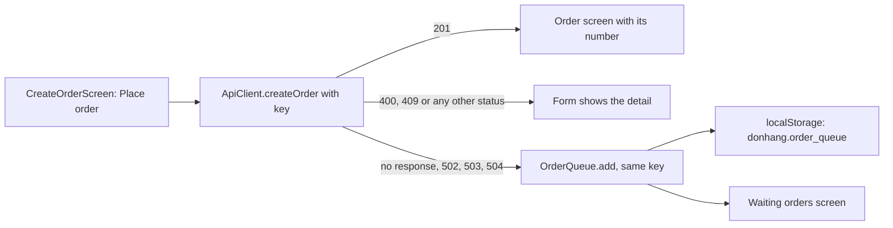

## Before you start

- [[frontend.l3.offline-first]] — you know DonHang.App keeps the product list in `localStorage` and still shows it when the API does not answer; this lesson keeps a new order there too.
- [[frontend.l2.server-errors-in-forms]] — you know `ApiClient.createOrder` turns a non-`201` answer into an `ApiProblem`, whose `detail` the form shows while every field keeps its value.
- [[backend.l2.idempotent-endpoints]] — you know one `Idempotency-Key` per intended order lets a client send the same `POST` again and still end up with exactly one order.
- [[backend.l3.outbox-pattern]] — you know the server saves a message first and delivers it afterwards; this lesson does the same on the customer's device.

## The situation

At stage-2 a customer picks a keyboard in DonHang.App and presses `Place order` just as the API stops answering. The form says `The order could not be sent. Check your connection and try again.` The customer means to try later, closes the tab and forgets. If the request never reached the API, the order now exists nowhere: not on the server, not on the device. If it did reach the API and only the answer was lost, pressing the button again would create a second order.

At stage-3 the product list already survives an unreachable API. What should happen to an order placed while the API cannot answer, so that it is neither lost nor placed twice?

## Core concepts

- **offline queue** — writes the app saves on the device while the server cannot be reached, to send later in order; in DonHang.App, the orders kept in `localStorage` under the key `donhang.order_queue`.
- no answer — what `ApiClient.createOrder` reports as `ApiUnreachable`: no response at all, or a `502`, `503` or `504`, which the code reads as the proxy in front of the API saying it could not reach it.
- queued order — a `QueuedOrder`: the items with the prices the customer saw, the `sub` of the customer who placed it (the field in the access token that identifies the signed-in customer), the order's `Idempotency-Key`, and a status that starts as waiting; the next lesson covers what it changes to.
- `OrderQueue` — the Riverpod class that holds the queued orders, oldest first, and writes every change to `localStorage` before the screens see it.

## How it works



In the situation above, the stage-2 form had two outcomes: an order, or a message. Stage-3 adds a third for no answer: it is the case DonHang.App treats as leaving the order's fate unknown.

When the customer presses `Place order`, `CreateOrderScreen` makes one `Idempotency-Key` for this order and calls `createOrder` with it. A `201` opens the new order's screen, as before.

Any other status is the API's answer, so the form shows its `detail` and keeps the fields, as at stage-2. A `400`, for example, refuses this exact order, and the customer, still at the form, can fix it. A `500` also comes from DonHang.Api itself, and DonHang.App counts any status the API sends as an answer, so it is shown, not queued.

No response, or a `502`, `503` or `504`, is no answer. The request may or may not have reached the API, and the app cannot tell which. The screen adds the order to the offline queue with the key it was just sent with, and opens `Waiting orders`. A later attempt sends that same key; the next lesson covers when. If the first attempt did create the order and only its answer was lost, the API hands back that order instead of storing a second one.

`OrderQueue` writes the new list to `localStorage` first and only then updates what the screens show. This is the outbox idea on the device: the intent is saved where a page reload cannot lose it, and delivered afterwards.

## In the Đơn Hàng system

The stage-3 submit handler of `CreateOrderScreen`:

```dart file=DonHang.App/lib/screens/create_order_screen.dart tag=stage-3 lines=64-79
    final product = _product!;
    final quantity = int.parse(_quantityController.text);
    final items = [OrderItemRequest(productId: product.id, quantity: quantity, unitPriceVnd: product.priceVnd)];
    final idempotencyKey = newIdempotencyKey();
    try {
      final order = await ref.read(apiClientProvider).createOrder(items, idempotencyKey: idempotencyKey);
      if (mounted) context.go('/orders/${order.id}');
    } on ApiUnreachable {
      _queue('$quantity × ${product.name}', items, idempotencyKey);
    } on ApiProblem catch (problem) {
      if (mounted) setState(() => _serverError = problem.detail);
    } on Exception {
      if (mounted) setState(() => _serverError = AppLocalizations.of(context).orderFailed);
    } finally {
      if (mounted) setState(() => _sending = false);
    }
```

`newIdempotencyKey()` runs once per press of the button, before the request, so the key exists even if no answer ever comes. `on ApiUnreachable` is the only branch that queues. `on ApiProblem` is the stage-2 branch, unchanged, and `on Exception` keeps the general message for any other exception. `mounted` turns false once the screen has left the widget tree; those checks only skip updating a screen that is gone. `_queue`, below the excerpt, reads the signed-in customer's `sub` from the token, adds a `QueuedOrder` holding the same `idempotencyKey`, and goes to `/orders/queued`; with no `sub` it queues nothing and shows the general message.

How `ApiClient` tells no answer from an answer:

```dart file=DonHang.App/lib/api_client.dart tag=stage-3 lines=65-79
  Future<OrderResult> createOrder(List<OrderItemRequest> items, {required String idempotencyKey}) async {
    final http.Response response;
    try {
      response = await _http.post(
        Uri.parse('$baseUrl/orders'),
        headers: {..._headers, 'Idempotency-Key': idempotencyKey},
        body: jsonEncode({'items': items.map((item) => item.toJson()).toList()}),
      );
    } on http.ClientException {
      throw ApiUnreachable();
    }
    if (const [502, 503, 504].contains(response.statusCode)) throw ApiUnreachable();
    if (response.statusCode != 201) throw ApiProblem.fromResponse(response);
    return OrderResult.fromJson(jsonDecode(response.body) as Map<String, dynamic>);
  }
```

`http.ClientException` is how the `http` package reports a request that got no response. The three proxy statuses are checked before the `201` check, so they never become an `ApiProblem`; every other non-`201` status still does, as at stage-2. Requests go through Caddy, which is why the comment just above `createOrder`, outside the excerpt, reads those three as the proxy in front of the API, here Caddy, failing to reach it.

The `Waiting orders` screen (`lib/screens/queued_orders_screen.dart`) lists the signed-in customer's queued orders; a waiting one shows `Waiting to be sent:` followed by the quantity and product name. It shows no order number: the number is the `id` in the API's `201` answer, and a waiting order has not had one.

## Seniors often assume…

- **"If a request fails, the app should queue it and retry later, whatever the status code was."** → Actually DonHang.App queues only no answer, the case where the outcome is unknown. A `400` or `409` is the API's answer, shown in the form; a `400` refuses this exact order, and sent again unchanged it is refused again, and a customer who has left the form never learns why. You notice this when a validation problem the customer could fix in a second shows up as a waiting order that never goes through.
- **"A new Idempotency-Key for each attempt is safer, because the server cannot confuse one attempt with another."** → Actually the key exists to tell the API that two attempts are one order. With a new key, an attempt whose answer was lost and the later resend look like two orders, and the API stores both. You notice this when a customer who saw an order waiting once finds two identical orders in their history.
- **"Once an order is in the local queue, the app can tell the customer it has been placed."** → Actually the order is placed only when the API stores it and answers `201`; until then the API may still refuse it. The queue holds an intention, not an order. You notice this when the `Waiting orders` screen lists the order without a number, because only the API gives one.

## Try it (3 minutes)

In `DonHang.App` at stage-3, `test/api_client_test.dart` runs `createOrder` against fake responses: a `201`, each proxy status, no response, a `400` and a `429`.

1. Run `flutter test test/api_client_test.dart`.
2. In `lib/api_client.dart`, change `const [502, 503, 504]` to `const [502, 504]`, then run the same command again.
3. Undo the change.

Expected result: the first run ends with `All tests passed!`. In the second run the test `a 503 from the proxy means no answer` fails, because a `503` now becomes an `ApiProblem`: the form would show it and the order would not be queued. The other six tests still pass.

Why does the test `a 400 is an answer: an ApiProblem` expect an `ApiProblem` and not `ApiUnreachable`?

<details><summary>Suggested answer</summary>

A `400` means the API received the order and refused it. Queuing it would only send the same refused order again later, while the customer has moved on. As an `ApiProblem`, its `detail` appears in the form at once, where the customer can fix the value and send the order again.

</details>

## Connections

- [[backend.l3.outbox-pattern]] — the same idea on the server: save the intent first where a crash cannot lose it, deliver it afterwards.
- [[backend.l2.idempotent-endpoints]] — the server half of this lesson: why a resend with the same key gets the first order back instead of a new one.
- [[backend.l3.dual-write]] — the same two-places problem: after no answer the order may exist both on the server and in the queue, and the shared key is what makes the later send harmless.
- [[frontend.l3.offline-first]] — the read side of the same design: a saved copy of the product list, where this lesson saves a write.
- [[frontend.l3.syncing-the-queue]] — the next step: when the queued orders are sent, one at a time and oldest first.

## Five-line summary

1. When the API cannot answer, DonHang.App keeps a new order in an offline queue on the device and sends it later instead of refusing it.
2. `ApiClient.createOrder` reports no answer separately: no response at all, or a `502`, `503` or `504` from the proxy.
3. Only no answer queues the order; a `400` or `409` is the API's answer and is still shown in the form.
4. The order keeps the `Idempotency-Key` it was first sent with, so a resend after a lost answer cannot create a second order.
5. Like an outbox, the queue is saved to `localStorage` before delivery, and a waiting order has no number until the API stores it.
