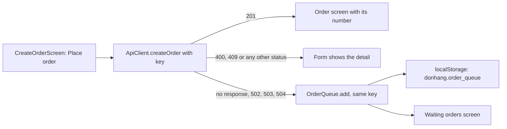

## Bạn cần biết trước

- [[frontend.l3.offline-first]] — bạn biết rằng DonHang.App giữ danh sách sản phẩm trong `localStorage` và vẫn hiện nó khi API không trả lời. Bài này cũng giữ một đơn mới ở đó.
- [[frontend.l2.server-errors-in-forms]] — bạn biết rằng `ApiClient.createOrder` biến một câu trả lời khác `201` thành một `ApiProblem`, và form hiện `detail` của nó trong khi mọi ô vẫn giữ giá trị.
- [[backend.l2.idempotent-endpoints]] — bạn biết rằng mỗi đơn định đặt có một `Idempotency-Key`, nhờ đó client gửi lại cùng `POST` mà cuối cùng vẫn chỉ có đúng một đơn.
- [[backend.l3.outbox-pattern]] — bạn biết rằng server lưu message trước rồi mới gửi đi sau. Bài này làm điều tương tự trên máy của khách.

## Tình huống

Ở stage-2, một khách chọn bàn phím trong DonHang.App và bấm `Place order` đúng lúc API ngừng trả lời. Form báo `The order could not be sent. Check your connection and try again.` Khách định lát nữa thử lại, đóng tab rồi quên mất. Nếu request chưa hề tới API, đơn giờ không nằm ở đâu cả: không trên server, cũng không trên máy. Nếu request đã tới API và chỉ có câu trả lời bị mất, bấm nút lần nữa sẽ tạo ra đơn thứ hai.

Ở stage-3, danh sách sản phẩm đã sống sót khi API không tới được. Vậy một đơn đặt trong lúc API không trả lời được nên đi đâu, để nó không bị mất mà cũng không bị đặt hai lần?

## Khái niệm cốt lõi

- **hàng đợi offline** (offline queue) — các thao tác ghi mà app lưu trên máy khi không tới được server, để gửi lại sau theo thứ tự. Trong DonHang.App, đó là các đơn giữ trong `localStorage` dưới key `donhang.order_queue`.
- không có câu trả lời — trường hợp `ApiClient.createOrder` báo bằng `ApiUnreachable`: hoàn toàn không có response, hoặc một `502`, `503` hay `504`, mà code hiểu là proxy đứng trước API báo rằng nó không tới được API.
- đơn đang chờ — một `QueuedOrder`: các món hàng kèm giá mà khách đã thấy, `sub` của khách đặt đơn (trường trong access token xác định khách đang đăng nhập), `Idempotency-Key` của đơn, và một trạng thái bắt đầu là đang chờ. Bài sau nói trạng thái đó đổi thành gì.
- `OrderQueue` — class Riverpod giữ các đơn đang chờ, cũ nhất đứng đầu, và ghi mọi thay đổi vào `localStorage` trước khi các màn hình thấy nó.

## Cơ chế hoạt động



Trong tình huống trên, form ở stage-2 có hai kết cục: một đơn, hoặc một câu báo lỗi. Stage-3 thêm kết cục thứ ba cho trường hợp không có câu trả lời: đây là lúc DonHang.App coi số phận của đơn là chưa rõ.

Khi khách bấm `Place order`, `CreateOrderScreen` tạo một `Idempotency-Key` cho đơn này và gọi `createOrder` kèm key đó. Một `201` mở màn hình của đơn mới, như trước.

Mọi status khác đều là câu trả lời của API, nên form hiện `detail` của nó và giữ nguyên các ô, như ở stage-2. Chẳng hạn một `400` từ chối chính đơn này, và khách, vẫn đang ở form, có thể sửa lại. Một `500` cũng đến từ chính DonHang.Api, mà DonHang.App coi mọi status API gửi về là một câu trả lời, nên nó được hiện ra chứ không vào hàng đợi.

Không có response, hoặc một `502`, `503` hay `504`, nghĩa là không có câu trả lời. Request có thể đã tới API hoặc chưa, và app không phân biệt được. Màn hình thêm đơn vào hàng đợi offline với đúng key vừa gửi, rồi mở `Waiting orders`. Lần thử sau gửi lại đúng key đó, còn khi nào thì bài sau sẽ nói. Nếu lần đầu đã tạo đơn và chỉ câu trả lời bị mất, API trả lại đơn đó thay vì lưu thêm đơn thứ hai.

`OrderQueue` ghi danh sách mới vào `localStorage` trước, rồi mới cập nhật thứ các màn hình hiển thị. Đây là ý tưởng outbox trên máy: ý định được lưu ở nơi mà tải lại trang không làm mất, rồi mới gửi đi sau.

## Trong hệ thống Đơn Hàng

Hàm xử lý nút gửi của `CreateOrderScreen` ở stage-3:

```dart file=DonHang.App/lib/screens/create_order_screen.dart tag=stage-3 lines=64-79
    final product = _product!;
    final quantity = int.parse(_quantityController.text);
    final items = [OrderItemRequest(productId: product.id, quantity: quantity, unitPriceVnd: product.priceVnd)];
    final idempotencyKey = newIdempotencyKey();
    try {
      final order = await ref.read(apiClientProvider).createOrder(items, idempotencyKey: idempotencyKey);
      if (mounted) context.go('/orders/${order.id}');
    } on ApiUnreachable {
      _queue('$quantity × ${product.name}', items, idempotencyKey);
    } on ApiProblem catch (problem) {
      if (mounted) setState(() => _serverError = problem.detail);
    } on Exception {
      if (mounted) setState(() => _serverError = AppLocalizations.of(context).orderFailed);
    } finally {
      if (mounted) setState(() => _sending = false);
    }
```

`newIdempotencyKey()` chạy một lần mỗi lần bấm nút, trước request, nên key đã có sẵn kể cả khi không bao giờ có câu trả lời. `on ApiUnreachable` là nhánh duy nhất đưa đơn vào hàng đợi. `on ApiProblem` là nhánh của stage-2, không đổi, còn `on Exception` giữ câu báo lỗi chung cho mọi exception khác. `mounted` thành false khi màn hình đã rời widget tree. Các phép kiểm tra đó chỉ để khỏi cập nhật một màn hình không còn nữa. `_queue`, nằm dưới đoạn trích, đọc `sub` của khách đang đăng nhập từ token, thêm một `QueuedOrder` giữ đúng `idempotencyKey` đó, rồi chuyển tới `/orders/queued`. Không có `sub` thì nó không đưa gì vào hàng đợi và hiện câu báo lỗi chung.

Cách `ApiClient` phân biệt không có câu trả lời với có câu trả lời:

```dart file=DonHang.App/lib/api_client.dart tag=stage-3 lines=65-79
  Future<OrderResult> createOrder(List<OrderItemRequest> items, {required String idempotencyKey}) async {
    final http.Response response;
    try {
      response = await _http.post(
        Uri.parse('$baseUrl/orders'),
        headers: {..._headers, 'Idempotency-Key': idempotencyKey},
        body: jsonEncode({'items': items.map((item) => item.toJson()).toList()}),
      );
    } on http.ClientException {
      throw ApiUnreachable();
    }
    if (const [502, 503, 504].contains(response.statusCode)) throw ApiUnreachable();
    if (response.statusCode != 201) throw ApiProblem.fromResponse(response);
    return OrderResult.fromJson(jsonDecode(response.body) as Map<String, dynamic>);
  }
```

`http.ClientException` là cách package `http` báo một request không nhận được response. Ba status của proxy được kiểm tra trước phép kiểm tra `201`, nên chúng không bao giờ thành `ApiProblem`. Mọi status khác `201` còn lại vẫn thành `ApiProblem`, như ở stage-2. Request đi qua Caddy, vì thế comment ngay phía trên `createOrder`, ngoài đoạn trích, hiểu ba status đó là proxy đứng trước API, ở đây là Caddy, không tới được API.

Màn hình `Waiting orders` (`lib/screens/queued_orders_screen.dart`) liệt kê các đơn đang chờ của khách đang đăng nhập. Một đơn đang chờ hiện `Waiting to be sent:` theo sau là số lượng và tên sản phẩm. Nó không hiện mã đơn: mã đơn là `id` trong câu trả lời `201` của API, mà đơn đang chờ thì chưa nhận được.

## Senior hay nhầm rằng…

- **"Request nào thất bại thì app cũng nên đưa vào hàng đợi rồi thử lại sau, bất kể status code là gì."** → Thực ra DonHang.App chỉ đưa vào hàng đợi khi không có câu trả lời, trường hợp mà kết cục chưa rõ. Một `400` hay `409` là câu trả lời của API, được hiện trong form. Một `400` từ chối chính đơn này, gửi lại y nguyên thì lại bị từ chối, và khách đã rời form thì không bao giờ biết vì sao. Bạn sẽ nhận ra khi một lỗi dữ liệu mà khách sửa trong một giây lại hiện thành một đơn đang chờ mãi không đi được.
- **"Mỗi lần thử dùng một Idempotency-Key mới thì an toàn hơn, vì server không thể nhầm lần thử này với lần thử khác."** → Thực ra key tồn tại để báo cho API rằng hai lần thử là một đơn. Với key mới, một lần thử bị mất câu trả lời và lần gửi lại sau đó trông như hai đơn, và API lưu cả hai. Bạn sẽ nhận ra khi một khách từng thấy một đơn đang chờ lại thấy hai đơn giống hệt nhau trong lịch sử.
- **"Một khi đơn đã nằm trong hàng đợi trên máy, app có thể báo khách rằng đơn đã được đặt."** → Thực ra đơn chỉ được đặt khi API lưu nó và trả lời `201`. Trước lúc đó API vẫn có thể từ chối. Hàng đợi giữ một ý định, không phải một đơn. Bạn sẽ nhận ra khi màn hình `Waiting orders` liệt kê đơn mà không có mã, vì chỉ API mới cấp mã.

## Thử ngay (3 phút)

Trong `DonHang.App` ở stage-3, `test/api_client_test.dart` chạy `createOrder` với các response giả: một `201`, từng status của proxy, không có response, một `400` và một `429`.

1. Chạy `flutter test test/api_client_test.dart`.
2. Trong `lib/api_client.dart`, đổi `const [502, 503, 504]` thành `const [502, 504]`, rồi chạy lại đúng lệnh đó.
3. Hoàn tác thay đổi.

Kết quả mong đợi: lần chạy đầu kết thúc bằng `All tests passed!`. Ở lần chạy thứ hai, test `a 503 from the proxy means no answer` hỏng, vì giờ một `503` thành `ApiProblem`: form sẽ hiện nó và đơn không vào hàng đợi. Sáu test còn lại vẫn qua.

Vì sao test `a 400 is an answer: an ApiProblem` chờ một `ApiProblem` chứ không phải `ApiUnreachable`?

<details><summary>Gợi ý đáp án</summary>

Một `400` nghĩa là API đã nhận đơn và từ chối nó. Đưa nó vào hàng đợi chỉ khiến cùng đơn bị từ chối đó được gửi lại sau, trong khi khách đã làm việc khác. Là một `ApiProblem`, `detail` của nó hiện ngay trong form, nơi khách sửa được giá trị và gửi lại đơn.

</details>

## Liên hệ

- [[backend.l3.outbox-pattern]] — cùng ý tưởng ở phía server: lưu ý định trước ở nơi một lần sập không làm mất, rồi mới gửi đi sau.
- [[backend.l2.idempotent-endpoints]] — nửa phía server của bài này: vì sao gửi lại với cùng key thì nhận lại đơn đầu tiên chứ không phải một đơn mới.
- [[backend.l3.dual-write]] — cùng bài toán hai nơi: sau khi không có câu trả lời, đơn có thể nằm cả trên server lẫn trong hàng đợi, và key dùng chung là thứ khiến lần gửi sau vô hại.
- [[frontend.l3.offline-first]] — phía đọc của cùng thiết kế: một bản sao danh sách sản phẩm được lưu lại, còn bài này lưu một thao tác ghi.
- [[frontend.l3.syncing-the-queue]] — bước tiếp theo: khi nào các đơn đang chờ được gửi đi, từng đơn một và cũ nhất trước.

## Tóm tắt 5 dòng

1. Khi API không trả lời được, DonHang.App giữ đơn mới trong hàng đợi offline trên máy và gửi lại sau, thay vì từ chối nó.
2. `ApiClient.createOrder` báo riêng trường hợp không có câu trả lời: hoàn toàn không có response, hoặc một `502`, `503` hay `504` từ proxy.
3. Chỉ khi không có câu trả lời thì đơn mới vào hàng đợi. Một `400` hay `409` là câu trả lời của API và vẫn hiện trong form.
4. Đơn giữ `Idempotency-Key` của lần gửi đầu, nên gửi lại sau khi mất câu trả lời không thể tạo đơn thứ hai.
5. Giống một outbox, hàng đợi được lưu vào `localStorage` trước khi gửi, và đơn đang chờ chưa có mã cho tới khi API lưu nó.
