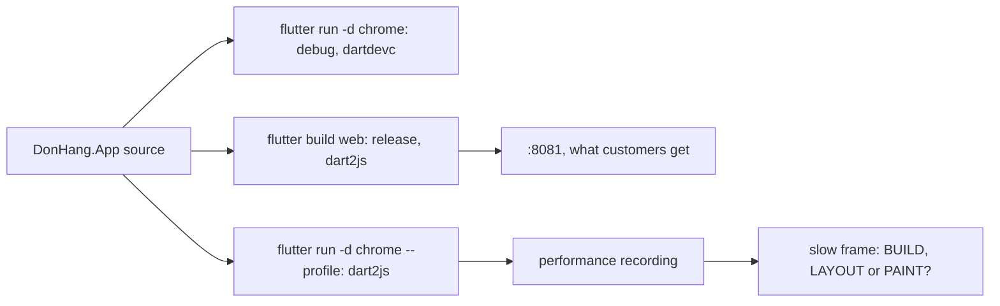

## Before you start

- [[frontend.l1.build-layout-paint]] — you know Flutter makes each frame in three phases, build, layout and paint, which is what a measurement splits a slow frame into.
- [[frontend.l1.render]] — you know the browser has its own steps for turning a page into pixels, and that some changes cost more than others.

## The situation

A teammate opens DonHang.App with `flutter run -d chrome`, goes from the product list to a product's page and back, and says each change of screen seems to hesitate. They propose rewriting `ProductListScreen` before stage-3 adds anything to it. You open the same screens at `http://localhost:8081`, the app the lab serves, and they change without a pause. Same code, same browser, two different impressions. Which one tells you how the app runs for customers, and how would you find which part of a frame is slow before rewriting anything?

## Core concepts

- debug build — what `flutter run` starts by default: on the web compiled by dartdevc, made for fast edit-and-run cycles with extra checks switched on, not for speed.
- release build — what you ship: on the web compiled by dart2js, made for speed and size, with the checks and debugging help left out.
- **profile mode** — a Flutter build mode that compiles much like release, with dart2js on the web, but keeps Flutter's timing entries, so it is the mode to measure in.
- performance recording — what the Performance panel of Chrome's developer tools captures while you use a page: a timeline of the work done for each frame.
- frame — one complete picture of the screen; to look smooth at 60 frames per second, each frame has about 16 ms for its work.
- **jank** — a frame that is not ready in time, so scrolling or an animation shows a visible stutter.

## How it works



The same source can become three different programs. In the situation above, your teammate ran a debug build: dartdevc's program with extra checks, not the one dart2js makes for release. So how fast it feels is no evidence about release, in either direction. A hesitation there may not exist for customers, and a smooth debug run tells you only about the debug program, not about the one customers get.

The app on `:8081` is a release build. That is what customers get, but it leaves out Flutter's timing entries, so a recording cannot tell which phase a slow frame spent its time in.

Profile mode sits between the two. You start it with `flutter run -d chrome --profile`. It uses dart2js like release, and Flutter keeps its timing entries, named `BUILD`, `LAYOUT` and `PAINT`, that show how long each phase of a frame took. In a performance recording they sit next to the browser's own work. A few appear twice, the plain one nested inside one marked `(root)`: one span of time, not two.

That is how you answer the question in the situation. A frame that takes more than about 16 ms is jank, and the recording shows which phase spent the time. Each phase has a different fix: too much time in `BUILD`, for example, calls for rebuilding fewer widgets. When a change for speed makes code harder to read, make it only where such a recording shows a slow frame: a change that costs readability with no measured gain is a pure cost.

## In the Đơn Hàng system

How the lab builds the app that `:8081` serves:

```bash file=scripts/up.sh tag=stage-2 lines=8-22
# lesson: frontend.l1.the-widget-tree
# The app-web container only serves files; building them needs the Flutter
# SDK, which runs on the host, not in a container (D5/D7: Flutter is a
# prerequisite here, same as Docker Desktop).
(cd DonHang.App && flutter build web >/dev/null)

# --wait returns once every service is running and each one with a healthcheck
# is healthy, the api included: it answers before any script runs.
docker compose up -d --build --wait

echo
echo "The lab is up."
echo "  site        http://localhost:8080/"
echo "  site (TLS)  https://donhang.local:8443/   (add '127.0.0.1 donhang.local' to your hosts file)"
echo "  app (web)   http://localhost:8081/"
```

Look at the `flutter build web` line; the comments above it only explain why the build runs on your machine, not in a container, and you can skip them here. It passes no mode flag, and the default mode of `flutter build web` is release. The `app-web` container then serves those built files, which is the address the last `echo` prints. So the screen you clicked at `:8081` was the release build, compiled by dart2js, not the program your teammate was clicking.

Neither impression is a measurement, though. The release build feels fast to you on your machine, and a recording of it cannot show which Flutter phase a frame spends its time in. Before anyone rewrites `ProductListScreen`, the next step is a profile-mode recording of the same clicks.

## Seniors often assume…

- **"If the app feels smooth in debug mode, it will be smooth in release, and if it stutters in debug, release will stutter too."** → Actually debug and release on the web are compiled by different compilers, and debug adds checks that release drops, so how one feels is no evidence about the other. You notice this when a stutter reported from `flutter run` never shows up on `:8081`.
- **"Jank means the app is slow overall; a fast average frame time rules it out."** → Actually jank is about single frames that miss their roughly 16 ms, and an average hides them. You notice this when users complain about a stutter on one screen while the average looks fine: the recording shows a few long frames among many short ones.
- **"Experienced developers can see what is slow by reading the code, so measuring first is only for beginners."** → Actually the cost of a frame depends on what Flutter and the browser do at run time, which the code does not show, so a guess can land on the wrong phase. You notice this when a rewrite ships and the stutter is still there.

## Try it (3 minutes)

Start the lab with `scripts/up.sh` so the app has an API to call.

1. In `DonHang.App`, run `flutter run -d chrome --profile`. The first compile can take a minute.
2. In the Chrome window that opens, open the developer tools, choose the Performance panel and start a recording.
3. Open a product's page and go back to the list, then stop the recording.

Expected result: the recording holds Flutter's entries for each frame you caused, among them `BUILD`, `LAYOUT` and `PAINT`.

Then repeat the clicks on `http://localhost:8081` with a recording. What is missing, and why?

<details><summary>Suggested answer</summary>

The entries named `BUILD`, `LAYOUT` and `PAINT` are missing. The app on `:8081` is a release build, and release leaves out the timing entries that profile mode keeps. You still see the browser's own work, but not which Flutter phase it belongs to.

</details>

## Connections

- [[frontend.l1.build-layout-paint]] — the three phases a profile-mode recording splits each frame into.
- [[frontend.l3.rebuild-scope]] — the fix to apply when a recording shows too much time in build.
- [[frontend.l3.web-bundle-size]] — the other half of web performance: what the browser downloads before the first frame.
- [[devops.l2.building-images-in-ci]] — the same principle on the server side: judge the build you ship, not a different build of the same code.

## Five-line summary

1. Measure speed in a profile build, because a debug build is a different program and a release build's recording cannot show the slow phase.
2. `flutter run` starts a debug build, compiled on the web by dartdevc with extra checks, so its speed says little about release.
3. `scripts/up.sh` runs `flutter build web`, whose default is release, so `:8081` serves what customers get.
4. A frame has about 16 ms at 60 frames per second; a late frame is jank, even when the average is fast.
5. A profile-mode recording shows `BUILD`, `LAYOUT` and `PAINT` per frame, so you change only the phase that is slow.
