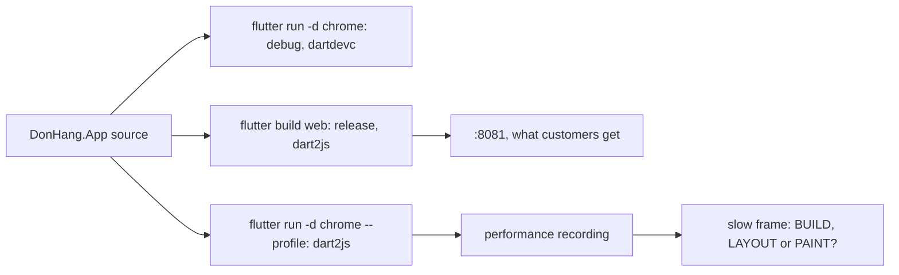

## Bạn cần biết trước

- [[frontend.l1.build-layout-paint]] — bạn biết Flutter làm mỗi khung hình qua ba giai đoạn build, layout và paint, và một phép đo chia khung hình chậm theo đúng ba phần đó.
- [[frontend.l1.render]] — bạn biết trình duyệt có các bước riêng để biến trang thành pixel, và có những thay đổi tốn kém hơn những thay đổi khác.

## Tình huống

Một đồng nghiệp mở DonHang.App bằng `flutter run -d chrome`, đi từ danh sách sản phẩm vào trang một sản phẩm rồi quay lại, và nói mỗi lần chuyển màn hình đều có vẻ khựng. Họ đề xuất viết lại `ProductListScreen` trước khi stage-3 thêm gì vào đó. Bạn mở cùng các màn hình ấy ở `http://localhost:8081`, app mà lab phục vụ, và chúng chuyển ngay, không chút ngập ngừng. Cùng code, cùng trình duyệt, hai cảm nhận khác nhau. Cảm nhận nào cho biết app chạy thế nào với khách hàng, và làm sao tìm ra phần nào của một khung hình bị chậm trước khi viết lại bất cứ thứ gì?

## Khái niệm cốt lõi

- bản build debug — thứ `flutter run` khởi động theo mặc định: trên web do dartdevc biên dịch, làm ra để sửa rồi chạy lại cho nhanh, bật thêm các phép kiểm tra, không nhằm chạy nhanh.
- bản build release — thứ bạn giao cho khách hàng: trên web do dart2js biên dịch, tối ưu cho tốc độ và kích thước, bỏ đi các phép kiểm tra và phần hỗ trợ gỡ lỗi.
- **profile mode** — một chế độ build của Flutter biên dịch gần giống release, trên web cũng dùng dart2js, nhưng giữ lại các mục đo thời gian của Flutter, nên đây là chế độ để đo.
- bản ghi hiệu năng (performance recording) — thứ panel Performance trong công cụ dành cho nhà phát triển của Chrome ghi lại trong lúc bạn dùng trang: một dòng thời gian cho thấy phần việc đã làm cho từng khung hình.
- khung hình (frame) — một bức hình hoàn chỉnh của màn hình. Để trông mượt ở 60 khung hình mỗi giây, mỗi khung hình có khoảng 16 ms cho phần việc của mình.
- **jank** — khung hình không xong kịp lúc, nên khi cuộn hay khi có hiệu ứng chuyển động, màn hình giật thấy rõ.

## Cơ chế hoạt động



Cùng một mã nguồn có thể thành ba chương trình khác nhau. Trong tình huống trên, đồng nghiệp của bạn chạy bản build debug: chương trình của dartdevc kèm các phép kiểm tra thêm, không phải chương trình dart2js tạo ra cho release. Vì vậy cảm giác nhanh hay chậm ở đó không chứng minh gì về release, theo cả hai chiều. Một chỗ khựng ở đó có thể không hề xảy ra với khách hàng, còn một lần chạy debug mượt mà chỉ cho bạn biết về chương trình debug, không phải chương trình khách hàng nhận được.

App trên `:8081` là bản build release. Đó là thứ khách hàng nhận được, nhưng bản này bỏ đi các mục đo thời gian của Flutter, nên bản ghi không cho biết một khung hình chậm đã tốn thời gian ở giai đoạn nào.

Profile mode nằm giữa hai bản đó. Bạn khởi động chế độ này bằng `flutter run -d chrome --profile`. Chế độ này dùng dart2js như release, và Flutter giữ lại các mục đo thời gian, tên là `BUILD`, `LAYOUT` và `PAINT`, cho thấy mỗi giai đoạn của khung hình mất bao lâu. Trong bản ghi hiệu năng, các mục này nằm cạnh phần việc riêng của trình duyệt. Vài mục xuất hiện hai lần, mục thường lồng bên trong một mục có đánh dấu `(root)`: đó là một khoảng thời gian, không phải hai.

Đó là cách trả lời câu hỏi trong tình huống. Khung hình nào mất hơn khoảng 16 ms là jank, và bản ghi cho thấy giai đoạn nào đã tiêu tốn thời gian. Mỗi giai đoạn có cách sửa riêng: chẳng hạn quá nhiều thời gian ở `BUILD` thì cần build lại ít widget hơn. Khi một thay đổi vì tốc độ làm code khó đọc hơn, chỉ làm ở chỗ mà bản ghi như vậy cho thấy có khung hình chậm: thay đổi làm code khó đọc mà không đo được lợi ích nào thì chỉ toàn là chi phí.

## Trong hệ thống Đơn Hàng

Cách lab build app mà `:8081` phục vụ:

```bash file=scripts/up.sh tag=stage-2 lines=8-22
# lesson: frontend.l1.the-widget-tree
# The app-web container only serves files; building them needs the Flutter
# SDK, which runs on the host, not in a container (D5/D7: Flutter is a
# prerequisite here, same as Docker Desktop).
(cd DonHang.App && flutter build web >/dev/null)

# --wait returns once every service is running and each one with a healthcheck
# is healthy, the api included: it answers before any script runs.
docker compose up -d --build --wait

echo
echo "The lab is up."
echo "  site        http://localhost:8080/"
echo "  site (TLS)  https://donhang.local:8443/   (add '127.0.0.1 donhang.local' to your hosts file)"
echo "  app (web)   http://localhost:8081/"
```

Hãy nhìn dòng `flutter build web`. Các comment phía trên chỉ giải thích vì sao bản build chạy trên máy bạn chứ không chạy trong container, nên ở đây bạn có thể bỏ qua. Dòng này không truyền cờ chế độ nào, và chế độ mặc định của `flutter build web` là release. Sau đó container `app-web` phục vụ các file đã build, chính là địa chỉ mà lệnh `echo` cuối cùng in ra. Vậy màn hình bạn bấm ở `:8081` là bản build release do dart2js biên dịch, không phải chương trình đồng nghiệp của bạn đang bấm.

Nhưng cả hai cảm nhận đều không phải phép đo. Bản release thấy nhanh với bạn, trên máy bạn, và bản ghi của bản này không cho thấy khung hình tốn thời gian ở giai đoạn Flutter nào. Trước khi ai đó viết lại `ProductListScreen`, bước tiếp theo là ghi lại đúng những cú bấm đó bằng profile mode.

## Senior hay nhầm rằng…

- **"Nếu app chạy mượt ở chế độ debug thì bản release cũng sẽ mượt, còn nếu debug bị giật thì release cũng sẽ giật."** → Thực ra trên web, debug và release do hai trình biên dịch khác nhau tạo ra, và debug thêm các phép kiểm tra mà release bỏ đi, nên cảm giác ở bản này không chứng minh gì về bản kia. Bạn sẽ nhận ra khi một chỗ giật báo từ `flutter run` không bao giờ xuất hiện trên `:8081`.
- **"Jank nghĩa là cả app chậm, và thời gian trung bình mỗi khung hình thấp thì loại trừ được nó."** → Thực ra jank là chuyện của từng khung hình riêng lẻ trễ mốc khoảng 16 ms, và con số trung bình che mất chúng. Bạn sẽ nhận ra khi người dùng phàn nàn bị giật ở một màn hình trong khi trung bình trông vẫn ổn: bản ghi cho thấy vài khung hình dài giữa rất nhiều khung hình ngắn.
- **"Lập trình viên có kinh nghiệm đọc code là thấy chỗ chậm, nên đo trước chỉ dành cho người mới."** → Thực ra chi phí của một khung hình phụ thuộc vào những gì Flutter và trình duyệt làm lúc chạy, điều mà code không cho thấy, nên phỏng đoán có thể rơi nhầm giai đoạn. Bạn sẽ nhận ra khi đã phát hành bản viết lại mà chỗ giật vẫn còn đó.

## Thử ngay (3 phút)

Khởi động lab bằng `scripts/up.sh` để app có API mà gọi.

1. Trong `DonHang.App`, chạy `flutter run -d chrome --profile`. Lần biên dịch đầu có thể mất một phút.
2. Trong cửa sổ Chrome vừa mở, mở công cụ dành cho nhà phát triển, chọn panel Performance và bắt đầu ghi.
3. Mở trang của một sản phẩm rồi quay lại danh sách, sau đó dừng ghi.

Kết quả mong đợi: bản ghi chứa các mục của Flutter cho từng khung hình bạn đã gây ra, trong đó có `BUILD`, `LAYOUT` và `PAINT`.

Sau đó lặp lại các cú bấm trên `http://localhost:8081`, cũng ghi lại như vậy. Thiếu gì, và vì sao?

<details><summary>Gợi ý đáp án</summary>

Thiếu các mục tên `BUILD`, `LAYOUT` và `PAINT`. App trên `:8081` là bản build release, và release bỏ đi các mục đo thời gian mà profile mode giữ lại. Bạn vẫn thấy phần việc riêng của trình duyệt, nhưng không biết phần việc đó thuộc giai đoạn nào của Flutter.

</details>

## Liên hệ

- [[frontend.l1.build-layout-paint]] — ba giai đoạn mà một bản ghi bằng profile mode chia mỗi khung hình ra.
- [[frontend.l3.rebuild-scope]] — cách sửa khi bản ghi cho thấy quá nhiều thời gian ở build.
- [[frontend.l3.web-bundle-size]] — nửa còn lại của hiệu năng web: những gì trình duyệt tải về trước khung hình đầu tiên.
- [[devops.l2.building-images-in-ci]] — cùng nguyên tắc ở phía server: đánh giá bản build bạn giao, không phải một bản build khác của cùng mã nguồn.

## Tóm tắt 5 dòng

1. Đo tốc độ trên bản build profile, vì bản debug là một chương trình khác, còn bản ghi của bản release không chỉ ra được giai đoạn chậm.
2. `flutter run` khởi động bản build debug, trên web do dartdevc biên dịch kèm các phép kiểm tra thêm, nên tốc độ của bản này nói lên rất ít về release.
3. `scripts/up.sh` chạy `flutter build web`, mặc định là release, nên `:8081` phục vụ đúng thứ khách hàng nhận được.
4. Ở 60 khung hình mỗi giây, mỗi khung hình có khoảng 16 ms: khung hình nào trễ là jank, kể cả khi trung bình vẫn nhanh.
5. Bản ghi bằng profile mode cho thấy `BUILD`, `LAYOUT` và `PAINT` của từng khung hình, nên bạn chỉ sửa giai đoạn đang chậm.
