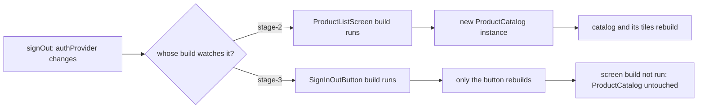

## Before you start

- [[frontend.l3.profile-mode]] — you know a recording splits a slow frame into build, layout and paint; this lesson is about doing less work in build.
- [[frontend.l2.notifier-for-app-state]] — you know `authProvider` holds the token and that every widget watching it rebuilds when the token changes.
- [[frontend.l2.overriding-providers-in-tests]] — you know a widget test can override `authProvider` and `productsProvider` to start a screen in a fixed state.

## The situation

At stage-2, the app bar of `ProductListScreen` switches between a sign-in and a sign-out icon, and a helper method `_actions`, called from the screen's `build`, decides which one to show by watching `authProvider`. You sign out. One icon changes; the product tiles below it look exactly as before. At stage-3 someone moved that icon into a small widget of its own, `SignInOutButton`. A reviewer asks whether this was only tidying, since the screen looks the same before and after. How much of the screen does Flutter build again when the token changes, and what decides where that work stops?

## Core concepts

- rebuild — running a widget's `build` again; it returns new child widget objects, even when they describe the same thing as before.
- subtree — a widget together with every widget below it in the widget tree.
- same instance — the very same object as last time, not merely an equal-looking one; this is how Flutter compares a child's old and new widget.
- `const` widget — a widget written with `const`; every `build` that writes it hands back the one same object, so Flutter can reuse that instance and skip its subtree, unless the widget has a change of its own, such as a provider it watches.
- `ConsumerWidget` — a widget whose `build` receives a `ref`; the providers it watches with `ref.watch` decide when its `build` runs again.

## How it works



A change of token starts at `authProvider`. Riverpod runs `build` again only for the widgets that watched it; the widgets above them do not run.

At stage-2 the watch sat in `_actions`, which runs inside `ProductListScreen`'s `build`. So that `build` ran again, and like every `build` it created new child widgets: a new `AppBar` and a new `ProductCatalog`, the widget that lays out the product tiles. Flutter then walks down. For each child whose new widget is not the same instance as the previous one, that child rebuilds too, and its own `build` creates new children in turn. Nothing in this walk asks whether the data changed. A new `ProductCatalog` holding the same products is still a new instance, so the catalog and its tiles rebuilt for one icon.

At stage-3 the watch moved down into `SignInOutButton`, the only widget that shows anything about the token. A change of token now runs only that button's `build`. The screen's `build` does not run, so the `ProductCatalog` it created earlier stays the same instance and its subtree is not touched.

The same skip also applies to `const` children: the walk stops at a child that is the same instance as before. In the stage-3 screen, `const LoadingView()`, the widget the screen shows while products are loading, is the one same object every time, so a rebuild of the screen skips its whole subtree. A skipped widget still rebuilds if it watches the provider that changed; the shortcut only skips widgets with no change of their own.

That answers the situation. A change rebuilds from the widget that watches it downward. So when only part of a screen depends on a provider, watch it in that part.

## In the Đơn Hàng system

The one widget on the stage-3 product list that watches the token:

```dart file=DonHang.App/lib/screens/product_list_screen.dart tag=stage-3 lines=76-97
// lesson: frontend.l3.rebuild-scope
// lesson: frontend.l2.notifier-for-app-state
// The one widget on this screen that depends on the token, so the one that
// watches authProvider: a change of token rebuilds this button only.
// onPressed only reads.
class SignInOutButton extends ConsumerWidget {
  const SignInOutButton({super.key});

  @override
  Widget build(BuildContext context, WidgetRef ref) {
    final l10n = AppLocalizations.of(context);
    final signedIn = ref.watch(authProvider) != null;
    if (signedIn) {
      return IconButton(
        icon: const Icon(Icons.logout),
        tooltip: l10n.signOut,
        onPressed: () => ref.read(authProvider.notifier).signOut(),
      );
    }
    return IconButton(icon: const Icon(Icons.login), tooltip: l10n.signIn, onPressed: () => context.go('/login'));
  }
}
```

The line `final signedIn = ref.watch(authProvider) != null;` is the only `ref.watch(authProvider)` in this file. The screen's `build`, above this excerpt, watches only `productsProvider`. Also outside the excerpt, the screen places the button as `const SignInOutButton()`. So when a new product list rebuilds the screen, the button is the same instance and is skipped as well. `onPressed` uses `ref.read`, which does not watch, so tapping it adds nothing to rebuild.

The widget test that checks this:

```dart file=DonHang.App/test/product_list_rebuild_test.dart tag=stage-3 lines=22-46
void main() {
  testWidgets('signing out rebuilds the button, not the catalog', (tester) async {
    await tester.pumpWidget(ProviderScope(
      overrides: [
        authProvider.overrideWith(SignedInAuth.new),
        productsProvider.overrideWithValue(AsyncValue.data(LoadedProducts([
          Product(id: 1, name: 'Bàn phím cơ', priceVnd: 1250000),
        ]))),
      ],
      child: const MaterialApp(
        locale: Locale('en'),
        localizationsDelegates: AppLocalizations.localizationsDelegates,
        supportedLocales: AppLocalizations.supportedLocales,
        home: ProductListScreen(),
      ),
    ));
    final catalogBefore = tester.widget<ProductCatalog>(find.byType(ProductCatalog));

    await tester.tap(find.byTooltip('Sign out'));
    await tester.pump();

    expect(find.byTooltip('Sign in'), findsOneWidget);
    expect(identical(tester.widget<ProductCatalog>(find.byType(ProductCatalog)), catalogBefore), isTrue);
  });
}
```

The overrides give the screen one fixed product, and `MaterialApp` with its language lines is only setup so the English tooltips appear. `SignedInAuth`, defined above the excerpt, makes the test start signed in. The test keeps the `ProductCatalog` widget in `catalogBefore`, taps `Sign out` and pumps one frame. The first `expect` shows the button did rebuild: it now offers `Sign in`. The second uses Dart's `identical`, which is true only for the very same object. `ProductCatalog` is created only by the screen's `build`, through its `_catalog` helper, so the same instance proves that `build` did not run.

## Seniors often assume…

- **"Any provider change makes Flutter rebuild and repaint the whole app, so where a widget calls ref.watch makes no difference."** → Actually a change runs `build` only for the widgets that watch that provider, and below them only for children that are new instances. You notice this when moving one `ref.watch` from the screen into `SignInOutButton` makes the stage-3 test pass, and moving it back makes it fail.
- **"Writing const in front of widgets is a style rule; it has no effect while the app runs."** → Actually `const` makes the widget one object, so a parent's rebuild hands Flutter the same instance and skips its subtree. You notice this when a `print` in the `build` of a `const` child that watches nothing stays silent while its parent rebuilds.
- **"Splitting a screen into smaller widgets helps readability only; Flutter rebuilds the same amount either way."** → Actually a separate `ConsumerWidget` can watch a provider on its own, so a change rebuilds that widget instead of the screen. A helper method cannot: it runs inside the screen's `build`. You notice this when a helper that calls `ref.watch` makes the whole screen rebuild, as `_actions` did at stage-2.

## Try it (3 minutes)

In `DonHang.App` at stage-3:

1. Run `flutter test test/product_list_rebuild_test.dart`.
2. In `lib/screens/product_list_screen.dart`, add the line `ref.watch(authProvider);` right below `final products = ref.watch(productsProvider);` in `ProductListScreen`'s `build`, then run the test again.
3. Undo the change.

Expected result: the first run ends with `All tests passed!`. The second run fails on the `identical` line with `Expected: true` and `Actual: <false>`: the screen watches the token again, so signing out runs its `build` and creates a new `ProductCatalog`.

The first `expect`, on the `Sign in` tooltip, passes in both runs. Why does `SignInOutButton` still rebuild when the screen hands Flutter the same `const` instance?

<details><summary>Suggested answer</summary>

The same-instance shortcut only skips a widget that has nothing of its own to update. `SignInOutButton` watches `authProvider` itself, so the change of token marks it for rebuild directly, whatever its parent passes down.

</details>

## Connections

- [[frontend.l3.profile-mode]] — how to find out that build is the slow phase before applying this fix.
- [[frontend.l1.setstate-and-rebuilding]] — the same rule without Riverpod: `setState` rebuilds that widget's subtree, so it belongs as low as the change.
- [[frontend.l1.composing-widgets]] — splitting a screen into widgets, here with an effect at run time, not only on readability.
- [[frontend.l3.lazy-lists]] — the next way to build less: build only the rows a list shows.

## Five-line summary

1. A change rebuilds from the widget that watches it downward, so when only part of a screen needs a provider, watch it there.
2. Each `build` creates new child widgets, and Flutter rebuilds every child that is not the same instance as before.
3. A `const` widget is the one same object every time, so a parent's rebuild skips its subtree unless it has a change of its own.
4. At stage-2 `ProductListScreen` watched `authProvider`, so signing out rebuilt the catalog; at stage-3 only `SignInOutButton` watches it.
5. The stage-3 test signs out and checks that `ProductCatalog` is the identical instance, so the screen's `build` did not run.
