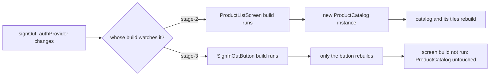

## Bạn cần biết trước

- [[frontend.l3.profile-mode]] — bạn biết một bản ghi chia khung hình chậm thành build, layout và paint. Bài này nói về cách làm ít việc hơn ở build.
- [[frontend.l2.notifier-for-app-state]] — bạn biết `authProvider` giữ token, và mọi widget theo dõi nó đều build lại khi token đổi.
- [[frontend.l2.overriding-providers-in-tests]] — bạn biết một widget test có thể override `authProvider` và `productsProvider` để mở màn hình ở một trạng thái cố định.

## Tình huống

Ở stage-2, thanh app bar của `ProductListScreen` đổi qua lại giữa biểu tượng đăng nhập và đăng xuất. Một hàm phụ `_actions`, được gọi từ `build` của màn hình, theo dõi `authProvider` để quyết định hiện biểu tượng nào. Bạn đăng xuất. Một biểu tượng đổi, còn các ô sản phẩm bên dưới trông y như trước. Ở stage-3, có người đã tách biểu tượng đó ra thành một widget nhỏ riêng, `SignInOutButton`. Người review hỏi đây có phải chỉ là dọn code cho gọn không, vì màn hình trước và sau trông giống hệt nhau. Khi token đổi, Flutter build lại bao nhiêu phần của màn hình, và điều gì quyết định phần việc đó dừng ở đâu?

## Khái niệm cốt lõi

- rebuild — chạy lại `build` của một widget. Lần chạy đó trả về các đối tượng widget con mới, kể cả khi chúng mô tả đúng những gì đã có trước đó.
- cây con (subtree) — một widget cùng mọi widget nằm dưới nó trong widget tree.
- cùng một instance (same instance) — đúng đối tượng của lần trước, không chỉ là một đối tượng trông giống hệt. Flutter so widget cũ và widget mới của một con theo cách này.
- widget `const` — widget viết kèm `const`. Mọi lần `build` có dòng đó đều trả về cùng một đối tượng duy nhất, nên Flutter dùng lại instance ấy và bỏ qua cây con của nó, trừ khi widget có thay đổi của riêng mình, chẳng hạn một provider nó theo dõi.
- `ConsumerWidget` — widget mà `build` nhận một `ref`. Các provider nó theo dõi bằng `ref.watch` quyết định khi nào `build` của nó chạy lại.

## Cơ chế hoạt động



Một lần đổi token bắt đầu từ `authProvider`. Riverpod chỉ chạy lại `build` của những widget đã theo dõi nó. Các widget phía trên chúng không chạy.

Ở stage-2, lời gọi theo dõi nằm trong `_actions`, hàm chạy bên trong `build` của `ProductListScreen`. Vì vậy `build` đó chạy lại, và như mọi `build`, nó tạo ra các widget con mới: một `AppBar` mới và một `ProductCatalog` mới, widget sắp xếp các ô sản phẩm. Sau đó Flutter đi dần xuống dưới. Con nào có widget mới không phải cùng một instance với lần trước thì con đó cũng build lại, và `build` của nó lại tạo ra các con mới. Suốt đường đi này, không bước nào hỏi dữ liệu có đổi hay không. Một `ProductCatalog` mới chứa đúng các sản phẩm cũ vẫn là một instance mới, nên danh mục và các ô của nó đã build lại chỉ vì một biểu tượng.

Ở stage-3, lời gọi theo dõi chuyển xuống `SignInOutButton`, widget duy nhất hiển thị điều gì đó liên quan tới token. Giờ token đổi chỉ làm chạy `build` của nút đó. `build` của màn hình không chạy, nên `ProductCatalog` mà nó tạo trước đó vẫn là cùng một instance, và cây con của nó không bị đụng tới.

Các con `const` cũng được bỏ qua theo đúng cách ấy: đường đi dừng ở con nào vẫn là cùng một instance như trước. Trong màn hình ở stage-3, `const LoadingView()`, widget màn hình hiện ra khi đang tải sản phẩm, luôn là cùng một đối tượng duy nhất, nên khi màn hình build lại, toàn bộ cây con của nó được bỏ qua. Một widget bị bỏ qua vẫn build lại nếu nó theo dõi provider vừa đổi. Lối tắt này chỉ bỏ qua những widget không có thay đổi của riêng mình.

Đó là lời đáp cho tình huống. Một thay đổi gây rebuild từ widget theo dõi nó trở xuống. Vậy khi chỉ một phần màn hình phụ thuộc vào một provider, hãy theo dõi provider ở chính phần đó.

## Trong hệ thống Đơn Hàng

Widget duy nhất trong danh sách sản phẩm ở stage-3 theo dõi token:

```dart file=DonHang.App/lib/screens/product_list_screen.dart tag=stage-3 lines=76-97
// lesson: frontend.l3.rebuild-scope
// lesson: frontend.l2.notifier-for-app-state
// The one widget on this screen that depends on the token, so the one that
// watches authProvider: a change of token rebuilds this button only.
// onPressed only reads.
class SignInOutButton extends ConsumerWidget {
  const SignInOutButton({super.key});

  @override
  Widget build(BuildContext context, WidgetRef ref) {
    final l10n = AppLocalizations.of(context);
    final signedIn = ref.watch(authProvider) != null;
    if (signedIn) {
      return IconButton(
        icon: const Icon(Icons.logout),
        tooltip: l10n.signOut,
        onPressed: () => ref.read(authProvider.notifier).signOut(),
      );
    }
    return IconButton(icon: const Icon(Icons.login), tooltip: l10n.signIn, onPressed: () => context.go('/login'));
  }
}
```

Dòng `final signedIn = ref.watch(authProvider) != null;` là `ref.watch(authProvider)` duy nhất trong file này. `build` của màn hình, nằm phía trên đoạn trích, chỉ theo dõi `productsProvider`. Cũng ngoài đoạn trích, màn hình đặt nút dưới dạng `const SignInOutButton()`. Vì vậy khi một danh sách sản phẩm mới làm màn hình build lại, nút vẫn là cùng một instance và cũng được bỏ qua. `onPressed` dùng `ref.read`, vốn không theo dõi, nên bấm nút không thêm gì phải build lại.

Widget test kiểm tra điều này:

```dart file=DonHang.App/test/product_list_rebuild_test.dart tag=stage-3 lines=22-46
void main() {
  testWidgets('signing out rebuilds the button, not the catalog', (tester) async {
    await tester.pumpWidget(ProviderScope(
      overrides: [
        authProvider.overrideWith(SignedInAuth.new),
        productsProvider.overrideWithValue(AsyncValue.data(LoadedProducts([
          Product(id: 1, name: 'Bàn phím cơ', priceVnd: 1250000),
        ]))),
      ],
      child: const MaterialApp(
        locale: Locale('en'),
        localizationsDelegates: AppLocalizations.localizationsDelegates,
        supportedLocales: AppLocalizations.supportedLocales,
        home: ProductListScreen(),
      ),
    ));
    final catalogBefore = tester.widget<ProductCatalog>(find.byType(ProductCatalog));

    await tester.tap(find.byTooltip('Sign out'));
    await tester.pump();

    expect(find.byTooltip('Sign in'), findsOneWidget);
    expect(identical(tester.widget<ProductCatalog>(find.byType(ProductCatalog)), catalogBefore), isTrue);
  });
}
```

Các override cho màn hình một sản phẩm cố định. `MaterialApp` cùng các dòng về ngôn ngữ chỉ là phần chuẩn bị để tooltip tiếng Anh hiện ra. `SignedInAuth`, định nghĩa phía trên đoạn trích, cho test bắt đầu ở trạng thái đã đăng nhập. Test giữ widget `ProductCatalog` trong `catalogBefore`, bấm `Sign out` rồi pump một khung hình. `expect` đầu tiên cho thấy nút đã build lại: giờ nó hiện `Sign in`. `expect` thứ hai dùng `identical` của Dart, chỉ đúng khi hai bên là chính cùng một đối tượng. `ProductCatalog` chỉ được tạo bởi `build` của màn hình, qua hàm phụ `_catalog`, nên còn là cùng một instance nghĩa là `build` đó đã không chạy.

## Senior hay nhầm rằng…

- **"Provider nào đổi cũng khiến Flutter build lại và vẽ lại cả app, nên widget gọi ref.watch ở đâu cũng vậy."** → Thực ra một thay đổi chỉ chạy `build` của những widget theo dõi provider đó, và bên dưới chúng chỉ chạy cho các con là instance mới. Bạn sẽ nhận ra khi chuyển một `ref.watch` từ màn hình vào `SignInOutButton` làm test ở stage-3 qua, còn chuyển ngược lại thì test rớt.
- **"Viết const trước widget chỉ là quy ước trình bày, không ảnh hưởng gì lúc app chạy."** → Thực ra `const` biến widget thành một đối tượng duy nhất, nên khi widget cha build lại, Flutter nhận cùng một instance và bỏ qua cây con của nó. Bạn sẽ nhận ra khi một lệnh `print` trong `build` của một con `const` không theo dõi gì vẫn im lặng trong lúc widget cha build lại.
- **"Tách màn hình thành các widget nhỏ chỉ giúp dễ đọc, Flutter vẫn build lại bằng ấy thứ."** → Thực ra một `ConsumerWidget` riêng có thể tự theo dõi một provider, nên thay đổi chỉ build lại widget đó thay vì cả màn hình. Hàm phụ thì không làm được vậy, vì nó chạy bên trong `build` của màn hình. Bạn sẽ nhận ra khi một hàm phụ gọi `ref.watch` làm cả màn hình build lại, như `_actions` ở stage-2.

## Thử ngay (3 phút)

Trong `DonHang.App` ở stage-3:

1. Chạy `flutter test test/product_list_rebuild_test.dart`.
2. Trong `lib/screens/product_list_screen.dart`, thêm dòng `ref.watch(authProvider);` ngay dưới `final products = ref.watch(productsProvider);` trong `build` của `ProductListScreen`, rồi chạy lại test.
3. Hoàn tác thay đổi.

Kết quả mong đợi: lần chạy đầu kết thúc bằng `All tests passed!`. Lần chạy thứ hai rớt ở dòng `identical` với `Expected: true` và `Actual: <false>`: màn hình lại theo dõi token, nên đăng xuất làm chạy `build` của nó và tạo ra một `ProductCatalog` mới.

`expect` đầu tiên, kiểm tooltip `Sign in`, qua ở cả hai lần chạy. Vì sao `SignInOutButton` vẫn build lại khi màn hình đưa cho Flutter cùng một instance `const`?

<details><summary>Gợi ý đáp án</summary>

Lối tắt cùng-một-instance chỉ bỏ qua widget không có gì của riêng mình cần cập nhật. `SignInOutButton` tự theo dõi `authProvider`, nên lần đổi token đánh dấu nó phải build lại trực tiếp, bất kể widget cha truyền xuống gì.

</details>

## Liên hệ

- [[frontend.l3.profile-mode]] — cách xác định build là giai đoạn chậm trước khi áp dụng cách sửa này.
- [[frontend.l1.setstate-and-rebuilding]] — cùng quy tắc nhưng không có Riverpod: `setState` build lại cây con của widget đó, nên nó nên nằm thấp ngang với chỗ thay đổi.
- [[frontend.l1.composing-widgets]] — tách màn hình thành các widget, ở đây có tác dụng lúc chạy chứ không chỉ cho dễ đọc.
- [[frontend.l3.lazy-lists]] — cách tiếp theo để build ít hơn: chỉ build những dòng mà danh sách đang hiện.

## Tóm tắt 5 dòng

1. Một thay đổi gây rebuild từ widget theo dõi nó trở xuống, nên khi chỉ một phần màn hình cần một provider, hãy theo dõi nó ở đó.
2. Mỗi lần `build` tạo ra các widget con mới, và Flutter build lại mọi con không phải cùng một instance như trước.
3. Widget `const` luôn là cùng một đối tượng duy nhất, nên khi widget cha build lại, cây con của nó được bỏ qua, trừ khi nó có thay đổi của riêng mình.
4. Ở stage-2, `ProductListScreen` theo dõi `authProvider`, nên đăng xuất làm danh mục build lại. Ở stage-3, chỉ `SignInOutButton` theo dõi nó.
5. Test ở stage-3 đăng xuất rồi kiểm `ProductCatalog` vẫn là chính instance cũ, chứng tỏ `build` của màn hình đã không chạy.
