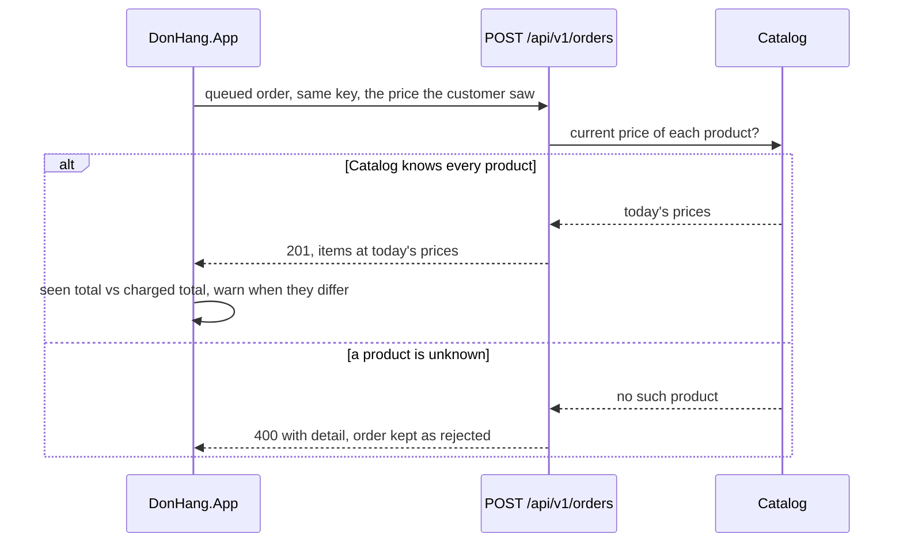

## Before you start

- [[frontend.l3.syncing-the-queue]] — you know a sync sends each waiting order with its stored key, and that a `201` marks it sent and a `400` marks it rejected.
- [[design.l3.one-way-module-dependencies]] — you know that at stage-3 Ordering asks Catalog for each product's price through `IProductPrices`.
- [[backend.l3.eventual-consistency]] — you know two copies of the same data can disagree for a while and agree later.

## The situation

A customer has DonHang.App open at stage-3 when the connection drops. The product list on screen is the one loaded earlier: `Tai nghe` at 890,000 VND. They order two, and the order waits on `Waiting orders`. While it waits, a staff member changes that product's price to 950,000 VND with `PATCH /api/v1/products/3`. The connection comes back and the customer taps `Send now`. The order is placed, but it costs 1,900,000 VND, not the two times 890,000 VND the list showed.

Who decides what a queued order costs when the data changed while it waited, and what must the app tell the customer?

## Core concepts

- **conflict (offline sync)** — a sync conflict for short: a change made from an offline copy that reaches a server whose data has changed since that copy was saved; here, an order priced from a list the staff member has since changed. Unlike a Git conflict, nobody is stopped and asked to choose; a rule decides.
- **last-write-wins** — a rule for a conflict where the newest write simply replaces whatever was stored, with nothing else checked.
- seen total — the total of the prices stored with the queued order, the ones the customer saw when ordering.
- charged total — the total of the prices in the API's answer to the order, the ones the order was placed at.

## How it works



In the situation above, the queued order and the price list came apart while the device was offline: a sync conflict. One person changed a price; another ordered from an older copy of it.

At stage-3 the app sends the queued order with its stored `Idempotency-Key` and, with each item, the price the customer saw. The API ignores that price. Ordering asks Catalog for the price now, so the order is charged 950,000 VND a piece. The server decides, because staff set prices in Catalog and Ordering reads them through `IProductPrices`; the customer chooses only the product and the quantity.

The API's answer carries the items at the prices it charged. After a `201`, DonHang.App compares the seen total with the charged total and, when they differ, warns on `Waiting orders` with both totals.

The second branch is a product Catalog does not know, for example one removed from the database while the order waited. The API answers `400` with a `detail`, nothing is saved, and the order stays as rejected until the customer removes it.

Last-write-wins would settle this differently. The contested value is the price used for this order. The API would keep the price that arrived last, the app's copy, so the staff member's newer price would never apply to this order. When only one person edits a record, the last write is that person's latest decision, so nobody else's change is lost. Here two people decide about the same price, so last-write-wins does not suit it.

## In the Đơn Hàng system

Where the API drops the price the app sent, in `OrdersController.Create`:

```csharp file=DonHang.Api/Controllers/OrdersController.cs tag=stage-3 lines=43-51
        // lesson: design.l3.one-way-module-dependencies
        // From stage-3 unitPriceVnd is still accepted, so clients written
        // for stage-2 keep working, but it is ignored: OrderService takes each
        // price from Catalog. A product Catalog does not know gets 400.
        var requested = request.Items
            .Select(i => new RequestedItem(i.ProductId, i.Quantity))
            .ToList();

        var (order, created) = await orderService.PlaceOrderAsync(customer.Id, requested, idempotencyKey);
```

`RequestedItem` has a product and a quantity only, so the price the customer saw never reaches `OrderService`. `ToDto`, at the end of the file and outside the excerpt, puts each item's charged price into the answer; that is what lets the app see the difference at all.

How each queued order is shown, in `QueuedOrdersScreen`. Each line is a `StatusBanner`: a widget showing one message in a `StatusTone` (info, success, warning or error), with at most one action.

```dart file=DonHang.App/lib/screens/queued_orders_screen.dart tag=stage-3 lines=72-95
  // One banner per order, in the tone of what happened to it. A rejected
  // order stays, with the API's detail, until the customer removes it.
  Widget _entry(BuildContext context, WidgetRef ref, QueuedOrder order) {
    final l10n = AppLocalizations.of(context);
    final queue = ref.read(orderQueueProvider.notifier);
    final result = order.result;
    return switch (order.status) {
      QueuedOrderStatus.waiting => StatusBanner(message: l10n.queuedWaiting(order.description), tone: StatusTone.info),
      QueuedOrderStatus.rejected => StatusBanner(
          message: l10n.queuedRejected(order.description, order.problem ?? ''),
          tone: StatusTone.error,
          actionLabel: l10n.remove,
          onAction: () => queue.remove(order.idempotencyKey),
        ),
      QueuedOrderStatus.sent => StatusBanner(
          message: order.priceChanged
              ? l10n.queuedPriceChanged(result!.id, totalVnd(order.items), totalVnd(result.items))
              : l10n.queuedSent(result!.id, order.description),
          tone: order.priceChanged ? StatusTone.warning : StatusTone.success,
          actionLabel: l10n.openOrder,
          onAction: () => _open(context, queue, order),
        ),
    };
  }
```

`priceChanged` lives in `lib/offline/order_queue.dart`, outside the excerpt: it is true when `totalVnd` of the answer's items differs from `totalVnd` of the stored items. At stage-3 comparing totals is the same as comparing prices, because the create order screen puts one product in each order. The sent order then gets the warning tone and both totals; otherwise it gets the success tone.

`queue` is the order queue, read through Riverpod with `ref.read`, and `remove` deletes the entry with that `Idempotency-Key`. A rejected order leaves the screen only that way, when the customer taps `Remove`.

## Seniors often assume…

- **"A queued order is charged the price the customer saw, since that is what they agreed to."** → Actually the API takes every price from Catalog and ignores the one the app sends, so the order costs what the product costs when the order arrives. You notice this when an order placed offline gets the price-changed warning on `Waiting orders`, with a charged total higher than the total the customer saw.
- **"Conflicts only happen when two people edit the same record at the same moment."** → Actually an offline copy stretches "the same moment" to however long the device was offline. The staff member changed a product, the customer created a new order, and neither touched the other's record. You notice this when a sent order gets the price-changed warning though no one else ever saw that order.
- **"Last-write-wins is always safe, because the newest write is the most correct one."** → Actually the newest write is only the last to arrive. A queued order can arrive after the price change but carry a price from before it, so letting it win would undo the staff member's change for that order. You notice this in a system that stores the client's price: orders sent after a long time offline carry prices the product list no longer shows.

## Try it (3 minutes)

In `DonHang.App` at stage-3, `test/queue_sync_test.dart` sends queued orders to a fake API with scripted answers. Two tests script an answer that charges 1,200 VND a piece for an order of two whose stored price is 1,000 VND a piece.

1. Run `flutter test test/queue_sync_test.dart`.
2. In `lib/offline/order_queue.dart`, replace the body of `priceChanged` with `return false;`, then run the same command again.
3. Undo the change.

Expected result: the first run ends with `All tests passed!`. In the second run two tests fail: `flags an order whose price changed while it waited`, with `Expected: true` and `Actual: <false>`, and `shows a rejected order until it is removed, and a changed price`, which finds no text containing `the price changed: you saw 2,000 VND, the order costs 2,400 VND`. The other six tests still pass.

The customer who sees that warning taps `Send now` again. Why does the order not come back at 2,000 VND?

<details><summary>Suggested answer</summary>

The order is no longer waiting, so a sync does not send it again. Even a resend with the same key would get the stored order back, at 2,400 VND, and a new order would also be charged the price Catalog has now. The warning tells the customer; the price stays the server's decision.

</details>

## Connections

- [[frontend.l3.syncing-the-queue]] — prerequisite: the sync that produces the `201` and `400` answers this lesson reads.
- [[design.l3.one-way-module-dependencies]] — the reason the server can decide: Ordering takes prices from Catalog, never from the client.
- [[backend.l2.optimistic-concurrency]] — the same problem on the server: a write based on an older read, which there a concurrency token refuses instead of letting the server's rule decide.
- [[frontend.l2.server-errors-in-forms]] — the same rule one step earlier: the API's answer is shown to the customer, in the form there, on `Waiting orders` here.
- [[frontend.l3.component-library]] — the next step: `StatusBanner`, which these lines use for every outcome, as a component shared across screens.

## Five-line summary

1. A sync conflict is a change made from an offline copy reaching a server whose data changed since that copy was saved.
2. At stage-3 the API ignores the price the app sends and takes each price from Catalog, so a queued order costs today's price.
3. After a `201`, DonHang.App compares the seen total with the charged total and warns on `Waiting orders` when they differ.
4. A queued order for a product Catalog does not know gets `400`; it stays as rejected, with the `detail`, until the customer removes it.
5. Last-write-wins keeps the write that arrives last; it suits a record one person edits, not an order whose price the server decides.
