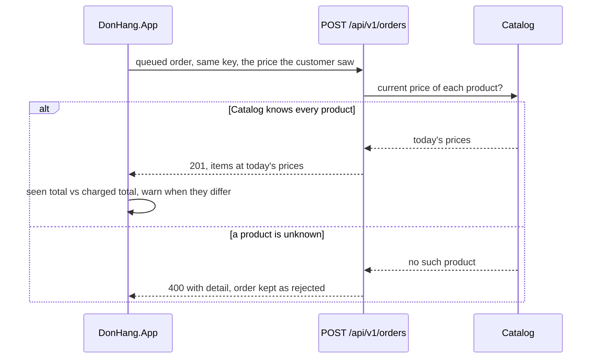

## Bạn cần biết trước

- [[frontend.l3.syncing-the-queue]] — bạn biết rằng một lượt sync gửi từng đơn đang chờ kèm key đã lưu của nó, và một `201` đánh dấu đơn đã gửi, còn một `400` đánh dấu đơn bị từ chối.
- [[design.l3.one-way-module-dependencies]] — bạn biết rằng ở stage-3, Ordering hỏi Catalog giá của từng sản phẩm qua `IProductPrices`.
- [[backend.l3.eventual-consistency]] — bạn biết rằng hai bản của cùng một dữ liệu có thể lệch nhau một lúc rồi khớp lại sau.

## Tình huống

Một khách đang mở DonHang.App ở stage-3 thì mất mạng. Danh sách sản phẩm trên màn hình là danh sách đã tải từ trước: `Tai nghe` giá 890.000 VND. Khách đặt hai cái, và đơn nằm chờ trên `Waiting orders`. Trong lúc đơn chờ, một nhân viên đổi giá sản phẩm đó thành 950.000 VND bằng `PATCH /api/v1/products/3`. Có mạng lại, khách bấm `Send now`. Đơn được đặt, nhưng giá là 1.900.000 VND, không phải hai lần 890.000 VND như danh sách đã hiện.

Khi dữ liệu đã đổi trong lúc một đơn nằm chờ, ai quyết định đơn đó giá bao nhiêu, và app phải báo gì cho khách?

## Khái niệm cốt lõi

- **xung đột đồng bộ** (sync conflict) — một thay đổi làm từ bản offline, tới server khi dữ liệu ở đó đã đổi kể từ lúc bản đó được lưu. Ở đây là một đơn tính giá theo danh sách mà nhân viên đã sửa sau đó. Khác với xung đột trong Git, không ai bị dừng lại để chọn bên nào: một quy tắc quyết định.
- **last-write-wins** — một quy tắc giải xung đột: lần ghi mới nhất thay hẳn thứ đang lưu, không kiểm tra gì thêm.
- tổng đã thấy — tổng các giá lưu cùng đơn trong hàng đợi, tức là các giá khách đã thấy lúc đặt.
- tổng thực tính — tổng các giá trong câu trả lời của API cho đơn đó, tức là các giá mà đơn thực sự được đặt theo.

## Cơ chế hoạt động



Trong tình huống trên, đơn trong hàng đợi và bảng giá đã lệch nhau khi máy offline: một xung đột đồng bộ. Một người đổi giá, người kia đặt hàng từ một bản cũ hơn của giá đó.

Ở stage-3, app gửi đơn trong hàng đợi kèm `Idempotency-Key` đã lưu, và với mỗi món, kèm giá khách đã thấy. API bỏ qua giá đó. Ordering hỏi Catalog giá hiện tại, nên đơn bị tính 950.000 VND mỗi cái. Server quyết định, vì nhân viên đặt giá trong Catalog và Ordering đọc giá qua `IProductPrices`. Khách chỉ chọn sản phẩm và số lượng.

Câu trả lời của API mang các món kèm giá mà API đã tính. Sau một `201`, DonHang.App so tổng đã thấy với tổng thực tính. Khi hai tổng khác nhau, app hiện cảnh báo trên `Waiting orders` kèm cả hai con số.

Nhánh thứ hai là một sản phẩm Catalog không biết, chẳng hạn sản phẩm đã bị xóa khỏi database trong lúc đơn chờ. API trả `400` kèm `detail`, không lưu gì, và đơn nằm lại ở trạng thái bị từ chối cho tới khi khách xóa nó.

Last-write-wins sẽ giải chuyện này theo cách khác. Giá trị bị tranh chấp là giá dùng cho đơn này. API sẽ giữ giá tới sau cùng, tức bản của app, nên giá mới hơn của nhân viên sẽ không bao giờ áp dụng cho đơn này. Khi chỉ một người sửa một bản ghi, lần ghi cuối là quyết định mới nhất của chính người đó, nên không ai mất thay đổi. Ở đây hai người cùng quyết định về một giá, nên last-write-wins không hợp.

## Trong hệ thống Đơn Hàng

Chỗ API bỏ giá app gửi, trong `OrdersController.Create`:

```csharp file=DonHang.Api/Controllers/OrdersController.cs tag=stage-3 lines=43-51
        // lesson: design.l3.one-way-module-dependencies
        // From stage-3 unitPriceVnd is still accepted, so clients written
        // for stage-2 keep working, but it is ignored: OrderService takes each
        // price from Catalog. A product Catalog does not know gets 400.
        var requested = request.Items
            .Select(i => new RequestedItem(i.ProductId, i.Quantity))
            .ToList();

        var (order, created) = await orderService.PlaceOrderAsync(customer.Id, requested, idempotencyKey);
```

`RequestedItem` chỉ có sản phẩm và số lượng, nên giá khách đã thấy không bao giờ tới được `OrderService`. `ToDto`, ở cuối file và nằm ngoài đoạn trích, đưa giá thực tính của từng món vào câu trả lời. Chính nhờ vậy app mới thấy được chênh lệch.

Cách mỗi đơn trong hàng đợi được hiển thị, trong `QueuedOrdersScreen`. Mỗi dòng là một `StatusBanner`: một widget hiện một thông báo theo một `StatusTone` (info, success, warning hoặc error), với tối đa một hành động.

```dart file=DonHang.App/lib/screens/queued_orders_screen.dart tag=stage-3 lines=72-95
  // One banner per order, in the tone of what happened to it. A rejected
  // order stays, with the API's detail, until the customer removes it.
  Widget _entry(BuildContext context, WidgetRef ref, QueuedOrder order) {
    final l10n = AppLocalizations.of(context);
    final queue = ref.read(orderQueueProvider.notifier);
    final result = order.result;
    return switch (order.status) {
      QueuedOrderStatus.waiting => StatusBanner(message: l10n.queuedWaiting(order.description), tone: StatusTone.info),
      QueuedOrderStatus.rejected => StatusBanner(
          message: l10n.queuedRejected(order.description, order.problem ?? ''),
          tone: StatusTone.error,
          actionLabel: l10n.remove,
          onAction: () => queue.remove(order.idempotencyKey),
        ),
      QueuedOrderStatus.sent => StatusBanner(
          message: order.priceChanged
              ? l10n.queuedPriceChanged(result!.id, totalVnd(order.items), totalVnd(result.items))
              : l10n.queuedSent(result!.id, order.description),
          tone: order.priceChanged ? StatusTone.warning : StatusTone.success,
          actionLabel: l10n.openOrder,
          onAction: () => _open(context, queue, order),
        ),
    };
  }
```

`priceChanged` nằm trong `lib/offline/order_queue.dart`, ngoài đoạn trích: giá trị này là true khi `totalVnd` của các món trong câu trả lời khác `totalVnd` của các món đã lưu. Ở stage-3, so tổng cũng chính là so giá, vì màn hình tạo đơn chỉ đặt một sản phẩm trong mỗi đơn. Khi đó đơn đã gửi nhận tone warning và cả hai tổng. Ngược lại, đơn nhận tone success.

`queue` là hàng đợi đơn, đọc qua Riverpod bằng `ref.read`, còn `remove` xóa mục có `Idempotency-Key` đó. Một đơn bị từ chối chỉ rời màn hình theo đúng cách này, khi khách bấm `Remove`.

## Senior hay nhầm rằng…

- **"Đơn trong hàng đợi được tính theo giá khách đã thấy, vì đó là giá khách đã đồng ý."** → Thực ra API lấy mọi giá từ Catalog và bỏ qua giá app gửi, nên đơn có giá bằng giá sản phẩm lúc đơn tới nơi. Bạn sẽ nhận ra khi một đơn đặt lúc offline nhận cảnh báo giá đổi trên `Waiting orders`, với tổng thực tính cao hơn tổng khách đã thấy.
- **"Xung đột chỉ xảy ra khi hai người sửa cùng một bản ghi vào cùng một lúc."** → Thực ra một bản offline kéo dài "cùng một lúc" thành toàn bộ khoảng thời gian máy offline. Nhân viên đổi một sản phẩm, khách tạo một đơn mới, và không ai đụng vào bản ghi của người kia. Bạn sẽ nhận ra khi một đơn đã gửi nhận cảnh báo giá đổi dù chưa từng có ai khác thấy đơn đó.
- **"Last-write-wins lúc nào cũng an toàn, vì lần ghi mới nhất là lần đúng nhất."** → Thực ra lần ghi mới nhất chỉ là lần tới sau cùng. Một đơn trong hàng đợi có thể tới sau lần đổi giá nhưng mang giá từ trước đó, nên để đơn thắng là xóa thay đổi của nhân viên đối với đơn này. Bạn sẽ nhận ra trong một hệ thống lưu giá do client gửi: các đơn gửi sau một thời gian dài offline mang những giá mà danh sách sản phẩm không còn hiện.

## Thử ngay (3 phút)

Trong `DonHang.App` ở stage-3, `test/queue_sync_test.dart` gửi các đơn trong hàng đợi tới một API giả với các câu trả lời định sẵn. Hai test định sẵn một câu trả lời tính 1.200 VND mỗi cái cho một đơn hai cái mà giá đã lưu là 1.000 VND mỗi cái.

1. Chạy `flutter test test/queue_sync_test.dart`.
2. Trong `lib/offline/order_queue.dart`, thay thân của `priceChanged` bằng `return false;`, rồi chạy lại đúng lệnh đó.
3. Hoàn tác thay đổi.

Kết quả mong đợi: lần chạy đầu kết thúc bằng `All tests passed!`. Ở lần chạy thứ hai, hai test hỏng: `flags an order whose price changed while it waited`, với `Expected: true` và `Actual: <false>`, và `shows a rejected order until it is removed, and a changed price`, không tìm thấy dòng chữ nào chứa `the price changed: you saw 2,000 VND, the order costs 2,400 VND`. Sáu test còn lại vẫn qua.

Khách thấy cảnh báo đó bấm `Send now` lần nữa. Vì sao đơn không quay về với giá 2.000 VND?

<details><summary>Gợi ý đáp án</summary>

Đơn không còn ở trạng thái chờ, nên lượt sync không gửi lại nữa. Ngay cả một lần gửi lại với cùng key cũng chỉ nhận về đơn đã lưu, giá 2.400 VND, còn một đơn mới cũng sẽ bị tính theo giá Catalog đang có. Cảnh báo để khách biết chuyện. Giá vẫn do server quyết định.

</details>

## Liên hệ

- [[frontend.l3.syncing-the-queue]] — bài cần biết trước: lượt sync tạo ra các câu trả lời `201` và `400` mà bài này đọc.
- [[design.l3.one-way-module-dependencies]] — lý do server quyết định được: Ordering lấy giá từ Catalog, không bao giờ từ client.
- [[backend.l2.optimistic-concurrency]] — cùng vấn đề đó ở phía server: một lần ghi dựa trên một lần đọc cũ hơn, nhưng ở đó concurrency token từ chối lần ghi thay vì để quy tắc của server quyết định.
- [[frontend.l2.server-errors-in-forms]] — cùng quy tắc ở một bước sớm hơn: câu trả lời của API được hiện cho khách, ở bài đó là trong form, còn ở đây là trên `Waiting orders`.
- [[frontend.l3.component-library]] — bước tiếp theo: `StatusBanner`, thứ các dòng này dùng cho mọi kết cục, trở thành một component dùng chung giữa các màn hình.

## Tóm tắt 5 dòng

1. Xung đột đồng bộ là một thay đổi làm từ bản offline, tới server khi dữ liệu ở đó đã đổi kể từ lúc bản đó được lưu.
2. Ở stage-3, API bỏ qua giá app gửi và lấy từng giá từ Catalog, nên đơn trong hàng đợi có giá của hôm nay.
3. Sau một `201`, DonHang.App so tổng đã thấy với tổng thực tính và cảnh báo trên `Waiting orders` khi hai tổng khác nhau.
4. Một đơn trong hàng đợi cho sản phẩm Catalog không biết nhận `400`. Đơn nằm lại ở trạng thái bị từ chối, kèm `detail`, cho tới khi khách xóa nó.
5. Last-write-wins giữ lần ghi tới sau cùng. Quy tắc này hợp với bản ghi chỉ một người sửa, không hợp với một đơn mà giá do server quyết định.
