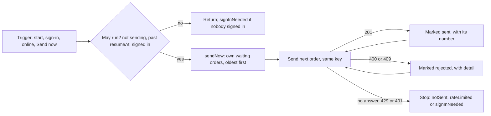

## Before you start

- [[frontend.l3.offline-order-queue]] — you know a `QueuedOrder` waits in `localStorage` with its `Idempotency-Key` and the `sub` of the customer who placed it; this lesson sends it.
- [[backend.l3.rate-limiting]] — you know `POST /api/v1/orders` can answer `429` with `Retry-After` when one customer sends too many orders in a window.
- [[frontend.l2.notifier-for-app-state]] — you know `authProvider` holds the access token in memory and that a `Notifier` changes its value by assigning `state`.

## The situation

At stage-3 you run `scripts/frontend/offline.sh down`, which stops Caddy, so the app still loads but its requests get no answer. A customer places two orders in DonHang.App; both appear on `Waiting orders`, with no number. You run `offline.sh up`. Caddy answers again, but the page does not change. The customer reloads the tab, which signs them out, and a colleague signs in on the same browser to order for themselves. The two waiting orders still belong to the first customer.

When the API can be reached again, how should DonHang.App send the waiting orders so that each one is placed exactly once, by the customer who queued it?

## Core concepts

- sync — one run of `QueueSync.sendNow`: it takes the signed-in customer's waiting orders, oldest first, and sends them one at a time until the list ends or something stops it.
- trigger — an event that starts a sync. At stage-3 there are four: the app starts, a customer signs in, the browser fires its `online` event, and the customer taps `Send now`.
- `online` event — a browser event that `listenForOnline` turns into a sync; nothing in it contacts the API, so whether the API answers is found out only by sending.
- pause — a `SyncPause` value saying why the last sync stopped early: `notSent`, `rateLimited` or `signInNeeded`. The `Waiting orders` screen shows it as a banner.

## How it works



Caddy coming back changed nothing, because only a trigger starts a sync; there is no timer and no backoff.

A sync first checks whether it may run. If one is running, or a `429`'s wait has not passed, it returns at once. If nobody is signed in, it sends nothing and, when orders are waiting, records `signInNeeded`. That is what the reload caused: a reload starts the app again, which is a trigger, but the token lived only in memory. The customer cannot open `Waiting orders` until they sign in, and that sign-in is the next trigger.

The colleague's sign-in is a trigger. The sync keeps only waiting orders whose `sub` matches the colleague's token, so the first customer's orders stay. With the colleague's token, they would become the colleague's.

It sends those one at a time, oldest first, each with the key from its first send. A `201` marks it sent, with its order number. A `400` or `409` marks it rejected, with the problem's `detail`. At stage-3 this endpoint answers `409` only when a resend arrives while an earlier attempt with that key, one that got no answer, is still being stored. So an order marked rejected with a `409` may exist on the server.

Three outcomes, and any status the code does not name, stop the whole sync and leave the order waiting. No answer means the request may have reached the API, so the next attempt sends the same key and gets that order back if it was stored. A `429` pauses the sync until the `Retry-After` time. A `401` means the API did not accept the token: the sync stops and the banner asks the customer to sign in; a trigger before that only tries the same token again.

## In the Đơn Hàng system

`sendNow`, which every trigger calls:

```dart file=DonHang.App/lib/offline/queue_sync.dart tag=stage-3 lines=41-63
  Future<void> sendNow() async {
    final resumeAt = state.resumeAt;
    if (state.sending || (resumeAt != null && DateTime.now().isBefore(resumeAt))) return;
    final token = ref.read(authProvider);
    final subject = token == null ? null : tokenSubject(token);
    if (subject == null) {
      state = SyncState(pause: _hasWaiting() ? SyncPause.signInNeeded : SyncPause.none);
      return;
    }
    state = const SyncState(sending: true);
    final waiting = [
      for (final order in ref.read(orderQueueProvider))
        if (order.status == QueuedOrderStatus.waiting && order.subject == subject) order,
    ];
    for (final order in waiting) {
      final stop = await _send(order);
      if (stop != null) {
        state = stop;
        return;
      }
    }
    state = const SyncState();
  }
```

`state.sending` keeps two triggers from running two syncs side by side: the second returns at once. `tokenSubject`, in `lib/auth/token_subject.dart`, reads `sub` from the token's middle part and does not check the signature; that stays the API's job.

`orderQueueProvider` holds the queue oldest first, because `OrderQueue.add` appends, and the `waiting` list keeps that order. The loop `await`s each `_send` before it starts the next, and returns at the first stop. Three triggers are wired in `build`, above the excerpt: sign-in through `ref.listen` on `authProvider`, the `online` event through `listenForOnline`, and app start. The `Send now` button on `Waiting orders` calls `sendNow` itself.

`_send`, which decides what one answer means:

```dart file=DonHang.App/lib/offline/queue_sync.dart tag=stage-3 lines=69-91
  Future<SyncState?> _send(QueuedOrder order) async {
    final queue = ref.read(orderQueueProvider.notifier);
    try {
      final result = await ref.read(apiClientProvider).createOrder(order.items, idempotencyKey: order.idempotencyKey);
      queue.markSent(order, result);
      return null;
    } on ApiUnreachable {
      return const SyncState(pause: SyncPause.notSent);
    } on ApiProblem catch (problem) {
      switch (problem.status) {
        case 400 || 409:
          queue.markRejected(order, problem.detail);
          return null;
        case 429:
          final wait = problem.retryAfter;
          return SyncState(pause: SyncPause.rateLimited, resumeAt: wait == null ? null : DateTime.now().add(wait));
        case 401:
          return const SyncState(pause: SyncPause.signInNeeded);
        default:
          return const SyncState(pause: SyncPause.notSent);
      }
    }
  }
```

`createOrder` throws `ApiUnreachable` when there is no answer, a `502`, `503` or `504` from the proxy included, and `ApiProblem`, with the status, for any other answer that is not `201`. Returning `null` means "go on with the next order"; any `SyncState` stops the sync and becomes the screen's banner. `order.idempotencyKey` is the stored key, never a new one. `problem.retryAfter` is the `Retry-After` header read as a whole number of seconds, or `null` when it is missing or not a number; then the next trigger may send at once. The `default` branch treats any other status, a `500` for instance, like no answer: the order keeps waiting.

## Seniors often assume…

- **"When the browser says it is online again, the API can be reached."** → Actually the event comes from the browser, which does not ask the API. Caddy or the API can still be down, so a sync started by it can end with no answer and the order still waiting. You notice this when a sync after `online` ends with the orders still on `Waiting orders` under the not-sent banner.
- **"Sending every queued order at once, in parallel, is faster and just as safe."** → Actually one at a time is what lets a stop work. Sent together, a `429` or `401` on the first order cannot hold back the others, which are already on their way. You notice this when a customer with several waiting orders gets several rate-limit refusals from one tap, instead of one banner with a time.
- **"A queued order that keeps failing should be deleted, so the queue does not get stuck."** → Actually an order with no answer may already exist on the server, and its stored key is the only way to get that order back. DonHang.App never deletes on its own: no answer keeps the order waiting, and a `400` or `409` leaves it on the screen as rejected. You notice this when a customer whose order vanished from `Waiting orders` places it again, and the API ends up with two: the one the lost answer had already created, and the new one with a new key.

## Try it (3 minutes)

In `DonHang.App` at stage-3, `test/queue_sync_test.dart` runs `sendNow` against a fake API that gives scripted answers and records each key it receives in `keysSent`; its tests use two customers, Alice and Bob.

1. Run `flutter test test/queue_sync_test.dart`.
2. In `lib/offline/queue_sync.dart`, delete ` && order.subject == subject` from the `waiting` list, then run the same command again.
3. Undo the change.

Expected result: the first run ends with `All tests passed!`. In the second run the test `sends only the signed-in customer's orders` fails with a `RangeError` from `ScriptedApi.createOrder`: the sync tried to send Bob's order with Alice's token. The other seven tests still pass.

Why does that test give the fake API no scripted answers at all?

<details><summary>Suggested answer</summary>

Any call to `createOrder` means the app tried to place Bob's order while Alice is signed in, which must never happen. With no answers, that call fails at once, and `keysSent` stays empty only when the sync sends nothing.

</details>

## Connections

- [[frontend.l3.offline-order-queue]] — prerequisite: how an order enters the queue with the key this lesson keeps resending.
- [[backend.l2.retry-with-backoff]] — the opposite choice: a retry loop with growing waits, where this sync stops and waits for the next trigger.
- [[backend.l3.retry-jitter]] — the problem a timer would bring back: many clients resending at the same moment, which jitter spreads out.
- [[frontend.l2.route-guards]] — the same in-memory token: after a reload it is gone and a guarded route sends the customer to `/login`; after a `401`, so does the sign-in banner.
- [[frontend.l3.sync-conflicts]] — the next step: what the app says when a sent order comes back different from what the customer saw.

## Five-line summary

1. DonHang.App sends its queue on a trigger, one order at a time, oldest first, and only an API answer moves an order out of waiting.
2. The triggers are app start, sign-in, the browser's `online` event and `Send now`; there is no timer, and `online` does not mean the API answers.
3. A `201` marks an order sent with its number; a `400` or `409` marks it rejected with the problem's `detail`.
4. No answer keeps the order waiting with its key; a `429` pauses until `Retry-After`; a `401` stops and asks for a new sign-in.
5. Only the signed-in customer's orders are sent, matched by the `sub` saved with each order, so another customer cannot place them.
