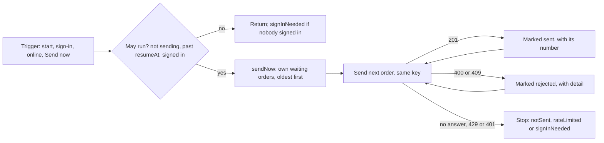

## Bạn cần biết trước

- [[frontend.l3.offline-order-queue]] — bạn biết rằng một `QueuedOrder` nằm chờ trong `localStorage` cùng `Idempotency-Key` của nó và `sub` của khách đã đặt nó. Bài này gửi nó đi.
- [[backend.l3.rate-limiting]] — bạn biết rằng `POST /api/v1/orders` có thể trả `429` kèm `Retry-After` khi một khách gửi quá nhiều đơn trong một khoảng thời gian.
- [[frontend.l2.notifier-for-app-state]] — bạn biết rằng `authProvider` giữ access token trong bộ nhớ, và một `Notifier` đổi giá trị của nó bằng cách gán `state`.

## Tình huống

Ở stage-3, bạn chạy `scripts/frontend/offline.sh down`. Lệnh này dừng Caddy, nên app vẫn tải được nhưng request của nó không nhận được câu trả lời. Một khách đặt hai đơn trong DonHang.App. Cả hai hiện trên `Waiting orders`, không có mã. Bạn chạy `offline.sh up`. Caddy trả lời lại, nhưng trang không thay đổi gì. Khách tải lại tab, thế là bị đăng xuất, rồi một đồng nghiệp đăng nhập trên cùng trình duyệt để tự đặt đơn cho mình. Hai đơn đang chờ vẫn thuộc về khách đầu tiên.

Khi API tới được trở lại, DonHang.App nên gửi các đơn đang chờ thế nào để mỗi đơn được đặt đúng một lần, và do chính khách đã xếp nó vào hàng đợi đặt?

## Khái niệm cốt lõi

- sync — một lượt chạy `QueueSync.sendNow`: lấy các đơn đang chờ của khách đang đăng nhập, cũ nhất trước, và gửi từng đơn một cho tới hết danh sách hoặc tới khi có gì đó chặn lại.
- trigger — sự kiện khởi động một lượt sync. Ở stage-3 có bốn: app khởi động, một khách đăng nhập, trình duyệt phát sự kiện `online`, và khách bấm `Send now`.
- sự kiện `online` — sự kiện của trình duyệt mà `listenForOnline` biến thành một lượt sync. Sự kiện này không liên lạc gì với API, nên API có trả lời hay không thì chỉ biết được khi gửi.
- pause — một giá trị `SyncPause` cho biết vì sao lượt sync trước dừng sớm: `notSent`, `rateLimited` hoặc `signInNeeded`. Màn hình `Waiting orders` hiện nó thành một banner.

## Cơ chế hoạt động



Caddy trả lời lại mà không có gì thay đổi, vì chỉ trigger mới khởi động một lượt sync. Không có timer, cũng không có backoff.

Trước hết, lượt sync kiểm tra xem nó có được chạy không. Nếu đang có một lượt chạy, hoặc thời gian chờ của một `429` chưa hết, nó trả về ngay. Nếu không ai đăng nhập, nó không gửi gì, và nếu có đơn đang chờ thì ghi lại `signInNeeded`. Lần tải lại trang gây ra đúng điều đó: tải lại là khởi động app lần nữa, tức là một trigger, nhưng token chỉ sống trong bộ nhớ. Khách không mở được `Waiting orders` cho tới khi đăng nhập, và lần đăng nhập đó là trigger tiếp theo.

Lần đăng nhập của người đồng nghiệp là một trigger. Lượt sync chỉ giữ các đơn đang chờ có `sub` khớp với token của người đồng nghiệp, nên các đơn của khách đầu tiên vẫn nằm yên. Nếu gửi bằng token của người đồng nghiệp, chúng sẽ thành đơn của người đồng nghiệp.

Lượt sync gửi các đơn đó từng đơn một, cũ nhất trước, mỗi đơn kèm key từ lần gửi đầu tiên của nó. Một `201` đánh dấu đơn đã gửi, kèm mã đơn. Một `400` hay `409` đánh dấu đơn bị từ chối, kèm `detail` của problem. Ở stage-3, endpoint này chỉ trả `409` khi một lần gửi lại tới nơi trong lúc một lần thử trước với cùng key, lần không nhận được câu trả lời, vẫn đang được lưu. Vì vậy một đơn bị đánh dấu từ chối với `409` có thể đã tồn tại trên server.

Ba kết cục, cùng mọi status mà code không gọi tên, dừng cả lượt sync và để đơn tiếp tục chờ. Không có câu trả lời nghĩa là request có thể đã tới API, nên lần thử sau gửi cùng key và nhận lại đúng đơn đó nếu nó đã được lưu. Một `429` tạm dừng lượt sync cho tới thời điểm `Retry-After`. Một `401` nghĩa là API không chấp nhận token: lượt sync dừng và banner nhắc khách đăng nhập. Trigger nào đến trước lúc đó chỉ thử lại đúng token cũ.

## Trong hệ thống Đơn Hàng

`sendNow`, hàm mà mọi trigger đều gọi:

```dart file=DonHang.App/lib/offline/queue_sync.dart tag=stage-3 lines=41-63
  Future<void> sendNow() async {
    final resumeAt = state.resumeAt;
    if (state.sending || (resumeAt != null && DateTime.now().isBefore(resumeAt))) return;
    final token = ref.read(authProvider);
    final subject = token == null ? null : tokenSubject(token);
    if (subject == null) {
      state = SyncState(pause: _hasWaiting() ? SyncPause.signInNeeded : SyncPause.none);
      return;
    }
    state = const SyncState(sending: true);
    final waiting = [
      for (final order in ref.read(orderQueueProvider))
        if (order.status == QueuedOrderStatus.waiting && order.subject == subject) order,
    ];
    for (final order in waiting) {
      final stop = await _send(order);
      if (stop != null) {
        state = stop;
        return;
      }
    }
    state = const SyncState();
  }
```

`state.sending` ngăn hai trigger chạy hai lượt sync song song: lượt thứ hai trả về ngay. `tokenSubject`, trong `lib/auth/token_subject.dart`, đọc `sub` từ phần giữa của token và không kiểm tra chữ ký. Kiểm tra chữ ký vẫn là việc của API.

`orderQueueProvider` giữ hàng đợi theo thứ tự cũ nhất trước, vì `OrderQueue.add` thêm vào cuối, và danh sách `waiting` giữ nguyên thứ tự đó. Vòng lặp `await` từng `_send` xong mới bắt đầu đơn kế tiếp, và trả về ngay ở lần dừng đầu tiên. Ba trigger được nối trong `build`, phía trên đoạn trích: đăng nhập qua `ref.listen` trên `authProvider`, sự kiện `online` qua `listenForOnline`, và lúc app khởi động. Nút `Send now` trên `Waiting orders` tự gọi `sendNow`.

`_send`, hàm quyết định một câu trả lời có nghĩa là gì:

```dart file=DonHang.App/lib/offline/queue_sync.dart tag=stage-3 lines=69-91
  Future<SyncState?> _send(QueuedOrder order) async {
    final queue = ref.read(orderQueueProvider.notifier);
    try {
      final result = await ref.read(apiClientProvider).createOrder(order.items, idempotencyKey: order.idempotencyKey);
      queue.markSent(order, result);
      return null;
    } on ApiUnreachable {
      return const SyncState(pause: SyncPause.notSent);
    } on ApiProblem catch (problem) {
      switch (problem.status) {
        case 400 || 409:
          queue.markRejected(order, problem.detail);
          return null;
        case 429:
          final wait = problem.retryAfter;
          return SyncState(pause: SyncPause.rateLimited, resumeAt: wait == null ? null : DateTime.now().add(wait));
        case 401:
          return const SyncState(pause: SyncPause.signInNeeded);
        default:
          return const SyncState(pause: SyncPause.notSent);
      }
    }
  }
```

`createOrder` ném `ApiUnreachable` khi không có câu trả lời, kể cả một `502`, `503` hay `504` từ proxy, và ném `ApiProblem`, kèm status, với mọi câu trả lời khác không phải `201`. Trả về `null` nghĩa là "đi tiếp sang đơn kế tiếp". Bất kỳ `SyncState` nào cũng dừng lượt sync và trở thành banner của màn hình. `order.idempotencyKey` là key đã lưu, không bao giờ là key mới. `problem.retryAfter` là header `Retry-After` đọc thành một số giây nguyên, hoặc `null` khi header thiếu hay không phải số. Khi đó trigger kế tiếp được gửi ngay. Nhánh `default` coi mọi status khác, chẳng hạn một `500`, như không có câu trả lời: đơn tiếp tục chờ.

## Senior hay nhầm rằng…

- **"Khi trình duyệt báo đã online trở lại, API tới được."** → Thực ra sự kiện đó đến từ trình duyệt, và trình duyệt không hỏi API. Caddy hay API vẫn có thể đang chết, nên một lượt sync do nó khởi động có thể kết thúc mà không có câu trả lời, và đơn vẫn chờ. Bạn sẽ nhận ra khi một lượt sync sau `online` kết thúc mà các đơn vẫn nằm trên `Waiting orders` dưới banner chưa gửi được.
- **"Gửi mọi đơn trong hàng đợi cùng lúc, song song, thì nhanh hơn mà vẫn an toàn như vậy."** → Thực ra gửi từng đơn một mới khiến việc dừng có tác dụng. Gửi cùng lúc thì một `429` hay `401` ở đơn đầu tiên không giữ lại được các đơn khác, vì chúng đã lên đường. Bạn sẽ nhận ra khi một khách có vài đơn đang chờ nhận về vài lần từ chối vì rate limit chỉ sau một lần bấm, thay vì một banner kèm thời điểm.
- **"Một đơn trong hàng đợi cứ thất bại mãi thì nên xóa đi, để hàng đợi không bị kẹt."** → Thực ra một đơn không nhận được câu trả lời có thể đã tồn tại trên server, và key đã lưu của nó là cách duy nhất để lấy lại đơn đó. DonHang.App không bao giờ tự xóa: không có câu trả lời thì đơn tiếp tục chờ, còn một `400` hay `409` để đơn nằm lại trên màn hình ở trạng thái bị từ chối. Bạn sẽ nhận ra khi một khách thấy đơn biến mất khỏi `Waiting orders` nên đặt lại, và API có hai đơn: đơn mà câu trả lời bị mất đã kịp tạo, và đơn mới với key mới.

## Thử ngay (3 phút)

Trong `DonHang.App` ở stage-3, `test/queue_sync_test.dart` chạy `sendNow` với một API giả trả các câu trả lời định sẵn và ghi lại mọi key nó nhận được vào `keysSent`. Các test dùng hai khách, Alice và Bob.

1. Chạy `flutter test test/queue_sync_test.dart`.
2. Trong `lib/offline/queue_sync.dart`, xóa ` && order.subject == subject` khỏi danh sách `waiting`, rồi chạy lại đúng lệnh đó.
3. Hoàn tác thay đổi.

Kết quả mong đợi: lần chạy đầu kết thúc bằng `All tests passed!`. Ở lần chạy thứ hai, test `sends only the signed-in customer's orders` hỏng với một `RangeError` từ `ScriptedApi.createOrder`: lượt sync đã thử gửi đơn của Bob bằng token của Alice. Bảy test còn lại vẫn qua.

Vì sao test đó không cho API giả câu trả lời định sẵn nào?

<details><summary>Gợi ý đáp án</summary>

Bất kỳ lời gọi `createOrder` nào cũng có nghĩa là app đã thử đặt đơn của Bob trong lúc Alice đăng nhập, điều không bao giờ được xảy ra. Không có câu trả lời định sẵn thì lời gọi đó hỏng ngay, và `keysSent` chỉ rỗng khi lượt sync không gửi gì.

</details>

## Liên hệ

- [[frontend.l3.offline-order-queue]] — bài cần biết trước: một đơn vào hàng đợi thế nào, cùng key mà bài này cứ gửi lại.
- [[backend.l2.retry-with-backoff]] — lựa chọn ngược lại: một vòng lặp thử lại với thời gian chờ tăng dần, trong khi lượt sync ở đây dừng và chờ trigger kế tiếp.
- [[backend.l3.retry-jitter]] — vấn đề mà một timer sẽ mang trở lại: nhiều client gửi lại cùng một lúc, điều jitter giúp dàn trải ra.
- [[frontend.l2.route-guards]] — cùng token trong bộ nhớ: sau khi tải lại trang, token mất và một route có guard đưa khách về `/login`. Sau một `401`, banner đăng nhập cũng vậy.
- [[frontend.l3.sync-conflicts]] — bước tiếp theo: app nói gì khi một đơn đã gửi quay về khác với điều khách đã thấy.

## Tóm tắt 5 dòng

1. DonHang.App gửi hàng đợi khi có trigger, từng đơn một, cũ nhất trước, và chỉ câu trả lời của API mới đưa một đơn ra khỏi trạng thái chờ.
2. Các trigger là app khởi động, đăng nhập, sự kiện `online` của trình duyệt và `Send now`. Không có timer, và `online` không có nghĩa là API trả lời.
3. Một `201` đánh dấu đơn đã gửi kèm mã đơn. Một `400` hay `409` đánh dấu đơn bị từ chối kèm `detail` của problem.
4. Không có câu trả lời thì đơn tiếp tục chờ với key của nó. Một `429` tạm dừng tới `Retry-After`. Một `401` dừng lại và yêu cầu đăng nhập lại.
5. Chỉ đơn của khách đang đăng nhập mới được gửi, khớp theo `sub` lưu cùng mỗi đơn, nên khách khác không thể đặt chúng.
