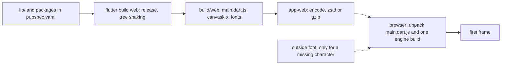

## Before you start

- [[frontend.l3.profile-mode]] — you know `scripts/up.sh` makes a release build with `flutter build web`, and that speed is measured, not guessed; this lesson measures the wait before the first frame.
- [[frontend.l2.deep-links]] — you know `app-web`, the Caddy web server that hands out DonHang.App's files on `:8081`, and its configuration file `deploy/app-web/Caddyfile`; this lesson reads one more line of it.

## The situation

A customer opens DonHang.App on a phone with a weak connection. The browser tab stays blank for several seconds, then the product list appears. The API answered the products request quickly, and the Dart code your team wrote for a handful of screens is small. So something other than the API and your code has to reach the phone before the app can draw. A teammate asks whether adding one more package would make it worse, and nobody can say. What does the browser download before DonHang.App draws its first frame, and how do you see that amount as a number?

## Core concepts

- **web bundle** — the files a browser downloads to start a web app: for DonHang.App, the compiled app in `main.dart.js`, Flutter's engine and the fonts the app ships with, all under `build/web`.
- **tree shaking** — a release build step that leaves out the Dart code the app never calls and the icons it never uses.
- engine build — the part of Flutter that draws your widgets in the browser, as a small `canvaskit.js` plus a large `canvaskit.wasm` file of compiled engine code; `build/web/canvaskit/` holds several, and a browser takes only the one that fits it. Chromium is the browser engine inside Chrome, Edge and similar browsers; they take `canvaskit/chromium/`, other browsers take `canvaskit/`.
- compression — the server packs a response into fewer bytes for the trip and the browser unpacks it before use; the browser lists the formats it can unpack in the `Accept-Encoding` header, and the server names the one it used in `Content-Encoding`.
- **gzip** — a common compression format; a browser that sends `Accept-Encoding: gzip` says it can unpack it.
- **zstd** — another compression format; when the browser lists both without preferring one, Caddy picks zstd.

## How it works



In the situation above, the blank tab is the time spent on everything to the left of the first frame.

Your code is only one input. `flutter build web` compiles your code in `lib/`, the Flutter framework code your widgets call and the code of every package listed in `pubspec.yaml`, the file where DonHang.App declares the packages it uses, into one file, `main.dart.js`. Because it is a release build, tree shaking runs: the compiler leaves out Dart code the app never calls, even inside a large package. Flutter's icons are drawn from a font file in which each icon is one character. The build writes a smaller icon font that holds only the icons the app uses.

Next to `main.dart.js` the build places the engine builds under `canvaskit/` and the fonts. From stage-4 `scripts/up.sh` adds `--no-web-resources-cdn`, so the build uses its own copy of the engine and `app-web` serves it like any other file; without this flag the engine is fetched from a server outside Đơn Hàng. The only thing the engine fetches from another server is a font for a character that no font in the build has, such as an emoji, and only when such a character appears.

Then the files travel. With `encode` in its Caddyfile, `app-web` packs `main.dart.js` and the engine build in a format the browser lists in `Accept-Encoding`. The browser unpacks them, starts DonHang.App, and only then draws the first frame. The files on disk stay as they are.

## In the Đơn Hàng system

`scripts/frontend/web-bundle.sh` measures the bundle in three parts. The first part, outside the excerpt below, lists the eight largest files under `build/web` with their size raw and packed with gzip. The second checks where the engine comes from. The part below asks `app-web` for `main.dart.js` and both engine builds; `curl` is a command-line program that sends an HTTP request and here reports the bytes it received:

```bash file=scripts/frontend/web-bundle.sh tag=stage-4 lines=36-51
# lesson: frontend.l3.web-bundle-size
# Before the first frame the browser needs main.dart.js and one engine
# build, chosen by flutter_bootstrap.js: canvaskit/chromium/ in a Chromium
# browser, canvaskit/ in others. Asked as a browser asks (zstd or gzip),
# app-web compresses each one; `sent` is the bytes that cross the network.
echo
echo "What app-web sends for them, with Accept-Encoding: zstd, gzip"
for path in main.dart.js canvaskit/chromium/canvaskit.js canvaskit/chromium/canvaskit.wasm \
            canvaskit/canvaskit.js canvaskit/canvaskit.wasm; do
  answer=$(curl --silent --show-error --fail --retry 2 --retry-all-errors --output /dev/null \
    --header 'Accept-Encoding: zstd, gzip' \
    --dump-header - --write-out 'sent %{size_download}\n' "http://localhost:8081/$path" | tr -d '\r')
  encoding=$(grep -i '^content-encoding:' <<< "$answer" | awk '{ print $2 }')
  sent=$(grep '^sent ' <<< "$answer" | awk '{ print $2 }')
  printf '  %-38s raw %s   sent %s (%s)\n' "$path" "$(wc -c < "$build/$path")" "$sent" "${encoding:-not compressed}"
done
```

```text output=true
Largest files under DonHang.App/build/web:
  canvaskit/canvaskit.wasm               raw 7284602   gzip 2916585
  canvaskit/chromium/canvaskit.wasm      raw 5428806   gzip 2063289
  canvaskit/skwasm_heavy.wasm            raw 5216217   gzip 2287232
  canvaskit/webparagraph/canvaskit.wasm  raw 3729129   gzip 1404032
  canvaskit/skwasm.wasm                  raw 3593715   gzip 1537083
  canvaskit/wimp.wasm                    raw 3581677   gzip 1446121
  main.dart.js                           raw 3044279   gzip 879216
  canvaskit/wimp.js.symbols              raw 1813030   gzip 204116
  all files together: raw ...

Engine: served by app-web (useLocalCanvasKit in flutter_bootstrap.js)

What app-web sends for them, with Accept-Encoding: zstd, gzip
  main.dart.js                           raw 3044279   sent 929127 (zstd)
  canvaskit/chromium/canvaskit.js        raw 86226   sent 29312 (zstd)
  canvaskit/chromium/canvaskit.wasm      raw 5428806   sent 2135951 (zstd)
  canvaskit/canvaskit.js                 raw 86987   sent 29524 (zstd)
  canvaskit/canvaskit.wasm               raw 7284602   sent 3025856 (zstd)

Fonts in the build: assets/fonts/MaterialIcons-Regular.otf assets/fonts/fallback/Roboto-Regular.ttf assets/packages/cupertino_icons/assets/CupertinoIcons.ttf
Fonts for missing characters come from: ...
```

The `--header` line asks as a browser asks; `encoding` is read from the `Content-Encoding` header and `sent` from curl's byte count.

In the first block, six of the eight largest files are `.wasm` engine builds, and `main.dart.js` comes seventh. The `skwasm`, `webparagraph` and `wimp` builds are other engine builds this app's start does not choose, and `wimp.js.symbols` is a debugging file the browser does not download. The total is masked because it changes with every build. The `Engine:` line confirms that this build serves its own engine; the script finds `useLocalCanvasKit` in `flutter_bootstrap.js`, the small file that starts the app and chooses the engine build.

The third block is what a customer waits for. `main.dart.js`, 3,044,279 bytes on disk, crosses the network as 929,127 bytes of zstd, under a third. A Chromium browser takes `canvaskit/chromium/canvaskit.wasm`, 5,428,806 bytes sent as 2,135,951. The `sent` figures differ from the `gzip` column, which the script computes with `gzip -9` on each file, because `app-web` compressed with zstd instead; here zstd came out slightly larger, 929,127 against 879,216 for `main.dart.js`. These numbers change whenever the code or Flutter changes.

The last block lists the fonts the build carries, Roboto among them, so `app-web` serves those too. The final line names the outside address for a missing character; the capture above elides it. Run the script before and after you add a package to `pubspec.yaml`, changing nothing else: the difference on the `main.dart.js` lines is the code that package added for every customer; a font or other file it ships shows up in the other blocks.

The compression comes from one line of the Caddyfile:

```text file=deploy/app-web/Caddyfile tag=stage-4 lines=16-21
	# lesson: frontend.l3.web-bundle-size
	# From stage-3 responses are compressed for every browser whose
	# Accept-Encoding allows it (zstd or gzip); the files on disk stay as
	# they are. main.dart.js, being text, shrinks the most.
	encode
	file_server
```

`encode` with no options turns on zstd and gzip; Caddy picks one from the formats the browser lists in `Accept-Encoding`. `file_server`, already there before, sends the files of `build/web`.

## Seniors often assume…

- **"A Flutter web app only downloads the Dart code I wrote, so a small app has a small bundle."** → Actually the browser also needs Flutter's engine and the framework and package code your widgets call, so even a small app starts from megabytes. You notice this when `web-bundle.sh` shows the engine build a browser takes sent as more bytes than `main.dart.js`.
- **"Compressing responses changes the files, so it can break the app."** → Actually `encode` packs only the bytes on their way, the files on disk stay as they are, and the browser unpacks each response before it uses it, so the app gets the same files the build wrote. You notice this when the script shows `(zstd)` on every line and the app on `:8081` still loads normally.
- **"Bundle size only matters on slow mobile networks, not for a desktop browser."** → Actually `main.dart.js` and the engine build must arrive before the first frame on any connection; a fast link shortens that wait, it does not remove it, and a first visit has no saved copy to start from. You notice this when a desktop user on a first visit still sees a blank tab before the product list.

## Try it (3 minutes)

Start the lab with `scripts/up.sh`, which builds `DonHang.App/build/web` and starts `app-web`.

1. Run `scripts/frontend/web-bundle.sh`.
2. In the block that starts with `What app-web sends`, compare `raw` and `sent` for `main.dart.js` and `canvaskit/chromium/canvaskit.wasm`.

Expected result: the line above that block reads `Engine: served by app-web`, every line in it ends with `(zstd)`, and each `sent` number is well below its `raw` number.

Then answer: why is the `all files together` number much larger than what one browser downloads on its first visit to `:8081`?

<details><summary>Suggested answer</summary>

The total counts every file under `build/web`. That includes several engine builds under `canvaskit/`, of which a browser downloads only the one that fits it, and the `.symbols` files, which are for debugging and not downloaded when the app loads. It also counts raw sizes, while `app-web` sends `main.dart.js` and the engine build compressed.

</details>

## Connections

- [[frontend.l3.profile-mode]] — the other half of web performance: how fast frames are once the app runs, where this lesson is about the wait before the first one.
- [[frontend.l2.deep-links]] — the same Caddyfile; `try_files` there decides which file is sent, `encode` here decides how it travels.
- [[foundation.l1.http-caching]] — what lets a repeat visit skip downloading the bundle again, which this lesson leaves aside.
- [[frontend.l3.offline-first]] — the next step for the same app: keeping data on the device, while the bundle itself still comes from `app-web`.

## Five-line summary

1. Before DonHang.App's first frame, the browser must download `main.dart.js` and one engine build, so their size is most of the wait.
2. `web-bundle.sh` lists the largest files raw and gzipped, then what `app-web` sends, so a change in bundle size shows up as a number.
3. A release build is tree-shaken: Dart code the app never calls and icons it never uses are left out.
4. `encode` makes `app-web` send zstd or gzip as the browser accepts: `main.dart.js` crosses as 929,127 of 3,044,279 bytes.
5. Every package in `pubspec.yaml` can add code to `main.dart.js`; running `web-bundle.sh` before and after adding one shows how much it added.
