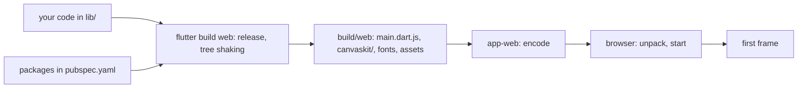

## Before you start

- [[frontend.l3.profile-mode]] — you know `flutter build web` makes a release build, and that a slow frame is measured, not guessed; this lesson looks at the wait before the first frame.
- [[frontend.l2.deep-links]] — you know `app-web` answers a path that is not a file with `index.html`; this lesson adds one more line to the same Caddyfile.

## The situation

A customer opens DonHang.App on a phone with a weak connection. The page stays blank for several seconds, then the product list appears. You check the API: the products request was answered quickly. DonHang.App has a handful of screens, and the Dart code your team wrote is small. So something other than the API and your code has to reach the phone before the app can draw anything. What does the browser download before DonHang.App draws its first frame, and how would you see that amount as a number that you can watch grow?

## Core concepts

- **web bundle** — the set of files the browser downloads before a web app can draw: for DonHang.App, the compiled app in `main.dart.js`, Flutter's engine files, fonts and assets, all under `build/web`.
- engine files — the part of Flutter that draws your widgets in the browser; `build/web/canvaskit/` holds several builds of it, and a browser downloads only the one it needs.
- **tree shaking** — a build step that leaves out of the release the Dart code the app never calls and the icons it never uses.
- compression — the server packs a response into fewer bytes for the trip and the browser unpacks it before use; the browser lists the formats it accepts in the `Accept-Encoding` header, and the server names the one it used in `Content-Encoding`.
- dependency — a package listed in the app's `pubspec.yaml`; the parts of its code the app calls end up in `main.dart.js` too.

## How it works



Read the diagram from left to right. In the situation above, the blank page is the time the browser spends on everything to the left of the first frame.

Your code is only one input. `flutter build web` also compiles the Flutter framework code your widgets call and the code of every package in `pubspec.yaml`. Together they become one file, `main.dart.js`. Next to it the build places the engine files, the fonts and the assets. That whole folder is the web bundle, and every piece the browser needs must arrive before DonHang.App draws anything.

Tree shaking keeps the bundle smaller than its inputs. Because the build is a release build, the compiler leaves out Dart code the app never calls, even inside a large package. It also builds a smaller icon font that holds only the icons the app uses. So a package costs you the parts you call, not the whole package.

Then the files travel. `main.dart.js` is text, and text shrinks a lot when compressed. From stage-3 the `app-web` Caddyfile turns compression on, so Caddy packs each response for any browser that says it can unpack it. The files on disk stay the same.

To see the bundle as a number, you need a script that measures `build/web`, which is the next section.

## In the Đơn Hàng system

The second half of `scripts/frontend/web-bundle.sh` measures the bundle and asks `app-web` how it sends `main.dart.js`:

```bash file=scripts/frontend/web-bundle.sh tag=stage-3 lines=13-33
# lesson: frontend.l3.web-bundle-size
# The eight largest files of the release build, with their size in bytes
# as stored and after gzip: main.dart.js, being text, shrinks the most.
# canvaskit/ holds several builds of Flutter's engine; a browser downloads
# only the one it needs, and no .symbols file (those are for debugging).
echo "Largest files under $build:"
find "$build" -type f -printf '%s %P\n' | sort -rn | head -n 8 |
  while read -r size path; do
    gzipped=$(gzip -c -9 "$build/$path" | wc -c)
    printf '  %-38s raw %s   gzip %s\n' "$path" "$size" "$gzipped"
  done
echo "  all files together: raw $(find "$build" -type f -printf '%s\n' | awk '{ total += $1 } END { print total }')"

# lesson: frontend.l3.web-bundle-size
# Asked as a browser asks, app-web answers with Content-Encoding: gzip, so
# fewer bytes cross the network; the browser unpacks them before running.
echo
echo "GET http://localhost:8081/main.dart.js with Accept-Encoding: gzip"
curl --silent --show-error --fail --output /dev/null --header 'Accept-Encoding: gzip' \
  --dump-header - --write-out 'bytes sent %{size_download}\n' http://localhost:8081/main.dart.js |
  tr -d '\r' | grep -i -e '^content-encoding:' -e '^bytes sent'
```

```text output=true
Largest files under DonHang.App/build/web:
  canvaskit/canvaskit.wasm               raw ...   gzip ...
  canvaskit/chromium/canvaskit.wasm      raw ...   gzip ...
  canvaskit/skwasm_heavy.wasm            raw ...   gzip ...
  canvaskit/webparagraph/canvaskit.wasm  raw ...   gzip ...
  canvaskit/skwasm.wasm                  raw ...   gzip ...
  canvaskit/wimp.wasm                    raw ...   gzip ...
  main.dart.js                           raw ...   gzip ...
  canvaskit/wimp.js.symbols              raw ...   gzip ...
  all files together: raw ...

GET http://localhost:8081/main.dart.js with Accept-Encoding: gzip
Content-Encoding: gzip
bytes sent ...
```

The sizes depend on your build, so the captured output shows `...` in their place. Look at the names instead. Most of the largest files are engine builds under `canvaskit/`, not your code, and `main.dart.js` sits among them. The `all files together` line counts every engine build and the `.symbols` file, so it is more than any one browser downloads. The last two lines show `app-web` answering with `Content-Encoding: gzip`. Run the script before and after you add a package to `pubspec.yaml`, changing nothing else: if the `main.dart.js` line grows, that package added code every customer downloads.

That answer comes from one line of the Caddyfile:

```text file=deploy/app-web/Caddyfile tag=stage-3 lines=16-21
	# lesson: frontend.l3.web-bundle-size
	# From stage-3 responses are compressed for every browser whose
	# Accept-Encoding allows it (zstd or gzip); the files on disk stay as
	# they are. main.dart.js, being text, shrinks the most.
	encode
	file_server
```

`encode` with no options lets Caddy pick zstd or gzip from what the browser accepts. A browser that sends no `Accept-Encoding` still gets the plain file.

## Seniors often assume…

- **"A Flutter web app only downloads the Dart code I wrote, so a small app has a small bundle."** → Actually the bundle also carries Flutter's engine, the framework code your widgets call and the code of your packages, so even a small app starts from a sizeable base. You notice this when `web-bundle.sh` lists engine files under `canvaskit/` above `main.dart.js`.
- **"Compressing responses changes the files, so it can break the app."** → Actually `encode` packs only the bytes on their way, the files on disk stay as they are, and the browser unpacks the response before it runs the code, so the app gets the same file. You notice this when the script shows `Content-Encoding: gzip` and the app on `:8081` behaves exactly as before.
- **"Bundle size only matters on slow mobile networks, not for a desktop browser."** → Actually every needed file must arrive before the first frame on any connection; a fast link shortens that wait, it does not remove it, and a first visit has no saved copy to start from. You notice this when a desktop user on a first visit still sees a blank page before the product list.

## Try it (3 minutes)

Start the lab with `scripts/up.sh`, which builds `DonHang.App/build/web` and starts `app-web`.

1. Run `scripts/frontend/web-bundle.sh`.
2. Find the `main.dart.js` line and compare its `raw` and `gzip` numbers, then read the last two lines.

Expected result: the `gzip` number for `main.dart.js` is much smaller than its `raw` number, and the last lines show `Content-Encoding: gzip` with a `bytes sent` figure.

Then answer: why is the `all files together` number larger than what a browser downloads on its first visit to `:8081`?

<details><summary>Suggested answer</summary>

The total counts every file under `build/web`. That includes several builds of Flutter's engine under `canvaskit/`, of which a browser downloads only the one it needs, and the `.symbols` files, which are for debugging and never downloaded. It also counts raw sizes, while `app-web` sends text files compressed.

</details>

## Connections

- [[frontend.l3.profile-mode]] — the other half of web performance: how fast frames are once the app runs, where this lesson is about the wait before the first one.
- [[frontend.l2.deep-links]] — the same Caddyfile; `try_files` there decides which file is sent, `encode` here decides how it travels.
- [[foundation.l1.http-caching]] — what lets a repeat visit skip downloading the bundle again, which this lesson leaves aside.
- [[frontend.l3.offline-first]] — the next step for the same app: keeping data on the device, while the bundle itself still comes from `app-web`.

## Five-line summary

1. Before DonHang.App draws its first frame, the browser downloads its web bundle: `main.dart.js`, Flutter's engine files, fonts and assets.
2. `scripts/frontend/web-bundle.sh` lists the largest files under `build/web`, raw and gzipped, so a change in size shows up as a number.
3. A release build is tree-shaken: Dart code the app never calls and icons it never uses are left out.
4. At stage-3 `encode` in the `app-web` Caddyfile compresses responses for browsers that accept it; files on disk stay unchanged.
5. Every package in `pubspec.yaml` can add code to `main.dart.js`, so check the bundle size whenever you add a dependency.
