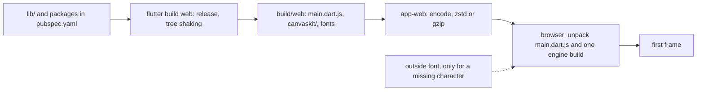

## Bạn cần biết trước

- [[frontend.l3.profile-mode]] — bạn biết `scripts/up.sh` tạo bản build release bằng `flutter build web`, và tốc độ phải đo chứ không đoán. Bài này đo khoảng chờ trước khung hình đầu tiên.
- [[frontend.l2.deep-links]] — bạn biết `app-web`, web server Caddy phục vụ các file của DonHang.App trên `:8081`, cùng file cấu hình `deploy/app-web/Caddyfile` của nó. Bài này đọc thêm một dòng trong file đó.

## Tình huống

Một khách hàng mở DonHang.App trên điện thoại, mạng yếu. Tab trình duyệt trắng trơn vài giây rồi danh sách sản phẩm mới hiện ra. API trả lời request lấy sản phẩm rất nhanh, còn phần code Dart nhóm bạn viết cho vài màn hình thì nhỏ. Vậy phải có thứ gì khác ngoài API và code của bạn cần đến được điện thoại trước khi app vẽ được. Một đồng nghiệp hỏi thêm một package nữa thì có tệ hơn không, và không ai trả lời được. Trình duyệt tải những gì trước khi DonHang.App vẽ khung hình đầu tiên, và làm sao thấy lượng đó thành một con số?

## Khái niệm cốt lõi

- **web bundle** — các file trình duyệt tải về để khởi động một web app: với DonHang.App là app đã biên dịch trong `main.dart.js`, engine của Flutter và các font app mang theo, tất cả nằm trong `build/web`.
- **tree shaking** — một bước của bản build release, bỏ đi phần code Dart app không bao giờ gọi và các icon app không bao giờ dùng.
- bản build engine — phần của Flutter vẽ các widget trong trình duyệt, gồm một file `canvaskit.js` nhỏ và một file `canvaskit.wasm` lớn chứa code engine đã biên dịch. `build/web/canvaskit/` có nhiều bản như vậy, và mỗi trình duyệt chỉ lấy bản hợp với nó. Chromium là engine trình duyệt bên trong Chrome, Edge và các trình duyệt tương tự: chúng lấy `canvaskit/chromium/`, các trình duyệt khác lấy `canvaskit/`.
- nén — server gói response thành ít byte hơn cho chuyến đi, trình duyệt giải nén trước khi dùng. Trình duyệt liệt kê các định dạng nó giải nén được trong header `Accept-Encoding`, còn server ghi định dạng đã dùng trong `Content-Encoding`.
- **gzip** — một định dạng nén phổ biến. Trình duyệt gửi `Accept-Encoding: gzip` là báo nó giải nén được định dạng này.
- **zstd** — một định dạng nén khác. Khi trình duyệt liệt kê cả hai mà không ưu tiên bên nào, Caddy chọn zstd.

## Cơ chế hoạt động



Trong tình huống trên, tab trắng chính là thời gian dành cho mọi thứ nằm bên trái khung hình đầu tiên.

Code của bạn chỉ là một đầu vào. `flutter build web` biên dịch code của bạn trong `lib/`, code framework Flutter mà widget của bạn gọi, và code của mọi package khai báo trong `pubspec.yaml` (file DonHang.App dùng để khai báo các package nó cần) thành một file duy nhất là `main.dart.js`. Vì đây là bản build release nên tree shaking chạy: trình biên dịch bỏ đi phần code Dart app không bao giờ gọi, kể cả bên trong một package lớn. Icon của Flutter được vẽ từ một file font, trong đó mỗi icon là một ký tự. Bản build ghi ra một file font icon nhỏ hơn, chỉ chứa những icon app dùng.

Cạnh `main.dart.js`, bản build đặt các bản build engine trong `canvaskit/` và các font. Từ stage-4, `scripts/up.sh` thêm `--no-web-resources-cdn`, nên bản build dùng bản engine của chính nó và `app-web` phục vụ engine như mọi file khác. Không có cờ này, engine được lấy từ một server bên ngoài Đơn Hàng. Thứ duy nhất engine lấy từ server khác là font cho một ký tự mà không font nào trong bản build có, chẳng hạn emoji, và chỉ khi ký tự đó xuất hiện.

Sau đó các file lên đường. Nhờ `encode` trong Caddyfile, `app-web` gói `main.dart.js` và bản build engine theo một định dạng mà trình duyệt liệt kê trong `Accept-Encoding`. Trình duyệt giải nén, khởi động DonHang.App, rồi mới vẽ khung hình đầu tiên. Các file trên đĩa vẫn giữ nguyên.

## Trong hệ thống Đơn Hàng

`scripts/frontend/web-bundle.sh` đo bundle theo ba phần. Phần đầu, nằm ngoài đoạn trích bên dưới, liệt kê tám file lớn nhất trong `build/web` kèm kích thước gốc và kích thước khi nén bằng gzip. Phần thứ hai kiểm tra engine đến từ đâu. Phần bên dưới hỏi `app-web` lấy `main.dart.js` và cả hai bản build engine. `curl` là một chương trình dòng lệnh gửi HTTP request, ở đây nó báo số byte đã nhận:

```bash file=scripts/frontend/web-bundle.sh tag=stage-4 lines=36-51
# lesson: frontend.l3.web-bundle-size
# Before the first frame the browser needs main.dart.js and one engine
# build, chosen by flutter_bootstrap.js: canvaskit/chromium/ in a Chromium
# browser, canvaskit/ in others. Asked as a browser asks (zstd or gzip),
# app-web compresses each one; `sent` is the bytes that cross the network.
echo
echo "What app-web sends for them, with Accept-Encoding: zstd, gzip"
for path in main.dart.js canvaskit/chromium/canvaskit.js canvaskit/chromium/canvaskit.wasm \
            canvaskit/canvaskit.js canvaskit/canvaskit.wasm; do
  answer=$(curl --silent --show-error --fail --retry 2 --retry-all-errors --output /dev/null \
    --header 'Accept-Encoding: zstd, gzip' \
    --dump-header - --write-out 'sent %{size_download}\n' "http://localhost:8081/$path" | tr -d '\r')
  encoding=$(grep -i '^content-encoding:' <<< "$answer" | awk '{ print $2 }')
  sent=$(grep '^sent ' <<< "$answer" | awk '{ print $2 }')
  printf '  %-38s raw %s   sent %s (%s)\n' "$path" "$(wc -c < "$build/$path")" "$sent" "${encoding:-not compressed}"
done
```

```text output=true
Largest files under DonHang.App/build/web:
  canvaskit/canvaskit.wasm               raw 7284602   gzip 2916585
  canvaskit/chromium/canvaskit.wasm      raw 5428806   gzip 2063289
  canvaskit/skwasm_heavy.wasm            raw 5216217   gzip 2287232
  canvaskit/webparagraph/canvaskit.wasm  raw 3729129   gzip 1404032
  canvaskit/skwasm.wasm                  raw 3593715   gzip 1537083
  canvaskit/wimp.wasm                    raw 3581677   gzip 1446121
  main.dart.js                           raw 3044279   gzip 879216
  canvaskit/wimp.js.symbols              raw 1813030   gzip 204116
  all files together: raw ...

Engine: served by app-web (useLocalCanvasKit in flutter_bootstrap.js)

What app-web sends for them, with Accept-Encoding: zstd, gzip
  main.dart.js                           raw 3044279   sent 929127 (zstd)
  canvaskit/chromium/canvaskit.js        raw 86226   sent 29312 (zstd)
  canvaskit/chromium/canvaskit.wasm      raw 5428806   sent 2135951 (zstd)
  canvaskit/canvaskit.js                 raw 86987   sent 29524 (zstd)
  canvaskit/canvaskit.wasm               raw 7284602   sent 3025856 (zstd)

Fonts in the build: assets/fonts/MaterialIcons-Regular.otf assets/fonts/fallback/Roboto-Regular.ttf assets/packages/cupertino_icons/assets/CupertinoIcons.ttf
Fonts for missing characters come from: ...
```

Dòng `--header` hỏi giống như trình duyệt hỏi. `encoding` được đọc từ header `Content-Encoding`, còn `sent` lấy từ số byte curl đếm được.

Trong khối đầu, sáu trên tám file lớn nhất là các bản build engine `.wasm`, còn `main.dart.js` đứng thứ bảy. Các bản `skwasm`, `webparagraph` và `wimp` là những bản build engine khác mà lúc khởi động app này không chọn, còn `wimp.js.symbols` là file gỡ lỗi trình duyệt không tải về. Con số tổng bị che đi vì nó đổi theo mỗi lần build. Dòng `Engine:` xác nhận bản build này tự phục vụ engine của mình: script tìm thấy `useLocalCanvasKit` trong `flutter_bootstrap.js`, file nhỏ khởi động app và chọn bản build engine.

Khối thứ ba là thứ khách hàng phải chờ. `main.dart.js` nặng 3.044.279 byte trên đĩa, đi qua mạng thành 929.127 byte zstd, chưa tới một phần ba. Trình duyệt Chromium lấy `canvaskit/chromium/canvaskit.wasm`, 5.428.806 byte, gửi đi thành 2.135.951 byte. Các con số `sent` khác cột `gzip`, là cột script tính bằng `gzip -9` trên từng file, vì `app-web` nén bằng zstd. Ở đây zstd ra lớn hơn một chút: 929.127 so với 879.216 cho `main.dart.js`. Các con số này đổi mỗi khi code hoặc Flutter thay đổi.

Khối cuối liệt kê các font bản build mang theo, trong đó có Roboto, nên `app-web` cũng phục vụ chúng. Dòng cuối cùng ghi địa chỉ bên ngoài cho ký tự còn thiếu, bản ghi ở trên đã lược đi. Hãy chạy script trước và sau khi thêm một package vào `pubspec.yaml`, không đổi gì khác: phần chênh ở dòng `main.dart.js` là lượng code package đó thêm cho mọi khách hàng. Font hay file khác mà package mang theo sẽ hiện ở các khối còn lại.

Phần nén đến từ một dòng trong Caddyfile:

```text file=deploy/app-web/Caddyfile tag=stage-4 lines=16-21
	# lesson: frontend.l3.web-bundle-size
	# From stage-3 responses are compressed for every browser whose
	# Accept-Encoding allows it (zstd or gzip); the files on disk stay as
	# they are. main.dart.js, being text, shrinks the most.
	encode
	file_server
```

`encode` không kèm tùy chọn nào thì bật zstd và gzip. Caddy chọn một trong các định dạng trình duyệt liệt kê trong `Accept-Encoding`. `file_server`, vốn đã có từ trước, gửi các file trong `build/web`.

## Senior hay nhầm rằng…

- **"Web app Flutter chỉ tải phần code Dart tôi viết, nên app nhỏ thì bundle nhỏ."** → Thực ra trình duyệt còn cần engine của Flutter cùng code framework và package mà các widget gọi, nên ngay cả app nhỏ cũng bắt đầu từ vài megabyte. Bạn sẽ nhận ra khi `web-bundle.sh` cho thấy bản build engine mà trình duyệt lấy được gửi đi nhiều byte hơn `main.dart.js`.
- **"Nén response là thay đổi file, nên có thể làm hỏng app."** → Thực ra `encode` chỉ gói các byte trên đường đi, file trên đĩa vẫn giữ nguyên, và trình duyệt giải nén từng response trước khi dùng, nên app nhận đúng những file bản build đã ghi ra. Bạn sẽ nhận ra khi script hiện `(zstd)` ở mọi dòng mà app trên `:8081` vẫn tải bình thường.
- **"Kích thước bundle chỉ quan trọng trên mạng di động chậm, trình duyệt máy tính thì không sao."** → Thực ra `main.dart.js` và bản build engine phải đến nơi trước khung hình đầu tiên trên mọi kết nối. Đường truyền nhanh rút ngắn khoảng chờ đó chứ không xóa nó, và lần ghé đầu tiên không có bản lưu sẵn nào để bắt đầu. Bạn sẽ nhận ra khi một người dùng máy tính ghé lần đầu vẫn thấy tab trắng trước khi danh sách sản phẩm hiện ra.

## Thử ngay (3 phút)

Khởi động lab bằng `scripts/up.sh`, lệnh này build `DonHang.App/build/web` và khởi động `app-web`.

1. Chạy `scripts/frontend/web-bundle.sh`.
2. Trong khối bắt đầu bằng `What app-web sends`, so sánh `raw` và `sent` của `main.dart.js` và `canvaskit/chromium/canvaskit.wasm`.

Kết quả mong đợi: dòng ngay trên khối đó là `Engine: served by app-web`, mọi dòng trong khối kết thúc bằng `(zstd)`, và mỗi số `sent` nhỏ hơn hẳn số `raw` tương ứng.

Sau đó trả lời: vì sao con số `all files together` lớn hơn nhiều so với lượng một trình duyệt tải trong lần đầu ghé `:8081`?

<details><summary>Gợi ý đáp án</summary>

Con số tổng tính mọi file trong `build/web`. Trong đó có nhiều bản build engine trong `canvaskit/`, mà mỗi trình duyệt chỉ tải một bản hợp với nó, và các file `.symbols` dùng để gỡ lỗi, không được tải khi app khởi động. Con số đó cũng tính kích thước gốc, trong khi `app-web` gửi `main.dart.js` và bản build engine ở dạng đã nén.

</details>

## Liên hệ

- [[frontend.l3.profile-mode]] — nửa còn lại của hiệu năng web: khung hình nhanh đến đâu khi app đã chạy, còn bài này nói về khoảng chờ trước khung hình đầu tiên.
- [[frontend.l2.deep-links]] — cùng Caddyfile đó: ở bài kia `try_files` quyết định gửi file nào, ở đây `encode` quyết định file đi như thế nào.
- [[foundation.l1.http-caching]] — thứ cho phép lần ghé sau khỏi tải lại bundle, phần bài này để sang một bên.
- [[frontend.l3.offline-first]] — bước tiếp theo cho cùng app: giữ dữ liệu trên thiết bị, trong khi bundle vẫn đến từ `app-web`.

## Tóm tắt 5 dòng

1. Trước khung hình đầu tiên của DonHang.App, trình duyệt phải tải `main.dart.js` và một bản build engine, nên kích thước của chúng chiếm phần lớn khoảng chờ.
2. `web-bundle.sh` liệt kê các file lớn nhất ở dạng gốc và dạng gzip, rồi đến thứ `app-web` gửi đi, nên mỗi thay đổi về kích thước bundle hiện thành một con số.
3. Bản build release đã qua tree shaking: code Dart app không bao giờ gọi và icon app không bao giờ dùng đều bị bỏ đi.
4. `encode` khiến `app-web` gửi zstd hoặc gzip tùy trình duyệt nhận gì: `main.dart.js` đi qua mạng thành 929.127 trên 3.044.279 byte.
5. Mỗi package trong `pubspec.yaml` có thể thêm code vào `main.dart.js`, và chạy `web-bundle.sh` trước và sau khi thêm một package cho thấy nó thêm bao nhiêu.
